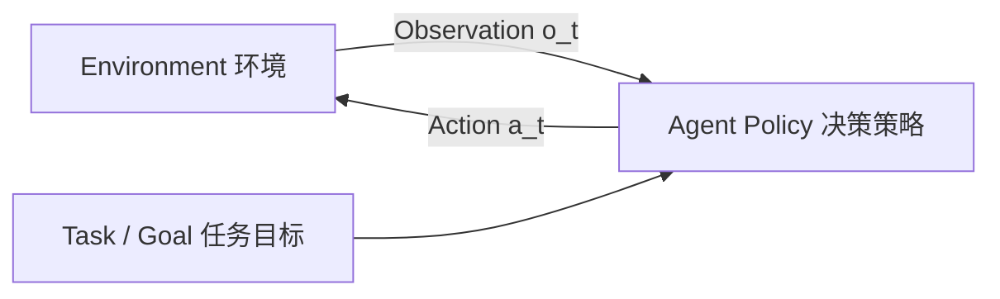
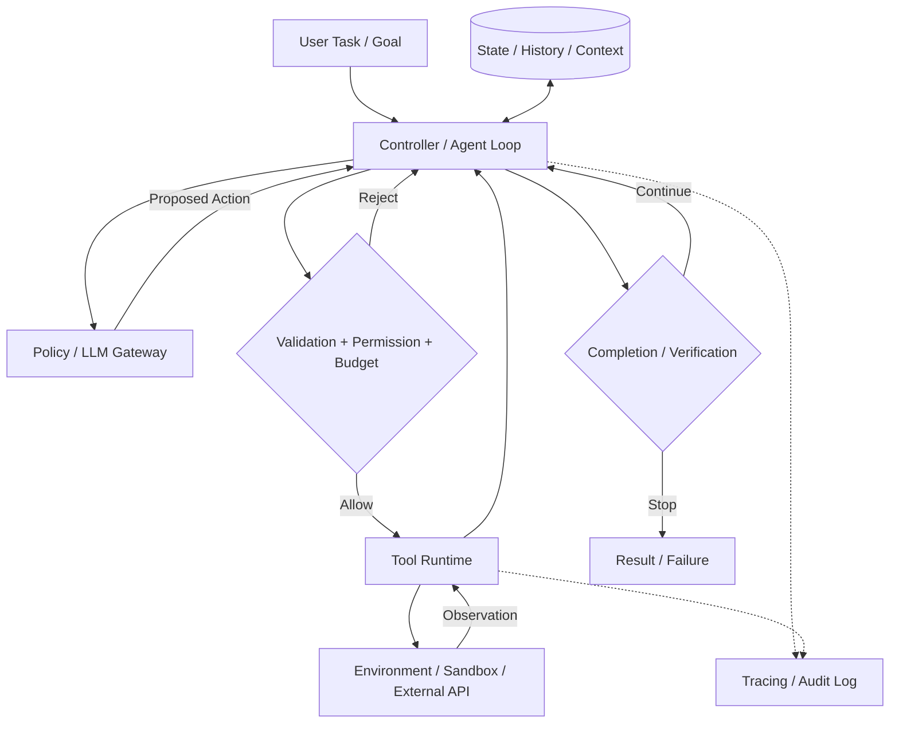
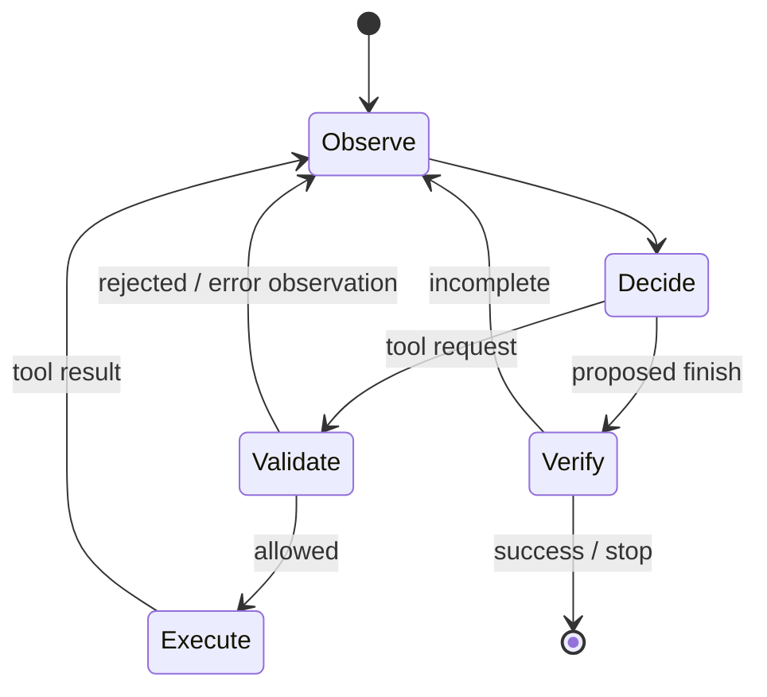

# 第 1 章：从大语言模型到智能 Agent

> **状态：正文初稿 v0.1（待技术审稿）** · 第一篇：Agent 基础原理与系统模型
>
> **前置知识**：了解 Python 函数、HTTP API 和大语言模型的基本用法即可。无需提前学习强化学习。
>
> **本章定位**：回答 Agent *是什么、为什么需要、与 Workflow 有何不同，以及如何判定一个 Agent 系统是否设计得合理*。第 2、3 章深入 LLM 与数学，第 4 章完整实现最小 Agent。

## 本章学习目标

学完本章，应当能够：

1. 用观察、决策、动作和反馈严格描述 Agent，而不把 Agent 等同于某种 SDK。
2. 区分普通 Chatbot、RAG、确定性 Workflow、Agent 和混合系统。
3. 画出 Agent 的核心运行架构，并解释 Policy/Model、Tool、Environment、Runtime、State 的职责。
4. 用一个最小数学模型表示 Agent–Environment 交互，理解反馈闭环为何重要。
5. 为典型任务选择确定性程序、Workflow 或 Agent，并解释成本、可靠性和可控性取舍。
6. 运行离线对照实验，理解“控制逻辑放在哪里”比“调用了多少次 LLM”更重要。

---

## 1.1 一个软件工程问题：为什么单次 LLM 调用不够？

假设用户给出一个任务：

> “修复这个 GitHub 仓库中失败的单元测试，解释根因，并提交可以审查的修复补丁。”

回答这个请求，不只是生成一段代码。系统需要依次或反复完成：

- 读取仓库结构、定位对应测试、重现失败；
- 根据日志决定接下来读哪个文件、运行哪条命令；
- 修改代码，再运行测试，观察新结果；
- 如果修复引入回归，撤销或重新选择方案；
- 达到可检验的成功条件，或在预算耗尽时安全停止。

这类任务有两个显著特点：**执行路径事先不能完全确定**，而且**中间动作会改变或揭示外部环境的状态**。

普通 LLM API 调用可以生成“可能的修复建议”，却不能仅凭一次文本补全得知真实测试是否通过。即使模型生成正确补丁，如果没有文件写入权限、隔离执行环境和测试反馈，它也无法完成端到端任务。

由此出现本书的第一个设计原则：

> **模型提供决策候选，运行时系统提供执行能力，环境反馈决定下一步所依据的事实。**

这个原则并不意味着每个任务都需要 Agent。对“把标题翻译成英文”这种输入和输出边界明确的任务，单次调用可能更简单、便宜且可靠。

### 1.1.1 为什么“多调用几次 LLM”仍未必是 Agent？

考虑如下程序：

```python
summary = llm("总结需求")
plan = llm("根据摘要生成固定格式计划：" + summary)
report = llm("根据计划生成报告：" + plan)
```

它进行了三次 LLM 调用，但调用顺序由程序预先决定。模型决定每一步的*内容*，没有决定“是否需要增加一步、选择什么工具、何时停止”的执行控制逻辑。这更接近 **LLM Workflow**。

反过来，Agent 可能只调用一次模型：模型根据当前观察选择一个工具，随后由运行时执行工具。系统是否具有 Agent 特性，要看整个任务中的**决策权、反馈回路和自主程度**，不能用 LLM 调用次数判断。

## 1.2 什么是 Agent？从经典定义到 LLM Agent

### 1.2.1 从观察、动作和环境出发

在人工智能与强化学习中，Agent 并不是新概念。抽象地看，一个智能体接收环境的观察（Observation），依据策略（Policy）做出动作（Action），动作影响环境，环境再反馈新的观察。



最基本的元素：

| 符号 | 名称 | 软件 Agent 中的例子 |
| --- | --- | --- |
| `g` | Goal / Task | 修复失败测试并提交补丁 |
| `o_t` | Observation | 终端输出、测试结果、网页内容 |
| `a_t` | Action | 读取文件、执行测试、编辑代码 |
| `h_t` | History | 先前动作、观察以及重要状态 |
| `π` | Policy | 根据目标及历史选择下一步动作 |
| `s_t` | Environment State | 仓库文件、进程状态、权限、网络等真实环境状态 |

**关键点**：策略不必是 LLM。规则引擎、搜索算法、强化学习策略都可以承担 Agent 的决策功能；Agent 也不必须拥有独立的长期记忆模块或外部工具。

### 1.2.2 本书对 LLM Agent 的工作定义

为了后续工程设计，本书采用以下**操作性定义**：

> **LLM Agent 是一种以语言模型参与动作选择的交互式系统。它围绕任务目标，根据当前上下文和环境反馈，动态选择后续动作，并由运行时在限定权限和资源预算内执行这些动作，直到达成完成条件或停止条件。**

这个定义刻意区分三个角色：

1. **LLM / Policy**：提出要做什么，可以生成文字、选择工具、修改计划或决定结束。
2. **Runtime / Controller**：检验决策是否允许，执行工具、维护状态、强制限制并记录结果。
3. **Environment**：提供动作实际发生的地方，可能是文件系统、网页、代码仓库、业务 API 或模拟世界。

**不要混淆“模型说它已经做了某事”和“工具确实完成了某事”。** 两者必须由可靠的执行记录和可验证结果连接起来。

### 1.2.3 自主性是连续维度，而不是非黑即白

“Agent”在学术论文、工程产品和营销语境中的边界并不完全一致。工程讨论更适合描述自主性：

- **动作选择**：模型是否能自行决定调用何种工具？
- **路径选择**：模型能否根据结果改变执行步骤？
- **结束判断**：模型是否能请求完成任务？最终完成条件是否需独立验证？
- **环境影响**：动作是只读检索，还是具有写入、购买、发送等副作用？
- **运行范围**：模型可操作的资源、时间、预算和权限边界在哪里？

自主性越强，不一定越好。高风险操作通常需要更严格的审批、沙箱、预算和回滚策略。

## 1.3 Chatbot、RAG、Workflow 与 Agent 的区别

### 1.3.1 关键区别：谁控制下一步？

| 系统类型 | 下一步主要由谁控制 | 常见形式 | 主要优势 | 典型限制 |
| --- | --- | --- | --- | --- |
| Chatbot | 用户与固定调用逻辑 | 用户提问 → 模型回答 | 简洁、低成本 | 不直接操作外部环境 |
| RAG Application | 预设检索流程 | 检索 → 拼接上下文 → 回答 | 引用知识、减轻知识缺口 | 检索链不必有动态规划 |
| LLM Workflow | 程序、规则、图节点 | 路由、顺序执行、并行汇总 | 可预测、易测试 | 未预料路径需要显式设计 |
| LLM Agent | 模型在允许范围内动态提议动作 | 观察 → 决策 → 工具 → 反馈 | 适应未知步骤与变化 | 成本、错误与不确定性更高 |
| Hybrid System | Workflow 限制边界，Agent 处理局部开放任务 | 确定性审批流 + 自主研究子任务 | 兼顾灵活性和治理 | 接口与状态边界更复杂 |

**注意两个反例**：

- Workflow 也可以有条件分支、循环和 LLM 分类器。因此，“出现了 `if` 或循环”并不自动意味着 Agent。
- Agent 也可以被嵌入受限的 Workflow。很多生产环境实际上采用的是混合架构，而不是无约束自主执行。

Anthropic 在《Building effective agents》中强调了 Workflow（代码预设编排）与 Agent（模型动态决定流程）这一架构区分，并建议优先采用能满足任务的最简单方案。[1]

### 1.3.2 同一任务的三种设计

任务：用户要求“查明最近一次测试失败的原因”。

**方案 A：固定流水线**

```text
获取日志 → 总结日志 → 生成报告
```

适用于格式固定且只需总结的任务。

**方案 B：带条件分支的 Workflow**

```text
获取日志 → 规则识别失败类型
                ├─ 依赖安装失败 → 检查依赖清单
                ├─ 单元测试失败 → 读取对应测试文件
                └─ 其他错误     → 转人工
```

适用于失败类型有限、业务规则相对稳定的任务。

**方案 C：Agent**

```text
读取日志 → 选择查看源文件 → 执行局部测试
    ↑                              ↓
    └──── 根据新输出调整策略 ← 观察结果
```

适用于未知的故障组合、上下文依赖强、需要多轮探索的问题。

**结论不是“C 永远优于 B”**。如果规则已知且可形式化，B 往往更容易验证、成本更低、行为更稳定。只有当环境变化、未知分支和探索价值足以抵消成本时，才值得引入动态 Agent。

### 1.3.3 RAG 不等于 Agent，Tool Calling 也不等于 Agent

- **RAG** 是将外部检索内容提供给模型的技术模式。固定“检索一次再回答”的应用通常是 Workflow。
- **Tool Calling** 是模型请求外部功能的一种协议能力，并不保证自动循环、失败恢复或目标验证。
- **Agent Loop** 是让模型有机会观察上一步的实际结果并继续决定下一步的控制结构。
- **Multi-Agent** 说明系统存在多个智能体，不自动意味着每一个都更聪明；多 Agent 也可能只是更昂贵的流水线。

## 1.4 Agent 的系统架构

### 1.4.1 将模型与运行时解耦

建议使用如下分层作为后续 34 章的共同架构：



模块边界及职责如下：

| 模块 | 要解决的问题 | 不应承担的职责 |
| --- | --- | --- |
| **Policy / Model** | 根据上下文提出回答或后续动作 | 直接绕过权限执行危险操作 |
| **Agent Loop** | 迭代、消息追加、动作分派与停止 | 假定模型输出始终正确 |
| **Tool Registry** | 工具发现、参数校验和类型契约 | 将工具描述等同于真实授权 |
| **Environment** | 实际执行命令、访问网页或文件 | 将不可信工具输出当作系统指令 |
| **Context / State** | 管理历史、工作状态和输入预算 | 盲目无限积累全部原始输出 |
| **Safety / Policy** | 控制能力、审批、敏感操作与预算 | 仅依赖一句 Prompt 保证安全 |
| **Observability** | 记录实际发生的事件及原因 | 仅保存最后一条自然语言答案 |

在实际系统中这些功能可以集成到同一个进程，但**逻辑边界依然重要**。

### 1.4.2 外部记忆不是一切 Agent 的必备条件

必须区分三种概念：

1. **对话历史 / 工作上下文**：本轮做过哪些动作、得到了哪些观察。
2. **持久化运行状态**：进程崩溃后是否可以恢复任务、是否重复执行动作。
3. **长期语义记忆**：跨任务保存可复用事实、经验和偏好。

一个最小 Agent 通常只需要第 1 种。第 2 种属于生产级可靠执行的问题，第 3 种属于个性化和长期任务能力的问题。它们将在第 8、9、12 章分别展开。

### 1.4.3 为什么 Runtime 不只是“while 循环”？

一个原型可能只包含如下循环：

```python
while not done:
    decision = model(context)
    observation = execute(decision)
    context.append(observation)
```

但生产级 Runtime 还必须回答：

- 模型返回了不存在的工具名怎么办？
- 工具参数非法或包含不可信路径怎么办？
- 工具已写入文件，但网络在回传前断开，重试是否会重复写入？
- 模型不断重复同一个动作怎么办？
- 用户撤销权限时，已经排队的执行怎样处理？
- 一轮任务超过费用或时间预算，谁强制结束？
- Agent 声称任务完成，怎样独立验证？

因此，**模型决定建议动作，Runtime 决定可否执行**，这是贯穿本书的边界。

## 1.5 Agent Loop：从线性调用到反馈控制

### 1.5.1 最小状态转移

一个简化的 Agent 可以抽象为以下控制状态：



此图表达的是一个**受运行时约束的反馈回路**，不是某种框架特定的类结构。

### 1.5.2 为什么环境反馈不可替代？

以修复代码为例：

- 模型推断“可能是数组下标越界”只是假设；
- 执行测试得到 `IndexError` 是新观察；
- 修改代码后测试通过才是支持该假设的证据；
- 但一次测试通过不保证没有回归，需要更多验证。

**反馈提供证据，不自动提供真理。** 工具可能超时、返回过期数据，测试也可能覆盖不足。Verifier 的可靠性本身需要评估。

### 1.5.3 如何避免无限循环？

从第一版系统开始就应该设置：

1. 最大决策步数（`max_steps`）；
2. 最大工具调用数、Token/费用预算和执行时限；
3. 受允许工具清单与参数校验；
4. 显式完成条件、取消机制；
5. 对重复动作、无进展与失败结果的检测。

这里的“停止”包括：完成、失败、用户取消、权限拒绝、资源耗尽。**停止不是失败处理的补丁，而是 Agent 控制模型的一部分。**

## 1.6 数学视角：Agent 是一个受约束的闭环决策系统

本节只建立直觉，严谨的 MDP、POMDP 和强化学习基础留到第 3 章。

设环境真实状态为 `s_t`，Agent 在时刻 `t` 观测到 `o_t`，历史为 `h_t`，目标为 `g`。模型与策略据此生成动作：

$$
a_t \sim \pi_\theta(\cdot \mid g,h_t,c_t)
$$

其中 `c_t` 表示整理后的上下文（例如摘要、检索结果和系统指令）。环境随后发生变化：

$$
s_{t+1} \sim T(\cdot \mid s_t,a_t), \qquad
o_{t+1} \sim O(\cdot \mid s_{t+1})
$$

得到观察后更新历史：

$$
h_{t+1}=h_t \oplus (a_t,o_{t+1})
$$

这是一种通用交互表示；它不要求模型内部实现了强化学习，也不要求环境状态能被 Agent 完全看见。

对于有权限限制的系统，真实可执行动作必须进一步满足：

$$
a_t \in \mathcal{A}_{\mathrm{allowed}}(s_t,\text{identity},\text{policy},\text{budget})
$$

若模型建议的动作不在允许集合中，Runtime 必须拒绝或请求人工批准。尤其要注意：**通过 Prompt 告诉模型“不要执行危险命令”，不等于完成了能力隔离。**

### 1.6.1 Open-loop 与 Closed-loop

- **Open-loop（开环）**：制定执行序列后不根据中间反馈改变动作。
- **Closed-loop（闭环）**：每次观察实际结果，再决定下一步。

闭环不是 Agent 专属：传统 PID 控制器、规则引擎和带条件分支的 Workflow 都可能是闭环系统。LLM Agent 的不同之处在于，**策略的部分决策能力由模型提供**，而不只是程序员显式写下的固定规则。

这意味着“闭环”和“模型动态决策”是两个不同维度，不能混为一谈。

### 1.6.2 为什么不能只优化最终回答质量？

Agent 的实际目标不仅是文本“看起来合理”。一个更完整的目标可以同时考虑任务成功、费用、时延与风险：

$$
\max_{\pi} \;
\mathbb{E}[R_{\text{task}}]
-\lambda_c \mathbb{E}[C_{\text{model}}+C_{\text{tools}}]
-\lambda_t \mathbb{E}[T]
-\lambda_r \mathbb{E}[\text{Risk}]
$$

这是**用于系统设计的概念性目标函数**，不是当前示例真实优化过的训练损失。不同任务的权重和风险度量必须通过业务目标、实验和安全要求定义。

## 1.7 LLM Agent 的主要发展线索

Agent 的思想早于大型语言模型。强化学习、自动规划、软件代理和多智能体研究已经长期讨论“智能体如何根据环境反馈行动”。

LLM 带来的重要变化不是首次发明 Agent，而是让**自然语言任务、非结构化信息与通用工具选择**可以由同一种模型进行连接。

具有代表性的线索：

| 方向 | 代表工作 | 本书关注点 |
| --- | --- | --- |
| 经典序列决策 | Sutton & Barto，《Reinforcement Learning: An Introduction》[2] | Policy、状态、反馈与回报 |
| Reasoning + Acting | Yao 等，《ReAct》（2022 首次公开）[3] | 推理与外部行动交替进行 |
| 工具增强语言模型 | Schick 等，《Toolformer》（2023）[4] | 模型为何及如何调用工具 |
| 软件工程 Agent | Yang 等，《SWE-agent》（2024）[5] | Agent–Computer Interface 与测试反馈 |
| 现代工程设计 | Anthropic，《Building effective agents》（2024）[1] | Workflow/Agent 边界、组合模式和简单性 |
| 系统化课程 | UC Berkeley，《Large Language Model Agents》（2024）[6] | 基础、Reasoning、Tool、Infra、评测与安全 |

这里不是完整历史梳理；每项工作对“Agent”的技术含义也并不完全一致。读论文时，优先辨别**任务设定、允许动作、反馈来源与评测方式**，避免只比较系统名称。

## 1.8 何时使用 Agent：一套工程判断框架

将任务分为以下三类，比“所有应用都 Agent 化”更实用：

### 类型 A：路径明确、结果可直接定义

如文本分类、字段提取、固定格式转换。优先考虑单次 LLM 调用或普通程序。

### 类型 B：多步骤但路径可枚举

如文档审批、固定的客服 SOP、财务报表流程。优先考虑确定性 Workflow，把模型放在少数内容理解或分支判断节点上。

### 类型 C：路径无法预先穷举，反馈会决定新动作

如陌生代码仓库调试、复杂检索、网页交互探索。考虑受约束 Agent 或混合系统。

在选型时，应逐项回答：

1. 是否真的存在无法穷举的中间步骤？
2. 任务是否有机器可检验的完成标准？
3. 外部工具是否可能产生不可逆副作用？
4. 单次调用或简单 Workflow 的基线表现如何？
5. Agent 新增的费用、延迟和失败路径是否在业务预算内？

**架构选择的合理顺序**：先实现简单基线，建立评测数据，再为实际暴露出的局限增加 Agent 自主性。

## 1.9 失败模式：Agent 的复杂性从哪里来？

| 失败类型 | 症状 | 根源示例 | 初步缓解方向 |
| --- | --- | --- | --- |
| 目标误解 | 答非所问、错误结束 | 目标含糊、缺乏验收标准 | 明确任务契约、Verifier |
| 工具使用错误 | 调用不存在的工具、参数无效 | 工具 Schema 不清楚或生成错误 | Schema 验证、错误观察 |
| 环境认知错误 | 将旧数据当新事实 | 观察过期或检索不完整 | 重新读取、来源及时间戳 |
| 规划失败 | 重复尝试、死循环 | 缺少停止规则和进展判断 | Budget、重复检测、分段计划 |
| 上下文失真 | 忘记约束、矛盾决策 | 上下文截断、摘要丢失关键信息 | Context Engineering |
| 安全边界失效 | 被网页内容诱导执行危险操作 | 混淆可信指令与不可信数据 | 权限隔离、Prompt Injection 防护 |
| 工具副作用 | 重试导致重复提交、重复支付 | 非幂等执行和状态不同步 | 幂等键、审批、补偿 |
| 验证虚假成功 | 模型说完成但没有完成 | 缺乏客观验收 | 独立测试、可观察结果 |

这些问题不完全由更强的模型解决。特别是权限控制、幂等、超时、恢复和审计属于**系统工程责任**。它们将在第四、第五篇详细实现。

### 1.9.1 为什么 Coding Agent 特别适合教学？

代码任务天然具备四项条件：

- **动作具体**：读文件、改代码、运行命令。
- **反馈密集**：编译错误、测试输出、静态检查。
- **可验证**：测试、Diff 和仓库状态能够提供部分客观证据。
- **风险清晰**：文件写入与 Shell 命令需要边界控制。

但测试通过不是数学意义上的完全正确。评测还必须关注测试覆盖、需求理解、补丁质量与隐藏副作用。

## 1.10 实践：Workflow 与反馈驱动的 Policy Loop

> **实验目的**：观察执行控制逻辑位于固定程序、条件分支程序和 Policy 接口时，结构有何不同。本实验完全离线，**Policy 是手写规则，不是真实 LLM**。实验不能用来宣称“LLM Agent 比 Workflow 更高效”。

### 1.10.1 准备环境

```bash
git clone https://github.com/apsaras-ai/agent-from-scratch.git
cd agent-from-scratch
python -m pip install -e .
python examples/ch01_workflow_vs_agent.py
python -m unittest discover -s tests -v
```

要求 Python 3.11 或更新版本，不需要 API Key。

完整代码：[`examples/ch01_workflow_vs_agent.py`](../../examples/ch01_workflow_vs_agent.py)；
自动测试：[`tests/test_ch01.py`](../../tests/test_ch01.py)。

### 1.10.2 三种执行结构

**A. Unconditional Pipeline（无条件流水线）**

```python
primary = world.primary()
backup = world.backup()  # 即使 primary 已成功，也照样调用
return primary if primary.startswith("FOUND:") else backup
```

**B. Conditional Workflow（规则条件分支）**

```python
primary = world.primary()
if primary.startswith("FOUND:"):
    return primary
return world.backup()
```

**C. Policy-driven Agent Loop（策略接口控制的循环）**

```python
# 具体 Policy 放在模型接口位置；本章用规则模拟
result = Agent(policy, registry, max_steps=4).run("Find the answer")
```

在 C 中，`Agent` 的执行循环没有硬编码 `primary → backup` 的路径；它只接受策略返回的 `ToolCall` 并收集观察。该策略在本实验中是确定性规则。把策略换成真实 LLM 并增加安全边界，是第 4、6、7 章的工作。

### 1.10.3 假设与变量

构建两种环境：

- **Case H（主路径成功）**：`primary()` 返回 `FOUND:42`。
- **Case M（主路径失效）**：`primary()` 返回 `MISS`，`backup()` 返回 `FOUND:42`。

记录三项指标：最终结果、工具调用序列、模型/策略决策轮数。

本例在不发生代码错误的情况下，应有如下**理论预期**：

| 场景 | 无条件流水线：工具调用 | 条件 Workflow：工具调用 | 策略循环：工具调用 |
| --- | --- | --- | --- |
| H：主路径成功 | 2 | 1 | 1 |
| M：主路径失败 | 2 | 2 | 2 |

策略循环还包含模型决策轮数：H 为 2 轮（选工具 + 结束），M 为 3 轮（主工具 + 备工具 + 结束）。这意味着即使工具次数相同，真实 LLM 版本也可能更慢、更贵。

**本实验最重要的结论**：

> Conditional Workflow 可以做到和这个规则式 Policy Loop 一样的工具使用效果。**不能仅凭用了 Agent Loop 就断言系统获得了更高的智能性。** 真正需要验证的，是模型驱动策略对复杂、未知分支的泛化是否足以抵消额外成本与风险。

### 1.10.4 阅读与修改代码

建议依次：

1. 阅读 `ToolRegistry` 如何把工具名绑定到显式 Python 函数；
2. 阅读 `Agent.run` 如何追加工具观察并要求 Policy 继续判断；
3. 在 `ReactivePolicy.complete` 中调整 `MISS` 的处理逻辑；
4. 将 `backup` 改为也返回 `MISS`，观察停止与失败语义；
5. 在最大步数限制内故意重复调用工具，观察运行时如何终止。

本仓库 v0.1 中的工具错误只覆盖部分异常类型；没有生产级超时、网络隔离、权限模型或持久化状态，不能用它执行不可信代码。

## 1.11 如何评价一个 Agent？先建立基线

比较 Agent 与 Workflow 时，**必须让两者解决同一组任务、使用可比的环境和验收规则**。

建议至少记录：

| 指标 | 定义 | 为什么重要 |
| --- | --- | --- |
| Task Success Rate | 成功完成的任务数 / 总任务数 | 衡量实际价值 |
| Tool Calls / Task | 每任务工具调用数 | 反映外部依赖与执行成本 |
| Model Calls / Task | 每任务模型调用数 | 影响 Token 费用与时延 |
| Latency p50/p95 | 任务耗时分布的中位数/高分位数 | 长尾体验与 SLA |
| Cost / Successful Task | 总成本 / 成功任务数 | 仅看单次请求费用会产生误导 |
| Unsafe Action Rate | 被定义为不安全的动作比例 | 反映权限与风险控制 |
| Recovery Rate | 可恢复错误发生后成功恢复的比例 | 衡量长任务韧性 |

公式示例：

$$
\text{SuccessRate} = \frac{N_{\text{success}}}{N_{\text{all}}}, \qquad
\text{CostPerSuccess} = \frac{\sum_i C_i}{N_{\text{success}}}
$$

若 `N_{\text{success}}=0`，第二个指标不可定义，不能默默记作 0。评测必须另外报告未完成任务、超时任务以及主动拒绝执行的任务。

本章实验只检验**控制流机制**。它不构成真实 Agent Benchmark。后续第 25–28 章将介绍可复现任务集、统计不确定性、环境重置和评测污染问题。

## 1.12 本章练习

### 理解题

**1.1** 某程序调用 LLM 三次，分别做分类、检索查询生成和报告总结。是否必然是 Agent？请画出控制流并说明判断依据。

**1.2** 一个 Workflow 使用 LLM 决定下一步进入哪个预定义分支，同时允许最多两次重试。它与完整的模型驱动 Agent 在自主性上有何差别？是否存在混合边界？

**1.3** “模型输出 JSON 格式的工具调用”为什么不等价于“工具真正执行成功”？请给出至少三种失败情形。

**1.4** 解释为什么长期 Memory、Multi-Agent 和强化学习均不是构建最小 Agent 的必要条件。

### 设计题

**1.5** 为“自动修改代码并提交 PR”设计一个最小架构图，明确哪一模块承担：权限校验、超时、测试反馈、Git 写入、任务完成验证。

**1.6** 为“翻译十万条商品标题”选择 Batch Pipeline、Workflow 或 Agent。若只有少数结果必须人工审核，你会怎样设计混合方案？说明成本与稳定性假设。

### 编程与实验题

**1.7** 修改 [离线实验](../../examples/ch01_workflow_vs_agent.py)，让 `backup()` 也可能失效。添加不成功结束的测试，确保 Agent 不会无限循环。

**1.8** 添加“工具调用上限”与“重复动作检测”，分别设计测试，说明它们与 `max_steps` 的区别。

**1.9（进阶）** 使用真实支持工具调用的模型替换手写 Policy，并建立至少 20 个不同输入的任务集。记录成功率、工具次数和模型费用；不能使用本章的两个固定用例直接推导泛化结论。

### 参考思路（节选）

- **1.1**：不必然。若三次调用次序由代码规定，通常属于 Workflow。
- **1.2**：如果模型只能在固定节点和固定分支内选择，它的自主性受程序图限制；某个子节点仍可采用自主 Agent Loop。两者可以组合。
- **1.3**：工具名无效、参数无效、权限拒绝、执行超时、外部系统出错、非幂等重复调用。
- **1.4**：最小系统只需目标、观察、动作决策和反馈；其他能力按任务需要逐步添加。

## 1.13 本章总结

1. **Agent 的核心是交互式决策系统**：观察、选择动作、执行、反馈、更新，而不是一个具体框架。
2. **LLM 不等于 Runtime**：模型提出动作，Runtime 负责合法性、实际执行、状态与停止。
3. **Agent ≠ Workflow**：是否动态决定后续动作是重要维度，但闭环和条件分支并非 Agent 独有。
4. **自主性应该受约束**：权限、环境隔离、预算、验证和审计都是架构的一部分。
5. **简单方案优先**：先建立基线、再量化复杂度收益。Agent 的价值必须通过任务成功率而不是宣传语证明。
6. **实验是教材的一部分**：本章离线示例模拟了策略接口，但不具备真实 LLM 的推理或泛化能力。

接下来：[第 2 章：LLM 如何驱动 Agent](02.md) 将进一步解释模型消息、Token、结构化输出和 Tool Calling 的技术基础。

---

## 参考资料

[1] Anthropic. *Building effective agents*. December 19, 2024. https://www.anthropic.com/engineering/building-effective-agents

[2] Richard S. Sutton and Andrew G. Barto. *Reinforcement Learning: An Introduction*, 2nd ed., MIT Press, 2018. https://mitpress.ublish.com/book/reinforcement-learning-an-introduction-2

[3] Shunyu Yao et al. *ReAct: Synergizing Reasoning and Acting in Language Models*. arXiv:2210.03629 (first submitted 2022; revised 2023). https://arxiv.org/abs/2210.03629

[4] Timo Schick et al. *Toolformer: Language Models Can Teach Themselves to Use Tools*. arXiv:2302.04761, 2023. https://arxiv.org/abs/2302.04761

[5] John Yang et al. *SWE-agent: Agent-Computer Interfaces Enable Automated Software Engineering*. arXiv:2405.15793, 2024. https://arxiv.org/abs/2405.15793

[6] UC Berkeley CS294/194-196. *Large Language Model Agents*, Fall 2024. https://rdi.berkeley.edu/llm-agents/f24

> **写作说明**：本章定义与数学抽象是为教学目的建立的工程模型，不声称代表所有学术工作对 Agent 的唯一统一定义。引用资料用于延伸阅读；所有图表和实验按本书独立设计。
