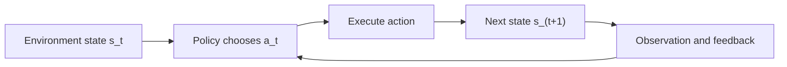

# 第 3 章：Agent 的数学模型与决策原理

> **状态：正文初稿 v0.1（待技术审稿）** · 第一篇：Agent 基础原理与系统模型  
> **前置知识**：条件概率、期望、Python 字典与函数；不要求提前掌握强化学习。  
> **本章路线**：顺序决策 → MDP → Policy / Value / Bellman → Value Iteration → POMDP → Belief Update → Value of Information → 与现代 LLM Agent 的对应和边界。

## 学习目标

完成本章，你应当能够：

1. 用 `State`、`Action`、`Transition`、`Reward`、`Policy` 和 `Observation` 建模一个多步骤任务。
2. 理解马尔可夫性质的真实含义，避免将“当前 Prompt”直接等同于环境状态。
3. 推导 Value Function、Action-Value Function 与 Bellman 最优方程。
4. 用 Python 从零实现有限 MDP 的 Value Iteration，解释折扣因子如何改变最优策略。
5. 解释 MDP 与 POMDP 的根本差别，通过贝叶斯公式更新 `Belief State`。
6. 使用**信息价值（Value of Information）**决定何时应该先检查环境、何时应直接行动。
7. 正确区分：**决策模型、规划算法、强化学习训练和 LLM 的推理时 Agent Loop 并不是同一件事**。

---

## 3.1 从 Coding Agent 出发：为什么下一步不能预先写死？

假设一个 Coding Agent 收到任务：

> 某个代码仓库持续出现测试失败。请找到真正原因、修复错误并给出可验证的结果。

目前真正的故障原因只有两种可能：

- 依赖配置错误（`dependency`）；
- 业务逻辑错误（`logic`）。

Agent 起初并不知道真实原因。它可以马上修改某一类代码，也可以先读取更详细的诊断日志，再决定修改什么。

这不是单纯的“生成文本”问题，而是一个**连续决策问题（Sequential Decision-Making）**：

- **动作消耗资源**：读取日志有时间成本，修改代码有潜在副作用；
- **动作影响后续决策**：一次检查可能改变对故障原因的判断；
- **环境不可完全观测**：真实故障原因可能不在当前上下文中；
- **结果具有不确定性**：即使采取自认为正确的动作，仍可能失败。

如果模型选择的动作仅依据最新一句自然语言描述，无法充分利用历史和反馈，它很难在复杂任务中保持一致性。

本章将提出两种数学模型：

- **MDP（Markov Decision Process）**：首先假设决策所需状态可以观测；
- **POMDP（Partially Observable Markov Decision Process）**：进一步允许真实状态被部分隐藏，通过观察持续更新信念。

它们是帮助我们理解和设计 Agent 的数学框架，不意味着真正的 Coding Agent 会显式枚举所有仓库状态，更不意味着它已经使用强化学习训练过。

## 3.2 顺序决策的基本对象

### 3.2.1 时间、状态与动作

把任务分成离散决策时刻 `t=0,1,2,\ldots`。在每一步：

1. Agent 收集环境观察；
2. 策略选择动作 `a_t`；
3. 环境根据动作转移到下一状态；
4. Agent 得到奖励、代价或新的观察。



这里最容易混淆的概念：

| 数学对象 | 含义 | 在软件 Agent 中的例子 |
| --- | --- | --- |
| `s_t` | 环境的真实状态 | 文件内容、测试数据库、当前网络状态、任务权限 |
| `o_t` | Agent 得到的观察 | 某次 `pytest` 日志，`git diff`，工具响应 |
| `a_t` | Agent 选择的动作 | 读取文件、运行测试、修改补丁 |
| `h_t` | 动作与观察历史 | 已调用工具及返回记录 |
| `\pi` | 从决策信息到动作的策略 | 规则、规划算法、LLM 驱动的动作选择 |
| `r_{t+1}` | 执行动作后获得的即时奖励 | 修复成功、失败惩罚、工具费用 |
| `g` | 任务目标 | 所有指定测试通过且不引入回归 |

**State 与 Observation 是两个不同对象**。真实仓库可能存在错误文件和权限状态，但 Agent 初始只看到用户描述，不能默认它对环境完全可见。

### 3.2.2 “状态”为什么需要足够充分？

马尔可夫性质要求：当 `s_t` 已知时，下一状态的条件分布不再依赖更早的完整历史：

$$
P(s_{t+1}\mid s_0,a_0,\ldots,s_t,a_t)
= P(s_{t+1}\mid s_t,a_t).
$$

这**不是说智能体无需历史**。如果你把 `s_t` 定义为“最近一条错误日志”，显然不足以描述文件内容、测试环境和未完成任务；这个选择可能不满足马尔可夫性质。

理论上可以扩充状态，使其包含影响未来转移的重要信息。现实工程中通常无法精确枚举，所以 MDP 是**建模近似**。

尤其不要把 `s_t` 误认为 Prompt 文本本身：Prompt 是模型可见输入，可能仅仅是隐藏环境状态的一个有损表示。

## 3.3 MDP：马尔可夫决策过程

### 3.3.1 数学定义

一个有限 MDP 常表示为：

$$
\mathcal{M}=(\mathcal{S},\mathcal{A},P,R,\gamma,\rho_0).
$$

其中：

- `\mathcal{S}`：状态集合；
- `\mathcal{A}(s)`：状态 `s` 下可选择的动作；
- `P(s'\mid s,a)`：执行 `a` 后转移到 `s'` 的概率；
- `R(s,a,s')`：发生相应转移后所获奖励（也可用随机奖励分布建模）；
- `\gamma\in[0,1)`：无限时域折扣因子；
- `\rho_0`：初始状态分布。

还需要指明任务是否**终止**（`terminal`），以及所有状态与动作是否具有固定或动态的可用边界。实际可考虑有限时域 `H` 或无限折扣时域。

**注意**：这是一个便于教学的常见定义。不同教材可能把折扣、初始状态和终止集合放在 MDP 元组之外。不能因为符号写法不同就认为模型本质不同。

### 3.3.2 转移函数到底表达什么？

假设“立即修复”有 50% 概率成功、50% 概率失败：

$$
P(\text{done}\mid\text{start},\text{quick\_fix})=0.5,
$$

$$
P(\text{failed}\mid\text{start},\text{quick\_fix})=0.5.
$$

两条结果对应的奖励为 `+10` 与 `-4`。那么该动作的**一期期望奖励**为：

$$
\mathbb{E}[R\mid \text{quick\_fix}]
=0.5\times10+0.5\times(-4)=3.
$$

另一个动作是先检查：

- `inspect`：花费 `-1`，转移到 `inspected`；
- `targeted\_fix`：在 `inspected` 状态获得 `+7` 并结束。

这里是一个**状态完全可见、检查后必定能执行有效修复的简化 MDP**。它只是为了演示动态规划；后面的 POMDP 会单独研究“不准确的检查”。

## 3.4 Policy：Agent 如何选择动作？

### 3.4.1 确定性与随机策略

确定性策略可写为：

$$
a_t=\pi(s_t).
$$

随机策略可写为：

$$
a_t\sim\pi(\cdot\mid s_t),
\qquad
\sum_{a\in\mathcal{A}(s)}\pi(a\mid s)=1.
$$

随机策略并不意味着系统一定更聪明。它可能用于探索，也可能是生成模型采样引入的不确定性。对于具有严重副作用的工具，应用程序往往应进一步限制或审批动作。

### 3.4.2 什么是 Return？

用折扣累计奖励表达从当前时刻开始的回报：

$$
G_t=\sum_{k=0}^{\infty}\gamma^k r_{t+k+1}.
$$

对于终止型任务，求和在终止时结束。折扣因子代表对未来收益的权衡；它也让有界奖励、`0\le\gamma<1` 的无限时域问题具有良好的数学性质。

- `\gamma` 越小：越看重眼前奖励；
- `\gamma` 越大：未来收益的重要性通常更高；
- **并不等价于产品中直接设置的延迟罚金**。若要具体量化模型成本、调用延迟和风险，应显式设计奖励或约束。

策略 `\pi` 在状态 `s` 的价值定义为：

$$
V^\pi(s)=\mathbb{E}_{\pi}[G_t\mid s_t=s].
$$

相应动作价值为：

$$
Q^\pi(s,a)=\mathbb{E}_{\pi}[G_t\mid s_t=s,a_t=a].
$$

区别：`V^\pi` 衡量“按策略从状态出发有多好”；`Q^\pi` 衡量“在状态下先选定动作，再按策略继续有多好”。

## 3.5 Bellman 方程：把多步骤决策分解为一步

### 3.5.1 从回报递推开始

先展开回报：

$$
G_t=r_{t+1}+\gamma G_{t+1}.
$$

对条件期望取值：

$$
V^\pi(s)=
\sum_a\pi(a\mid s)
\sum_{s'}P(s'\mid s,a)
\left[R(s,a,s')+\gamma V^\pi(s')\right].
$$

这就是在给定策略 `\pi` 下的 **Bellman 期望方程**；有随机奖励时将 `R` 理解为条件期望。

### 3.5.2 最优性方程

寻找最大期望回报的策略：

$$
V^*(s)=\max_a
\sum_{s'}P(s'\mid s,a)
\left[R(s,a,s')+\gamma V^*(s')\right].
$$

进而选出最优动作：

$$
\pi^*(s)\in\operatorname*{argmax}_a
\sum_{s'}P(s'\mid s,a)
\left[R(s,a,s')+\gamma V^*(s')\right].
$$

该方程的价值在于：**不用枚举每条可能的完整执行轨迹，就可以通过局部转移递推整个任务的长期收益**。

### 3.5.3 为什么还需要终止状态？

任务结束后应停止积累后续奖励。因此本书的代码在转移记录中携带 `terminated` 标记。若动作终止，递推项 `\gamma V(s')` 不再贡献后续收益。

## 3.6 Value Iteration：从零计算最优策略

### 3.6.1 算法推导

设初始值 `V_0(s)=0`，同步执行 Bellman 最优备份：

$$
V_{k+1}(s)=
\max_a\sum_{s'}P(s'\mid s,a)
\left[R(s,a,s')+\gamma V_k(s')\right].
$$

这个算法叫 **Value Iteration（价值迭代）**。

对于有限状态、动作集合以及有界奖励、`\gamma<1` 的折扣 MDP，Bellman 最优算子是以 `\gamma` 为收缩系数的映射，迭代会收敛到唯一最优值函数。工程实现仍需明确容差、最大迭代次数与数值误差。

### 3.6.2 手算一个 Coding Agent 玩具 MDP

取 `\gamma=0.9`。第 0 轮 `V_0(\text{start})=V_0(\text{inspected})=0`。

第 1 轮：

$$
Q_1(\text{start},\text{quick\_fix})=3,
$$

$$
Q_1(\text{start},\text{inspect})=-1+0.9(0)=-1,
$$

$$
V_1(\text{start})=3,\quad V_1(\text{inspected})=7.
$$

第 2 轮：

$$
Q_2(\text{start},\text{inspect})=-1+0.9(7)=5.3,
$$

$$
V_2(\text{start})=\max(3,5.3)=5.3.
$$

第 3 轮值不再变化，故得到最优动作 `inspect`。

| 迭代 | `V_k(\text{start})` | `V_k(\text{inspected})` |
| --- | ---: | ---: |
| 0 | 0.0 | 0.0 |
| 1 | 3.0 | 7.0 |
| 2 | 5.3 | 7.0 |
| 3 | 5.3 | 7.0 |

若改用 `\gamma=0.2`：

$$
Q(\text{start},\text{inspect})=-1+0.2(7)=0.4 < 3.
$$

这时最优策略是立即修复。**同一环境与奖励，折扣偏好不同，最优动作可能不同。**

本节 MDP 与下节 POMDP 使用不同的检查效果假设，不能将它们的收益直接做横向比较。

### 3.6.3 实现细节与数值可靠性

仓库提供标准库实现：[`src/mini_agent/decision_process.py`](../../src/mini_agent/decision_process.py)。

关键循环等价于：

```python
values = {s: 0.0 for s in dynamics}
for iteration in range(max_iterations):
    new_values = {
        s: max(
            sum(
                item.probability * (
                    item.reward
                    + (0 if item.terminated else gamma * values[item.next_state])
                )
                for item in outcomes
            )
            for outcomes in actions.values()
        ) if actions else 0.0
        for s, actions in dynamics.items()
    }
    residual = max(abs(new_values[s] - values[s]) for s in values)
    values = new_values
    if residual <= tolerance:
        break
```

核心实现使用 **Jacobi 式同步备份**：每轮统一读取旧 `values`，而不是更新一个状态后立即影响同一轮后续状态。另有输入校验：

- 任一动作的转移概率和必须约等于 1；
- 概率在 `[0,1]` 内，奖励必须有限；
- 后继状态必须存在；
- 非终止转移不能无意进入没有动作的终止状态；
- 折扣范围 `0\le\gamma<1`，容差及最大迭代次数有效。

对于实际 Agent，`|\mathcal S|` 很大甚至不可枚举，完整 Value Iteration 通常不可直接应用。这不是算法错误，而是**精确动态规划方法的规模约束**。

## 3.7 从 MDP 到 POMDP：看不到真实故障怎么办？

在真实 Coding Agent 中，假设仓库的根因是 `dependency` 或 `logic`，Agent 并不直接知道是哪一种。

如果真实状态无法被完全观察，应该区分：

- 真正的隐藏状态 `s_t`；
- 采取动作 `a_t`；
- 状态如何改变 `P(s_{t+1}\mid s_t,a_t)`；
- 模型实际获得的观察 `o_{t+1}`；
- 某状态下出现该观察的概率 `O(o_{t+1}\mid s_{t+1},a_t)`。

POMDP 可以用：

$$
\mathcal P=(\mathcal S,\mathcal A,P,\mathcal O,O,R,\gamma,\rho_0)
$$

表示。比 MDP 多出的重点是**观察集合 `\mathcal O` 与观察概率模型 `O`**。

### 3.7.1 为什么最近一次观察不一定够？

假设某条错误日志显示“连接超时”。真实原因可能是 DNS、依赖版本、数据库或代理问题。只根据最新错误行去修改网络参数，可能误判。先前“已经尝试过哪些修复、各自结果如何”会改变后续决策。

在 POMDP 中，一个数学上常用的办法是使用 **Belief State（信念状态）**：

$$
b_t(s)=P(s_t=s\mid o_{1:t},a_{0:t-1}).
$$

也就是对真实状态的概率分布。Belief 压缩了与未来决策有关的历史信息：若模型及更新正确，它对于 POMDP 的后续决策是充分的状态表示。

这里的 `b_t` 不代表 LLM “口头说自己有 80% 把握”；它是基于明确的先验、转移及观察似然计算出的概率。

### 3.7.2 贝叶斯 Belief 更新

执行动作 `a_t` 后先预测下一状态：

$$
\bar b_{t+1}(s')=
\sum_{s}P(s'\mid s,a_t)b_t(s).
$$

再结合新观察 `o_{t+1}`：

$$
b_{t+1}(s')=
\frac{O(o_{t+1}\mid s',a_t)\bar b_{t+1}(s')}
{\sum_{u}O(o_{t+1}\mid u,a_t)\bar b_{t+1}(u)}.
$$

分母是该观察在当前模型下的总概率。如果它为零，说明观察在模型中“不可能发生”；实现不应静默除以零或返回伪造的均匀分布。

### 3.7.3 一个手算例子

先验：

$$
P(\text{dependency})=P(\text{logic})=0.5.
$$

执行一次诊断动作，假设它有 80% 的准确率，而且错误时一定报告另一类原因：

$$
P(o=\text{dependency}\mid s=\text{dependency})=0.8,
$$

$$
P(o=\text{dependency}\mid s=\text{logic})=0.2.
$$

此诊断动作**不改变隐藏根因**，所以预测分布和先验相同。观察到“dependency”后：

$$
P(\text{dependency}\mid o=\text{dependency})
=\frac{0.8\times0.5}{0.8\times0.5+0.2\times0.5}
=0.8.
$$

结论：Agent 应把“依赖问题”的信念提高到 80%，但仍不能将其当作确定事实。

## 3.8 Value of Information：什么时候应该先检查？

“多收集信息”通常被视为 Agent 的好习惯，但**检查也有成本**。必须评估信息是否会改变决策，以及改变决策带来的收益是否超过检查成本。

### 3.8.1 设定一个可精确计算的任务

本节是独立的**两步、有限时域、无折扣** POMDP 玩具实验：

- 真实根因：`dependency` 或 `logic`，先验均为 50%；
- 直接选择一个补丁：正确 `+10`，错误 `-4`；
- 可以先执行一次 `inspect`，成本 `-1`；
- 诊断报告准确率 `p\in[0.5,1]`，两类问题对称；
- 检查不会改变根因，之后选择一个补丁，任务结束；
- 默认采用后验概率最大的补丁（MAP）。

这是一个用于说明信息价值的理想化模型，不代表真实程序测试的准确率已知，也不代表实际问题只有两类。

### 3.8.2 不检查：直接行动的期望收益

因为两种原因等概率，任选其中一种：

$$
P(\text{success}\mid\text{direct})=0.5.
$$

$$
V_{\text{direct}}=0.5(10)+0.5(-4)=3.
$$

### 3.8.3 先检查：使用诊断观察更新 Belief

由于先验对称，诊断准确率 `p\ge0.5`，采用后验最可能原因作为补丁，成功概率为 `p`：

$$
P(\text{success}\mid\text{inspect})=p.
$$

检查总收益：

$$
V_{\text{inspect}}=-1+p(10)+(1-p)(-4)=14p-5.
$$

选择检查当且仅当：

$$
V_{\text{inspect}}>V_{\text{direct}}
\iff 14p-5>3
\iff p>\frac{4}{7}\approx0.5714.
$$

可见：**检查不是永远值得**。只有当观察足够可靠、足以改善后续决策，且所获收益超过成本时，它才更有价值。

| 诊断准确率 `p` | 直接修复期望收益 | 先检查再修复期望收益 | 优先策略 |
| --- | ---: | ---: | --- |
| 0.50 | 3.00 | 2.00 | Direct |
| 0.55 | 3.00 | 2.70 | Direct |
| 0.60 | 3.00 | 3.40 | Inspect |
| 0.80 | 3.00 | 6.20 | Inspect |
| 1.00 | 3.00 | 9.00 | Inspect |

这个表的数值**来自概率枚举的理论期望**，不是模型跑了 100 次或 1000 次之后测得的结果。

### 3.8.4 Information Gain 不等于 Value of Information

观察能明显降低熵，不表示一定提高任务价值；如果无论观测到什么，都不会改变最优动作，就可能没有正的决策信息价值。

因此，应区分：

- **信息增益**：观察减少了多少对状态的不确定性；
- **决策信息价值**：观察改变最优动作后，能增加多少期望回报；
- **净信息价值**：增加的期望回报减去获取信息的成本。

在 Coding Agent 中，这对应“是否值得运行更精细的测试、下载更多日志、调用更昂贵的验证模型”。

## 3.9 Belief State、LLM Context 与 Memory 是不同层次

真实 LLM Agent 未必维护一个显式概率表。它通常基于自然语言日志、工具输出、检索资料和历史消息作出下一步建议。

| 层次 | 内容 | 解决的问题 |
| --- | --- | --- |
| 环境状态 `s_t` | 文件、网络、数据库、执行权限等事实 | 真实世界现在是什么 |
| 观察 `o_t` | 单次工具调用返回的信息 | 这一步看到了什么 |
| Belief `b_t` | 对隐藏状态的概率判断 | 基于证据目前相信什么 |
| Context | 输入模型的消息、摘要、工具规格 | 模型本轮能处理什么 |
| Memory | 跨轮或跨任务保存与检索信息 | 历史经验怎样被保留 |

**不能因为 Context Window 很大，就认定已经解决了状态估计。** 大量日志可能过时、矛盾或来自不可信来源。反过来，压缩或摘要又可能丢失影响决策的关键信息。

这也是为什么第 8、9、12 章会将 Context Engineering、Memory 和 Durable State 分开讲解。

## 3.10 Agent Policy 与 Runtime 约束

数学模型中动作可能写作 `a\in\mathcal A`，但生产系统的可执行动作往往还受到身份、权限、预算、审批和环境隔离约束。

因此，模型推荐的动作与实际允许动作应分离：

$$
a_t^{\text{proposal}}\sim\pi_\theta(\cdot\mid g,h_t,c_t),
$$

$$
a_t^{\text{execute}}\in
\mathcal A_{\text{allowed}}(\text{identity},\text{permissions},\text{budget},s_t).
$$

Runtime 可能拒绝某次提议，等待用户确认，或者把工具错误返回给模型。*高奖励*不能自动覆盖权限规则：泄漏凭证、执行危险 Shell 命令等必须被硬性阻止，而不能只用负奖励“劝阻”。

对于大多数应用，模型输出 `Action Proposal`，Runtime 检查 `Policy` 和 `Tool Contract`，在受控沙箱里执行，再把 **Observation** 送回模型。这是第 1、2 章原理在决策模型上的统一。

## 3.11 Planning、RL、LLM Agent 之间究竟是什么关系？

这些概念经常被不准确地混用。

### 3.11.1 规划（Planning）

如果 `P` 和 `R` 已经给定，算法可以直接计算好的决策，例如本章的 **Value Iteration**。这属于**有模型的规划 / 动态规划**，并没有从交互数据学习环境参数。

### 3.11.2 强化学习（Reinforcement Learning）

如果环境规律未知，或策略需要通过经验提高，智能体可以利用状态、动作、奖励与后继状态构成的轨迹来学习：

$$
\tau=(s_0,a_0,r_1,s_1,a_1,r_2,\ldots).
$$

典型方法包括 Q-Learning、Policy Gradient 等。与本章 Value Iteration 不同，许多 RL 方法不需要提前给出完整转移矩阵。**但 RL 也不等于“所有没有显式环境模型的方法”**，它既包括 model-free 也包括 model-based 方法。

### 3.11.3 LLM Agent 的推理时循环

一个使用现成 LLM 的 Agent 可以根据上下文选择工具，无须在每个任务执行过程中更新模型权重。它可能用预训练阶段获得的知识进行动作规划，但这并不等于该应用实现了在线 RL。

### 3.11.4 Agentic RL

如果进一步收集 Agent 执行轨迹，对动作策略进行训练、优化奖励，才会进入更明确的 Agentic RL 主题。相关内容将在第 29–32 章展开。

| 方案 | 是否需要显式已知的转移模型 | 执行任务时是否必然更新模型参数 |
| --- | --- | --- |
| 本章 Value Iteration | 是（有限、可枚举） | 否 |
| 本章 Belief Update | 是（假设已知转移和观察概率） | 否 |
| Q-Learning（典型模型无关实现） | 否 | 通过经验更新 Q 估计 |
| 现成 LLM + Tool Loop | 不一定 | 否 |
| Agentic RL | 由具体算法决定 | 训练阶段通常会更新策略参数 |

**重要提示**：将 LLM Agent 描述为 POMDP 有助于系统分析，但不意味着它具备可校准的 Belief 或保证最优的 Policy。

## 3.12 代码实战：用 Python 复现实验

仓库新增加三个资源：

- [核心算法 `src/mini_agent/decision_process.py`](../../src/mini_agent/decision_process.py)：有限 MDP Value Iteration 与贝叶斯 Belief Update；
- [实验 `examples/ch03_decision_process.py`](../../examples/ch03_decision_process.py)：两类决策问题的对照；
- [测试 `tests/test_ch03.py`](../../tests/test_ch03.py)：数值结果、边界条件、非法概率等。

运行方式：

```bash
git clone https://github.com/apsaras-ai/agent-from-scratch.git
cd agent-from-scratch
python -m pip install -e .
python examples/ch03_decision_process.py
python -m unittest discover -s tests -v
```

### 3.12.1 定义一个有限 MDP

代码核心数据结构：

```python
from dataclasses import dataclass

@dataclass(frozen=True)
class Transition:
    probability: float
    next_state: str
    reward: float
    terminated: bool = False
```

转移表：

```python
{
    "start": {
        "quick_fix": (
            Transition(0.5, "done", 10.0, True),
            Transition(0.5, "failed", -4.0, True),
        ),
        "inspect": (Transition(1.0, "inspected", -1.0),),
    },
    "inspected": {
        "targeted_fix": (Transition(1.0, "done", 7.0, True),),
    },
    "done": {},
    "failed": {},
}
```

### 3.12.2 运行 Value Iteration

```python
from mini_agent.decision_process import value_iteration
from examples.ch03_decision_process import coding_mdp

result = value_iteration(coding_mdp(), discount=0.9)
print(result.policy["start"])       # inspect
print(result.values["start"])       # ~5.3
```

### 3.12.3 运行 Belief Update

```python
from mini_agent.decision_process import belief_update

prior = {"dependency": 0.5, "logic": 0.5}
identity = {
    "dependency": {"dependency": 1.0},
    "logic": {"logic": 1.0},
}
posterior = belief_update(
    prior, identity, {"dependency": 0.8, "logic": 0.2}
)
assert abs(posterior["dependency"] - 0.8) < 1e-12
```

### 3.12.4 示例的预期输出

```text
MDP discount=0.9: start_action=inspect start_value=5.30
MDP discount=0.2: start_action=quick_fix start_value=3.00
POMDP posterior P(dependency | dependency_report)=0.80
accuracy=0.50 direct_reward=3.00 inspect_reward=2.00 inspect_success=0.50 preferred=direct
accuracy=0.55 direct_reward=3.00 inspect_reward=2.70 inspect_success=0.55 preferred=direct
accuracy=0.60 direct_reward=3.00 inspect_reward=3.40 inspect_success=0.60 preferred=inspect
accuracy=0.80 direct_reward=3.00 inspect_reward=6.20 inspect_success=0.80 preferred=inspect
accuracy=1.00 direct_reward=3.00 inspect_reward=9.00 inspect_success=1.00 preferred=inspect
```

所有数字可通过有限状态概率**精确枚举**得到，不依赖网络、随机种子或调用费用。

### 3.12.5 单元测试究竟验证什么？

测试覆盖：

1. `\gamma=0.9` 选 `inspect`，最优值约 `5.3`；
2. `\gamma=0.2` 选 `quick_fix`，最优值约 `3.0`；
3. 非法折扣、最大迭代次数和转移概率归一化失败；
4. 不存在的后继状态；
5. 后验 `(0.8,0.2)` 及概率和为 1；
6. 信息检查有利和无利两种情况；
7. 理论检查阈值；
8. 不可能发生的观察；
9. 非法先验与观察模型输入。

这些测试确认算法与玩具模型一致，但**不是**真实 Coding Agent 的成功率评测。要验证现实任务表现，还必须引入真实仓库和独立测试环境。

## 3.13 思考题与编程练习

### 基础推导

**3.1** 对 `V^\pi(s)` 写出 Bellman 期望方程，解释为什么从 `G_t=r_{t+1}+\gamma G_{t+1}` 可以得到递推形式。

**3.2** 在本章 MDP 中求使 `inspect` 优于 `quick_fix` 的 `\gamma` 区间；比较其阈值与 POMDP 中 `p>4/7` 的数值，解释它们相等是否是普遍规律。

**3.3** 假设检查工具费用由 `1` 上升为 `2`，其它不变。重新计算先检查更优的准确率阈值。

**3.4** 解释如果 `s_t` 只包含最近一行测试日志，为什么状态转移可能不满足马尔可夫性质。怎样设计更充分的状态？

### 编程题

**3.5** 将 MDP 的 `quick_fix` 成功概率从 `0.5` 改成 `0.7`，重新运行实验。计算在 `\gamma=0.9` 下最优动作是否改变，并与手算比较。

**3.6** 实现一个两状态、两个动作的随机环境采样器，使用固定随机种子对比 Monte Carlo 均值与本章精确期望。样本量增加时观察误差，但不能认为有限样本会完全相同。

**3.7** 修改 `belief_update` 使用非恒等状态转移，即检查动作本身可能改变隐藏状态；用手算核对后验。

**3.8** 把 POMDP 先验从 `(0.5,0.5)` 改成 `(0.8,0.2)`，说明 `p=0.6` 的诊断为什么可能不会改变最优补丁动作。比较信息增益与决策价值。

### 工程设计题

**3.9** 为 Coding Agent 设计一个可以记录在 Trace 中的状态模型，至少包含最近动作、工具耗时、真实副作用、任务验收结果和剩余预算。哪些字段属于环境真实状态、哪些只是观察？

**3.10** 一个 Agent 提议删除仓库中的全部测试文件，以提高“测试通过率”。如果只用 `+10` 奖励通过测试，会发生什么？如何使用硬约束与独立 Verifier 防止 Reward Hacking？

**3.11（进阶）** 使用同一组真实仓库调试任务，比较：直接修改、先读取局部日志后修改、先运行更细粒度测试后修改。观察不同检查成本与任务成功率，而不要直接假设所有检查都有正价值。

### 部分参考答案

- **3.2**：`-1+7\gamma>3\iff\gamma>4/7`。它与前文信息准确率阈值相同只是本章数字配置造成的**巧合**，二者衡量不同。
- **3.3**：`V_{\text{inspect}}=-2+10p-4(1-p)=14p-6`，故 `p>9/14\approx0.6429`。
- **3.5**：`V_{\text{quick}}=0.7(10)+0.3(-4)=5.8`；`V_{\text{inspect}}=5.3`，因此最优改为 `quick_fix`。
- **3.8**：若先验偏好很强，弱诊断可能无法推翻原来最优动作；即便后验熵变化，决策收益仍可能不足以覆盖检查成本。

## 3.14 本章总结

1. **Agent 是连续决策系统**。每次工具调用都能影响后续信息、资源和选择。
2. **MDP 的 State 必须满足足够的马尔可夫性**。最新 Prompt 或工具日志通常只是观察，并非完整状态。
3. **Value Function 和 Bellman 方程**把长期目标转化为局部可递推计算。
4. **Value Iteration**在已知有限模型中能计算最优策略，但不能直接应用于巨大的真实代码仓库状态空间。
5. **POMDP 用 Belief State 表示不可观测状态的不确定性**，贝叶斯更新融合动作与新观察。
6. **信息具有成本和决策价值**。检查工具并非越多越好。
7. **规划、强化学习和推理时 LLM Agent Loop 应严格区分**。
8. **安全是硬约束**，不能用奖励函数代替权限检查。

下一章：[第 4 章：从零实现第一个 Agent](04.md) 将把 `Agent State`、`Policy`、`Tool Calling`、`Observation`、`Stop Condition` 转换为明确的 Python 接口和工程代码。

---

## 参考文献与课程

[1] Richard S. Sutton, Andrew G. Barto. *Reinforcement Learning: An Introduction*, 2nd ed., MIT Press, 2018. https://mitpress.mit.edu/9780262039246/reinforcement-learning/

[2] UC Berkeley CS188. *Markov Decision Processes*, course textbook: https://inst.eecs.berkeley.edu/~cs188/textbook/mdp/

[3] Leslie Pack Kaelbling, Michael L. Littman, Anthony R. Cassandra. *Planning and Acting in Partially Observable Stochastic Domains*. Artificial Intelligence, 101(1–2):99–134, 1998. https://doi.org/10.1016/S0004-3702(98)00023-X

[4] UC Berkeley CS188. *Partially Observable Markov Decision Processes*, course lecture materials (Fall 2025): https://inst.eecs.berkeley.edu/~cs188/fa25/

[5] UC Berkeley CS294/194-196. *Large Language Model Agents* (Fall 2024): https://rdi.berkeley.edu/llm-agents/f24

> **模型说明**：本章代码是小规模已知模型的演示；数值结果依赖上述自定义任务和奖励设定，不代表任何现实 Agent 或模型的 Benchmark 成绩。文中参考经典定义和教学材料，推导叙述及实验为本仓库原创。
