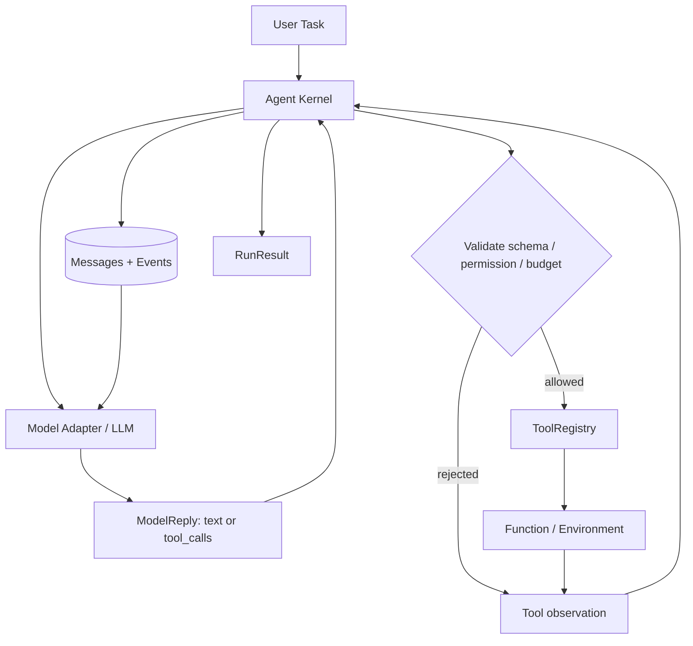
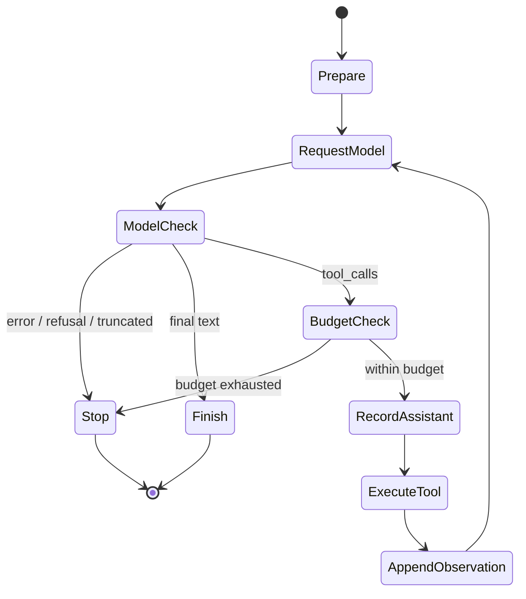

# 第 4 章：从零实现第一个 Agent

> **状态：正文初稿 v0.1（待技术审稿）** · 第一篇：Agent 基础原理与系统模型  
> **代码环境**：Python 3.11+，标准库 `dataclasses`、`typing`、`json`、`urllib`、`unittest`。离线实验不需要第三方依赖，也不需要 API Key。  
> **本章目标**：从最小 Agent Loop 出发，设计能够与真实 LLM 交换 Tool Calling 消息的 **Agent Kernel**，并通过测试观察它的行为边界。

**阅读提示**：本章在 `mini_agent.agent_v2` 和 `mini_agent.chat_adapter` 中新建教学实现。第 1–3 章使用的 `mini_agent.core` 保留不变，便于比较从 v0.1 到新内核的演进。新内核仍是**同步、单进程、无沙箱、无持久化**的教学原型，不能直接暴露给不可信用户或执行危险工具。

## 学习目标

完成本章，你应该能：

1. 定义 `Agent`、`Model`、`Tool`、`Action`、`Observation`、`State` 和 `RunResult` 之间的协议。
2. 从零实现有限步数的 Agent Loop：模型请求 → 校验 → 工具执行 → 观察回填 → 再请求模型。
3. 理解消息转录本（Transcript）为何必须保留 `tool_call_id`、工具参数和执行结果。
4. 给模型提供工具 JSON Schema，并且**由 Runtime 在执行前再次独立验证**。
5. 处理多个 Tool Calls、未知工具、错误参数、权限拒绝、模型截断、模型异常及执行预算。
6. 使用标准库 `urllib.request` 接入 Chat Completions 兼容模型，区分真实推理与离线规则模型。
7. 使用 Python `unittest` 实现可以复现的测试，而不是根据一段模型演示“看起来成功”来判断工程质量。

---

## 4.1 从数学模型到可运行程序

前三章建立了一个抽象：

$$
a_t\sim \pi(a\mid g,h_t,c_t),
\qquad o_{t+1}=\operatorname{Environment}(a_t).
$$

工程实现并不直接调用一个名为 `\pi` 的数学对象，而是要将它拆分成几个清晰的模块：



**工程中最重要的边界**：

- 模型（Model）提出下一步可能的动作，而不是执行动作；
- 工具注册表（ToolRegistry）决定哪些动作存在、参数如何检查；
- Agent Kernel（Controller）控制什么时候调用模型、何时执行工具、何时停止；
- 观察（Observation）记录工具的实际输出或错误，可能包含不可信外部数据；
- RunResult 表示运行结果及停止原因，并不天然保证任务在现实世界已经达成。

在真正的生产系统中，工具还需要权限隔离、身份认证、预算、超时、审计和幂等保障。这些问题将在第 7、12、18–24 章深入展开。

### 4.1.1 为什么选择 Python 标准库？

为了让学习过程尽可能透明，本章不直接使用 LangGraph、AutoGen 或 OpenAI Agents SDK。这并非否定它们的价值，而是希望把框架通常封装掉的细节完全展开：

1. 模型收到哪些消息？
2. 它如何提出 Tool Call？
3. 为什么必须验证参数？
4. 什么时候允许执行？
5. 工具结果怎样关联回对应的请求？
6. 为什么模型输出最终答案，并不等于任务完成了？

读者理解这些接口后，再学习高级 Agent 框架就能明确其抽象对应的底层机制。

## 4.2 定义最小 Agent 数据模型

新建 [`src/mini_agent/agent_v2.py`](../../src/mini_agent/agent_v2.py)。

### 4.2.1 Tool Call 应该是数据，而不是可执行代码

```python
from dataclasses import dataclass

@dataclass(frozen=True)
class ToolCall:
    id: str
    name: str
    arguments_json: str
```

设计要点：

- `id` 标识一次工具调用，同一轮多次调用同名工具也应保持可区分；
- `name` 用于匹配已注册的工具，而不是任意 Python 反射或 Shell 命令；
- `arguments_json` **保存模型生成的原始 JSON 字符串**，直到 Runtime 决定解析和校验。

为什么不在 Model Adapter 阶段直接执行 `json.loads`？因为 JSON 可能有问题。错误 JSON 也是可以返回给模型的**工具错误观察**：Runtime 应有机会把错误告诉模型，让它选择修复调用或终止，而不是把参数解析等同于业务执行。

### 4.2.2 模型响应不是只有字符串

```python
@dataclass(frozen=True)
class ModelReply:
    content: str | None = None
    tool_calls: tuple[ToolCall, ...] = ()
    finish_reason: str = "stop"
```

本章关注三类主要行为：

| 模型返回 | Kernel 应做什么 |
| --- | --- |
| `finish_reason="stop"`，返回文本 | 将文本作为模型的最终回答 |
| `finish_reason="tool_calls"`，返回工具请求 | 检查合法性与预算；执行允许的工具 |
| `finish_reason="length"` 或 `"content_filter"` | **停止并报告**，不可把不完整输出视为正常答案 |

另有显式拒绝 `"refusal"`。不同提供商使用不同协议，本章 Adapter 只覆盖指定的 Chat Completions 兼容格式，不承诺它是全模型通用的线协议。

### 4.2.3 面向依赖反转的 Model 接口

```python
from typing import Any, Protocol

class Model(Protocol):
    def complete(
        self,
        messages: list[dict[str, Any]],
        tools: list[dict[str, Any]],
    ) -> ModelReply: ...
```

无论模型是离线脚本、OpenAI 兼容服务、未来的 Anthropic 适配器或本地模型，只要遵守该接口，Agent Kernel 就不需要更改控制流程。

这是系统设计中常见的**依赖反转**：高层 Kernel 依赖抽象协议，而不是依赖具体服务商 SDK。

### 4.2.4 为什么 RunResult 需要停机原因？

```python
@dataclass(frozen=True)
class RunResult:
    status: str
    reason: str
    output: str | None
    messages: tuple[dict[str, Any], ...]
    events: tuple[Event, ...]
    model_calls: int
    tool_calls: int
```

我们不能把每一次停止都当成任务成功。

- `status="completed"`：模型给出了可接受格式的最终文本；
- `status="halted"`：触发预算、模型错误、协议不合法、拒绝或其他停止原因；
- `reason`：区分 `model_final`、`max_model_calls`、`max_tool_calls`、`model_length` 等；
- `messages`：便于审查交互协议是否正确；
- `events`：保存关键控制流程事件；
- `model_calls` 与 `tool_calls`：分别计数，避免把两个不同预算混在一起。

**极重要**：`completed` 不是“业务任务已得到独立验证”。在本章的算术例子中，模型完全可能说“答案是 43”，即使工具实际计算了 42。核验最终答案需要独立 Verifier，后面章节再实现。

## 4.3 从零实现 Tool Registry

### 4.3.1 定义工具契约

```python
@dataclass(frozen=True)
class Tool:
    name: str
    description: str
    parameters: dict[str, Any]
    handler: Callable[..., Any]
    read_only: bool = True
```

四个基本问题：

- **Name**：模型可以选择哪个动作？
- **Description / Parameters**：模型怎样生成工具参数？
- **Handler**：实际的 Python 函数是什么？
- **Read-only / Write**：该工具是否会修改外部状态？

本章用 `read_only=False` 为可能有副作用的工具提供一个最基本的执行阻断机制。它不等于真实的用户审批系统，也无法自动侦测一个标为只读的函数是否偷偷发生写入。**工具元数据必须由可信开发者配置**。

### 4.3.2 工具声明与执行不能混在一起

以 `add` 为例：

```python
schema = {
    "type": "object",
    "properties": {
        "a": {"type": "integer"},
        "b": {"type": "integer"},
    },
    "required": ["a", "b"],
    "additionalProperties": False,
}
```

注册工具的意思是：**允许调用名为 `add` 的操作，并明确参数约束**。它不代表模型发送任何 JSON 都应当被执行。

`ToolRegistry` 的核心 API：

```python
registry.register(tool)
registry.descriptions()       # 提供给模型的工具说明
registry.invoke(tool_call)    # 运行时再次校验和执行
```

为什么 `descriptions()` 返回深拷贝？因为外部调用者不应通过修改模型看到的工具说明，意外修改 Runtime 的注册契约。例子中用 `deepcopy` 做一个简单的数据隔离。

### 4.3.3 不能只依赖模型遵循 Schema

本章 `validate_arguments` 执行四项基本检验：

1. JSON 能否成功解析；
2. 根值是否为对象；
3. 必填字段是否全部出现、是否带有额外字段；
4. 各字段类型是否符合声明。

例如：

| 输入 | 结果 |
| --- | --- |
| `{"a":2,"b":3}` | 合法 |
| `{"a":2}` | `missing_required:b` |
| `{"a":true,"b":3}` | `wrong_type:a` |
| `{"a":2,"b":3,"command":"..." }` | `unexpected_properties:command` |
| `{"a":2,` | `invalid_json` |

额外值得注意的是 `bool` 在 Python 中是 `int` 子类：

```python
isinstance(True, int)  # True
type(True) is int      # False
```

因此本章专门用 `type(value) is int` 检查 JSON 整数，以防止 Python 语言特性悄悄放宽工具参数约束。

本实现**只支持浅层 JSON Schema 子集**：`string`、`integer`、`number`、`boolean` 四类字段，根类型为对象，并要求 `additionalProperties=false`。不支持嵌套结构、`oneOf`、数组、格式规则和完整 JSON Schema Draft。不要将它称作通用 JSON Schema 校验器。第 7 章会升级工具协议与验证组件。

## 4.4 Agent Loop：模型 → 工具 → 观察 → 模型

### 4.4.1 运行流程



与第一章的最小循环相比，本章增加了**协议状态与预算**。如果模型要求执行工具，但已经没有剩余模型轮次读取这次工具的结果，Kernel 会在执行工具之前停止。这样可以避免最后一轮不必要的写入副作用。

### 4.4.2 为什么要完整保留 Assistant Tool Calls？

许多 Chat Completions 兼容接口使用的消息转录本如下：

```json
[
  {"role": "user", "content": "Compute 2+3"},
  {
    "role": "assistant",
    "content": null,
    "tool_calls": [{
      "id": "call_1",
      "type": "function",
      "function": {
        "name": "add",
        "arguments": "{\"a\":2,\"b\":3}"
      }
    }]
  },
  {
    "role": "tool",
    "tool_call_id": "call_1",
    "content": "{\"ok\":true,\"result\":5}"
  }
]
```

三个容易犯的错误：

1. 只把工具结果写回用户消息，而丢掉原来的 Assistant Tool Call；
2. 只保留工具名、丢掉 `tool_call_id`，导致一轮多个工具的结果无法对应；
3. 在工具执行前直接让模型继续回答，造成模型不知道真实执行结果。

本章每次调用工具都添加 `tool_call_id` 关联结果。多个 Tool Calls 按出现顺序串行执行，**不会在没有依赖分析的情况下并行**。

### 4.4.3 ReAct 与工程上的 Action–Observation Loop

ReAct [1] 强调推理与外部行动的交替。这里实现的循环可概括为：

```text
Task
  → Model action proposal
  → Tool validation and execution
  → Observation
  → Updated message history
  → Model action or final answer
```

**这不是要求模型公开私有的 Chain-of-Thought**。我们的可观测 Trace 记录工具请求、工具结果、错误和终止状态；不声称获得模型内部完整推理过程。

## 4.5 工具异常、权限与预算：如何让循环可控？

### 4.5.1 错误也应成为 Observation

如果工具名不存在，返回：

```json
{"ok": false, "error": "unknown_tool"}
```

参数错误：

```json
{"ok": false, "error": "wrong_type:a"}
```

执行异常：

```json
{
  "ok": false,
  "error": "tool_execution_failed",
  "error_type": "ZeroDivisionError"
}
```

这里没有原样返回任意 Python 异常消息，以减少把内部路径、配置或敏感值交给模型的风险。真实系统还应分离内部日志和可传给模型的错误摘要。

**失败后继续尝试不等于失败后一定安全**。如果一次支付或外部写入工具实际完成了副作用，却在响应前超时，盲目重试可能造成重复提交。本章不实现分布式幂等或事务补偿。

### 4.5.2 模型拒绝和截断不是成功

模型返回 `finish_reason="length"` 时，回答可能被截断。即便返回了部分文本，Kernel 应终止并报告 `model_length`，而不是把它作为成功结果。

同理，`content_filter`、`refusal` 和不支持的协议状态都应被明确记录。

### 4.5.3 模型预算和工具预算要分别计数

这里的限制包括：

- `max_model_calls`：最多可向模型请求几次决策；
- `max_tool_calls`：最多执行几个工具（包括收到拒绝错误的请求）；
- `max_observation_chars`：单个工具观察写回消息的最大字符数。

当一轮模型请求多个工具时，Kernel 会提前检查是否有足够的剩余工具预算：不应执行一半后才发现另外一半没有预算。

本章代码中的限制**不是硬性的墙钟超时，也不是 Token/美元预算**；运行时间、Token 使用与费用预算需要在后续 Runtime 中增强。模型 HTTP 适配器有网络请求超时参数，但它不能中断正在执行的任意 Python 工具函数。

### 4.5.4 为什么只读工具也需要信任边界？

一个函数被注册为 `read_only=True`，只能说明开发者**宣称它是只读工具**，不具备操作系统层面的权限约束。若工具内部调用 `os.system`、写文件或上传数据，当前 Kernel 无法拦截。

本章仅注册算术函数。不要在当前内核中直接注册通用 Shell、任意文件写入或浏览器登录工具来处理来自不可信用户的任务。

## 4.6 离线实验：真正观察两轮工具调用

### 4.6.1 任务描述

> 计算 `(8+13)\times2`，先加法，再乘法。

实验代码：[`examples/ch04_agent_loop.py`](../../examples/ch04_agent_loop.py)；共享工具：[`src/mini_agent/demo_tools.py`](../../src/mini_agent/demo_tools.py)。

我们先用一个简单的规则模型 `RuleBasedDemoModel`：

- 第一次调用时返回 `add(8,13)`；
- 看到 `add` 工具观察 `21` 后，返回 `multiply(21,2)`；
- 看到乘法结果 `42` 后，返回最终文字 `Answer: 42`。

它使用模型接口与消息反馈，但**模型策略是 Python 显式编写的规则，不是 LLM 推理**。这么做的目的是隔离外部模型不确定性，先测试 Agent Kernel 的控制流程。

### 4.6.2 运行

```bash
git clone https://github.com/apsaras-ai/agent-from-scratch.git
cd agent-from-scratch
python -m pip install -e .

python examples/ch04_agent_loop.py
```

预期主要输出：

```text
Status: completed
Answer: Answer: 42
Model calls: 3
Tool calls: 2
```

**为什么模型调用 3 次，工具执行 2 次？**

- `M_1` → 决定 `add`；工具返回 `21`；
- `M_2` → 决定 `multiply`；工具返回 `42`；
- `M_3` → 根据观察给出最终文本。

这里体现一个重要的性能公式：

$$
T_{\text{end-to-end}}
\approx \sum_{i=1}^{N_m}T_{\text{model},i}
+ \sum_{j=1}^{N_t}T_{\text{tool},j}
+T_{\text{runtime}},
$$

它只是串行路径的时间分解，不考虑异步重叠、排队、缓存或网络波动。后续性能篇会扩展为关键路径分析。

## 4.7 用真实 LLM 驱动同一个 Kernel

到目前为止，一切实验都可离线复现。接下来，替换的**只有 Model 实现**：

```text
RuleBasedDemoModel
         ↓  swap Model adapter
ChatCompletionsModel (real HTTP model)
         ↓
same AgentKernel + same arithmetic_tools()
```

源码：[`src/mini_agent/chat_adapter.py`](../../src/mini_agent/chat_adapter.py)；可执行示例：[`examples/ch04_live_agent.py`](../../examples/ch04_live_agent.py)。

### 4.7.1 Chat Completions 兼容适配器

本章使用 HTTP POST `/chat/completions`。它把内部 `messages` 与 `tools` 编码成请求 JSON，使用 `urllib.request.urlopen` 发送，并把返回的 `choices[0].message` 解码为 `ModelReply`。

核心代码片段：

```python
from urllib.request import Request, urlopen
import json

request = Request(
    url,
    data=json.dumps(payload).encode("utf-8"),
    headers={
        "Authorization": f"Bearer {api_key}",
        "Content-Type": "application/json",
    },
    method="POST",
)
with urlopen(request, timeout=30) as response:
    data = json.load(response)
```

API Key 来自环境变量，不应硬编码在脚本或 GitHub 仓库中。

本 Adapter 还加入了：

- 对 Provider Response 的基本形状校验；
- 保留原始工具参数 JSON，交由 Kernel 执行前校验；
- 处理 `stop`、`tool_calls`、`length`、`content_filter` 与显式拒绝；
- 只允许 HTTPS Endpoint（或明确指定的 localhost/loopback HTTP）；
- 可注入假 Transport，用于不联网测试请求和响应协议。

**兼容范围**：支持常见的文本式 Chat Completions `function tool_calls`，不实现 Responses API、Anthropic content blocks、流式部分响应、多模态输入、自动限流与重试。OpenAI 官方说明，新项目可考虑 Responses API；本书使用 Chat Completions 是为了更容易逐字段展示请求/响应结构。更完整的多提供商 Model Gateway 会在第 6 章实现。[2]

### 4.7.2 配置真实模型

选择你有权访问、支持 Chat Completions 和 Function Calling 的模型，再设置：

```bash
export AGENT_API_KEY="your-api-key"
export AGENT_MODEL="your-supported-model"
# 如果使用其他兼容提供商，再设置：
# export AGENT_BASE_URL="https://your-compatible-endpoint/v1"

python examples/ch04_live_agent.py
```

模型可能选择一次或多次工具，也可能不使用工具，或者回答错误。这取决于模型能力、服务商协议和运行环境。**本书没有预先断言特定线上模型一定给出“42”**。

真实示例会打印 `status`、`reason`、`model_calls`、`tool_calls`；网络、权限、协议或模型错误会中断，不能将失败伪装成成功。

### 4.7.3 为什么不能把 OpenAI-compatible 当作完全兼容？

“兼容 Chat Completions”不代表：

- 每种模型都接受同样的工具 JSON Schema；
- 所有服务都返回相同的 `finish_reason`；
- 所有模型都支持同一轮多个 Tool Calls；
- Prompt、Token 计数、推理预算、重试语义完全一致；
- Chat Completions 与 Responses API 可以直接互换。

这是为什么要用 `Model` 接口解耦 API Adapter，而不能将某个服务商的响应数据模型直接作为 Agent Kernel 的核心结构。

## 4.8 测试设计：验证行为，不验证演示截图

本章测试：[`tests/test_ch04.py`](../../tests/test_ch04.py)。

执行全部已有章节测试：

```bash
python -m unittest discover -s tests -v
```

本章新增的核心测试覆盖：

| 测试维度 | 测试目的 |
| --- | --- |
| 两轮工具执行 | 检查 `add → multiply → final` 的消息和计数 |
| 无工具最终回答 | 检查直接完成路径 |
| 单轮多个 Tool Calls | 检查工具结果与 ID 对应 |
| 重复 ID | 阻止歧义工具结果 |
| 未注册工具 | 确保不会隐式执行任意操作 |
| 非法 JSON、缺失参数、额外字段 | 检查工具执行前的契约 |
| 布尔值作为整数 | 检查 Python 特有类型边界 |
| 写操作拒绝与显式放行 | 验证最基本的默认拒绝策略 |
| 工具异常 | 把执行错误转成受控 Observation |
| 模型异常 | 不把网络/解析错误当作成功 |
| 预算不足 | 在执行副作用前停止 |
| 截断/内容过滤/拒绝 | 不接受无效完成 |
| 工具结果过长 | 返回显式 `truncated` 信息 |
| 假 Transport | 无网络验证请求和工具消息回填 |
| 非法 Provider Response | 将无效响应与正常模型答案区别处理 |

单元测试确认实现符合本书当前协议和有限用例。真实生产的正确性还需要复杂工具、真实网络故障、分布式重复请求和安全对抗测试。

### 4.8.1 没有 API Key 也能验证 Adapter

真实网络不是协议正确性的必要条件。

`ChatCompletionsModel` 允许注入 `transport(payload) -> response_json`。测试可构造两轮服务端响应，检查第二轮请求是否正确带上：

```text
assistant.tool_calls[0].id = "tool-1"
tool.tool_call_id = "tool-1"
```

这与运行真实 LLM 不是同一种测试：**Fake Transport 检验请求格式和返回解析，不检验模型推理能力与远程服务是否可用**。

## 4.9 Agent Runtime 的不足：后续章节为什么必需？

本章完成了第一个完整的工具交互闭环，但尚未解决：

| 生产环境需求 | 本章现状 | 后续章节 |
| --- | --- | --- |
| 异步工具、并行执行 | 同步串行执行 | 第 7、20 章 |
| 全量 JSON Schema 和 MCP | 只支持浅层 JSON 参数 | 第 7 章 |
| Context Budget / Compaction | 只限制工具观察字符数 | 第 8 章 |
| Long-term Memory | 未实现 | 第 9 章 |
| Planning / Verification | 无独立规划和结果验证器 | 第 10、30 章 |
| Durable Execution | 内存态，无持久化恢复 | 第 12、21 章 |
| Sandbox、OS 级权限隔离 | 无 | 第 18、19 章 |
| Tracing 与 Metrics | 仅有简化事件列表 | 第 22 章 |
| 多模型路由、流式协议、重试 | 最小 Chat Completions Adapter | 第 6、23 章 |
| Benchmark 与质量闭环 | 单元测试，无正式任务基准 | 第 25–28 章 |

因此，当前实现只能在可信环境中调用开发者明确注册的低风险工具。**它是用于理解系统架构的教学代码，不是可以安全执行任意代码、访问真实生产数据的通用 Agent 产品。**

## 4.10 将本章与前面三章串起来

前三章的重要概念，终于有了具体映射：

| 理论概念 | 第 4 章源码映射 |
| --- | --- |
| Policy `\pi` | `Model.complete` 的输出 |
| Action `a_t` | `ToolCall` |
| Observation `o_t` | `ToolRegistry.invoke` 的结果 |
| History `h_t` | `messages` 中的调用与工具反馈 |
| Transition | 执行工具后扩充消息并进入下一轮 |
| Terminal Condition | `RunResult.status` / `reason` |
| Allowed Action Set | 工具注册、权限和参数校验 |
| Budget Constraint | `max_model_calls` / `max_tool_calls` |
| Partial Observability | 工具只返回观察，不会暴露环境全部真实状态 |

这个映射是工程上的类比，不宣称内部语言模型真的计算了显式的 POMDP Belief State，也不表明算法拥有最优性保证。

## 4.11 练习与挑战

### 理解题

**4.1** 为什么 `ToolCall.arguments_json` 先保留 JSON 文本，而不是在模型收到响应时就执行函数？

**4.2** Tool Call 的 `id` 与工具 `name` 有什么不同？如果一轮调用三次 `read_file`，缺少 ID 会发生什么？

**4.3** 为什么 `RunResult.status="completed"` 不能单独用于统计“任务成功率”？你会设计什么外部 Verifier？

**4.4** 为什么 Kernel 在模型次数预算即将耗尽时应提前阻止新的写操作，而不是执行完工具才发现无法观察结果？

### 编程题

**4.5** 给 ToolRegistry 增加 `enum`、`minimum`、`maximum` 和字符串长度限制，并编写正例、反例测试。不要忽略 Python `bool`/`int` 类型继承问题。

**4.6** 在离线规则模型中加入一次故意非法的 Tool Call，使模型读到错误 Observation 后重新产生合法调用。验证实际处理路径确实发生了恢复。

**4.7** 增加 `max_wall_clock_seconds` 限制，分析同步阻塞工具为何无法被普通 Python 时间检查可靠中断；设计一个使用独立进程执行工具的替代方案。

**4.8** 尝试一轮返回两个互不依赖的算术工具请求，观察它们被串行执行。随后修改为“先读取结果再决定第二个工具”，解释为何这两种模式不能简单等价。

### 实验题

**4.9** 选择一个支持 Function Calling 的真实 LLM，准备至少 20 道不同的工具任务。记录工具调用合法率、真正计算正确率、模型轮数和响应延迟。将评测脚本与演示脚本分离，报告失败的具体类型。

**4.10** 在不改变模型的情况下，比较工具说明清晰程度、参数字段数量和错误 Observation 格式对任务成功率的影响。明确控制变量。

### 高级系统设计题

**4.11** 把 `allow_writes=True` 替换为逐工具、逐任务审批策略。若审批期间任务被取消，必须保证哪些状态一致性？

**4.12** 为一次会产生副作用的外部 API 工具设计幂等键和执行记录，考虑“服务器处理成功，但响应丢失”的情形。

## 4.12 本章总结

1. **Agent Kernel 的核心是控制与协议**，不是某种 LLM SDK。
2. **Tool Call 是建议动作**：先验证名字、参数、权限与预算，再执行。
3. **消息必须成对对应**：`assistant.tool_calls` 与后续 `tool.tool_call_id` 不得丢失。
4. **错误属于观察的一部分**：可供模型修正，但不能忽略已经发生的副作用。
5. **预算与终止是正确性问题**：模型截断、工具错误、重复 ID 和资源耗尽应能清晰报告。
6. **离线测试与真实推理测试各有职责**：前者验证协议，后者衡量模型行为；两者都不能代替生产安全测试。
7. **教学原型还不是生产 Runtime**：无沙箱、持久化、真正执行时限或独立成功验证。

在下一篇，我们开始把这一内核逐步变成可以维护和扩展的 Agent 平台。

**下一章**：[第 5 章：Agent 的软件架构设计](05.md)，将进一步设计 Agent、Task、Run、Step、Event 的领域模型，梳理控制流与事件驱动架构，避免核心模块在功能增加后迅速失去边界。

---

## 参考资料

[1] Shunyu Yao et al. **ReAct: Synergizing Reasoning and Acting in Language Models**, 2022/2023. https://arxiv.org/abs/2210.03629

[2] OpenAI. **Chat Completions API Reference**（请求/响应与 Function Calling，具体模型支持会变动）. https://platform.openai.com/docs/api-reference/chat

[3] OpenAI. **Function Calling Guide**. https://platform.openai.com/docs/guides/function-calling

[4] Anthropic. **Building effective agents**, 2024. https://www.anthropic.com/engineering/building-effective-agents

[5] UC Berkeley. **Large Language Model Agents**, Fall 2024. https://rdi.berkeley.edu/llm-agents/f24

[6] Python documentation. **typing.Protocol**, **dataclasses**, **unittest**. https://docs.python.org/3/library/typing.html · https://docs.python.org/3/library/dataclasses.html · https://docs.python.org/3/library/unittest.html

[7] JSON Schema. **Understanding JSON Schema**. https://json-schema.org/understanding-json-schema/

> **作者注**：本章所有代码为演示目的编写，HTTP Adapter 仅支持指定接口子集；API 最新协议与配额以服务商官方文档为准。运行真实模型会产生费用。严禁将密钥提交到公开仓库。
