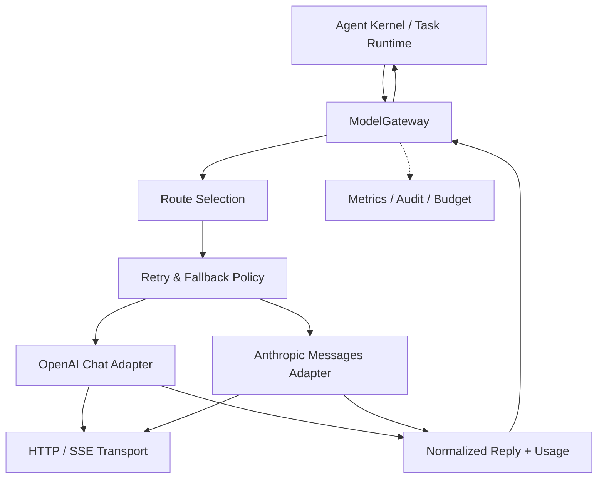

# 第 6 章：Model Gateway 与模型适配

> **状态：正文初稿 v0.1（待技术审稿）** · 第二篇：从零实现 Agent 核心架构  
> **本章目标**：把第 4 章中依赖一个特定 Chat Completions 协议的模型访问层，演进为**能在多提供商之间保留正确工具语义、流式结果、使用量、错误语义和策略约束的 Model Gateway**。  
> **运行环境**：Python 3.11+，全部离线测试仅使用标准库。真实 API 演示是可选的，需自行配置密钥并承担请求费用。  
> **协议范围**：原生 OpenAI **Chat Completions**（不是 Responses API）和 Anthropic **Messages API** 的文本与客户端工具调用子集。

上一章我们设计了 Task / Run / Step / Event，并把控制逻辑从模型调用中解耦。现在来看同一系统中的另一个变化源：**模型服务商协议**。

如果 Agent 的核心代码直接依赖某个 API 的 `tool_calls` 字段，那么替换模型时你可能发现：

- 另一家模型的工具调用是 `tool_use` 内容块；
- 工具结果并不是以 `role="tool"` 回填；
- `stop_reason` 的枚举不同；
- Token Usage 的字段名和缓存计费口径不同；
- Streaming 的 SSE 事件结构不同；
- 模型可能在结果返回前限流、超时或返回半截工具 JSON；
- 不同模型对函数工具、多模态、最大输出 Token 和推理预算的支持不同。

如果在每一个 Agent 实现里用 `if provider == "..."` 单独处理上述区别，很快会出现协议重复、异常行为不一致、隐性费用和安全漏洞。

本章的任务是把这些差异收敛到一个明确边界：

> **Agent Kernel 关注“何时选择动作、何时执行工具”；Model Gateway 关注“如何在指定模型上获得一个可信结构的决策提议，以及这次模型调用的资源、错误和协议状态”。**

---

## 6.1 为什么需要 Model Gateway？

### 6.1.1 一个 Agent 系统至少存在两个边界

在第 4 章，我们实现的最小接口是：

```python
class Model(Protocol):
    def complete(
        self, messages: list[dict], tools: list[dict]
    ) -> ModelReply: ...
```

它能让 Agent Kernel 和具体模型 SDK 解耦。但它还没有解决：

1. **协议适配**：不同提供商如何编码同一段交互；
2. **资源可见性**：调用实际用了多少 Input/Output Tokens；
3. **失败语义**：哪些错误可以重试，哪些必须立即停止；
4. **可控制的选择策略**：从哪个 Backend 发起请求；
5. **Streaming**：如何把服务端流变成有明确边界的标准事件；
6. **治理**：路由、隐私、预算和升级模型的审计。

仅做一个共同的 `generate(prompt)` 接口是不够的。Agent 需要比普通 Chatbot 更严格的工具语义和运行一致性。

### 6.1.2 软件架构分层



其中：

- **Agent Kernel** 管理用户目标、上下文、工具执行及终止；
- **Gateway** 管理提供商访问、协议转换、重试、路由和模型调用结果；
- **Backend Adapter** 对应一家厂商的特定 API 协议；
- **Transport** 专门处理 HTTP、TLS、SSE、超时及错误；
- **ModelReply** 是供 Agent Kernel 消费的中立结构；
- **TokenUsage** 是为成本分析提供的数据，而不是最终账单。

当前示例不接入数据库或完整 Metrics 系统，所有依赖通过 Python 对象和测试替身注入。

### 6.1.3 统一接口不等于抹平能力差异

好的 Gateway 必须遵守一条原则：

> **能明确归一化的语义才归一化；不能保留语义的响应必须被拒绝或显式标记“不支持”，而不是猜测或静默丢弃。**

例如：

- OpenAI Chat Completions 的 `function tool_calls` 能映射为 `ToolCall`；
- Anthropic Messages 的客户端 `tool_use` 内容块也能映射为 `ToolCall`；
- 但是支持任意多模态、服务器内执行工具、Thinking Block 或暂停恢复的扩展，并不能自动变成相同的简单结构；
- 一次真正被截断的 Tool Call 不能作为完整可执行工具请求交给 Runtime。

因此，本章坚持**有限但语义明确**的接口，而不是试图承诺所有模型的“全功能兼容”。

## 6.2 构建统一的数据契约

代码入口：[`src/mini_agent/model_gateway.py`](../../src/mini_agent/model_gateway.py)。

### 6.2.1 GatewayResponse 与 ModelReply

第 4 章的 `ModelReply` 描述一次模型决策：

```python
@dataclass(frozen=True)
class ModelReply:
    content: str | None = None
    tool_calls: tuple[ToolCall, ...] = ()
    finish_reason: str = "stop"
```

本章追加调用来源与资源统计：

```python
@dataclass(frozen=True)
class GatewayResponse:
    reply: ModelReply
    usage: TokenUsage
    provider: str
    model: str
    attempts: int = 1
```

**为什么不把 `usage` 加到模型文本里？** 这会污染 Agent 的上下文，也会把运行成本变成模型可自主改写的叙述。Gateway 的资源数据属于**控制平面记录**，不是模型自然语言输出。

### 6.2.2 内部 ToolCall 契约

```python
@dataclass(frozen=True)
class ToolCall:
    id: str
    name: str
    arguments_json: str
```

它保留：

- `id`：把一次工具请求和对应工具响应关联起来；
- `name`：工具名，必须由 Runtime 显式注册；
- `arguments_json`：序列化的参数文本，由 Tool Registry 在执行前验证。

Gateway 将模型响应变成**动作提议**，并不调用工具。即使模型返回了合法 JSON，工具的 Schema、权限和副作用验证仍在 Agent Kernel / Tool Runtime 中完成。

### 6.2.3 Provider Adapter 接口

```python
class ModelBackend(Protocol):
    name: str

    def complete(self, messages, tools) -> GatewayResponse: ...

    def stream(self, messages, tools): ...
```

为什么把 `complete` 和 `stream` 放在同一个 Backend 上？因为两者使用同样的模型配置、凭证、消息变换和工具定义，但**输出控制语义不同**：

- `complete` 返回完整响应，可以根据错误类型决定是否重试；
- `stream` 在第一个字符出现后就可能有用户可见的效果，安全的恢复策略必须更加保守。

## 6.3 OpenAI Chat Completions 与 Anthropic Messages 的本质差异

### 6.3.1 OpenAI Chat Completions 协议

典型工具响应结构：

```json
{
  "choices": [{
    "finish_reason": "tool_calls",
    "message": {
      "role": "assistant",
      "content": null,
      "tool_calls": [{
        "id": "call_1",
        "type": "function",
        "function": {
          "name": "add",
          "arguments": "{\"a\": 2, \"b\": 3}"
        }
      }]
    }
  }]
}
```

工具执行结束后，应用通常向下一次请求中加入：

```json
{
  "role": "tool",
  "tool_call_id": "call_1",
  "content": "{\"ok\":true,\"result\":5}"
}
```

这些字段在第 4 章的 Agent Kernel 中已实现；本章重用解析逻辑，并抽取 Usage、重试状态和流式事件。关于 Chat Completions 的当前字段定义见官方 API 文档 [1]。

### 6.3.2 Anthropic Messages 协议

相似的动作，在 Anthropic Messages 中可能返回：

```json
{
  "stop_reason": "tool_use",
  "content": [{
    "type": "tool_use",
    "id": "toolu_1",
    "name": "add",
    "input": {"a": 2, "b": 3}
  }]
}
```

工具结果以 **User Message 中的 `tool_result` 内容块**提交：

```json
{
  "role": "user",
  "content": [{
    "type": "tool_result",
    "tool_use_id": "toolu_1",
    "content": "{\"ok\":true,\"result\":5}"
  }]
}
```

更重要的是请求中的工具 Schema：

```json
{
  "name": "add",
  "description": "Add two integers",
  "input_schema": {
    "type": "object",
    "properties": {
      "a": {"type": "integer"},
      "b": {"type": "integer"}
    },
    "required": ["a", "b"]
  }
}
```

它使用 `input_schema`，而不是 OpenAI 风格的嵌套 `{"type":"function","function":...}`。Anthropic Messages 还要求明确设置 `max_tokens`，并通过 `system` 顶层字段传递系统提示。[2][3]

### 6.3.3 核心差异对照

| 语义 | OpenAI Chat Completions | Anthropic Messages |
| --- | --- | --- |
| 工具声明 | `tools[].function.parameters` | `tools[].input_schema` |
| 工具请求 | `assistant.tool_calls[]` | `assistant.content[].tool_use` |
| 工具参数 | `function.arguments` JSON 字符串 | `tool_use.input` JSON 对象 |
| 工具回复 | `role="tool"` | `role="user"` 的 `tool_result` |
| 工具关联 | `tool_call_id` | `tool_use_id` |
| 正常结束 | `finish_reason="stop"` | `stop_reason="end_turn"` |
| 工具结束 | `finish_reason="tool_calls"` | `stop_reason="tool_use"` |
| 输出截断 | `length` | `max_tokens` 等 |
| 流式工具参数 | `delta.tool_calls` 片段 | `input_json_delta.partial_json` |
| 常用 Usage | `prompt_tokens / completion_tokens` | `input_tokens / output_tokens` 与缓存字段 |

**不能直接复用原始消息列表。** 必须把 Chapter-4 风格的 `assistant.tool_calls` + `role="tool"` 组合转换成 Anthropic 的 `tool_use` + `tool_result`，并保证所有工具结果与原调用 ID 一一对应。

### 6.3.4 Adapter 必须检测不完整的历史

如果一条 `assistant` 工具请求之后缺失某个结果，直接转发给另一个服务商，可能导致不合法的消息序列或错误的决策上下文。本章在 Anthropic 适配器中维护 `pending tool call IDs`：

```text
assistant tool_use [id=a, id=b]
         ↓
user tool_result [a]
         ↓
user tool_result [b]
         ↓
next assistant turn allowed
```

如果出现未配对结果或孤立的 Tool Result，直接抛出 `GatewayProtocolError`，不会把它伪装成普通用户文本。

**边界**：由于 Anthropic 原生工具请求需要 JSON 对象，本章不尝试将“语法无效的原始工具参数字符串”强行转换为合法对象。这类不兼容情形必须停止或由上层明确处理，不能静默修复并改变原动作语义。

## 6.4 结束原因是一种控制协议

很多业务 Bug 源于把所有停止原因理解成“模型说完了”。

### 6.4.1 统一的最小枚举

本章 `ModelReply.finish_reason` 只使用以下基本语义：

| 中立状态 | 含义 | Agent Kernel 应如何处理 |
| --- | --- | --- |
| `stop` | 模型结束文本生成 | 可生成模型最终回复 |
| `tool_calls` | 模型提交工具请求 | 工具执行前检查权限、Schema、预算 |
| `length` | 输出达到限制 / 不完整 | 停止，不能执行残缺工具 |
| `content_filter` | 内容被服务端过滤 | 停止并记录 |
| `refusal` | 明确拒绝 | 停止并记录 |

Anthropic 还可能返回 `pause_turn`，表示一个需要继续的暂停轮次，尤其涉及服务端工具。在本教材的简化协议中**尚未实现相应的状态机**。所以 `pause_turn` 会被显式拒绝，不能当作“已完成”或“正常无工具返回”。其他未支持的扩展同理。[3]

### 6.4.2 为什么不能凭非空文本判断完成？

例如模型先输出：

```text
I have inspected the source files and I will...
```

如果随后命中长度限制，前半段文本仍存在，但它可能完全没有执行工具，也没有给出最终补丁。

Agent Kernel 应依靠**协议结束状态**控制执行，而不是对自然语言做字符串猜测。

## 6.5 Token Usage 的归一化和费用计算

### 6.5.1 Token Usage 不是“直接计费金额”

OpenAI Chat Completions 的典型字段：

```json
{
  "prompt_tokens": 200,
  "completion_tokens": 30,
  "prompt_tokens_details": {"cached_tokens": 80}
}
```

其中 `prompt_tokens` **已经包含缓存命中的输入 Token**。不能简单相加为 `200+80=280`，否则会重复计数。

Anthropic Messages 可能返回：

```json
{
  "input_tokens": 100,
  "cache_read_input_tokens": 80,
  "cache_creation_input_tokens": 20,
  "output_tokens": 15
}
```

在这种口径下，完整输入 Token 数为：

$$
N_{\mathrm{input,total}}
= N_{\mathrm{input,uncached}}
+N_{\mathrm{cache,read}}
+N_{\mathrm{cache,write}}
=100+80+20=200.
$$

两家的缓存 Token 字段**不能机械相加或直接按名称对齐**。[1][2]

### 6.5.2 本章 TokenUsage 统一约定

```python
@dataclass(frozen=True)
class TokenUsage:
    input_tokens: int | None = None
    output_tokens: int | None = None
    cached_read_input_tokens: int | None = None
    cached_write_input_tokens: int | None = None
```

语义：

- `input_tokens` 为规范化后的**总输入 Token**，包括已计入的缓存读写 Token；
- `output_tokens` 为厂商报告的生成量；
- `cached_read_input_tokens`、`cached_write_input_tokens` 是输入的**组成部分**，不是额外相加的总量；
- 如果服务商未返回 Usage，字段使用 `None`，而不是猜成 0。

为什么缺失值不能自动等于 0？Streaming 中断时可能无法拿到最终 Usage，但模型已经消耗了 Token。将缺失视为 0 会系统性低估失败调用的成本。

### 6.5.3 费用公式和定价版本

简化的模型费用可表示为：

$$
C =
\frac{N_{\mathrm{normal\ input}}P_{\mathrm{input}}}
{10^6}
+
\frac{N_{\mathrm{cached\ read}}P_{\mathrm{read}}}
{10^6}
+
\frac{N_{\mathrm{cached\ write}}P_{\mathrm{write}}}
{10^6}
+
\frac{N_{\mathrm{output}}P_{\mathrm{output}}}{10^6}.
$$

这里 `P` 是相应模型/提供商**每百万 Token 的实际定价**。若提供商不支持缓存写入的独立价格，就按其真实计费规则调整；还可能存在不同输出类别、服务层级、搜索、工具和批处理费用。

**本章不硬编码任何模型的实时价格**。价格、模型可用性、折扣和计费方式可能变动，应维护明确的 `provider + model_version + price_version` 价格表，在实际任务中使用已生效的价格版本计算成本。

另外，模型请求发生超时或重试，失败尝试可能也已产生费用。`GatewayResponse.usage` 只记录**成功返回该响应所报告的使用量**，不保证覆盖此前失败尝试。因此它不是完整的账单汇总系统。

## 6.6 Streaming：为什么 SSE 增加了复杂性？

### 6.6.1 Chat Completions 的 SSE

OpenAI Chat Completions 的流式返回通常以 `data:` 行发送 JSON chunk：

```text
data: {"choices":[{"index":0,"delta":{"content":"Hello"}}]}

data: {"choices":[{"index":0,"delta":{"content":" world"},"finish_reason":"stop"}]}

data: {"choices":[],"usage":{"prompt_tokens":12,"completion_tokens":4}}

data: [DONE]
```

如果请求设置 `stream_options.include_usage=true`，服务可能在结束前额外发送 `choices=[]` 的最终 Usage chunk。**若连接中断，该 Usage chunk 可能永远不会到达**。[1]

工具参数通常出现在 `delta.tool_calls` 的多条片段中，需要根据 `index` 累积。同一轮如果调用多个工具，必须按每个工具自己的 ID 和 Index 关联片段。

### 6.6.2 Anthropic Messages 的 SSE

Anthropic 的流式事件显式包含事件类型：

```text
event: content_block_start
data: {"type":"content_block_start","index":0,"content_block":{"type":"tool_use","id":"toolu_1","name":"add","input":{}}}

event: content_block_delta
data: {"type":"content_block_delta","index":0,"delta":{"type":"input_json_delta","partial_json":"{\"a\":"}}

event: content_block_delta
data: {"type":"content_block_delta","index":0,"delta":{"type":"input_json_delta","partial_json":"2,\"b\":3}"}}

event: content_block_stop
data: {"type":"content_block_stop","index":0}

event: message_delta
data: {"type":"message_delta","delta":{"stop_reason":"tool_use"},"usage":{"output_tokens":8}}

event: message_stop
data: {"type":"message_stop"}
```

实际流还包括 `message_start`、其他内容块事件及 `ping`；上面仅展示工具参数部分。注意 `input_json_delta.partial_json` **不是完整 JSON**，即使当前模型每次发送较完整的属性片段，仍应严格按照流增量组装。[4][5]

### 6.6.3 SSE 解析分为三个层次

本书将 Streaming 拆为：

1. **Transport**：读取 HTTPS 响应，得到按行分隔的 UTF-8 SSE；
2. **SSE Parser**：处理 `event:` / `data:`、空行分隔和注释；
3. **Provider Accumulator**：将具体厂商的内容 Delta 与 Tool Call Delta 汇总为 `ModelReply`。

源码：[`src/mini_agent/gateway_stream.py`](../../src/mini_agent/gateway_stream.py)。

接口：

```python
for event in backend.stream(messages, tools):
    if event.kind == "text_delta":
        print(event.text, end="")
    elif event.kind == "done":
        reply = event.response.reply
```

本章定义四种标准事件：

| 事件 | 作用 | 能否马上执行工具？ |
| --- | --- | --- |
| `text_delta` | 展示逐步生成的文本 | 否 |
| `tool_call` | 完整组装的工具提议 | 仍需 Runtime 验证 |
| `usage` | 已知使用量 | 否 |
| `done` | 完整最终协议响应 | 可交给 Runtime 决定后续动作 |

### 6.6.4 为什么必须等到流结束才能执行工具？

假设模型先流出：

```text
{"name":"read_file","arguments":{"path":"/home/
```

这不是完整参数，无法安全判断目标路径是什么。如果某个 UI 组件把部分字符串立即作为工具调用执行，会造成高风险协议问题。

因此本教材采用保守规则：

> **文本可增量展示；工具调用必须完整组装、获得合法结束状态、通过 Runtime 验证后，才能真正执行。**

这比追求最低 Tool Call 启动延迟更适合初学者和有副作用的生产任务。

### 6.6.5 处理流中断

一旦已经输出部分文本，系统可能不知道：

- 服务端是否已经完成推理；
- 最终工具参数是否有效；
- 完整 Usage 是多少；
- 用户是否已看到某些不完整内容。

如果此时静默重试或切换到另一模型，前后片段可能矛盾、重复展示，甚至产生两个不同的动作提议。

所以本章 `ModelGateway.stream` **只使用路由的第一个 Backend，不做自动重试或故障切换**。若缺少 `[DONE]` 或 Anthropic `message_stop`，抛出协议错误，绝不提交伪造的最终响应。进阶的可恢复 Streaming 要在明确的请求身份、游标、去重与幂等约束下设计。

## 6.7 Timeout、Retry 与错误分类

### 6.7.1 四种不同的失败

| 类型 | 例子 | 是否适合自动重试 |
| --- | --- | --- |
| **Permanent** | 401 密钥错误、403 权限不足、无效请求 | 通常不应盲目重试 |
| **Transient** | 429 限流、部分 5xx、网络临时不可用 | 可能适合有界重试 |
| **Protocol** | 响应字段非法、未知结束原因、不支持的消息块 | 应停止并定位适配 Bug/兼容性 |
| **Semantic** | 模型输出合法但答案错误、选错工具 | 不是 HTTP 重试能解决的问题 |

本章 `GatewayPermanentError`、`GatewayTransientError`、`GatewayProtocolError` 分别表达前三类。

HTTP 429、408、部分 5xx 通常可以作为重试候选；401 / 403 则通常需要修复凭证或权限。是否应该重试还要结合业务幂等、提供商政策和费用要求。

### 6.7.2 指数退避

本章使用一个有限的退避策略：

$$
d_k=\min(d_{\mathrm{max}}, d_0\cdot 2^{k-1}),
$$

其中 `k` 是本次 Backend 的第几次重试等待。对过载服务直接高频重试容易形成 **Retry Storm**；生产环境通常还需要随机抖动（Jitter）、`Retry-After`、熔断器、并发限流与端到端 Deadline。

```python
retry = RetryPolicy(
    max_attempts=2,
    base_delay=0.1,
    max_delay=1.0,
)
```

**本章仅实现简单指数退避**，未实现随机抖动、`Retry-After` 解析和 Token Bucket。不能把它称作完整 Rate Limiter。

### 6.7.3 连接超时不等于端到端超时

本章传给 `urllib` 的 `timeout` 约束阻塞网络操作；**不等于包含重试、多个 Backend、流式生成和工具执行的总墙钟时间限制**。

在生产系统里应区分：

- Connect Timeout；
- Read Timeout / Idle Timeout；
- Backend Attempt Deadline；
- Global Request Deadline；
- Agent Run Deadline；
- Tool Execution Deadline。

一个 Runtime 的总体延迟可能近似写成：

$$
T_{\mathrm{run}} \approx
\sum_i T_{\mathrm{model},i}
+
\sum_j T_{\mathrm{tool},j}
+
T_{\mathrm{queue}}+
T_{\mathrm{retries}}.
$$

若并行执行，则需要按关键路径计算，不能简单相加。

### 6.7.4 为什么模型调用的重试仍有成本风险？

即使同一个 Prompt 再调用一次并没有立即执行外部工具，服务端可能已经对第一次推理计费。请求超时不能证明服务端没有处理。因此重试有可能重复 Token 消耗，且两次模型输出并不保证一致。

未来接入幂等请求标识、平台计费对账和分布式调用记录时，需要明确服务商是否真正支持相关能力，而不能仅靠客户端传一个随机 ID 就声称实现 exactly-once。

## 6.8 Fallback、模型路由与权限边界

### 6.8.1 本章为什么使用显式路由？

```python
gateway = ModelGateway(
    backends={"chat": openai, "claude": anthropic},
    routes={
        "default": ("chat", "claude"),
        "research": ("claude",),
    },
)
```

它表达：

- `default`：优先 Chat；当所有本 Backend 的重试都以**Transient** 错误结束时，才考虑显式列出的下一 Backend；
- `research`：只调用 Anthropic Backend；
- 未在路由内列出的 Backend 不会被自动调用。

这是一种**静态路由**，不是系统根据复杂任务“智能选出最佳模型”的算法。模型质量与成本优化必须有真实 Benchmark 和业务场景证据。

### 6.8.2 为什么不能对所有失败做 Fallback？

假如主模型返回：

- `401 Unauthorized`：这是凭证/权限问题，换提供商可能绕过预期的认证边界；
- `400 Invalid Request`：是应用协议问题，换提供商可能掩盖 Bug；
- `tool_calls` 参数非法：这是模型/工具语义问题，不是网络问题；
- `refusal`：不能把拒绝自动当作“要多试几家直到有人答应”。

因此本章只在**可重试的临时失败已经耗尽**时才进行明确配置的后端切换。对于持久或协议错误，直接停止。

### 6.8.3 Fallback 会改变数据流向

**这是常被模型路由忽略的安全问题**。一段用户对话可能包含代码、商业机密、敏感文档或个人数据。从 A 服务商自动发送到 B 服务商，本身就是一个新的数据处理决策。

生产级路由策略必须首先检查：

- 用户/租户是否允许该服务商；
- 数据驻留、地域和合同约束；
- 服务商对输入和日志的保留/使用政策；
- 是否支持任务所需的工具协议、上下文长度与其他能力；
- 是否允许降级到可能更弱的模型；
- 工具调用历史能否在不丢失语义的情况下迁移。

本章的静态路由把授权前置为**配置责任**，并没有实现自动的数据合规校验。因此真实部署前，应在上层业务策略明确许可 Provider，再允许传入这种 Fallback Route。

### 6.8.4 基于能力而不是品牌路由

未来可以扩展为：

```text
Task requirements
    ├── required_tool_use = true
    ├── max_latency_ms = 2500
    ├── context_requirement = long
    ├── data_policy = approved_providers_only
    └── target_success_rate = >= ...
          ↓
Capability filter
          ↓
Quality / latency / cost ranking
          ↓
Approved provider + model snapshot
```

其中每项能力与指标都应来自明确版本的模型说明或测量数据。不能通过模型名字臆测实际推理质量。

## 6.9 从零实现：核心代码导航

本章代码刻意拆成三个文件，保持前面章节可正常运行：

| 路径 | 角色 |
| --- | --- |
| [`src/mini_agent/model_gateway.py`](../../src/mini_agent/model_gateway.py) | Gateway、Backend、错误分类、Usage、Retry、Routing |
| [`src/mini_agent/gateway_stream.py`](../../src/mini_agent/gateway_stream.py) | SSE Parser 与 OpenAI/Anthropic 的流式组装 |
| [`tests/test_ch06.py`](../../tests/test_ch06.py) | 离线协议/错误/流式/路由回归测试 |
| [`examples/ch06_gateway_demo.py`](../../examples/ch06_gateway_demo.py) | 完全离线、双协议与 Streaming 演示 |
| [`examples/ch06_live_gateway.py`](../../examples/ch06_live_gateway.py) | 可选真实 Provider 端到端示例 |

### 6.9.1 继承 Chapter-4 Agent Kernel

GatewayModel 把新 Gateway 适配回第 4 章的接口：

```python
class GatewayModel:
    def __init__(self, gateway, route="default"):
        self.gateway = gateway
        self.route = route
        self.history = []

    def complete(self, messages, tools):
        result = self.gateway.complete(messages, tools, route=self.route)
        self.history.append(result)
        return result.reply
```

因此第 4 章的控制器仍可照常调用：

```python
agent = AgentKernel(GatewayModel(gateway), arithmetic_tools())
result = agent.run("Compute 8+13 using the add tool.")
```

无须为每种模型编写新的 Agent Loop。这才是抽象的主要价值。

**注意**：`GatewayModel.history` 是简化的**单请求内存日志**，没有线程安全、持久化或隐私脱敏能力。生产中应使用 Run/Trace 级的外部观测体系。

### 6.9.2 最小 HTTP 传输层

实际请求通过标准库 `urllib.request` 发送 HTTPS POST。传输层包含：

- 拒绝非 HTTPS URL（显式 loopback HTTP 用于本地开发除外）；
- 拒绝 URL 里嵌入账号/密码、查询或 fragment；
- 禁止自动 HTTP Redirect，以减少凭证被重定向发送至非预期主机的风险；
- HTTP Status 与网络异常转化为显式错误类型；
- 对一次非流式响应和 SSE 行设置教学用途的内存大小限制；
- 不把原始 Provider Error Body 直接写入异常消息或发给模型。

这还不是完整的 SSRF 防护和企业网络策略：真实生产需要可信 URL 配置、DNS / IP 出站限制、TLS 校验、代理策略、环境隔离和凭证生命周期控制。

### 6.9.3 可注入 Transport 是测试关键

每个 Backend 可指定 `transport(body) -> response` 作为非流式替代，以及 `stream_transport(body) -> Iterable[str]` 作为 SSE 替代。

这样可以完全离线验证：

- 请求 JSON 是否使用正确的协议；
- Tool Call ID 是否保留；
- Provider Usage 是否被正确规范化；
- 重试次数是否符合预期；
- 流式 JSON 是否被正确组装；
- 在非法消息与中断时是否拒绝产生最终调用。

真实模型是否一定正确选择工具，是**另一个层面的 Evaluation**，不能由 Mock Transport 测试代替。

## 6.10 运行离线实验

### 6.10.1 准备环境

```bash
git clone https://github.com/apsaras-ai/agent-from-scratch.git
cd agent-from-scratch
python -m pip install -e .

python examples/ch06_gateway_demo.py
python -m unittest discover -s tests -v
```

无需 API Key，所有 Provider 响应来自 Python 内建测试数据。

### 6.10.2 实验 A：同一个 Agent Kernel，不同模型协议

演示先用模拟 Chat Completions 返回一个 `add(8,13)` 工具请求，再向同一 Backend 发送带工具结果的后续消息。

之后通过 `research` 路由调用模拟 Anthropic 消息。两个 Backend 输出映射成同一种 `GatewayResponse`，但各自发送的是不同供应商协议。

预期关键输出：

```text
Chat Agent: completed 21 tool_calls= 1
Gateway calls: 2
Input tokens reported: 79
Cached input (included): 10
Other provider: claude answer= Claude-style protocol reply
Other input tokens including cache: 19
No network requests were made.
```

其中 `79=35+44` 是示例中两次 Chat 调用各自报告的输入 Token；`19=14+5` 是模拟 Anthropic 的非缓存输入和缓存读取总数。

这些数字完全来自预设 JSON Fixture，**不是实际 OpenAI/Anthropic 模型的测速或账单数据**。

### 6.10.3 实验 B：Streaming Tool Call 片段组装

示例 OpenAI SSE 将参数拆成两个片段：

```text
chunk 1: {"a":8,
chunk 2: "b":13}
```

最终工具请求：

```json
{"a":8,"b":13}
```

预期事件次序：

```text
Streaming event kinds: ['text_delta', 'tool_call', 'usage', 'done']
Final tool arguments: {"a":8,"b":13}
```

这体现本章的**先完整组装，再交给工具运行时验证**的设计。

### 6.10.4 实验 C：重试与路由

离线测试会构造：

```text
primary: 429 → success
    => retry same backend; no fallback

primary: 503 → 503 (attempts exhausted)
backup:  success
    => explicit fallback

primary: 401
    => permanent error; stop; no fallback
```

并验证 RetryPolicy 的等待参数、总 Attempts 与错误分类。此处 `sleep` 由测试替身注入，不会真的等待或者调用外部 API。

## 6.11 可选：调用真实模型

实验脚本：[`examples/ch06_live_gateway.py`](../../examples/ch06_live_gateway.py)。

**OpenAI Chat Completions**：

```bash
export AGENT_PROVIDER=openai
export OPENAI_API_KEY="your-key"
export AGENT_MODEL="your-supported-chat-model"

python examples/ch06_live_gateway.py
```

**Anthropic Messages**：

```bash
export AGENT_PROVIDER=anthropic
export ANTHROPIC_API_KEY="your-key"
export AGENT_MODEL="your-supported-messages-model"

python examples/ch06_live_gateway.py
```

脚本只注册简单的只读算术工具，并限制模型调用与工具次数。真实模型可能不调用工具、使用不同工具顺序、拒绝或触发协议异常；这并不意味着 Mock 实验失败，说明还需要真实模型评测。

**不应该把环境变量或 Provider Key 提交到公开仓库**。若使用云端企业账号，也应考虑日志、审计、区域与凭证授权策略。

本章不会声称真实 API 示例已经成功运行，因为仓库的 GitHub Actions 不携带私有 API Key，也不会为了 CI 对外发送计费请求。

## 6.12 测试矩阵：哪些行为必须被证明？

本章自动化测试至少覆盖以下边界：

| 领域 | 核心验证 |
| --- | --- |
| OpenAI | Chat 工具调用与 `tool_call_id` 原样保留 |
| Anthropic | `system` 顶层字段、`input_schema`、`tool_use` / `tool_result` 转换 |
| Tool Errors | `tool_result.is_error` 与无法配对的调用 ID |
| Usage | Cached Token 计数不重复，缺失返回 `None` |
| Stop Reasons | 截断、拒绝、暂停状态不伪装成成功 |
| Streaming | SSE Comment、Data Chunk、Tool JSON Fragment |
| Stream Interruption | 没收到完整终止事件，不能生成 `done` |
| Multiple Tool Calls | 累积工具 Index 与 ID，不丢失分片 |
| Retry | 429 / 5xx 和网络临时失败可以受限重试 |
| Permanent Failure | 401、协议不兼容不能静默 Fallback |
| Route | 按显式配置选择模型，使用总尝试次数审计 |
| Security Boundary | Fake Transport 不发送真实密钥、HTTP Redirect 被禁用 |
| Integration | 继续运行 Chapter-4 AgentKernel 的工具回路 |

单元测试证实的是**我们定义的有限协议契约和异常行为**，不是所有模型、所有字段、所有 API 版本都能被统一适配。生产时需要对具体模型版本增加 Contract Tests 与定期的线上小流量验证。

## 6.13 生产系统还缺什么？

本章得到的是一个真实可调用但教学范围有限的 Gateway。它没有：

- Responses API 与 Anthropic 所有扩展、多模态和服务器端工具支持；
- 完整的客户端 Token Bucket、分布式限流和熔断器；
- 全局 Deadline、可取消异步请求和任务级预算；
- 基于价格表和 Benchmark 的智能模型选择；
- 模型能力目录、版本固定及自动兼容性测试；
- 敏感数据脱敏、各租户 Provider 白名单和数据驻留策略；
- Agent Run 级的持久化 Usage 统计与费用对账；
- Stream Resume、端到端请求幂等与安全重放；
- OpenTelemetry 真实 Trace 的关联；
- 对外部工具调用的独立验证、审批和隔离。

其中 Model Gateway 的进一步架构会贯穿第 8、12、19、22–28 章。切记**不应该因为网关有 Retry、Fallback，就把整个 Agent Runtime 误认为具备可靠分布式执行语义**。

## 6.14 习题与实践挑战

### 基础理解

**6.1** 对比 OpenAI Chat 与 Anthropic Messages 的 Tool Call 请求、工具结果与停止原因。画出映射过程，解释为什么不能用一个简单的字段重命名函数完成全部适配。

**6.2** 某 OpenAI 请求报告 `prompt_tokens=1200`、`cached_tokens=800`。为什么不能说本次 Input 共 2000 Tokens？如果缓存输入单位价格不同，应如何计算成本？

**6.3** Anthropic 返回 `input_tokens=150`、`cache_read_input_tokens=200`、`cache_creation_input_tokens=50`。按本书规范化口径算 `TokenUsage.input_tokens`。

**6.4** 一次流式请求在 Tool Call 参数输出到一半时断开。怎样区分“已经展示的文本”“完整动作提议”和“已执行的工具副作用”？

### 编程题

**6.5** 给 `RetryPolicy` 添加带 Jitter 的退避和 `Retry-After` 处理。测试在服务端返回错误 `Retry-After` 时的边界，避免等待时间无限扩大。

**6.6** 扩展 Gateway，加入系统级 Deadline。要求所有重试和 Fallback 的延迟总和不能超过 Deadline，并证明不会在剩余预算为负时继续请求。

**6.7** 设计 Provider Capability Manifest，显式标记 `tools`、`streaming`、`vision`、`max_context` 等，并在路由前执行能力过滤。

**6.8** 为 Anthropic 实现“工具参数 JSON 不完整”时的受控错误路径，说明什么情况下可以回传给同一 Provider 修复、什么时候必须停止以免损坏消息历史。

**6.9** 用可注入的 Provider Fake Transport 模拟 `429→503→200`，统计 ModelGateway 实际尝试次数和延迟；然后模拟 `401`，证明它不会触发 Fallback。

### 系统设计与研究题

**6.10** 设计一个三租户模型路由规则：租户 A 禁止跨提供商 Fallback，租户 B 可在两个批准提供商之间切换，租户 C 要求固定数据地域。模型性能优化应如何服从这些约束？

**6.11** 设计“线上实际账单金额与模型 Usage 统计不一致”的对账流程，考虑失败请求、缓存、重试、多种计费工具和价格快照。

**6.12** 选择两个真实模型，在统一任务集上比较 Tool Call Validity、Task Success Rate、p50/p95 Latency 和 Cost per Successful Task。除了模型型号之外，需要控制哪些变量？

**6.13（进阶）** 实现异步流式 SSE Parser，使其能对用户输出增量文本并支持取消。讨论取消后如何记录未知 Token 使用量和可能已产生的远程计算。

### 参考思路（节选）

- **6.2**：`cached_tokens` 是 `prompt_tokens` 的子集，不是新增输入数量。
- **6.3**：总输入 `150+200+50=400`，三个分类仍应分别保留，以便计算实际缓存费用。
- **6.4**：部分文本可以已经被用户看到，但不代表已形成完整工具请求；不存在合法 `done` 就不能触发工具执行。
- **6.10**：Provider 合规和访问控制应先于质量/成本路由，而不是在 Fallback 成功后才审计。

## 6.15 本章总结

1. **Model Gateway 是协议与资源治理层，不是新的 Agent Planner**。
2. **OpenAI Chat Completions 与 Anthropic Messages 的工具协议确实不同**，不能通过简单 JSON 复制保持语义。
3. **统一模型响应必须保留结束原因、Tool Call ID、Usage 和实际来源**。
4. **Token Usage 的缓存字段口径有差异**；报告值也不等于最终账单。
5. **Streaming 文本可以逐步发送，但工具提议必须完整组装后再验证执行**。
6. **重试只适用于符合条件的失败**。无限重试、错误 Fallback 和残缺流续接都可能带来新风险。
7. **Model Routing 首先是能力与合规约束问题，才是成本和模型质量优化问题**。
8. **测试协议与评估模型是不同层面**。Mock 证明数据转换，真实 Benchmark 证明任务能力。
9. **本章只是教学 Gateway 的第一版**，不具备生产级调度、限流、计费对账与安全边界。

下一章：[第 7 章《Tool Use 与工具系统》](07.md) 将从模型协议继续进入工具契约、Schema、MCP、权限、并行调用、错误传播与副作用管理，并逐步实现一个更完整的 Tool Runtime。

---

## 参考资料与接口版本说明

[1] OpenAI. *Chat Completions API Reference*（含 Function Calling、Streaming 和 Usage 字段）. https://platform.openai.com/docs/api-reference/chat

[2] Anthropic. *Create a Message — Claude API Reference*（工具定义、stop_reason、usage）. https://platform.claude.com/docs/en/api/messages/create

[3] Anthropic. *How tool use works*. https://platform.claude.com/docs/en/agents-and-tools/tool-use/how-tool-use-works

[4] Anthropic. *Streaming messages*. https://platform.claude.com/docs/en/build-with-claude/streaming

[5] Anthropic. *Fine-grained tool streaming*. https://platform.claude.com/docs/en/agents-and-tools/tool-use/fine-grained-tool-streaming

[6] OpenAI. *Function calling*. https://platform.openai.com/docs/guides/function-calling

[7] OpenAI. *API Reference and backwards compatibility*. https://platform.openai.com/docs/api-reference/introduction

[8] Martin Kleppmann. *Designing Data-Intensive Applications*, 1st edition. O'Reilly, 2017. （分布式错误、重试与一致性相关背景）

> **技术核验说明**：本章在 2026 年 10 月编写，API 协议可能随提供商和模型版本演进。测试 Fixture 对应本书刻意选择的文本 + 客户端工具调用子集，不声称完整支持提供商 API 的全部功能。若接口变动，应同步更新 Provider Adapter 与 Contract Tests。所有源码为本书演示目的编写，生产部署需单独完成安全审查。
