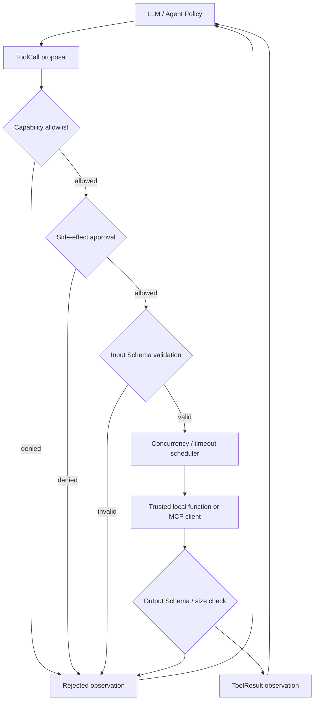
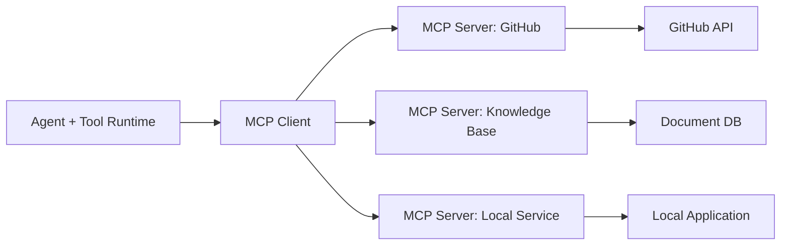

# 第 7 章：Tool Use 与工具系统

> **状态：正文初稿 v0.1，待技术审稿** · 第二篇：从零实现 Agent 核心架构  
> **本章目标**：将第 4 章简单的 Tool Registry 升级为真正的工具调用边界：**完整版本化 JSON Schema 校验、模型可见工具目录、本地权限、异步执行、超时、错误、MCP Tool Discovery 与跨服务器名称隔离**。  
> **实践范围**：Python 3.11+；核心新增依赖为 `jsonschema>=4.23,<5`，可选 MCP SDK 为 `mcp>=2,<3`。所有 CI 用离线 Fake MCP，不连接真实服务。  
> **安全定位**：**教学级 Tool Runtime，不是 OS 沙箱、授权服务器、分布式 Durable Execution 或代码执行器**。

前六章，我们已经建立了 LLM 驱动的 Agent Loop、模型消息协议、Run 状态模型和多提供商 Model Gateway。但系统能够生成工具调用，并不意味着它已经有一套**正确、可靠、安全的工具系统**。

考虑一个 Coding Agent 的同一轮动作提议：

```json
[
  {"name":"repo.read_file","arguments":{"path":"src/app.py"}},
  {"name":"tests.run","arguments":{"target":"tests/test_app.py"}},
  {"name":"repo.delete","arguments":{"path":"tests/"}}
]
```

三个调用结构相似，但它们带来的工程约束完全不同：读文件可能相对低风险；运行测试消耗 CPU 并可能具有环境副作用；删除文件是不可逆或高风险操作。仅仅为模型展示函数的名称和 JSON Schema，并不能定义谁有权执行、哪些请求必须审批、失败之后能否重试，以及两个工具是否可以并行。

本章的中心结论是：

> **Tool Calling 是模型提供的动作提议；Tool Runtime 是一个可信度边界。工具 Schema 约束数据形状，权限控制允许执行的能力，执行环境限制副作用；三者互不替代。**

## 学习目标

完成本章，应该能够：

1. 理解工具生命周期：**发现 → 声明 → 筛选 → 授权 → 验参 → 执行 → 验证结果 → 观察回填**。
2. 使用 JSON Schema Draft 2020-12 验证复杂的嵌套数组、对象、枚举和条件约束。
3. 明确区分 Schema 合法、业务合法、身份有权以及动作本身安全。
4. 实现只向模型暴露显式允许的工具、并在执行时再次授权的双重检查。
5. 用 Python `asyncio` 调度相互独立的只读工具，理解超时、取消和结果顺序。
6. 设计写入和破坏性工具的逐调用授权与重复执行防护，并陈述这些机制的边界。
7. 使用官方 MCP Python SDK v2 客户端接口做分页式工具发现和远程调用；处理 `inputSchema`、`outputSchema`、`structuredContent`、`isError`。
8. 将新 Tool Runtime 接入先前的 Agent Kernel / Model Gateway，无需重写模型适配器。

---

## 7.1 Tool Use 的架构定位

### 7.1.1 为什么 Tool Registry 不应该直接执行函数名？

最危险的伪代码之一：

```python
name = model_response["tool"]
eval(name)(**model_response["arguments"])  # 不要这样写！
```

它既没有可信的工具目录，也没有输入契约、权限和可审计的执行记录。即使去掉 `eval`，使用 `globals()[name]` 任意查找函数仍然没有解决工具能力边界问题。

推荐架构：



模型从一份**经过当前身份、租户和任务范围筛选**的工具目录中提出调用。Runtime 收到请求后还要重新检查权限，因为工具描述是帮助模型选择的提示信息，不具备强制性授权效果。

### 7.1.2 Tool 由三部分组成

本章定义：

```python
@dataclass(frozen=True)
class ToolDefinition:
    name: str
    description: str
    input_schema: dict[str, Any]
    handler: Callable[..., Awaitable[Any]]
    risk: Risk = Risk.READ
    output_schema: dict[str, Any] | None = None
```

其中：

- `name/description`：模型可见的工具身份与说明；
- `input_schema/output_schema`：数据契约；
- `handler`：可信开发者注册的本地异步函数，或由可信 MCP Client 封装的远程工具；
- `risk`：由**本地可信应用**配置的风险级别，而不是依赖远程服务器的文字声明。

**关键区别**：Schema 是数据类型约束，不会自动阻止工具访问未授权文件或网络。即使 `path` 是合法字符串，也可能指向不允许的系统路径。

## 7.2 JSON Schema：从浅层验证到标准契约

### 7.2.1 为什么前面版本的校验器不够？

第 4 章的 `validate_arguments` 是刻意简化的演示，只支持 `string`、`integer`、`number`、`boolean` 等浅层类型。生产工具却经常出现：

- 嵌套对象和数组；
- `enum`、`const`；
- `minimum/maximum`、`minItems/maxItems`；
- `oneOf/anyOf/allOf`；
- `pattern`、`format`；
- `additionalProperties`；
- `$defs` 与本地 `$ref`。

这些要求不应该靠几十个手写 `if` 拼凑。本章使用 Python `jsonschema` 库的 `Draft202012Validator`，并在注册工具时调用 `check_schema`，确保 Schema 自身合法。[1][2]

### 7.2.2 一个嵌套工具契约

```json
{
  "$schema": "https://json-schema.org/draft/2020-12/schema",
  "type": "object",
  "properties": {
    "numbers": {
      "type": "array",
      "minItems": 2,
      "maxItems": 3,
      "items": {"type": "integer", "minimum": 0}
    },
    "mode": {"enum": ["sum", "max"]}
  },
  "required": ["numbers", "mode"],
  "additionalProperties": false
}
```

有效：

```json
{"numbers":[1,2,3],"mode":"sum"}
```

无效：

```json
{"numbers":[1,-2],"mode":"sum"}
```

后者违反了数组元素 `minimum=0`。请注意：`numbers` 是数组，只有检查顶层字段数量的浅层校验器无法发现这个错误。

### 7.2.3 Schema 合法不代表业务动作可执行

一个 `delete_file` 工具可能要求：

```json
{"path": "string"}
```

虽然 `{"path":"/etc/passwd"}` 符合该 Schema，但仍然可能违反业务授权与文件访问规则。必须独立检查：

1. 参数的数据结构正确；
2. 参数的业务语义合法；
3. 当前身份对目标资源拥有权限；
4. 当前任务是否被授权执行该动作；
5. 动作的风险、预算和幂等性是否允许。

**不要把 Input Schema 当成 Authorization Policy。**

### 7.2.4 关于 `format`、远程 `$ref` 和资源消耗

`jsonschema` 支持 Draft 2020-12，并可用 `FormatChecker` 启用部分标准 Format 的检查；并非所有 Format 都自动提供实现，具体依赖版本及可选安装组件。[2]

本教材虽采用成熟校验库，但仍明确限制：

- 只接受 `$schema` 为 Draft 2020-12 或省略版本的 Schema；
- Input Schema 根类型必须为 `object`；
- 只允许 `#...` 本地引用，不允许自动网络/文件读取远程 Schema；
- 限制 Schema 本身的序列化体积；
- 限制工具参数和响应体积。

这是**对不可信工具描述的防御性限制**。它不等于已经实现针对恶意嵌套深度、复杂 `$ref` 循环和资源耗尽的完整沙箱；在生产环境必须进一步设置工具定义审批和资源隔离。

### 7.2.5 JSON 解析还要处理非标准输入

Python `json.loads` 默认存在一些教学上容易忽视的行为，例如可接受 `NaN` 等非标准 JSON 常量。本章显式拒绝它们，并通过 `object_pairs_hook` 拒绝重复字段名：

```json
{"path":"safe.txt","path":"secret.txt"}
```

“两个 `path`”在不同解析器里可能产生不同的结果；当请求跨模型、Gateway、应用和远程工具系统时，这种差异可能引入参数混淆。**拒绝重复键**比“最后一个键覆盖前一个”更适合作为可信执行边界的默认行为。

## 7.3 统一工具目录（Tool Catalog）

### 7.3.1 注册与发现是不同动作

`ToolCatalog.register(definition)` 仅表示可信开发者将一种能力注册到当前环境。它不等于向所有模型用户公开该能力。

真正给模型展示工具时，使用：

```python
specs = catalog.specs_for(policy)
```

其中 `policy.allowed_tools` 由上层应用根据租户、身份和任务上下文确定。

假如服务有 100 个工具，某个任务可能只需要：

```python
ToolPolicy(
    tenant_id="tenant-a",
    run_id="run-123",
    allowed_tools=frozenset({"repo.read_file", "repo.search"}),
)
```

此时不应把另外 98 个工具塞入模型 Prompt。减少工具列表不仅有助于 Token/模型工具选择质量，还降低了误调用风险。**但隐藏工具只是辅助控制**：即使模型知道某个隐藏工具的名字，也不能绕过 Runtime 的 `allowed_tools` 检查。

### 7.3.2 工具名称需要明确的命名空间

当两个 MCP Server 都提供 `search` 时，如果不消歧就注册为同一个名字，很容易产生冲突或劫持。

推荐：

```text
github.search
docs.search
browser.search
```

本书远程工具使用 `server_alias + "." + remote_name`，例如 `remote.lookup`。注意 `server_alias` 必须是本地配置的可信名称，不能无条件相信远程服务器自报的显示名称。

## 7.4 工具权限模型：Read、Write、Destructive

### 7.4.1 工具风险不是单一的 allow/deny

```python
class Risk(str, Enum):
    READ = "read"
    WRITE = "write"
    DESTRUCTIVE = "destructive"
```

这里的“READ”由**工具注册者承诺**，不是运行时自动推断的事实。比如一个名为 `get_report` 的远程工具也可能在服务端记录敏感审计信息或更新计数器。

最低限度的安全策略：

- READ：当前任务的工具白名单允许即可；
- WRITE：必须既在白名单中，也获得针对**特定 Tool Call ID** 的批准；
- DESTRUCTIVE：除了指定批准，还需明确允许破坏性操作的额外开关；
- 未注册工具、未知租户资源或缺少授权的请求均应默认拒绝。

### 7.4.2 每次批准要与具体动作绑定

本章以 `(tool_name, call_id)` 作为教学用审批键：

```python
ToolPolicy(
    tenant_id="tenant-a",
    run_id="run-123",
    allowed_tools=frozenset({"report.write"}),
    approvals=frozenset({("report.write", "call-9")}),
)
```

并通过 Event Store / Runtime 中的 `tenant_id + run_id + call_id` 区分执行尝试。

这是一种**可信应用内部传参约束**，而不是可供客户端随意构造的授权 Token。现实审批应绑定目标资源、参数摘要、身份、审批有效期、签名/数据库状态、租户与具体运行，并在真正执行前再次校验。不能简单让模型生成一个审批 ID 就认为已经获得批准。

### 7.4.3 为什么权限要执行前再次校验？

应用可在模型调用时展示 `report.write` 的工具说明，但用户可能在工具返回前撤销权限。因此至少需要：

- 规划/Prompt 阶段过滤工具；
- 执行阶段再次检查身份和授权；
- 执行环境层的资源访问限制；
- 关键副作用操作的审计与结果确认。

本章只实现前两个环节的部分机制。文件系统 ACL、容器、MicroVM、出站网络限制将在安全与沙箱篇实现。

## 7.5 Tool Runtime 的执行状态和错误契约

### 7.5.1 工具成功与模型最终回答不同

本章的执行结果：

```python
@dataclass(frozen=True)
class ToolResult:
    call_id: str
    name: str
    ok: bool
    value: Any = None
    error: str | None = None
```

每次工具调用都要明确告诉模型：

```json
{"ok":true,"result":42}
```

或：

```json
{"ok":false,"error":"schema_validation_failed"}
```

这是一种**可机器解析的执行结果**。不要仅用文本 `"success"` 表示动作已经成功，因为失败、异常、权限拒绝和返回内容都可能包含这个词。

### 7.5.2 错误分类决定能否自我修复

| 错误代码 | 示例 | 推荐处理 |
| --- | --- | --- |
| `unknown_tool` | 模型请求未注册工具 | 不执行，允许模型选择其他合法工具 |
| `tool_not_allowed` | 工具已注册，但用户未授权 | 不执行，不能绕过权限 |
| `approval_required` | 写操作缺少批准 | 等待可信审批，不应由模型自动批准自己 |
| `invalid_json` / `duplicate_json_key` | 参数无法解析或含重复键 | 可请求模型修正参数 |
| `schema_validation_failed` | 参数结构不满足 JSON Schema | 可请求模型调整 |
| `tool_execution_failed` | handler 抛出异常 | 记录内部异常，模型只看安全摘要 |
| `output_schema_validation_failed` | 工具返回了违约结构 | 视为工具契约错误 |
| `tool_timeout_outcome_unknown` | 超时后仍不确定远程副作用 | **禁止无脑重试** |
| `duplicate_call_id` | 相同 Run 的调用 ID 重复 | 阻止本进程内重复调用 |

当工具抛出异常时，本章只把 `tool_execution_failed` 写回模型，而不是直接回显任意 Python 异常字符串。错误详情应留在受访问控制的内部日志，不应将密码、系统路径或请求 Header 传给模型。

### 7.5.3 输出也必须验证

如果声明：

```json
{
  "type": "object",
  "properties": {"total": {"type":"integer"}},
  "required": ["total"],
  "additionalProperties": false
}
```

而工具返回：

```json
{"total":"not a number"}
```

即使 Input Schema 完全合法，工具仍违反了 Output Contract。只有输入和输出都经过相应验证，模型才能在定义好的契约内消费结果。

同时需要限制返回大小；未裁剪的几十 MB 构建日志不应该直接写入模型上下文。更大内容以后可存入 Artifact Store，由检索或摘要工具分段读取。

## 7.6 异步与并行工具调用

### 7.6.1 为什么选择 asyncio？

典型 Agent 任务包含大量 I/O：

- 读取网络 API；
- 查询搜索服务；
- 访问远程 MCP Server；
- 等待外部任务完成。

把独立 I/O 请求完全串行执行，会增加总体延迟。

```python
results = await asyncio.gather(
    read_a(),
    read_b(),
)
```

如果两个任务独立，串行耗时可近似为：

$$
T_{\text{sequential}}\approx T_a+T_b.
$$

并行时理想情况下：

$$
T_{\text{parallel}}\approx \max(T_a,T_b)+T_{\text{overhead}}.
$$

真实延迟仍受远程服务并发限制、排队、速率控制、网络拥塞及共享资源竞争影响。

### 7.6.2 并行不是默认对所有动作都正确

考虑：

```text
A: create_file("src/new.py")
B: run_tests("tests/test_new.py")
```

B 依赖 A 写入的文件，如果盲目 `gather`，可能在文件尚未创建前开始测试。因此应该由 Planner/Workflow 明确表达依赖关系。

本章 `AsyncToolRuntime.execute_many` 假设**传入的是一组相互独立的动作**：

- 使用 `asyncio.Semaphore` 限制全局并发数量；
- READ 工具允许同轮并发；
- WRITE / DESTRUCTIVE 工具还要经过单进程 `asyncio.Lock` 串行执行；
- 工具结果按照输入顺序返回，即使实际完成顺序不同；
- 调用之前预检查单轮重复 ID 和剩余工具预算。

这仍不足以确保真正的并发正确性：真实写操作可能跨进程，多个 Worker 仍可能并发访问同一数据库或仓库。资源锁与事务须由被访问的外部系统负责。

### 7.6.3 多工具调用与 Model Gateway

第 6 章允许模型在单轮返回多个 `ToolCall`。本章 `AsyncToolAgent` 将这些调用映射到 Runtime，再把每个结果回填为：

```json
{
  "role": "tool",
  "tool_call_id": "call-1",
  "content": "{\"ok\":true,\"result\":21}"
}
```

这让 Chapter-6 `GatewayModel` 可以继续被复用，工具执行与模型适配不必互相依赖。

## 7.7 Timeout、Cancellation 和 Side Effect

### 7.7.1 asyncio.wait_for 到底保证什么？

```python
value = await asyncio.wait_for(
    handler(**arguments), timeout=2.0
)
```

当超时发生，`asyncio` 会向任务发送取消请求。但**取消是协作式的**：

- handler 必须有机会处理取消；
- 某些阻塞库不及时响应取消；
- 远程服务可能早已接到请求并执行副作用；
- 线程、子进程和数据库事务不一定随 Python coroutine 取消而停止。

因此，当工具超时时，应该返回 `tool_timeout_outcome_unknown`，而不是 `"operation_failed_and_rolled_back"`。

### 7.7.2 超时后的重复调用危险

考虑一次扣款：

```text
client ── charge(order_1) ──> payment server
                        server commits transaction
             <── response lost due to timeout
client: retry charge(order_1) ?
```

客户端无法仅凭 Timeout 判断扣款是否生效。如果服务端没有去重机制，重试可能重复扣款。

本章记录 `tenant_id/run_id/call_id` 并在当前进程内阻止重复 ID 申请。它只解决**同一个 Runtime 实例的部分重复调用**，不能保证进程重启、多个实例、服务端超时后的 exactly-once。生产中应使用工具层稳定 `idempotency_key`、业务级查询确认、数据库事务或补偿策略。

### 7.7.3 不要自动重试有副作用的工具

Model Gateway 的 HTTP 重试针对**模型推理请求**，不能机械地复制到 Tool Runtime。尤其对于 WRITE、DELETE、SEND_EMAIL、PAYMENT 等工具，重试协议必须明确副作用是否幂等。

本章故意**不实现自动 Tool Retry**。当发生超时、网络不可达或未知状态时，让上层按照工具的幂等承诺、执行凭证与业务策略决定后续动作。

## 7.8 MCP：模型与外部工具之间的标准协议

### 7.8.1 为什么需要 MCP？

假设你的 Agent 同时要访问 GitHub、数据库、企业知识库和浏览器。若每个框架都要手写几十种工具适配器，重复的身份认证、工具发现、Schema 与结果格式会造成维护困难。

Model Context Protocol（MCP）提供一套可发现的外部能力协议，包括 Tools、Resources、Prompts 等。Tool Host 可以通过 MCP Client 与一个或多个 MCP Server 交互。



注意：**MCP Server 不是模型本身，也不是系统自动批准外部动作的凭证**。Host/Runtime 仍须根据当前用户身份决定哪些工具可以提供给模型。

### 7.8.2 MCP 2026-07-28 工具规范重点

截至本章编写时，我们参考 MCP `2026-07-28` 版本 Tools 规范。[3]

它规定了以下重要接口：

| MCP 概念 | 对应含义 |
| --- | --- |
| `tools/list` | 查询当前授权下可发现的工具清单，可能分页 |
| `tools/call` | 调用一个指定工具及参数 |
| `inputSchema` | 工具输入 JSON Schema |
| `outputSchema` | 可选结构化输出 Schema |
| `structuredContent` | 结构化返回数据 |
| `content` | 文本或其他内容块 |
| `isError` | 工具层执行错误 |
| `annotations` | 说明性元数据，不能无条件当成安全授权 |
| `nextCursor` | Tool List 分页游标 |

规范特别指出，服务器提供的工具注解应被客户端视为**不可信信息**，除非来源已经被明确认证和信任。即便 `readOnlyHint=true`，Host 仍不应据此直接跳过本地审批。

另外，2026 年规范已支持更丰富的 `tools/call` 结果，包括需要进一步输入的多轮交互场景。本章只支持“一次调用直接得到 complete”的子集，遇到 `input_required` 等未支持状态会明确报告错误，而不是当作工具成功。

### 7.8.3 MCP 与 Function Calling 的关系

二者互补：

- **LLM Function Calling**：模型怎样向 Host 提议调用工具；
- **MCP Tools**：Host 怎样发现并调用外部 MCP Server 的工具。

因此一个典型路径是：

```text
LLM → Function Call
       ↓
Agent Kernel (identity, permission, budgets)
       ↓
Tool Runtime
       ↓
MCP Client → MCP Server → external system
       ↓
ToolResult → model Observation
```

这使得模型提供商和工具服务商可以独立演化，而不要求二者使用相同 HTTP API。

## 7.9 MCP Tool Discovery 的安全设计

### 7.9.1 远程 Tool 列表不能自动全部注册

本章实现 [`src/mini_agent/mcp_tools.py`](../../src/mini_agent/mcp_tools.py)。核心构造方式：

```python
source = MCPToolSource(
    client=mcp_client,
    server_alias="remote",
    approved_tools={
        "lookup": Risk.READ,
        "submit_change": Risk.WRITE,
    },
)
await source.register(catalog)
```

`approved_tools` 是**本地应用明确允许的工具白名单和风险分类**。如果 MCP Server 额外返回 `delete_everything`，也不会自动进入本地 Tool Catalog。

MCP Server 的 `name` 和 `description` 可帮助模型理解工具用途，但不应该覆盖服务器来源、租户身份、角色权限或资源边界的本地判定。

### 7.9.2 分页和动态更新

一个 MCP Server 可能返回多页工具目录。代码循环调用：

```python
page = await client.list_tools(cursor=cursor)
for tool in page.tools:
    ...
cursor = page.next_cursor
```

直到游标为空；同时限制最多页数、最多允许工具数，检测重复游标与重复工具名。真实系统还需要处理工具列表变更通知、缓存失效与 Schema 版本更新。

本例选择在一次 `register` 时获取快照；服务器后续变化不会自动刷新。调用时如果服务器已移除工具，应按远程错误处理。

### 7.9.3 结构化输出与错误区分

当 MCP Server 返回 `structuredContent` 且声明了 `outputSchema`，Host 应校验该返回值符合 Schema。若服务返回 `isError=true`，则属于工具执行失败，即使 JSON-RPC 本身通信成功，也不能把它写成成功的业务结果。

错误机制包括：

- **协议错误**：工具不存在、格式不符合 JSON-RPC、服务器无法处理等；
- **工具执行错误**：函数运行时发生的业务错误，以 `isError` 标识；
- **未支持的多轮操作**：应上报并交由更高级 Runtime 处理。

为了防止内部敏感信息泄露，本书默认将外部异常转换为简短的错误代码。未来可增加有策略的、经过裁剪和脱敏的错误细节，供模型尝试自我修正。

### 7.9.4 客户端与服务端生命周期

MCP 连接、协议协商、认证和传输由**官方 SDK**负责，本书不手写自己的 JSON-RPC stdio/HTTP 实现。MCP Python SDK v2 推荐使用一个异步 `Client` 对象：

```python
from mcp import Client

async with Client("http://127.0.0.1:8000/mcp") as client:
    page = await client.list_tools()
    result = await client.call_tool("lookup", {"key": "value"})
```

这份代码只是官方 SDK 用法示意；本书把实际连接放在单独的可选示例中，不自动连接任意外部服务器。[4][5]

**安全注意**：连接未知 MCP Server 可能触发权限、数据泄漏、服务端工具执行等风险。尤其不要让模型任意决定要启动哪个本地 stdio 可执行文件。MCP 服务来源、认证、网络地址及进程启动命令必须是可信配置。

## 7.10 从零实现 AsyncToolRuntime

本章代码：[`src/mini_agent/tool_runtime.py`](../../src/mini_agent/tool_runtime.py)。

主要 API：

```python
catalog = ToolCatalog()
catalog.register(tool_definition)

runtime = AsyncToolRuntime(
    catalog,
    max_parallel=4,
    timeout_seconds=3.0,
    max_input_bytes=65536,
    max_output_bytes=65536,
)

result = await runtime.execute_one(call, policy)
results = await runtime.execute_many(calls, policy)
```

### 7.10.1 为什么要分离 ToolCatalog 和 ToolRuntime？

`ToolCatalog` 是长期注册的能力清单，主要关注工具身份和契约。

`AsyncToolRuntime` 则关注每次 Run 的执行控制：

- 当前租户/Run 的策略；
- 已使用的调用预算；
- 相同 Call ID 的本机去重；
- 并发数量和写操作串行化；
- 超时与取消行为；
- 输出大小、输出 Schema 和错误归一化。

拆分后，就可以在不改写工具定义的前提下更换调度方式，或者在不改动 Runtime 的情况下增加新 Provider。

### 7.10.2 执行顺序

本章规定：

```text
1. Batch IDs & budget preflight
2. Reserve call IDs in in-memory ledger
3. Resolve registered tool name
4. Check allowlist and write/destructive approval
5. Parse strict JSON
6. Validate against Draft 2020-12 inputSchema
7. Acquire concurrency semaphore (and write lock if needed)
8. Await handler with bounded timeout
9. Check result JSON serialization and size
10. Validate outputSchema if present
11. Return ToolResult / Error Observation
```

预算和重复 ID 检查发生在副作用之前。如果同一轮的工具请求 ID 冲突或超出剩余预算，**整轮被拒绝，不执行其中一半**。这是为了使同轮多工具执行的部分失败行为更易预测。

注意上述策略只在本进程内保证行为；跨进程的全局预算和去重将在 Durable Runtime 中实现。

### 7.10.3 与 AgentKernel 的兼容

为保持前六章教学代码不变，本章新增一个独立的异步桥接器：

[`src/mini_agent/async_agent.py`](../../src/mini_agent/async_agent.py)

它接收：

- 与第 4 章 `Model.complete(messages, tools)` 兼容的同步 Model；
- 本章 `AsyncToolRuntime`；
- 当前 `ToolPolicy`。

同步模型调用使用 `asyncio.to_thread` 避免阻塞主事件循环。它只是教学桥接层：**取消外层 coroutine 并不能保证正在运行的阻塞线程或远程推理立即终止**。第 20 章将用更合适的异步 Model Gateway 和 Worker 调度实现进一步改进。

## 7.11 离线实战：完整工具执行链

实验路径：

- [`examples/ch07_tool_runtime.py`](../../examples/ch07_tool_runtime.py)
- [`tests/test_ch07.py`](../../tests/test_ch07.py)

### 7.11.1 准备环境

```bash
git clone https://github.com/apsaras-ai/agent-from-scratch.git
cd agent-from-scratch

python -m pip install -e .
python examples/ch07_tool_runtime.py
python -m unittest discover -s tests -v
```

本章引入 `jsonschema` 作为标准 Schema 校验依赖，不会为了展示完整验证而自己重新实现 JSON Schema 规范。

### 7.11.2 实验 A：从 Agent Loop 选择两个工具

沿用之前的规则模型：

```python
result = await AsyncToolAgent(
    RuleBasedDemoModel(), runtime
).run("Compute (8+13)*2", policy)
```

预期主要输出：

```text
Agent: completed Answer: 42
Model calls: 3 Tool calls: 2
```

规则模型根据 `add` 的工具结果 `21` 再请求 `multiply(21, 2)`。结果是否与模型最终文字一致，在本章依然需要额外 Verifier；目前只实现调用协议与工具结果反馈。

### 7.11.3 实验 B：伪 MCP Server 的工具发现

离线 Fake MCP Server 返回 `check`：

```text
remote.check
inputSchema  →  name: string, minLength=1
outputSchema →  {healthy: boolean}
annotations  →  readOnlyHint=true
```

但是**本地工具清单把它归类为 WRITE**。没有审批时预期：

```text
MCP without approval: approval_required
```

给出明确的本地审批后：

```text
MCP with approval: {'healthy': True}
```

这证明一个非常重要的系统不变量：

> **远程工具的注解、说明文字或模型推荐，不是授权依据。本地 Host 仍拥有最终执行决定权。**

### 7.11.4 实验 C：异步并发和副作用串行

单元测试构造两个异步只读工具，每个耗时约几十毫秒，记录同时活跃任务的峰值。若允许并发为 2，期望 `peak_active=2`。

另一组测试构造两个 WRITE 工具，并为各调用分别授权。由于共用 `asyncio.Lock`，同一 Runtime 内的写操作峰值应为 `peak_active=1`。

这只证明**本进程中 AsyncToolRuntime 的并发规则**，不能证明跨服务实例的数据库事务隔离或文件系统强一致性。

### 7.11.5 实验 D：异常、超时与风险管理

其他测试覆盖：

| 场景 | 预期行为 |
| --- | --- |
| JSON 参数有重复键、`NaN` | 拒绝执行 |
| 嵌套数组元素超出 `minimum` | `schema_validation_failed` |
| 请求未注册/未批准工具 | 不执行 handler |
| 同一 Run 重复 `call_id` | 在本实例内拒绝重复 |
| 工具结果不符合 Output Schema | `output_schema_validation_failed` |
| 工具返回数据超过上限 | `tool_output_too_large` |
| 工具超过 `wait_for` 时限 | `tool_timeout_outcome_unknown` |
| 工具抛含秘密的异常 | 只暴露安全错误代码 |
| MCP `isError=true` | 不是成功结果 |
| MCP 只提供结构化输出但 Schema 不匹配 | 拒绝返回“成功” |
| Tool Call 有依赖却被强行并行 | 不自动处理依赖，由调用方/Planner 负责 |

## 7.12 可选：连接真正的 MCP Server

本章提供一个**只连本机**的发现示例：

[`examples/ch07_mcp_client_v2.py`](../../examples/ch07_mcp_client_v2.py)

安装官方 SDK v2：

```bash
python -m pip install -e ".[mcp]"
```

先自己启动**可信**的 MCP Streamable HTTP 服务，再配置白名单：

```bash
export MCP_URL="http://127.0.0.1:8000/mcp"
export MCP_TOOL_ALLOWLIST="echo,add"

python examples/ch07_mcp_client_v2.py
```

这个示例只做工具发现与 Schema 注册，不自动执行真实远程工具。实际客户端需要选择已批准且有权限访问的服务端；不能把未知的网络 MCP 服务和系统级凭证直接交给 Agent 自主控制。

**版本说明**：本书选择 Python MCP SDK v2（`mcp>=2,<3`），其客户端 API 与旧 v1 `ClientSession` 用法存在差异。以 [官方 v2 文档](https://py.sdk.modelcontextprotocol.io/client/) 为准。

## 7.13 从测试角度理解安全边界

测试不是“输入一个参数看输出是否对”，而要覆盖**所有拒绝路径**。

### 7.13.1 不变量

本章建议长期保持以下性质：

1. 不在 Catalog 的工具永远不会被执行；
2. 不在当前 Policy 白名单的工具永远不会被执行；
3. 写入工具不能凭模型一句“我已获批准”跳过审批；
4. Tool Call 参数必须通过严格 JSON 解码和相应 Schema 校验；
5. MCP Server 的 `readOnlyHint` 不会自动修改本地 Risk；
6. 同 Run 的调用 ID 不应在同一实例内重复造成第二次副作用；
7. 超时不能被解释成“外部副作用一定失败”；
8. 输出 Schema 不匹配不得伪装成成功工具结果；
9. 执行异常不能将未经审查的内部详情泄漏给模型；
10. 全部离线回归必须不依赖付费 LLM、企业凭证或真实外部服务。

### 7.13.2 这些测试不能证明什么？

它们**不能**证明：

- 外部 API 的幂等性或分布式 Exactly-Once；
- 真实 Shell 工具的操作系统隔离；
- 多租户密钥保管和跨服务鉴权；
- 进程崩溃后调用日志不会丢失；
- 复杂 JSON Schema 在敌对极端规模输入下不会耗尽资源；
- Prompt Injection 对真实模型无效；
- 第三方 MCP Server 本身安全可信。

需要将这些风险放入第 18–19、21–22 章的安全测试、沙箱和生产故障实验中，而不能在 Tool Runtime 教学样例里宣称已经解决。

## 7.14 Tool Use 的性能和成本模型

一次工具调用有模型决策、参数校验、排队、执行、结果返回和上下文处理几个阶段：

$$
T_{\mathrm{tool\ cycle}}=
T_{\mathrm{proposal}}+
T_{\mathrm{validation}}+
T_{\mathrm{queue}}+
T_{\mathrm{execute}}+
T_{\mathrm{observation}}.
$$

工具执行成本未必体现为 Token 费用，还可能包含：

- API 调用计费；
- Sandbox CPU / Memory；
- 网络带宽；
- 远程服务并发资源；
- 失败重试与人工审批成本。

当工具说明非常长，增加几十个候选工具也会增加模型上下文成本。工具目录设计需要考虑**能力发现准确度、权限暴露最小化、Prompt 预算与执行延迟**之间的平衡。

一个简单的效率衡量是：

$$
\mathrm{CostPerSuccessfulTask}
=\frac{\sum_{i=1}^{N}C_i}{N_{\mathrm{success}}},
$$

但任务失败成本、人工介入、安全事件以及统计不确定性同样需要考虑。工具系统不仅要“能调用”，还要“调用结果可信、授权有边界且可以度量”。

## 7.15 练习与开放问题

### 原理题

**7.1** 解释 JSON Schema Validation、Business Validation、Authorization 与 Sandbox 的不同职责；为什么四者都不能互相替代？

**7.2** 一个远程 MCP 工具同时提供 `readOnlyHint=true`、`destructiveHint=false`。为什么 Host 不应直接把它授予所有用户？

**7.3** 比较 `Tool Call ID`、`Run ID`、`Idempotency Key`、`Trace ID` 的语义；为什么仅靠 Call ID 不足以实现跨进程 Exactly-Once？

**7.4** 解释一次工具 Timeout 是否意味着执行失败。给出至少两种无法从客户端判定实际副作用的情形。

### 编程题

**7.5** 使用 `Draft202012Validator` 增加嵌套 `oneOf`、`$defs`、本地 `$ref` 测试，确保 Schema 自身不合法时在注册阶段失败。

**7.6** 扩展 `ToolPolicy`，将当前审批从 `(tool_name,call_id)` 增强为 `(tenant,run,tool,args_hash,expiry)`，并实现撤销与审计。不应允许调用方自己伪造批准凭据。

**7.7** 使用资源 ID 实现 per-repository 写入锁；不同仓库允许并行写，同一个仓库的写入必须串行。对比本章全局写锁带来的吞吐量限制。

**7.8** 为 `MCPToolSource` 增加工具列表变化通知的处理，设计 Schema 版本及运行中兼容性策略。

**7.9** 为 Tool Runtime 增加对 MCP `input_required` 的状态机支持，并整合到第 5 章 `WAITING_APPROVAL` / `WAITING_INPUT` 状态设计中。

### 实验题

**7.10** 创建一组 50 个工具任务，比较“只有相关工具对模型可见”和“全部工具均可见”的 Tool Selection Accuracy、误调用率和 Token 消耗。

**7.11** 对两个可并发检索工具和一个依赖结果的写入工具，分别设计正确 DAG 和错误并行方案，复现 Race Condition。

**7.12** 构造一次工具完成副作用但 ACK 丢失的故障，解释为什么本章 Duplicate Call ID 检查仍无法完全解决问题，并给出外部幂等键或业务补偿方案。

### 参考答案与提示

- **7.1**：Schema 检查数据形状；Business Validation 检查语义；Authorization 检查谁能执行；Sandbox 隔离执行对环境的影响。
- **7.2**：注解属于远程服务器自报信息，它没有替本地用户授予资源权限的权力。
- **7.4**：Timeout 可能发生在服务端执行前、执行中或执行后。客户端仅依据 Timeout 无法判断副作用是否发生。
- **7.7**：锁粒度越粗，写入冲突更少但吞吐更低；锁粒度越细，需更复杂的依赖和死锁管理。
- **7.10**：先控制模型、任务集、工具内容和预算，再比较性能，避免从少量演示推断系统性提升。

## 7.16 本章总结

1. **Tool Use 是 Agent 与外部环境交互的关键能力，也是重要安全边界**。
2. **Tool Calling 和 Tool Execution 必须解耦**：模型只提出动作，Runtime 校验与授权后才真正执行。
3. **JSON Schema 是工具数据契约，不是授权策略**；完整 Schema 还需明确版本、引用和资源限制。
4. **工具能力应按租户/任务过滤**，执行时必须再次检查授权和风险。
5. **Async 并行只适合无依赖、满足资源约束的动作**；写入需要一致性设计，不能盲目并发。
6. **Timeout 不代表副作用被回滚**；不能自动重试具有未知结果的非幂等工具。
7. **MCP 是 Tool Host 到工具服务器的标准接口**，不等于免审工具商店。远程注解并非本地授权。
8. **Input 与 Output Schema、isError、工具 ID、分页**都是可靠 MCP 集成的重要组成部分。
9. 本章实现的是**可验证的教学 Runtime**，真实生产还需要 OS 级沙箱、持久化、鉴权和审计。

**下一章**：[第 8 章《Context Engineering》](08.md)，将处理工具执行结果带来的上下文膨胀：Token Budget、Context Compaction、工具结果裁剪、动态检索以及长任务中的上下文恢复。

---

## 参考文献与官方标准

[1] JSON Schema. *Specification Draft 2020-12*. https://json-schema.org/draft/2020-12

[2] python-jsonschema. *Schema Validation: Draft202012Validator, check_schema, FormatChecker*. https://python-jsonschema.readthedocs.io/en/stable/validate/

[3] Model Context Protocol. *Tools Specification, 2026-07-28*. https://modelcontextprotocol.io/specification/2026-07-28/server/tools

[4] Model Context Protocol. *Python SDK v2 — Client*. https://py.sdk.modelcontextprotocol.io/client/

[5] Model Context Protocol. *Python SDK GitHub Repository*. https://github.com/modelcontextprotocol/python-sdk

[6] OpenAI. *Function Calling*. https://platform.openai.com/docs/guides/function-calling

[7] Anthropic. *Tool Use*. https://platform.claude.com/docs/en/agents-and-tools/tool-use/how-tool-use-works

[8] Python Documentation. *asyncio — Asynchronous I/O*. https://docs.python.org/3/library/asyncio.html

[9] Python Documentation. *asyncio.wait_for*. https://docs.python.org/3/library/asyncio-task.html#asyncio.wait_for

[10] OWASP. *LLM Prompt Injection Prevention Cheat Sheet*. https://cheatsheetseries.owasp.org/cheatsheets/LLM_Prompt_Injection_Prevention_Cheat_Sheet.html

> **技术边界说明**：本章使用 2026 年 10 月时可检索到的 MCP 规范和 Python SDK v2 用法；实际 API 仍可能随版本演化。本书仅覆盖工具协议与结构化返回的教学子集；没有实现远程身份认证、服务器端工具运行隔离、完整多模态 MCP、平台级授权与持久化工作流。
