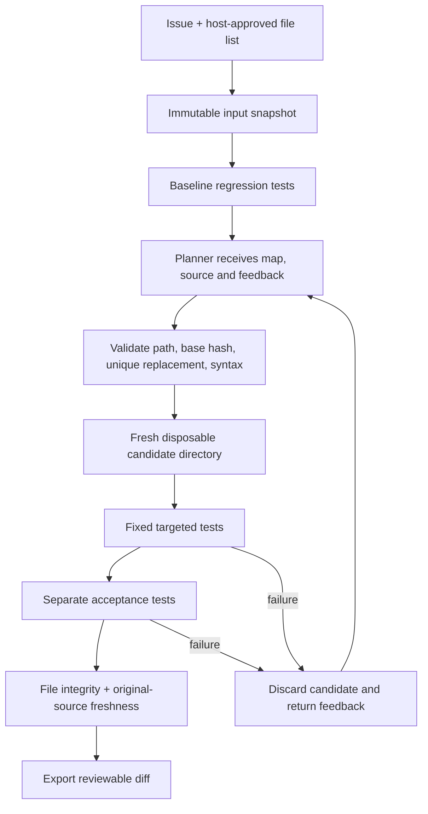

# 第 15 章：构建自主 Coding Agent

> **状态：正文初稿 v0.1，待技术审稿** · 第三篇：构建真实场景的智能 Agent  
> **本章主线**：Issue → Inspect → Propose → Validate → Edit → Test → Verify → Export Patch。  
> **实现范围**：真实 Python 文件、真实子进程测试、一次性工作副本、失败反馈、独立验收和可应用的 Unified Diff。默认 Planner 是确定性规则；另提供与第 6 章 Model 协议兼容的补丁提议适配器，但不声称已做真实 LLM 端到端评测。  
> **执行警告**：`TrustedPythonTests` 仅供可信教学代码使用。临时目录、`shell=False` 和 Python `-I` 都不是安全沙箱。未知仓库或模型生成代码必须先放进不含宿主凭证、限制网络与资源的隔离 Worker，再运行测试。

## 学习目标

本章结束时，你应能把“模型会写代码”和“系统完成了可验收的修复”区分开，设计受约束的补丁协议，真实复现一个 Bug，检查补丁基线及修改范围，在失败后从干净快照继续尝试，并输出有测试证据的补丁。

代码导航：[控制器与测试执行器](../../src/mini_agent/coding_agent.py) · [可信实验仓库与规则 Planner](../../src/mini_agent/coding_fixture.py) · [命令行实验](../../examples/ch15_coding_lab.py) · [回归测试](../../tests/test_ch15.py)。

---

## 15.1 从“找到相关代码”到“完成修复”

第 14 章建立了文件、符号和行号索引。但找到一个函数，只说明我们知道了可能的修改位置，不能说明它就是根因，更不能说明改动不会引入回归。

考虑一个具体 Issue：

> `inclusive_sum(start, stop)` 应对闭区间内的所有整数求和，包括两个端点；负数区间也应正确；起点大于终点时必须抛出 `ValueError`。

当前实现：

```python
def inclusive_sum(start: int, stop: int) -> int:
    if start > stop:
        raise ValueError("start must not exceed stop")
    return sum(range(start, stop))
```

需要建立的工程事实不是“模型说最后一行少了 `+1`”，而是：原始代码能否稳定复现错误；候选补丁是否针对正确版本；实际执行了哪些测试；测试本身有没有被改动；边界行为是否仍正确；最终补丁能否在未修改的基线上重新应用。

SWE-agent 研究了面向模型的文件导航、编辑和执行接口，说明 Agent–Computer Interface 的设计是 Coding Agent 系统的重要组成部分，而不只是给模型附加一个终端。[1] 本章先把这个接口收紧为**一个可以校验的修改提议**，把测试命令与验收权保留在控制器内。

## 15.2 三种权力必须分离

| 组件 | 拥有的职责 | 不应拥有的权力 |
| --- | --- | --- |
| Planner | 阅读受控上下文，提出候选修改 | 随意修改测试、执行 Shell、扩大可写路径 |
| Controller | 校验补丁、创建工作副本、执行固定流程 | 根据模型自报结果直接标记修复成功 |
| Verifier | 检查真实测试结果、文件完整性与验收条件 | 将有限测试通过解释为程序被完全证明正确 |

实际代码的边界如下：



图中的循环有尝试次数上限，不会无限修改。一个候选失败不会污染下一个候选的基础文件。整个流程不直接把补丁写回调用方的源目录，也不自动创建 Commit 或 Pull Request。

### 自主性究竟在哪里？

控制器决定合法执行步骤；`Planner.propose(context)` 决定具体改什么。默认实验用规则产生两个候选，目的是稳定覆盖失败恢复路径。`ModelPatchPlanner` 可以将符合第 6 章协议的模型响应转成同一种 `Edit`。替换 Planner 不应改变编辑权限、测试选择和验收条件。

因此，默认演示是**可替换决策策略的修复控制器**，不是通用模型自主解决未知 Issue 的能力证明。

## 15.3 把 Issue 转成任务契约

一个工程任务不应该只包含自然语言描述。至少还要由可信调用方提供以下边界：

| 项目 | 本章取值 | 理由 |
| --- | --- | --- |
| 可编辑文件 | `range_tools.py` | 不允许模型顺手修改其他文件 |
| 受保护文件 | 两个测试文件 | 防止直接删除断言来得到通过 |
| 原始输入版本 | 每个文件的 SHA-256 | 拒绝针对过期内容生成的补丁 |
| 回归测试 | `test_regression.py`，必须运行 4 项 | 区分实际运行与零测试假通过 |
| 验收测试 | `test_acceptance.py`，必须运行 1 项 | 检查另一组边界条件 |
| 尝试预算 | 默认最多 3 次 | 包括非法提议和失败候选 |
| 输出 | Unified Diff 与逐次测试结果 | 交付可以审查的变更，而非一句“完成” |

这不是授权服务：这些对象必须由可信应用创建。真实平台还需要绑定用户、租户、Run、仓库版本、批准的操作及有效期。

在本例中，`Snapshot` 只复制明确列出的文件。不递归复制 `.git`、`.env`、SSH 配置或其他未列入任务范围的文件。测试中专门检查了一个额外的 `.env` 文件不会进入工作副本。

## 15.4 Inspect：建立基线，而不是先改代码

### 15.4.1 Repository Map 与可编辑源文件

控制器在基线副本上调用第 14 章的 `RepositoryIndex`，生成最多 60 行的结构视图。Planner 接收到：

```python
@dataclass(frozen=True)
class RepairContext:
    issue: str
    repository_map: str
    files: tuple[tuple[str, str, str], ...]  # path, sha256, text
    feedback: str
    attempt: int
```

`files` 只包含可编辑文件。验收测试正文不进入提议 Prompt，但文件仍在测试工作区中，因此这只是上下文隔离，**不是对恶意进程保密的隐藏测试机制**。

第 14 章索引负责导航；本章的文件白名单与快照负责定义输入边界。不要让一个检索结果里的路径自动变成允许修改的路径。

### 15.4.2 先复现失败

基线运行会出现几种不同结果：

| 结果 | 控制器行为 |
| --- | --- |
| 已全部通过 | 返回 `baseline_already_passes`，不声称修复成功 |
| 断言失败、测试数量正确、没有导入错误 | 进入候选生成循环 |
| 超时、模块导入错误、零测试、跳过或测试数量异常 | 返回 `baseline_not_reproduced` |
| 测试过程修改了工作区文件 | 返回 `baseline_changed_workspace` |

不能把安装依赖失败、环境损坏或测试发现失败当作“已经复现代码 Bug”。这也是为什么基线不仅看退出码，还检查 `tests`、`failures`、`errors`、`skipped`。

## 15.5 Edit：让补丁成为可校验的数据

### 15.5.1 最小修改协议

本章不让模型发送任意 Shell 命令，也不接受它指定测试程序。它只能提交：

```python
@dataclass(frozen=True)
class Edit:
    path: str
    expected_sha256: str
    before: str
    after: str
```

例如把 `return sum(range(start, stop))` 替换为 `return sum(range(start, stop + 1))`。`expected_sha256` 必须填写快照中给出的真实哈希，不能用省略号作为实际输入。

一次候选只修改一个 Python 文件中的一个唯一文本片段。这个范围比通用 Patch 系统窄，但有利于把正确性条件讲清楚；新增文件、删除文件、重命名、二进制和多文件事务留作后续扩展。

### 15.5.2 执行前的校验顺序

1. 路径必须是规范的相对路径；拒绝绝对路径、`..`、反斜杠、驱动器样式及非规范路径。
2. 路径必须位于可信调用方指定的可编辑清单，不能改受保护测试。
3. 原文件哈希必须与提议中的哈希一致。
4. `before` 非空，且在原文件中**恰好出现一次**。
5. `before` 与 `after` 不得相同，避免空修改伪装为有效尝试。
6. 修改后的文件满足大小、UTF-8 与 LF 行尾要求。
7. `ast.parse` 必须接受候选 Python 语法。

这些检查只能证明提议符合本章的编辑契约。语法正确不等于功能正确，更不等于执行安全。

### 15.5.3 为什么不模糊匹配？

若 `before` 出现两次，控制器无法知道模型想修改哪一处。若一个修改基于旧内容，而用户已经在另一个窗口更新文件，模糊匹配可能把补丁应用到错误位置。本章选择拒绝并把原因返回给 Planner，而不是自动寻找一个“最接近”的位置。

真实的 Git 补丁系统可以处理上下文和多文件变更。Git 的 `apply --check` 只检查补丁可应用性，并不会完成测试或产生 Commit。[2] 因而“Patch 能应用”和“Issue 已解决”是两种验收。

## 15.6 Workspace：失败回滚采用丢弃，而非覆盖

本章从同一个快照建立三类目录：

```text
original source                   不写入
   ├── baseline temporary copy    复现失败后删除
   ├── candidate 1 copy           应用错误候选，测试失败后删除
   └── candidate 2 copy           应用新候选，验收后导出 Diff 并删除
```

每个候选都基于原始内容，Planner 也始终看到原始文件和上次失败反馈。第二个候选不会在第一个候选的错误上继续叠加。

这种策略简化了回滚：无需在调用方工作区执行 `git reset --hard` 或 `git clean`，也不需要恢复用户的未提交改动。代价是复制和重复测试开销；对于大型仓库，应研究快照、镜像层和受控 Git Worktree。

Git Worktree 可以为同一仓库建立多个工作树，但会共享一部分仓库元数据。[3] 它能改善开发工作区组织，**不能隔离不可信代码对宿主文件、网络和凭证的访问**。

本章的“丢弃回滚”仅针对临时副本。它不能回滚测试代码已写到副本外的文件、外部 API、数据库或网络副作用。使用真实未知仓库前，需要第 18–19 章的 OS 级隔离和权限设计。

## 15.7 Test：固定命令与真实执行结果

### 15.7.1 模型不能决定怎样验收自己

`TrustedPythonTests` 使用固定的宿主脚本调用 `unittest`，并由可信的 `TestSpec` 指定一个测试文件及其准确测试数量。它不会执行模型返回的命令字符串。

核心调用：

```python
subprocess.run(
    [sys.executable, "-I", "-B", "-S", "-c", trusted_script, test_file],
    cwd=candidate_directory,
    env=restricted_environment,
    stdin=subprocess.DEVNULL,
    stdout=log_file,
    stderr=subprocess.STDOUT,
    shell=False,
    timeout=timeout_seconds,
    check=False,
)
```

Python 官方文档说明 `subprocess.run` 可以返回子进程退出状态，接受指定的环境变量，并在超时时终止、等待直接子进程。[4] 这不等于自动治理完整进程树，也不构成运行资源沙箱。

### 15.7.2 为什么设置 `-I -B -S`？

`-I` 使用 Python 的隔离启动模式，忽略 `PYTHON*` 环境变量并调整模块搜索路径；`-B` 避免写入字节码缓存；`-S` 不执行通常的 `site` 初始化。[5] 本章先加载可信测试框架，再显式加入工作副本，使它能导入待测文件。

这些参数有助于减少启动环境干扰，但不会撤销文件系统和网络权限。清理环境变量可以避免自动继承 API Key，不能阻止恶意进程从其他可读位置寻找凭证。

### 15.7.3 零测试也可能退出 0

不能只依据 `returncode == 0` 判断成功。一个没有发现测试的 Test Suite 可能正常结束；一个全部被跳过的 Suite 也不等于完成了验收。`unittest` 的结果对象提供执行数、失败、错误和跳过记录。[6]

本章的通过条件是：

```text
not timed_out
AND process return code == 0
AND expected number of tests actually ran
AND test runner reports success
AND failures == errors == skipped == 0
```

宿主读取结构化结果及日志尾部，再形成 `TestOutcome`。缺少合法结果、输出被截断到无法读取结果或数据类型错误，都不能成为成功。

日志先写入临时文件，只把最后 6,000 字节解码后返回。这样限制了进入反馈上下文的日志大小，但**不是磁盘写入配额**；恶意无限输出仍需 Worker 层限制。

## 15.8 Verify：不仅再跑一次相同测试

### 15.8.1 分离回归测试与验收测试

本例的回归测试覆盖四个行为：普通正数区间、单元素区间、从零开始的区间、反向边界抛异常。

另一个受保护的验收文件遍历：

```python
for start in range(-4, 5):
    for stop in range(start, 5):
        expected = (start + stop) * (stop - start + 1) // 2
        self.assertEqual(inclusive_sum(start, stop), expected)
```

这里包含 **45 组区间子用例，但只有 1 个 unittest 测试方法**。日志和统计必须区分 Test Method 与 Subtest，不能宣称发现了 45 个独立测试方法。

它能识别一种过拟合修复：仅对非负区间正确，对负数区间一律返回 0。该补丁可以通过当前四项回归测试，却会在验收阶段失败。

### 15.8.2 文件完整性与测试完整性

每个测试阶段结束后，控制器重新检查临时副本中的文件集合和内容。候选预期改动以外的新增文件、删除或修改都使验证失败；测试文件被改写也不能继续导出补丁。

导出之前，还会重新核对调用方源目录中的已选文件是否仍与原始快照一致。如果另一个编辑器已经修改它们，返回 `source_changed`，保留对方变更，不用旧快照覆盖。

这些是并发冲突与常见篡改的检测机制，不是文件系统锁。校验之后仍可能发生新的修改，因此真正应用 Diff 时还要再次检查基线。

### 15.8.3 “独立”不等于“不可欺骗”

本章 Verifier 的独立性体现在：测试选择、期望数量、结果判定和文件校验由控制器控制，不相信 Planner 自报成功。

但待测 Python 与测试框架仍处于同一个子进程中。恶意代码可能伪造输出、修改内存中的测试行为、短暂篡改后恢复文件，或影响进程外环境。因此本章没有证明对恶意代码的验证器完整性。

生产架构需要独立的评测服务、受控测试资产和严格隔离。通过全部测试也只表示满足当前测试契约，不是对所有输入的形式化证明。

## 15.9 从失败到修正：有界闭环

控制器不会因为一次合法补丁失败而立刻失去全部进度。它保留 `Attempt` 记录，把错误反馈给下一个 Planner 请求：

| 结果 | 后续行为 |
| --- | --- |
| 补丁字段、路径、哈希或语法不合法 | 不执行，反馈明确原因并消耗一次尝试 |
| 回归测试失败 | 丢弃候选，将测试日志反馈给 Planner |
| 验收失败 | 丢弃候选，反馈边界条件仍未满足，不把验收正文发给 Planner |
| 工作副本完整性异常 | 停止；不将异常写入当成普通修复失败继续尝试 |
| Planner 异常 | 返回 `planner_error`，不回显任意内部异常详情 |
| 尝试上限到达 | 返回 `attempt_budget_exhausted`，不导出失败补丁 |
| 全部检查通过且源目录未变化 | 返回 `verified` 与 Diff |

默认最多 3 个候选。这是候选预算，不是总耗时或账单预算。模型调用自身的网络超时、服务端重试、Token 使用和全局 Deadline 仍需要 Gateway/Runtime 协调。

## 15.10 运行一次真正的文件修复实验

### 环境与命令

```bash
git clone https://github.com/apsaras-ai/agent-from-scratch.git
cd agent-from-scratch
python -m pip install -e .
python examples/ch15_coding_lab.py
python -m unittest discover -s tests -p 'test_ch15.py' -v
```

不需要 API Key，不下载依赖仓库，不联网搜索，不安装待修项目的包。实验仓库的源文件和测试均来自本章可信 Fixture。

### 运行结果

```text
Baseline: tests=4 failures=3
Attempt 1: targeted_tests_failed
Attempt 2: verified_on_fixture
Status: verified
Source unchanged: True
```

第一版候选把 `stop` 改成 `stop + 2`，仍然失败；第二版改成 `stop + 1`，通过回归和独立验收。第一次错误是规则 Planner 刻意注入的，用来覆盖反馈及回滚路径，不是对模型自我纠错能力的测量。

最终生成的差异包含：

```diff
-    return sum(range(start, stop))
+    return sum(range(start, stop + 1))
```

需要保存时运行：

```bash
python examples/ch15_coding_lab.py --patch-output proposed.patch
```

该参数只创建一个新补丁文件，若目标已存在则拒绝覆盖。示例源仓库位于临时目录，运行结束后会删除；导出的 Diff 只是教学产物，不是对本书源码发起的修复。

## 15.11 接入真实模型：先替换提议器，不放宽执行边界

`ModelPatchPlanner` 接收与第 6 章 `GatewayModel.complete(messages, tools)` 兼容的对象。它发送 Issue、Repository Map、可编辑文件、文件哈希与上一轮反馈，要求模型返回只有四个字段的 JSON。

```python
# gateway_model 由上层按第 6 章配置；这里只生成提议，不执行代码。
planner = ModelPatchPlanner(gateway_model)
edit = planner.propose(context)
expected_files, diff = snapshot.prepare(edit)
# 到此可以先人工审查 diff。
# 后续执行模型生成代码，必须交给真正隔离的测试 Worker。
```

适配器拒绝截断、拒绝响应、额外 Tool Calls、非 JSON、Markdown 代码围栏、重复键和额外字段。JSON 形状正确后仍需 `Snapshot.prepare` 做哈希、路径和唯一替换校验。

本章提供了使用 Fake Model 的接口集成测试，**没有使用真实付费模型完成端到端修复实验**，也不默认在宿主上执行任何外部模型返回的代码。不要直接把本地 `TrustedPythonTests` 当成生产 Runner。

### 与前面章节的实际复用关系

| 已有组件 | 本章实际使用方式 |
| --- | --- |
| 第 14 章 RepositoryIndex | 直接调用，生成输入快照的结构索引 |
| 第 6 章 Model 协议 / GatewayModel | 通过 ModelPatchPlanner 兼容；用 Fake Model 测试协议 |
| 第 10 章 Planning / Verifier 思想 | 实现本章自己的有限修复状态循环，不直接复用其模拟仓库 |
| 第 7 章 Tool Runtime | 本章采用更窄的专用编辑/测试接口，尚未注册成通用工具 |
| 第 8–9 章 Context / Memory | 后续可接入候选上下文选择，当前只传白名单内的小文件 |
| 第 11–12 章 Workflow / Durable Store | 尚未自动接入；候选历史仍为内存对象，不支持崩溃续跑 |

接口兼容、概念复用与完整集成是三件不同的事。不能因为仓库里已经存在某个模块，就宣称 Coding Agent 已具备其全部能力。

## 15.12 Git 与 Pull Request：验收之后仍需审批

当前系统只生成 Diff；不执行目标项目的 Git Commit、Push、PR 创建或 Merge。

把补丁用于一个真正项目时，建议遵循：确认干净的任务工作副本和正确基线，审查 Diff，检查可应用性，在受控环境重新测试，最后再按仓库权限创建提交和 PR。

```bash
git status --short
git apply --check proposed.patch
# 只有在基线正确、内容已审查的目标工作副本中才应用：
git apply proposed.patch
git diff --check
```

`git apply --check` 检查可应用性；`git diff --check` 不是业务测试；二者都不能授权发布。[2] 本章测试额外把生成的 Diff 应用到另一个全新 Fixture 副本，验证应用后的文件内容与候选内容一致。

将来自动创建 PR 时，还应明确目标仓库、基准分支、任务分支、提交身份、权限 Token 和 CI 状态。不要让模型自己选择发布凭证或绕过人工审批。

## 15.13 24 项测试在验证什么？

本章的控制器测试包括真实 subprocess 执行，而不只是 Mock 返回“测试成功”。覆盖范围如下：

| 类别 | 关键场景 |
| --- | --- |
| 修复闭环 | 基线失败、首次候选失败、下一候选成功、原始源文件不变 |
| 有界执行 | 用完预算不导出补丁；最后一次允许的尝试仍能成功 |
| 过拟合防护 | 回归通过但负数区间验收失败 |
| 补丁合同 | 过期哈希、绝对路径、路径穿越、受保护测试、无效语法、重复匹配 |
| 文件边界 | 父目录链接和文件链接拒绝、额外秘密文件不复制 |
| 环境完整性 | 候选改写测试被发现、外部源文件发生变化时不覆盖 |
| 执行判定 | 零测试、跳过、数量不符、超时和基线导入失败不算成功 |
| 凭证卫生 | 测试子进程不继承示例 API Key 环境变量 |
| 提议接口 | Fake Model 完成修复流程；非法或不完整响应被拒绝 |
| 补丁交付 | 有 Git 时执行 `git apply --check` 并在新副本实际应用 |

其中 Git 或符号链接能力在某些开发环境不可用时，相关测试会显式 Skip；不要把测试文件中的方法数量和每个环境实际执行数量混为一谈。

这些测试不证明生产沙箱安全，也不证明模型能够定位任意仓库的未知 Bug。

## 15.14 实验设计：从可运行 Demo 到可比较系统

本章只有一个人工设计的 Issue，不应该报告泛化修复率。准备更大的实验时，应固定任务、基线提交、依赖环境、模型标识、采样参数、预算和验证器。

可以设置四组对照：只生成补丁；生成后运行测试；测试反馈后允许修正；再增加独立验收。至少记录 Patch 可应用率、目标测试通过率、独立验收通过率、尝试次数、拒绝原因、执行耗时和单位成功任务成本。

定义成功率时，分子应来自独立验收，而不是模型完成声明：

\[
\mathrm{VerifiedSuccessRate}
=\frac{N_{\mathrm{independently\ accepted}}}{N_{\mathrm{assigned\ tasks}}}.
\]

SWE-bench 的任务形式是给定代码仓库和 Issue，生成候选补丁，再由测试评估；官方评估框架使用容器化环境以提高可复现性。[7] 本章复用了“生成补丁与评估补丁分离”的设计思想，但没有运行 SWE-bench，也没有复现任何论文分数。

## 15.15 尚未提供的生产能力

本章已经实现真实文件修改、真实测试与可审查 Diff，但仍有严格边界：只支持 UTF-8/LF、单文件单处替换；只处理显式清单内的小型 Python 项目；测试不安装依赖；没有操作系统沙箱、全局资源配额、远程 Worker、取消/恢复协议、跨文件事务、自动 PR 发布或真实模型质量评测。

特别是以下风险仍需后续章节处理：

- **代码执行风险**：测试会 import 候选代码。候选可访问当前系统权限允许的资源；快照检查是事后检测，不是隔离。
- **进程与资源风险**：当前 timeout 面向直接子进程，日志尾部裁剪不限制磁盘总写量，也没有完整 CPU、内存和进程数配额。
- **验证器风险**：模型生成代码可与测试处于同一解释器，当前结果协议不是抗恶意篡改的证明系统。
- **来源与并发风险**：路径和哈希检查不防止所有 TOCTOU 竞态；工作副本需要独占，最终应用仍应核对仓库基线。
- **外部副作用风险**：删除临时目录不能撤销网络、数据库或副本外文件操作。

`verified` 在这里准确表示“这个候选通过了本章可信 Fixture 的测试契约”，不是“任何生产项目都可以安全合并”。

## 15.16 习题与进一步实现

**15.1** 把单处替换扩展为多个 Edit，要求全部预校验通过后才写入，失败时不能出现半应用状态。

**15.2** 支持从指定 Git Commit 建立工作副本，把 `base_commit` 和每个修改文件哈希一起记录进结果，讨论快照版本不一致的后果。

**15.3** 加入独立的隔离 Worker：只挂载候选代码和受保护测试，清理凭证，限制网络、CPU、内存、磁盘和进程树。不要把 `cwd` 当成文件系统隔离。

**15.4** 设计防止修改测试、删除断言或伪造测试输出的验证服务。说明客户端结构化 JSON 校验和验证器可信度之间的区别。

**15.5** 将每个 Attempt 的输入哈希、补丁哈希、模型来源、工具耗时、日志引用和验收结果接入第 5、12 章，分析崩溃后应重跑哪些测试、哪些外部动作不能盲目重试。

**15.6** 使用一个真实模型只生成候选 Diff，经人工审查和隔离执行后，与规则基线比较；报告失败样例，不要仅展示成功修复。

**15.7** 增加跨语言项目，例如 Java 编译测试或 Rust 单元测试。定义可信构建命令和依赖准备，不接受模型随意生成安装脚本。

**15.8** 扩展为任务分支和 PR 产物：要求已授权仓库、明确分支、独立 CI 和审查，不自动 Merge。

## 15.17 本章总结

Coding Agent 的工程价值来自可追溯的闭环，而不只是补丁文本。首先复现问题，再基于明确快照提出受约束的改动；每个候选在新的工作副本中测试；失败反馈驱动下一次尝试，独立验收及完整性检查决定能否导出补丁。模型提议、实际执行和验收权必须分开。

**下一章**：[第 16 章《Browser Agent 与 Computer Use》](16.md)，将把类似的观察—动作—验证机制扩展到页面状态、DOM、截图及界面操作。

---

## 参考资料

[1] Yang et al. *SWE-agent: Agent-Computer Interfaces Enable Automated Software Engineering*. 2024. https://arxiv.org/abs/2405.15793

[2] Git. *git-apply Documentation*. https://git-scm.com/docs/git-apply

[3] Git. *git-worktree Documentation*. https://git-scm.com/docs/git-worktree

[4] Python. *subprocess — Subprocess management*. https://docs.python.org/3/library/subprocess.html

[5] Python 3.11. *Command line and environment*. https://docs.python.org/3.11/using/cmdline.html

[6] Python 3.11. *unittest — Unit testing framework*. https://docs.python.org/3.11/library/unittest.html

[7] SWE-bench. *Evaluation Guide*. https://www.swebench.com/SWE-bench/guides/evaluation/

> **复现范围**：本章默认实验使用原创可信 Fixture 和规则 Planner；真实文件与子进程测试确实发生，但没有付费模型调用、未知代码执行、在线 PR 操作或生产安全保证。API 与外部工具能力以各自版本文档和实测为准。
