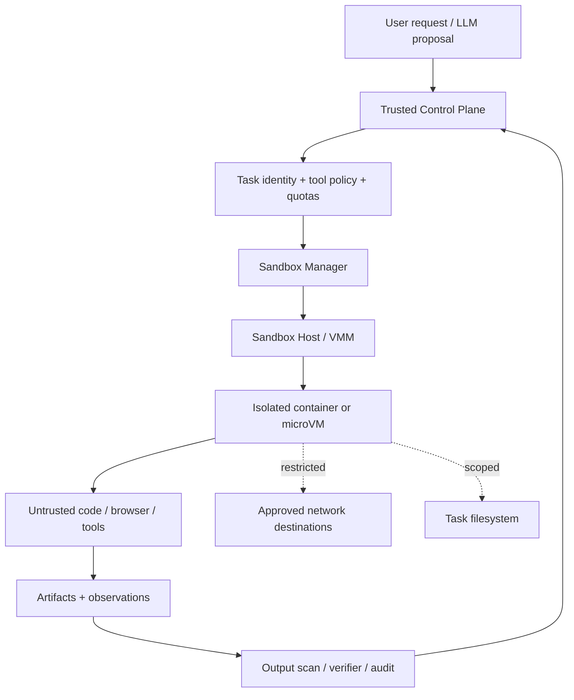
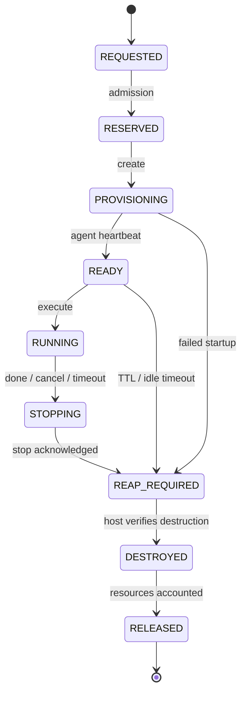
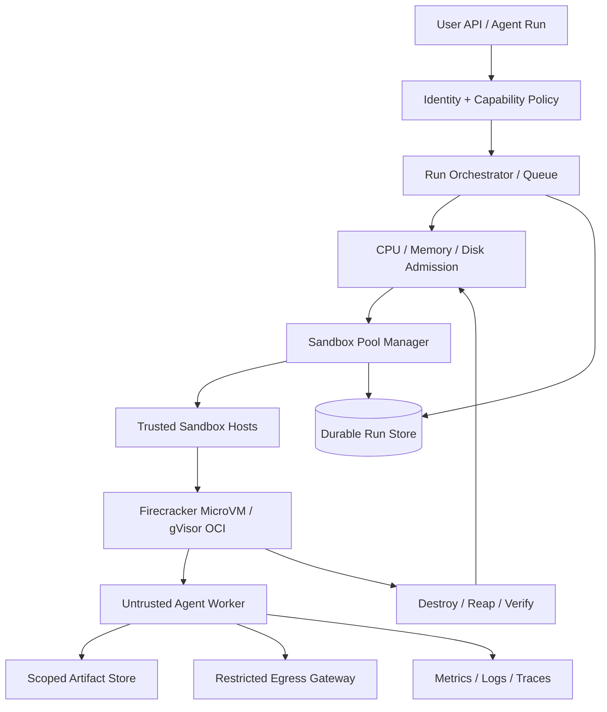

# 第 18 章：Agent Sandbox 与执行环境

> **状态：正文初稿 v0.1（待技术审稿）** · 第四篇：生产级 Agent Runtime 与 Infrastructure  
> **目标读者**：准备在云端运行 Coding Agent、Browser Agent、Research Agent 或用户生成工具代码的软件工程师与 AI Infra 工程师。  
> **教学实验**：Python 3.11+、Linux 主机、标准库；不需要 root、Docker、KVM、付费模型或访问外网。实验使用**宿主进程级资源限制器**和受信任的 Fixture，严格不把它当成可以运行恶意代码的安全沙箱。  
> **真实安全边界**：Namespace、cgroup、seccomp、容器、gVisor 或 MicroVM 的部署及安全配置由受信任的运行平台负责；本章不在 GitHub Actions 里启动 Firecracker 或声称完成正式隔离安全认证。

此前我们构建了 Agent Kernel、Tool Runtime、长期记忆、代码修改、浏览器交互和 Multi-Agent 编排。但代码能运行与代码**能够安全地运行**是两件不同的事。

如果 Agent 在云端替用户执行生成的 Python、Shell、NPM 安装、单元测试甚至浏览器自动化，执行内容可能是不可信的。即使模型没有恶意，它也可能：

- 读取本不属于当前任务的文件；
- 意外删除工作区；
- 运行无限循环或产生大量子进程；
- 使用过多 CPU、内存、磁盘、网络；
- 下载并执行存在漏洞的第三方包；
- 尝试获取宿主云平台凭证；
- 因用户 A 的工作区或环境残留泄露用户 B 的数据；
- 通过同机内核漏洞或错误挂载逃出隔离边界。

因此，真实 Agent Runtime 至少同时面对三个问题：

1. **安全隔离**：工作负载能看见、调用、影响什么？
2. **资源治理**：CPU、内存、进程、磁盘、I/O、网络的上限是什么？
3. **生命周期管理**：如何创建、就绪、执行、取消、销毁、回收、审计和调度？

本章从系统原理解释这些机制，并实现一个可测量的执行生命周期基础层。

---

## 18.1 先定义威胁模型（Threat Model）

### 18.1.1 信任边界



可信控制平面至少应持有：

- 租户和用户身份；
- 任务与 Run ID；
- 允许的工具、镜像、网络、存储权限；
- 可审计的授权和资源预算；
- 任务的终止及清理权。

工作负载被视作**不可信代码与数据**。它不应自动获得宿主的 Docker Socket、云凭证、Kubernetes ServiceAccount Token、宿主文件系统或调用其他租户工作区的能力。

### 18.1.2 隔离要保护谁？

| 保护对象 | 威胁示例 | 需要的控制 |
| --- | --- | --- |
| Host / Kernel | Sandbox Escape、系统调用攻击 | 内核加固、Seccomp、gVisor 或 VM 边界 |
| 其他租户 | 跨租户文件/内存/请求访问 | 进程/文件/网络隔离和身份授权 |
| 工作区 | 不允许的文件覆盖、持久化污染 | 独立根文件系统、只读基础镜像、临时可写层 |
| 平台凭证 | 读取环境变量、Metadata Service | 不注入高权限密钥、网络过滤、短期凭证 |
| 可用性 | Fork Bomb、OOM、无限输出 | cgroup CPU/Memory/PIDs/IO、限时销毁 |
| 平台成本 | 无限循环/滥用 API | 资源预留、配额、限价、到期销毁 |
| 审计完整性 | Worker 自称已销毁、结果被篡改 | Control Plane 独立确认与不可变事件 |

**一个 Sandbox 不是一种技术名称，而是一组以威胁模型为依据的可验证安全属性。**

## 18.2 进程、容器、gVisor 和 MicroVM 的隔离层级

### 18.2.1 不同运行形态到底隔离了什么？

| 形态 | 与宿主共享内核 | 核心隔离手段 | 适合的情境 | 主要边界与风险 |
| --- | --- | --- | --- | --- |
| 普通子进程 | 是 | UID、进程组、RLimit 等 | 可信离线测试 | **不是安全沙箱**；同 UID 代码可能访问宿主 |
| Hardened OCI 容器 | 是 | Namespaces、cgroups、Capabilities、Seccomp、Mounts | 有明确风险评估的容器任务 | 宿主 Linux 内核仍面向不可信系统调用 |
| Rootless 容器 | 是 | User Namespace + 无特权 Daemon/Runtime | 减少 rootful Daemon 风险 | 并非自动实现所有隔离属性 |
| gVisor / `runsc` | 主要仍在宿主上运行用户态应用内核 | Sentry、Gofer、平台拦截机制 | 需要增加系统调用隔离层的 OCI 工作负载 | 兼容性、平台差异、资源/系统调用额外开销 |
| MicroVM / Firecracker | 使用独立 Guest Kernel | KVM + VMM + Jailer + 宿主硬化 | 多租户不可信代码、隔离优先的任务 | 启动和内存开销、网络/磁盘管理、宿主 KVM 安全 |

这些形态不是“只选一个就足够安全”。真实系统通常采用多层 Defense in Depth。例如在 Firecracker MicroVM 之外仍使用 Jailer、cgroup、Seccomp、最小 Guest Image、网络策略和独立的 Credential Broker。

### 18.2.2 普通进程为什么不能直接执行未知 Python？

即使：

```python
subprocess.run(
    [sys.executable, "untrusted.py"],
    timeout=10,
)
```

看似有超时，实际代码可能在超时前读取用户主目录、发网络请求、写入宿主目录、复制秘钥，甚至自行创建脱离父进程组的新会话。

`timeout` 控制的是等待期限，不是文件、网络或内核权限。`cwd` 设在临时目录也不代表程序只能访问临时目录。

**本章 Process Executor 只用于 Host 审批过的 Fixture。第 15 章的代码修改代理如需执行未知用户代码，必须转移到真正隔离的 Sandbox Worker。**

## 18.3 Linux Namespace：隔离资源视图

Linux Namespace 将部分全局资源抽象成进程各自的隔离视图（见官方 `namespaces(7)`）。其中主要类型包括：[1][2]

| Namespace | 隔离的资源 | Agent Runtime 用途 |
| --- | --- | --- |
| User | UID/GID、Capability 语境 | 将 Guest Root 映射为宿主非特权身份 |
| PID | 进程 ID 空间 | 避免看到宿主/其他租户的 PID；控制 PID 1 语义 |
| Mount | 挂载视图 | 独立 RootFS、只读镜像与临时卷 |
| Network | 网络协议栈 | 仅允许审查过的网络、路由、端口 |
| IPC | 部分进程间通信资源 | 限制跨工作负载 IPC 可见性 |
| UTS | 主机名等标识 | 提供独立主机名 |
| Cgroup | Cgroup 视图 | 与实际资源委派一起管理工作负载 |
| Time | 特定时钟视图 | 有针对性的时间隔离场景 |

### 18.3.1 User Namespace 的细节

在一个 User Namespace 内，进程可以表现为 UID 0，但在宿主对应普通的非特权 UID。它的 Capability 权限受所属 User Namespace 范围限制，而不是自动拥有宿主初始 User Namespace 的 Root 权力。[2]

不过，**User Namespace 也增加了某些内核接口的可达性**。仍应遵循发行版和集群运营者的安全策略，不能凭“启用了 Rootless”就假设不存在宿主内核攻击面。

### 18.3.2 Mount Namespace 不是文件访问限制的全部

Mount Namespace 分离挂载视图，但还需要实际准备 RootFS：

- 最小只读基础镜像；
- 任务独立的可写层；
- 仅挂载获得授权的目录；
- 不挂宿主 `/` 或私有凭证；
- 避免危险的特权 Bind Mount；
- 必要时使用 `pivot_root` 等切换到合适的根目录；
- 清理卷、挂载、临时镜像与所有 Lease。

只执行 `chroot` 或设置 `cwd` 并不能构成完整安全边界。

### 18.3.3 PID Namespace 与孤儿进程

一个有独立 PID Namespace 的容器，通常需要其 PID 1 管理信号和孤儿进程回收。单纯杀死业务主进程不一定意味着所有子进程都已停止。对于短任务 Agent，最好通过专门的 Init/Reaper 或 VM 生命周期管理保证所有子进程都终止。

本章普通进程实验使用 `setsid` 创建进程组，然后调用 `killpg`。它能终止同一进程组中的子进程，却不能证明阻止进程创建新 Session，也不能替代 PID Namespace 或 VM销毁。

## 18.4 cgroup v2：隔离以外的资源控制

Namespace 更多管理“资源视图”；cgroup 管理“资源使用与配额”。Linux Kernel 的 cgroup v2 文档明确将其定义为层次化组织进程并分配系统资源的机制。[3]

### 18.4.1 CPU

`cpu.max` 是一个配额/周期接口：

```text
$MAX $PERIOD
```

例如：

```text
50000 100000
```

表示每个 100000 微秒周期内可使用最多 50000 微秒 CPU 时间，近似等效于 0.5 个 CPU 的平均计算配额。它不等于绑定到某颗指定 CPU，也不能保证无噪声邻居或固定延迟。

`cpu.weight` 则影响竞争时的相对权重。`cpuset` 进一步用于 CPU/NUMA 绑定。[3]

### 18.4.2 内存

`memory.max` 是 cgroup 的主要硬限制，无法回收内存时可能在该 cgroup 内触发 OOM Killer。`memory.high` 是回收/节流压力边界，通常不直接触发 OOM Kill。[3]

为什么不能只使用 Python `RLIMIT_AS`？

- RLIMIT_AS 约束**单个进程的虚拟地址空间**；
- cgroup Memory 统计的是该组工作负载及其子树的实际内存使用类别；
- 一个进程可以有很大的虚拟映射，却不一定占用等量物理内存；
- 子进程分别受 RLimit 并不等于整个任务的总内存被限制。

因此，**RLIMIT_AS 不是 Memory cgroup 的替代品**，本章的进程实验也不会将其描述成有效防御恶意内存攻击的生产机制。

### 18.4.3 PIDs

`pids.max` 控制一个 cgroup 可创建的任务数量。它对于防止 Fork Bomb 在耗尽主机其他资源前造成灾难很重要。[3]

单个进程的 `RLIMIT_NOFILE` 控制打开文件描述符的数量，不会限制进程树的数量。仅凭子进程退出码或最大运行时间也不等于实现 PID Quota。

### 18.4.4 I/O 与磁盘

有了 Memory Limit 仍需考虑磁盘爆满。运行日志、Package Cache、Code Checkout、Browser Profile 和模型生成文件都可能快速增长。

应设计：

- 文件系统级的写入层容量或配额；
- `io.max` 等 I/O 控制（取决于宿主和设备支持）；
- 临时文件生命周期与对大文件的分段输出；
- 独立 Artifact Store 而非无限本地日志；
- RootFS/Image Cache 的配额和垃圾回收。

### 18.4.5 cgroup 本身不是安全隔离

即使有完善的 CPU/Memory/PIDs 限额，工作负载也可能从同一宿主的正常权限访问敏感文件或网络。因此**Quota、Auth、Isolation** 必须分别设计和验证。

## 18.5 Seccomp、Capabilities 与网络限制

### 18.5.1 Seccomp

Seccomp-BPF 可限制可执行的系统调用及部分参数形态。容器运行时通常通过配置默认过滤器减少宿主系统调用攻击面；对 Firecracker 进程，官方同样强调保守的 Seccomp 过滤器。[4]

但 Seccomp 不是语义文件系统，也不能单独限制一个允许的 `openat` 能打开哪些数据。它需要与 Mount Namespace、最小 Linux Capabilities、用户身份、只读文件系统和实际网络隔离共同使用。

### 18.5.2 No New Privileges 与 Linux Capabilities

生产配置应尽可能：

- 使用非 root UID；
- 只保留必要的 Capability，通常 Drop All 再有选择地允许；
- 开启 `no_new_privs`，避免通过 Exec 获得额外特权；
- 不使用 `--privileged`；
- 不传入 Docker Socket、Host PID/Network/Mount；
- 设置只读根文件系统与单独的任务卷。

这些约束需要在**真实运行平台的 API** 中配置，而不是由模型 Prompt 承诺“不会做危险操作”。

### 18.5.3 网络 Egress

即使文件隔离正确，只要工作负载能访问内部网与云平台 Metadata Service，就仍然可能读取秘密或扫描内网服务。生产应采用 Deny-by-Default：

```text
Guest workload
    → egress proxy / NAT policy
    → allowlisted destinations
    → rate limit, timeouts, audit
```

应该考虑 DNS Rebinding、重定向、重试、IP/域名变更、Private IP、IPv6 与 Host Proxy 配置。Browser Agent 还可能发起页面脚本隐式请求，因此仅在调用 `navigate(url)` 前验证 URL 不够。

**本章 Process Executor 没有网络隔离**，即使清空了环境变量，也不能保证工作负载无法访问机器上的 Metadata Service。

## 18.6 容器、gVisor、Firecracker 的工程区别

### 18.6.1 OCI 容器

OCI Runtime 将镜像、RootFS、Namespace、cgroup、安全配置和进程生命周期装配起来。通常适合与 Docker/Containerd/Kubernetes 结合的工作负载。

容器的冷启动、资源开销和兼容性取决于镜像大小、存储驱动、宿主内核、运行时以及 Kubernetes/网络/存储栈，不宜不经实测给出固定启动毫秒数。

### 18.6.2 Rootless Docker

Docker 官方说明 Rootless Mode 让 Daemon 与容器都在 User Namespace 下以非 Root 用户运行，其安全目的主要是降低 Daemon/运行时特权风险。[5]

Rootless 并不是“宿主没有 Root 进程、所有安全问题就消失”。实际还要验证 Namespace 配置、磁盘挂载、UID 映射、网络策略和内核版本。

### 18.6.3 gVisor

gVisor 的 `runsc` 是 OCI Runtime。其架构主要由：

- **Sentry**：用户态 Application Kernel，处理 Linux 风格系统调用和内部内核逻辑；
- **Gofer**：帮助访问外部文件系统资源；
- **Platform**：负责将应用系统调用转交给 Sentry 的机制；

组成。[6]

`systrap` 使用 Seccomp Trap/SIGSYS 路径，KVM Platform 利用 KVM 来优化特定场景下的 Address Space Switch；部署平台和 Guest 兼容性会影响性能表现。[6][7]

gVisor 能为许多 OCI 兼容任务引入比直接共享宿主内核系统调用更严格的隔离层，但它不是提供完整独立 Guest Kernel 的普通 MicroVM。是否适合你的特定语言运行时、浏览器或 GPU 需求，需要兼容性与性能测试。

### 18.6.4 Firecracker MicroVM

Firecracker 使用 Linux KVM 提供硬件虚拟化基础，并运行精简虚拟设备的 MicroVM。与共享 Host Kernel 的进程/容器不同，Guest 有自己的内核。

然而，“Firecracker = 安全”仍然不充分。官方的 Production Host Setup 明确建议在生产场景配合使用：

- **Jailer**：限制 Firecracker VMM 进程的文件系统/身份/Namespace/cgroup；
- 严格 Seccomp 配置；
- 非特权 UID/GID；
- 受保护的 Jailer Path、RootFS 和可执行文件；
- 定期修复宿主内核、Guest 内核和 Host Microcode。[4]

Firecracker MicroVM 的生命周期管理需要控制其 API Socket、Kernel/RootFS、网络 TAP、Block Device、Vsock、启动状态以及销毁。VMM API Socket 不是一个可以直接暴露给不可信模型的公共工具。

### 18.6.5 选择策略

| 工作负载 | 可以优先评估 | 仍需特别验证 |
| --- | --- | --- |
| 可信内部离线实验 | Process Executor | 用户输入、文件/网络权限 |
| 低风险、经过审查的容器任务 | Hardened Rootless OCI | 宿主内核攻击面、RootFS、网络 |
| 未知依赖的多租户 Python/Node 工具 | gVisor 或 MicroVM | 兼容性、Cold Start、隔离配置 |
| 高风险用户生成代码 | Firecracker/Kata 类强隔离 Worker | KVM、Jailer、Network Policy、Secrets |
| 真实 Chromium / Browser Agent | OCI+gVisor 或合适的 VM 环境 | Chrome 兼容性、Syscalls、Browser Profile、Network |
| GPU/复杂系统软件 | 宿主支持的隔离 Runtime | GPU 直通、Driver 攻击面、设备权限 |

表格是**工程评估起点**，不是不经风险分析就可套用的安全评级。

## 18.7 Sandbox Lifecycle：从创建到销毁

生产 Agent Runtime 的生命周期应显式化：



### 18.7.1 为什么 `RUNNING` 到 `DESTROYED` 不是直接跳转？

工作负载终止可能涉及：

- 业务进程退出；
- 子进程和进程组被回收；
- Namespace / cgroup 的任务真正结束；
- VM 进程终止；
- TAP / Vsock / Runtime Socket 清理；
- 文件卷卸载；
- 临时凭证撤销；
- Artifact 写入可信存储；
- 日志、指标和任务结果持久化。

因此“发送 Kill 请求成功”不等于“执行环境已经彻底消失”。

### 18.7.2 TTL 是租约，不是操作系统强制执行

设置 `ttl_seconds=1200` 只是声明沙箱最多应该使用 20 分钟。仅把数据库字段 `expires_at` 改成过去时间，不会自动销毁 VM。

正确顺序是：

```text
Lease expires
  ↓
Scheduler marks REAP_REQUIRED
  ↓
Runtime sends terminate/destroy
  ↓
Host confirms VM gone, network detached, storage reclaimed
  ↓
Accounting releases reserved resources
```

**绝不能因为 TTL 到期就立即把仍占用资源的 VM 从容量账本里删掉**，否则新任务可能过度预留资源导致 OOM 和过载。

## 18.8 Sandbox Capacity Planning

### 18.8.1 基本容量模型

定义：

- `C_h`：Node 可用 CPU（Millicores）；
- `M_h`：可用于 Sandbox 的内存；
- `D_h`：可用于 Sandbox 的临时磁盘；
- `c_s`：单个 Sandbox 的 CPU 预留；
- `m_g`：Guest 业务内存；
- `m_o`：VMM/Runtime/Host Overhead；
- `d_s`：单 Sandbox 的 Workspace Disk。

在不考虑超配的保守模型下：

\[
N_{\mathrm{capacity}}
\le
\min\left(
\left\lfloor\frac{C_h}{c_s}\right\rfloor,\,
\left\lfloor\frac{M_h}{m_g+m_o}\right\rfloor,\,
\left\lfloor\frac{D_h}{d_s}\right\rfloor
\right).
\]

需要强调：这只是**预留容量的算术上界**，没有考虑系统突发、Page Cache、镜像缓存、NUMA、cgroup 使用、网络带宽或 Snapshot 恢复所需的额外存储。

### 18.8.2 计算示例

假设某 Node 有 8 个可用 CPU、32 GiB 内存，宿主预留 2 GiB，因此沙箱可用内存 30 GiB；临时盘可用 100 GiB。

每个沙箱预算：

```text
CPU reservation               1,000 millicores
Guest memory                    512 MiB
VMM + system memory overhead    128 MiB
Workspace disk                    1 GiB
---------------------------------------
Total memory reservation        640 MiB
```

则：

\[
N_{\mathrm{CPU}}=8,\quad
N_{\mathrm{Memory}}=\lfloor 30720/640\rfloor=48,\quad
N_{\mathrm{Disk}}=100.
\]

按保守预留策略，上界是 `min(8,48,100)=8` 个实例，当前示例由 CPU 限制。

这是教学算例，不能当作 Firecracker、gVisor 或任意云机器在真实任务上的实测容量。具体部署还要使用真实 workload profiling 和 Overcommit/Admission 策略。

### 18.8.3 Oversubscription

对多数时刻等待 LLM 的 Agent，实际 CPU 使用可能远低于其峰值。如果所有任务均满配 CPU 预留，会导致 Node 利用率低。

你可以尝试将 CPU 配额与资源预留分开，允许一定超卖；但必须知道 CPU Throttling、Memory OOM、响应尾延迟、节点突发负载和“多个 Worker 同时执行测试”的负载相关性。

特别注意**CPU 可以相对灵活地进行共享调度，Memory 超配更容易造成不可恢复的 OOM**。不要仅用平均 CPU 利用率决定 Memory Pool 大小。

## 18.9 Warm Pool、Snapshot 与冷启动

### 18.9.1 启动延迟的分解

对一次全新环境：

\[
T_{\mathrm{ready}} =
T_{\mathrm{admission}}+
T_{\mathrm{image/rootfs}}+
T_{\mathrm{runtime\ init}}+
T_{\mathrm{boot}}+
T_{\mathrm{healthcheck}}.
\]

对已经预热的环境，可省去部分启动工作，但要持续支付 Idle Resource Cost。

基于 Pool 的预计可用时间约为：

\[
E[T_{\mathrm{acquire}}]
\approx
p_{\mathrm{warm}}T_{\mathrm{warm}}
+(1-p_{\mathrm{warm}})T_{\mathrm{cold}}.
\]

这里 `p_warm` 是命中预热实例的概率。该估算忽略排队和负载相关性的复杂影响，用于说明工作原理，而不是严格性能预测。

### 18.9.2 Firecracker Snapshot 不是“免费的预热”

Firecracker 支持保存和加载 MicroVM 内存与设备状态。官方 Snapshot 文档说明 Full Snapshot 包括 Guest Memory、VM State，以及由用户负责管理的 Block Disk，并采用按需映射/Copy-on-Write 等机制来优化恢复。[8]

需要特别注意：

- Snapshot 文件含有 Guest Memory，可能包含 Secret 或用户数据；
- 从相同 Snapshot 恢复多个克隆，可能复制随机状态、令牌或设备标识；
- 网络连接和 Vsock 不能简单假设无损延续；
- CPU 模型、内核与设备版本的兼容性需要被明确验证；
- Snapshot 的真实大小、恢复成本、磁盘生命周期必须计费和清理。

**不要在保存了用户登录态、租户密钥或会话 Token 之后，将该 Snapshot 作为多个租户共享的通用预热镜像。**

### 18.9.3 预热池的 Tenant Boundary

可考虑：

- 只在不含租户数据的“干净模板”状态共享基础 Snapshot；
- 单租户专用 Warm Pool；
- 恢复后重新生成身份与随机材料；
- 租户专用可写层和独立凭证；
- 对取回的 Pool Item 执行 Cleanliness / Health Check；
- Idle TTL 到期后重新创建或清理，不无限延寿。

一旦使用真正的用户会话浏览器或者未知代码，跨 Tenant 复用运行环境尤其要谨慎。

## 18.10 本章代码：Trusted Process Executor

本章包含两个互相独立的实验组件：

1. [`process_executor.py`](../../src/mini_agent/process_executor.py)：实际运行可信 Python Fixture，观察 Host 子进程的资源约束与回收；
2. [`sandbox_reservations.py`](../../src/mini_agent/sandbox_reservations.py)：在内存中模拟 Sandbox 资源预留、过期与清理确认。

我们故意**没有**将它们称作可执行不可信代码的安全沙箱。

### 18.10.1 Executor 的公开接口

```python
catalog = TrustedScriptCatalog({
    "fixture": path_to_approved_fixture,
})
runner = TrustedProcessExecutor(catalog)

result = runner.run(
    ProcessRequest("job-1", "fixture", ("report",)),
    ProcessLimits(
        wall_seconds=2.0,
        cpu_seconds=2,
        memory_mb=256,
        max_file_bytes=1_048_576,
        max_output_bytes=4096,
        max_open_files=64,
    ),
)
```

与直接 `subprocess.run(...)` 相比，教学实现显式提供：

- Host 维护的脚本白名单，模型只可以选择已批准的 `script_id`；
- 将固定脚本字节复制到本次专用的临时 Workspace；
- 不经过 Shell 解析的参数数组；
- 新进程 Session + 独立 Process Group；
- 最小化的子进程环境变量；
- 在受信任的子进程引导器内设置 Linux RLIMIT；
- 使用 Selector 同时读取 stdout/stderr，并限制总输出字节；
- 单调时钟 Wall Deadline；
- 结束后 Kill 同组残留进程，等待子进程退出，回收临时工作目录；
- 显式返回状态、退出码、耗时、输出字节和 Lifecycle 事件。

代码结果中 `execution_boundary` 固定声明为：

```text
host_process_rlimits_NOT_A_SANDBOX
```

避免后续章节或使用者误把实验名当成已实现的隔离安全性质。

### 18.10.2 子进程 RLIMIT

在执行可信 Fixture 之前，辅助程序 [`_resource_child.py`](../../src/mini_agent/_resource_child.py) 设置：

```python
resource.setrlimit(resource.RLIMIT_CPU, (cpu, cpu + 1))
resource.setrlimit(resource.RLIMIT_AS, (address_bytes, address_bytes))
resource.setrlimit(resource.RLIMIT_FSIZE, (fsize, fsize))
resource.setrlimit(resource.RLIMIT_NOFILE, (nofiles, nofiles))
```

并通过 `os.execv` 启动 Python Fixture。启动参数使用 `python -I -S`，减少对用户级 Python 环境和 Site 的依赖。

为什么不用在主进程中直接设置 `preexec_fn`？在多线程 Python 应用中，`preexec_fn` 的行为具有特定的死锁风险。我们把设置 RLimit 的逻辑放入专门的 Python Bootstrap 子进程。这个方案同样只是教学组件，不会防止 Same-UID、Detached Process 或 Host Network 攻击。

### 18.10.3 为什么要读 stdout/stderr 的上限？

若子进程执行：

```python
while True:
    print("log message " * 10000)
```

即使设置了 10 秒 Deadline，单纯调用 `communicate()` 也可能积累很大的内存输出。本章使用 `selectors` 和 `os.read`，累积的 stdout/stderr 总量超过指定字节数后停止并终止进程组。

这只能限制**父进程捕获的输出大小**，不能限制应用在磁盘或网络中产生的全部数据。生产仍应配合 cgroup、磁盘配额、日志服务限流以及 VM 级销毁。

### 18.10.4 超时为什么使用 Process Group？

`Popen.terminate()` 通常只能针对主进程。如果它有子进程，主进程退出并不等于所有工具操作完成。

`start_new_session=True` 建立新 Session/Process Group；`os.killpg` 尝试终止同组进程。但进程可以自行调用 `setsid` 脱离 Group，因此**这不是可防御恶意代码的进程树清理机制**。

对于真正不可信代码，必须在容器/VM/Cgroup 级管理完整工作负载生命周期，并由 Host 确认已销毁。

## 18.11 Sandbox Admission 与资源租约

实验中的 [`ReservationController`](../../src/mini_agent/sandbox_reservations.py) 是一个**纯内存容量规划器**。它不创建容器、进程、cgroup 或 MicroVM。

输入示例：

```python
capacity = HostCapacity(
    cpu_millis=2000,
    memory_mb=2048,
    disk_mb=2048,
)
allocation = SandboxAllocation(
    cpu_millis=1000,
    guest_memory_mb=512,
    runtime_overhead_mb=128,
    workspace_disk_mb=512,
    ttl_seconds=20,
)
```

Reservation 使用：

```python
controller.reserve("run-1", "tenant-1", allocation)
controller.mark_running("run-1")
controller.scan_expired()  # expired → reap_required
controller.confirm_destroyed("run-1", cleanup_confirmed=True)
```

### 18.11.1 为什么把 Guest Memory 与 VMM Overhead 分开？

实际使用资源通常不仅来自 Guest：

- MicroVM 设备和 VMM 元数据；
- Guest Kernel；
- 网络组件；
-宿主 Page Cache 与映射；
- Logging / Metrics / IO；
- 可选 Browser、模型工具和 Package Cache。

我们的教学计算为：

\[
M_{\mathrm{reserve}} =
M_{\mathrm{guest}} + M_{\mathrm{runtime\ overhead}}.
\]

真正容量规划应该通过压测校正每个项目，并考虑峰值 Memory，而不只是静态猜测。

### 18.11.2 Expiration 不释放资源

本章刻意实现：

```text
reserve → running → reap_required → destroyed
```

`scan_expired()` **只标记**需要销毁，不会释放 Used Capacity。

只有可信控制平面确认实际清理后，才调用 `confirm_destroyed(...,cleanup_confirmed=True)`。本示例无法核验这个布尔值是否真的对应 VM 销毁，因此它仍需要生产版执行器与一致性日志协作。

### 18.11.3 为什么状态要留有 Run ID？

不同租户可能同时申请沙箱，必须能够关联：

```text
tenant_id
   └── run_id
       └── sandbox_id / generation
           ├── allocated CPU/Memory/Disk
           ├── lifecycle status
           ├── lease expiry
           └── host / isolation backend
```

同一个 Run ID 应避免意外重复占用资源。真正的多主调度还需要数据库 CAS、Worker Lease 和 Host Heartbeat，不能直接把本章 Python Dictionary 放到多个 Pod 上。

## 18.12 只读诊断：如何确认主机使用了什么隔离机制？

新增 [`sandbox_diagnostics.py`](../../src/mini_agent/sandbox_diagnostics.py) 只读取：

```text
/proc/self/ns/{user,pid,mnt,net,ipc,uts,cgroup}
/sys/fs/cgroup/{cgroup.controllers,cpu.max,memory.max,pids.max,...}
```

它能显示当前进程看到的 Namespace 标识与 cgroup 文件配置，帮助理解 Linux 运行环境。

**读到一个 Namespace ID 不等于证明“这个任务已经与宿主安全隔离”。** 验证需要比较预期、实际 Namespace Membership、RootFS、Capabilities、Seccomp、网络 Egress、cgroup Attachment 和 Host Resource Usage。

不同 CI / 云主机可能禁用 User Namespace、没有 `/dev/kvm` 或限制 cgroup 文件写入。因此本章自动测试不尝试在共享 Runner 上创建或修改这些系统资源。

## 18.13 运行离线实验

主要文件：

| 文件 | 职责 |
| --- | --- |
| [`src/mini_agent/process_executor.py`](../../src/mini_agent/process_executor.py) | Linux Host Process Runner，输出边界和临时工作区 |
| [`src/mini_agent/_resource_child.py`](../../src/mini_agent/_resource_child.py) | 执行前设置 POSIX Resource Limit 的可信 Bootstrap |
| [`src/mini_agent/sandbox_reservations.py`](../../src/mini_agent/sandbox_reservations.py) | CPU/Memory/Disk Admission、TTL 和销毁确认 |
| [`src/mini_agent/sandbox_diagnostics.py`](../../src/mini_agent/sandbox_diagnostics.py) | 只读 Namespace / cgroup 诊断 |
| [`examples/ch18_trusted_worker.py`](../../examples/ch18_trusted_worker.py) | 主机批准的合成 Fixture，不接受任意代码 |
| [`examples/ch18_sandbox_lab.py`](../../examples/ch18_sandbox_lab.py) | 运行演示、超时、输出限制和资源租约 |
| [`tests/test_ch18.py`](../../tests/test_ch18.py) | 安全输入、资源限制、回收与生命周期单元测试 |

### 18.13.1 准备

```bash
git clone https://github.com/apsaras-ai/agent-from-scratch.git
cd agent-from-scratch

python -m pip install -e .
python examples/ch18_sandbox_lab.py
python -m unittest discover -s tests -p 'test_ch18.py' -v
```

实验在 Linux 上运行；其他系统会跳过 Linux 专属的进程 RLIMIT 测试。无需 Docker、root、Firecracker，也不运行任何外部服务。

### 18.13.2 正常执行

Fixture 向 stdout 输出当前：

- Job ID；
- HOME、CWD；
- CPU Soft Limit；
- Address Space Limit；
- 最大文件大小；
-最大文件描述符数量；
- 外层测试设置的私有变量是否存在。

父进程检查输出数据，确认高权限环境变量没有进入子进程、工作目录已销毁。

### 18.13.3 超时实验

```text
mode=sleep
wall_seconds=0.15
    ↓
timed_out / wall_deadline_exceeded
    ↓
best-effort process-group kill
    ↓
workspace reclaimed
```

这个实验确认的是**对可信、同进程组的 Fixture** 的正常超时行为，不能证明针对恶意 Fork/Detached Process 的完整阻止能力。

### 18.13.4 输出洪泛实验

```text
mode=spam
max_output_bytes=512
    ↓
output_limited
    ↓
captured bytes <= 512
    ↓
workspace reclaimed
```

无需占用大量内存或在云端运行危险脚本，便可验证控制器捕获输出上限。

### 18.13.5 文件体积限制

Fixture 尝试写入超过 `RLIMIT_FSIZE` 的文件。预期出现失败而不是成功，工作区会被回收。

但文件大小限制不等于 Sandbox 真实磁盘配额：多个文件、子进程、网络挂载和其他文件系统路径均需要额外策略。

### 18.13.6 资源预留与过期

实验可模拟：

```text
run-1 RESERVED
    ↓
RUNNING
    ↓ advance virtual clock
REAP_REQUIRED
    ↓ resources STILL charged
trusted cleanup confirmed
    ↓
DESTROYED, accounting released
```

测试明确检查“过期但未销毁”时资源仍在 Used Capacity 中，防止双重分配。

## 18.14 生产级 Sandbox Reference Architecture

若目标是生产运行 Coding Agent、Browser Agent 或未知插件，本书推荐如下**逻辑参考架构**：



### 18.14.1 Control Plane / Data Plane 分离

Control Plane 负责 Admission、Placement、身份和任务状态；Data Plane 负责运行虚拟机、处理文件/网络与工具执行。

原则：**Model 不应直接持有 Sandbox Host 的管理员令牌或 KVM 控制接口**。它只能通过已授权、可审计的 Tool/Task API 请求受限操作。

### 18.14.2 Firecracker 的最小运营要求

生产平台应至少验证：

- Host 支持 KVM 且采用可信内核和更新策略；
- Firecracker VMM 与 Jailer 版本固定、校验与审计；
- Jailer 使用非特权用户、被保护的 Jailer Path、正确的 cgroup 和 Seccomp；
- Guest RootFS 最小化且只读，单任务可写盘独立；
- TAP/NetNS/路由策略真正限制 Guest Egress；
- API Socket/Vsock 不对不可信用户暴露管理能力；
- 镜像与 Snapshot 的供给链、来源和加密；
- 任务完成或失败后的可靠销毁；
- 由 Host 独立判断进程/VM 已不存在，再返还资源。

这不是一份可复制粘贴的 Firecracker 生产配置。MicroVM 部署需要与具体宿主、内核、网络和 Firecracker 版本匹配，并以官方配置规范和安全审计为准。[4][8]

### 18.14.3 与 Agent Tool Runtime 的接口

最终我们希望将第 7 章 Tool Runtime 连接到一个明确的端口：

```python
class SandboxPort(Protocol):
    async def allocate(self, run_id: str, limits: ResourceBudget) -> SandboxLease: ...
    async def execute(self, lease: SandboxLease, tool: ToolRequest) -> ToolResult: ...
    async def terminate(self, lease: SandboxLease) -> TerminationReceipt: ...
    async def verify_destroyed(self, lease: SandboxLease) -> bool: ...
```

**这里是目标接口，不是本章已经交付的可执行 Python 类。** 真正实现将在第 19–21 章延伸安全、调度与恢复。

一个可信 Host Adapter 需要把真实 runtime 的 `runsc`、Containerd、Kubernetes 或 Firecracker Control API 包装为这个端口，处理认证、错误分类、重复请求、日志和租约。

## 18.15 安全与性能验收计划

### 18.15.1 必须区分的测试等级

| 测试类型 | 本章是否实际运行 | 目标 |
| --- | --- | --- |
| Resource Limit 单元测试 | 是 | RLIMIT、Timeout、Output Cap |
| Temporary Workspace Cleanup | 是 | 正常/失败/超时回收 |
| Admission / TTL State Test | 是 | 过期必须等待真实清理确认 |
| Namespace / cgroup Read-only Diagnostic | 是 | 正确读取可见的配置 |
| cgroup OOM/PIDs/Fork 限制实测 | **否** | 需隔离测试机/容器权限 |
| gVisor OCI Integration | **否** | 需安装与受控 OCI 环境 |
| Firecracker / KVM Integration | **否** | 需硬件虚拟化宿主 |
| Cross-Tenant Isolation Pen Test | **否** | 需独立渗透/安全测试环境 |
| VM Snapshot Cold/Warm Benchmark | **否** | 需目标 Runtime 和已定义工作负载 |
| Real Browser / Package Installation Attack Surface | **否** | 需隔离环境和明确攻击演练计划 |

真实上线至少应在专用 Host 上执行后面五类测试，不能因为 Python 例子通过就宣称达到了多租户安全目标。

### 18.15.2 建议度量

- `P50/P95/P99 Sandbox Acquire Latency`；
- Cold Start、Warm Resume、Snapshot Restore 延迟；
- Task Setup Success Rate；
- Host Memory Overhead / Guest Memory RSS；
- CPU Throttling 时间；
- cgroup OOM/PIDs Limit 命中；
- Workspace Disk 和 Artifact I/O；
- Sandbox Destruction Latency；
- Leaked/Orphaned Resources；
- Cost per Verified Task；
- 安全隔离失败事件及其风险严重度。

### 18.15.3 不该在生产共享 Host 上直接做的实验

不要在未隔离的共享环境里对未知代码执行 Fork Bomb、宿主内核漏洞测试、任意外部网络扫描或真正的逃逸攻击。

这些测试需要专门授权、测试网段、隔离主机和明确的清理预案。课程提供的正常权限边界测试已经足以解释最重要的概念，后续若设计红队实验也应保持安全和合规。

## 18.16 习题与项目挑战

### 计算与原理

**18.1** 为什么 Process RLimit、cgroup Memory、PID Namespace 与 MicroVM 不是同一种机制？分别给出其主要资源边界。

**18.2** 给定 Host CPU 16 核、可用内存 48 GiB、Scratch 100 GiB。每个 Sandbox CPU 1.5 核、Guest Memory 768 MiB、Host Overhead 128 MiB、Scratch 2 GiB。按保守不超配模型计算最多可并行沙箱数。

**18.3** 解释 `cpu.max=200000 100000`、`memory.high` 和 `memory.max` 的区别。哪个控制 CPU 带宽，哪个用于 Memory Reclaim 压力，哪个用于硬内存限制？

**18.4** 为什么 Rootless Docker 虽然减少 Daemon 特权，却仍不等于每个工作负载都拥有独立 Guest Kernel？

**18.5** 比较 gVisor Sentry/Gofer 与 Firecracker Guest Kernel/VMM/Jailer 的主要职责。

### 编程练习

**18.6** 在具备 cgroup v2 Delegation 权限的**专用测试环境**，实现可创建的工作负载 cgroup，配置 CPU/Memory/PIDs Limit，并在完成后安全清理。不能在宿主根 cgroup 上直接实验。

**18.7** 扩展 Process Executor，将返回的 Workspace Path 替换成短期 Artifact 引用，并测试用户只能访问被授权导出的内容。

**18.8** 将 `ReservationController` 的逻辑状态保存到第 12 章 Durable Store，使用事务 CAS 保证两个 Scheduler 不会同时预留相同资源。

**18.9** 在真实 KVM Host 上，编写 Firecracker MicroVM 的启动/销毁脚本，使用 Jailer、最小 RootFS、关闭默认 Egress、记录销毁回执。脚本必须经过安全审查后才可用于不可信代码。

**18.10** 研究 gVisor `runsc` 的 OCI 兼容性，比较 Python、Rust、Node 和 Chromium 等工作负载的正确率、系统调用差异和实际启动耗时。

**18.11** 在专用节点执行 Snapshot Load/Resume 实验，测量内存快照文件大小、恢复延迟、Copy-on-Write 页故障、网络连接行为及恢复后 Token/Identity 再生成。

**18.12** 为 Process Executor 增加结构化 `TerminationReceipt`，让 `Run.status=completed` 只有在 Workload Stop 和 Cleanup Check 都完成后才可返回。

### 系统设计

**18.13** 设计一个支持 1000 并发、平均 20 分钟 TTL 的 Agent Sandbox Pool。讨论 Warm Pool 命中率、Host Placement、CPU Overcommit、Memory Reservation、任务最长执行时限和 Idle Reap 策略。

**18.14** 对比用户代码执行、可信 Web Crawler、Browser Computer Use、代码编译任务的安全隔离要求，并给出不同的 Backend 选择。

**18.15** 将第 15 章 Coding Agent 的 `Inspect → Edit → Test → Verify` 工作流迁移到真实隔离 Workload。必须保证 Git Diff/Artifact 可以导出，而 Host RootFS 不会被代码直接修改。

**18.16** 将第 17 章 Multi-Agent 的三个 Worker 部署在不同 Sandbox 中。定义共享 Artifact Store 的权限，确保 API Worker 无法读取 QA Worker 的私有输入。

### 扩展研究

**18.17** 分析为什么将 `/var/run/docker.sock` 挂进 Agent 容器是高风险行为，即使该容器在正常用户态没有 Root 权限。

**18.18** 结合 Firecracker 官方 Snapshot Security 文档，设计“通用模板共享，租户数据不能泄漏”的可验证恢复流程。

**18.19** 对同一 Coding Agent 基准，比较 Hardened Container、gVisor 与 MicroVM 的 Cost/Verified Task、P99 Acquire Latency、内存占用和故障类型。列出结果成立所需的 Host 和软件版本信息。

**18.20** 解释为什么“用户 A 的 VM 已经显示 Stopped”仍不一定意味着其挂载盘、日志、网络连接、Snapshot 或持久化 Artifact 都已删除。

## 18.17 本章总结

1. **Agent Sandbox 首先是安全威胁模型和资源边界**，不是把代码放进一个临时目录。
2. Namespace 管理资源视图，cgroup 管理资源预算，Seccomp/Capabilities 限制调用与特权；它们需要组合使用。
3. Docker/OCI、Rootless、gVisor 和 Firecracker 有不同的隔离架构、兼容性和成本，必须根据用户/任务威胁选择。
4. Firecracker 提供独立 Guest Kernel，但真实生产仍要有 Jailer、Seccomp、RootFS、Network 和 Host 安全配置。
5. **Deadline 与 Kill 信号不等于环境已销毁**；必须确认子任务、Mounts、Network、Disk 和凭证已经被清理。
6. **TTL 过期不能直接释放容量**，否则可能造成资源重复预留。
7. 资源容量模型必须包含 Guest 与 Runtime Overhead，CPU/Memory/磁盘/Network/IO 都可能成为瓶颈。
8. Warm Pool 和 Snapshot 可改善启动路径，但存在空闲成本、信息残留、身份重用和 Snapshot 兼容性问题。
9. 本章实际实现的是可信 Fixture 的 Host Process Executor、容量租约模型和只读诊断，**不是生产安全沙箱**。
10. 下一个阶段要把 Worker 生命周期与真正的身份安全、平台调度、持久化恢复和可观测性整合起来。

**下一章**：[第 19 章《Agent Security》](19.md)，将围绕 Prompt Injection、Sandbox Boundary、Secrets、身份授权、工具滥用、数据泄漏、防护策略和安全评测构建更完整的 Agent Security 架构。

---

## 参考资料

[1] Linux Man Pages. *namespaces(7)*. https://man7.org/linux/man-pages/man7/namespaces.7.html

[2] Linux Man Pages. *user_namespaces(7)*、*mount_namespaces(7)*、*pid_namespaces(7)*. https://man7.org/linux/man-pages/man7/user_namespaces.7.html · https://man7.org/linux/man-pages/man7/mount_namespaces.7.html · https://man7.org/linux/man-pages/man7/pid_namespaces.7.html

[3] The Linux Kernel Documentation. *Control Group v2*. https://docs.kernel.org/admin-guide/cgroup-v2.html

[4] Firecracker. *Production Host Setup Recommendations*. https://github.com/firecracker-microvm/firecracker/blob/main/docs/prod-host-setup.md

[5] Docker. *Rootless Mode*. https://docs.docker.com/engine/security/rootless/

[6] gVisor. *Architecture Guide / What is gVisor*. https://gvisor.dev/docs/ · https://gvisor.dev/docs/architecture_guide/intro/

[7] gVisor. *Platform Guide*（systrap / KVM）. https://gvisor.dev/docs/architecture_guide/platforms/

[8] Firecracker. *Snapshotting and Snapshot Security*. https://github.com/firecracker-microvm/firecracker/blob/main/docs/snapshotting/snapshot-support.md

[9] Firecracker. *MicroVM Snapshot Versioning*. https://github.com/firecracker-microvm/firecracker/blob/main/docs/snapshotting/versioning.md

[10] OCI. *Runtime Specification*. https://github.com/opencontainers/runtime-spec

[11] Google. *gVisor: Linux Application Kernel and Container Sandbox*. https://github.com/google/gvisor

[12] Linux Man Pages. *setrlimit(2)*, *prlimit(2)*. https://man7.org/linux/man-pages/man2/getrlimit.2.html

[13] Python Documentation. *subprocess*, *resource*, *selectors*, *tempfile*. https://docs.python.org/3/library/subprocess.html · https://docs.python.org/3/library/resource.html · https://docs.python.org/3/library/selectors.html

> **技术审稿提醒（2026 年 10 月）**：本章所有 Process Executor 测试默认运行 Linux 上的可信 Fixture，不能据此对未知/恶意工作负载作安全保证。各 Runtime 的具体支持、版本、性能和安全特性以部署环境与官方文档为准。正式使用 Firecracker/gVisor/Kubernetes 前应完成网络、凭证、资源、镜像、内核和隔离回归测试。
