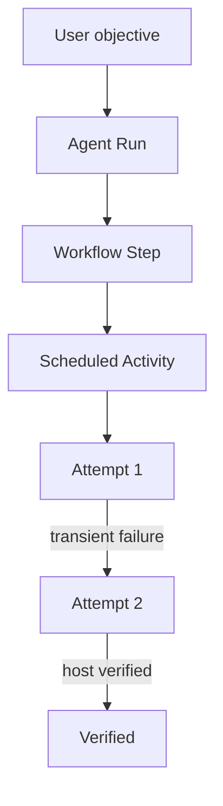
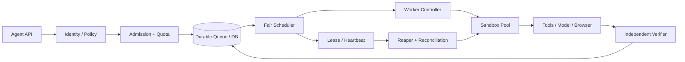

# 第 20 章：Agent Runtime 调度与并发

> **正文初稿 v0.1，待技术审稿** · 第四篇：生产级 Agent Runtime 与 Infrastructure  
> **技术主线**：Admission → Durable Queue → Fair Claim → Worker Lease → Heartbeat / Fencing → Tool Execution → Independent Verify → Retry / Reconcile → Cleanup。  
> **实现环境**：Python 3.11+、SQLite、`asyncio`，无模型 API Key、无外部 Queue Broker。演示代码运行真实 SQLite 事务和可信 Python Async Handler。  
> **真实边界**：本章没有实现宿主 IAM、网络/进程隔离、外部副作用 Exactly-Once、真实 Sandbox Reaper、持续运行的 Heartbeat Service 或多区域一致性；Worker/Host 的身份和清理回执均来自可信测试代码。

## 学习目标

完成本章，应能够：

1. 区分 Task、Run、Step、Queue Item、Activity Attempt、Worker、Lease 与 Resource Reservation。
2. 使用 Little's Law 分析任务数量、吞吐、队列等待及端到端时延。
3. 区分 `asyncio` 的协作式并发、多进程并行与跨主机分布式执行。
4. 实现 Queue Backpressure、Tenant Fairness、Priority 和 CPU/Memory/Disk Admission。
5. 实现基于数据库事务的原子 Claim、Worker Lease、Heartbeat、代数递增的 Generation Fencing。
6. 正确处理 Lease Expired、Worker Cancel、Sandbox Destroy、External Side Effect Unknown 四种不同状态。
7. 对安全可重试操作使用指数退避；对未知非幂等操作要求先查证外部事实。
8. 用 Host-owned Verifier 判定结果，而不是使用 Worker `"done":true` 的文字。
9. 通过多连接并发测试、重启测试、失联注入、权限/预算测试证明核心不变量。
10. 清晰划定 SQLite 教学调度器与生产级 Agent Scheduling Control Plane 的差异。

---

## 20.1 为什么 Agent Runtime 需要 Scheduler？

前 19 章已有 Model Gateway、Tool Runtime、Workflow DAG、Durable Store、Coding/Browser Agent、Sandbox 资源模型及安全权限边界。现在讨论一个新场景：

> 一千名用户同时提交 Coding Agent 任务，但机群只剩下 80 个安全 Worker Slot。

系统需要回答：

- 哪些请求被接受，哪些应被 Backpressure 拒绝？
- 某 Tenant 连续提交 10,000 个低优先级任务，其他 Tenant 能否按时运行？
- 哪些任务适合 CPU/GPU Worker，哪些属于远程模型 I/O？
- Worker 已领取 Task，却因网络分区不再发 Heartbeat，怎么处理？
- Worker A 的结果晚到，Worker B 已经重新执行，谁能提交？
- 运行中任务被取消，但外部 API 可能已经生效，可以向用户说“已取消”吗？
- 一个未知结果的“发送邮件”能否在 Lease 到期后自动重试？
- 当总请求速率超过处理能力时，如何防止 Queue 无界增长？
- Scheduler 重启后，任务状态和预算会不会丢失？

**Scheduler 是 Agent 平台的控制平面组件；它不等于 `asyncio.create_task`，也不等于一张简单的 FIFO 数据库表。**

### 20.1.1 与前面章节的集成

| 已有能力 | 本章依赖与衔接 |
| --- | --- |
| 第 5 章 Task/Run/Event | Task 与 Run 的身份、事件审计 |
| 第 7 章 Tool Runtime | Worker 只能调用受 Host 批准的工具 |
| 第 11 章 Workflow | DAG Node 需要可调度的 Activity |
| 第 12 章 Durable Store | 崩溃恢复、操作身份与版本控制 |
| 第 18 章 Sandbox | HostCapacity、SandboxAllocation、任务销毁 |
| 第 19 章 Agent Security | Worker/Principal 身份、Tool/Resource Policy |
| 第 25–28 章 Evaluation | 真实 Task Success、Latency、Cost 的计量 |

本章没有直接替换前面的实现，而是提供一个独立、清晰且可以安全回归测试的 Queue/Worker 状态机。

## 20.2 Task、Run、Activity、Attempt

### 20.2.1 任务层次



- **Task**：希望完成什么，例如“修复一个测试失败”。
- **Run**：对这个 Task 的一次可追踪执行。
- **Step**：计划中的一个逻辑节点。
- **Activity / Queue Item**：调度器应执行的具体工作。
- **Attempt**：一次真实领取及执行；失败重试可能产生多个 Attempt。
- **Worker**：持有该 Attempt 的临时执行者。
- **Lease**：当前尝试的有时限所有权。
- **Resource Reservation**：为实际执行环境保留的 CPU/内存/磁盘等容量。

Temporal 区分推进 Workflow 状态的 Workflow Task 与执行业务动作的 Activity Task；后者可能有多个 Attempt，工作流状态则可通过 History 重建。[1]

本章的 `JobSpec` 更接近一个可重试 Activity；它不替代整个第 5 章的 Run/Event Domain，也没有实现 Temporal Workflow Replay。

### 20.2.2 状态与 Attempt

同一 Job 第一次失败后重新排队，不应被误认为一个新用户任务。我们保存：

```text
job_id = task-x
attempt = 1
generation = 1
lease = token-a

after verified cleanup / retry:
job_id = task-x
attempt = 2
generation = 2
lease = token-b
```

Attempt 是计费、可靠性和诊断的基本单位；用户看到的业务成功率应按最终经过验收的 Task 计算。

## 20.3 `asyncio` 并发不是分布式调度

### 20.3.1 Python 协程的适用范围

`asyncio` 适合大量主要等待模型 API、受控 HTTP、数据库或 Browser I/O 的工作。某个协程在 `await` 时让出执行权，其他协程可以推进。[2]

```python
async def worker(lease):
    result = await trusted_api_request(lease.payload)
    return result
```

若工作本身是纯 Python CPU 密集型运算，单一 Event Loop 并不能自动使用所有 CPU 核心。需要考虑进程池、原生扩展、独立容器、GPU 或远端 Worker。

### 20.3.2 协作式取消

`asyncio.wait_for` 和 `Task.cancel` 使用协作式取消。如果调用中的外部工具已产生副作用，Python 的 `CancelledError` 不能撤回外部世界里已经生效的操作。Python 3.11 的 TaskGroup 和 Timeout 也不能提供 OS 级工作负载销毁保证。[2]

因此 Worker Timeout 与 `Sandbox Destroyed` 必须由 Host 在不同层级证明。

### 20.3.3 为什么无界 `gather` 很危险？

```python
await asyncio.gather(*(run_job(item) for item in a_million_jobs))
```

这样会一次性创建大量 Coroutine/Task 并争用内存与连接。正确的 Worker Pool 应固定并发数量，每次只在有容量和权限时领取下一个 Queue Item。

本章 `AsyncWorkerPool` 启动固定数目的 Worker Loop；每个 Loop 持有一个 Lease、执行一个已注册的受信任 Handler、报告结果，再请求下一个 Lease。

## 20.4 排队论：吞吐与延迟

### 20.4.1 Little's Law

在稳定系统等条件下：

\[
L=\lambda W.
\]

- `L`：平均未完成任务数；
- `\lambda`：平均处理吞吐率；
- `W`：任务在整个系统中的平均逗留时间。

例如吞吐为 20 Tasks/s，每个 Task 从提交到最终完成平均需要 10 秒，系统内平均有 200 个未完成 Task。

注意 `W` 包括队列等待、Sandbox Ready、模型/工具执行、独立验证及其他必要阶段。

### 20.4.2 延迟分解

\[
T_{\mathrm{end-to-end}}
=
T_{\mathrm{queue}}
+T_{\mathrm{admission}}
+T_{\mathrm{acquire}}
+T_{\mathrm{execute}}
+T_{\mathrm{verify}}.
\]

如果有 Human Approval，则还需要审批等待。若有 Retry，应累计尝试次数、回退等待和再执行时间。

对于 Coding Agent，执行可能是分钟级编译和测试；对于 Browser Agent，可能跨多个页面；对于 Research Agent，模型 API 和检索延迟通常是核心成本。

### 20.4.3 为什么利用率高不代表体验好？

当吞吐达到系统可处理上限附近，Queue Wait 与尾延迟可能迅速增大。CPU、模型 Provider Rate Limit、浏览器 Slot、数据库连接都可能成为瓶颈。应监控 p95/p99 Queue Delay，而不是仅追求平均 CPU 利用率。

## 20.5 Queue Backpressure

### 20.5.1 不接受无限工作负债

无限 Queue 造成任务越积越多，最终可能出现：

- 请求已失效但仍占空间；
- 用户不断重试导致重复提交；
- 任务已经超过 SLA；
- 审批/网络/存储成本持续增长；
- 恶意或意外提交消耗其他租户的容量。

本章 `SchedulerLimits` 显式配置：

```python
SchedulerLimits(
    max_live_jobs=64,
    max_live_per_tenant=32,
    max_running=4,
    max_running_per_tenant=2,
    lease_seconds=20,
)
```

它会拒绝超过全局或单 Tenant Live Job 数的提交。Live 既包括 `queued`、`running`，也包括 `reap_required` 和 `needs_reconciliation`。

### 20.5.2 Live Job 与 Active Resource 不是同一个数量

```text
Live Jobs:
  queued + running + reap_required + needs_reconciliation

Active Resource Reservations:
  running + reap_required
```

正在等待确认外部付款结果的任务可能不再持有 Worker/VM，却仍是不能忽略的业务义务。要同时监控这两个数字。

### 20.5.3 对客户端的处理

生产 API 可以返回 `429` 或 `503` 以及明确的 Retry Guidance。客户端必须使用稳定的 Idempotency Key，避免超时重试创造新的重复任务。

本章通过 `submit()` 的事务及 `(tenant_id,run_id,idempotency_key)` 唯一约束，演示**入队幂等**。但入队幂等不等于实际业务副作用恰好发生一次。

## 20.6 Tenant-Aware Fairness 与优先级

### 20.6.1 为什么全局 FIFO 不够？

若 Tenant A 先提交 10,000 个任务，B 之后提交 1 个任务，全局 FIFO 容易导致 B 排队很久。独立为每个 Tenant 分配固定 Worker 则可能造成空闲资源浪费。

本章使用一个简单的 Tenant Round-Robin 近似：

1. 计算所有当前 Ready、资源允许、权限允许的租户；
2. 选择 `last_served_turn` 最小的 Tenant；
3. 从该 Tenant 选择 Priority 最高的 Ready Job；
4. Claim 成功后更新 Tenant 的服务轮次。

其形式为：

\[
t_{\mathrm{next}}=
\arg\min_{t\in E}
(\mathrm{lastTurn}(t), \mathrm{tenantId}(t)).
\]

`E` 只包含当前有可执行任务并满足容量约束的 Tenant。

### 20.6.2 示例

```text
Tenant alpha:
  task-a1(priority=10)
  task-a0(priority=0)

Tenant beta:
  task-b0(priority=0)
  task-b1(priority=0)

Expected claim:
  a1 → b0 → a0 → b1
```

Priority 决定同一个 Tenant 内的选择，Tenant Turn 决定不同租户之间的轮换。

### 20.6.3 公平性的定义和限制

这是**按领取次数的公平性**，不是按 CPU 时间、费用、显存或真实执行时长严格公平。一个 Tenant 的作业可能很重，另一个 Tenant 的作业很轻。生产需要评估 Deficit Round Robin、Weighted Fair Queuing、Dominant Resource Fairness、Priority Aging、Deadline-Aware Scheduling 等算法。

本章还没有实现防止同 Tenant 低优先级任务长期饥饿的 Priority Aging。不要将这个调度器的`fair`描述成通用公平性保证。

## 20.7 从 JobSpec 到 Resource Admission

### 20.7.1 任务规格

```python
@dataclass(frozen=True)
class JobSpec:
    task_id: str
    tenant_id: str
    run_id: str
    kind: str
    payload: dict
    allocation: SandboxAllocation
    effect: Effect
    idempotency_key: str = ""
    priority: int = 0
    max_attempts: int = 3
```

`kind` 必须在可信 Scheduler 的 Verifier Registry 中注册；不能让模型任意写一个 `shell.exec` 并被调度器自动识别为可执行任务。

### 20.7.2 CPU、Memory、Disk 三维约束

本章复用第 18 章的 `HostCapacity` 与 `SandboxAllocation`：

```python
allocation = SandboxAllocation(
    cpu_millis=1000,
    guest_memory_mb=512,
    runtime_overhead_mb=128,
    workspace_disk_mb=256,
    ttl_seconds=60,
)
```

其内存预算为：

\[
M_{\mathrm{reserved}}=
M_{\mathrm{guest}}+M_{\mathrm{runtime-overhead}}.
\]

`claim()` 会计算当前 `running`、`reap_required` 占用的 CPU/Memory/Disk，并验证新的 Job 是否能容纳。

**有两个 Admission 层次**：提交时检查单个 Job 的需求与队列上限；Claim 时检查所有正在运行/待清理任务的累计资源。已成功 Submit 并不意味着立即运行。

## 20.8 原子 Claim 与 SQL 并发

### 20.8.1 经典 Race

如果使用：

```python
job = db.select_ready_job()
db.update_job_to_running(job)
```

两个 Worker 可能先后读取同一个 Ready Job，并各自认为自己应该执行。单纯在内存里加锁无法控制另一个进程。

### 20.8.2 SQLite `BEGIN IMMEDIATE`

本章每次 `claim()` 在一个真正的 SQLite 写事务中执行：

```sql
BEGIN IMMEDIATE;
SELECT ... FROM jobs WHERE state='queued' ...;
UPDATE jobs
SET state='running',
    generation=?,
    lease_owner=?,
    lease_token=?,
    lease_deadline=?
WHERE task_id=? AND state='queued';
COMMIT;
```

它在多个 SQLite 连接之间串行化互相竞争的写操作，避免同一个 Job 被同时成功 Claim。本章测试实际用两个 Scheduler 实例、两个数据库连接和线程同时竞争一条任务，并验证只有一个成功。

### 20.8.3 PostgreSQL `SKIP LOCKED`

更大规模部署可考虑：

```sql
SELECT task_id
FROM jobs
WHERE state = 'queued'
ORDER BY priority DESC, created_at
FOR UPDATE SKIP LOCKED
LIMIT 1;
```

PostgreSQL 文档指出，`SKIP LOCKED` 可在 Queue-like Table 中避免消费者争用行锁，但它不提供一般查询的一致视图。[3] 工程上还要把 Claim、Lease Generation、资源预留与审计事件放在正确的事务边界内。

### 20.8.4 为什么 SQLite 不是生产多机共识系统？

SQLite 单文件事务适合本章教学和小规模单机应用。但它不能自动提供：

- 多区域一致性；
- 多主数据库主节点故障切换；
- 高吞吐跨机 Broker；
- 独立数据库服务端时钟；
- 可信 Worker IAM；
- Host Sandbox销毁确认。

一旦扩展为分布式平台，通常需要 PostgreSQL、消息 Broker、Event Store、Operator 与独立 Workflow Runtime 的组合。


## 20.9 Worker Lease、Generation 与 Fencing

### 20.9.1 Lease 表示临时所有权

```python
@dataclass(frozen=True)
class WorkerLease:
    task_id: str
    worker_id: str
    token: str
    generation: int
    deadline: float
    attempt: int
    kind: str
    payload: dict
    effect: Effect
```

Worker Claim 成功后获得随机 Token 和单调递增 Generation；只有当前 Lease 的持有者在 Deadline 之前可以更新任务状态。Model 不会接收到 Lease Token。

### 20.9.2 Stale Worker

```text
Worker A claims task-x, generation=1
   └─ heartbeat lost / network partition
        ↓
Host confirms A's sandbox destroyed
        ↓
Worker B claims task-x, generation=2
        ↓
A's old completion message arrives
        ↓
Scheduler rejects generation=1 (fenced)
```

数据库 `_fence` 校验：

- `task_id` 与当前活动 Job 对应；
- `state == running`；
- `lease_owner` 与当前 Worker 相符；
- 随机 `lease_token` 完全匹配；
- `generation` 与最新成功 Claim 一致；
- `now < lease_deadline`；
- 当前没有要求取消。

任何一个条件失败，旧 Worker 不得在调度数据库里确认结果。

### 20.9.3 为什么 Fencing 仍不足以实现 Exactly-Once？

数据库可以拒绝 Worker A 的旧 `complete()`，却无法撤回 A 已经发到外部支付服务的请求。若资源服务器不认识 Generation，旧 Worker 可能继续产生副作用。

因此，对外部写入要求更强的组合：

```text
Fencing at scheduler + host runtime
     + effect-specific idempotency key
     + external resource verifier
     + durable operation ledger
```

**Fencing Token 是控制平面的协议，不是 OS 安全沙箱，也不等于外部副作用的隔离保证。**

## 20.10 Heartbeat 与超时

### 20.10.1 为什么需要 Heartbeat？

一个 Worker 可能正常执行长时间代码测试，也可能已崩溃无法联系。仅使用固定超时无法高效区分这两种情况。

```python
if scheduler.heartbeat(lease):
    # Lease is still recognized, and expiration was extended.
    ...
```

在本章实现中：

- 有效的运行中 Lease 可以续期；
- 已过期、被取消、被 Fencing 的 Lease 不可续期；
- 已经 `verified/failed/cancelled` 的任务不可续期；
- Heartbeat 事件不记录 Payload 或 Secret。

Temporal 的文档也强调 Activity 的超时和 Heartbeat 用于检测失联 Worker，而不是直接感知进程是否已崩溃。[4]

### 20.10.2 Lease Expired 后的关键状态

错误逻辑：

```text
lease expired
    → release CPU/Memory
    → requeue job
```

实际上旧进程可能仍然活着。若立即分配同一资源，就可能过量预留内存和 CPU。

本章使用：

```text
running
    ↓ lease deadline
reap_required
    ↓ trusted host confirms stopped / VM destroyed
queued OR needs_reconciliation OR failed OR cancelled
```

`reap_required` 任务仍占用 `usage()` 中的 CPU、Memory、Disk。只有可信宿主确认清理后，才能调用 `confirm_reaped(...)` 释放预留。

### 20.10.3 虚假的销毁确认

```python
scheduler.confirm_reaped(
    task_id="task-x",
    generation=1,
    cleanup_confirmed=True,
)
```

这个 API 是教学模拟：其调用方必须是**已经独立验证过 Sandbox 实际销毁的 Host 控制层**。传入 `True` 本身不产生任何 Kill、Unmount 或 VM Destroy 操作。

生产版应要求带任务身份、Sandbox ID、Generation 和实际销毁证据的 `TerminationReceipt`，且由不可被 Agent 操控的 Host API 签发。

## 20.11 Retry 语义与 Effect 分类

### 20.11.1 三种可重复执行性

```python
class Effect(str, Enum):
    READ_ONLY = "read_only"
    IDEMPOTENT = "idempotent"
    NON_IDEMPOTENT = "non_idempotent"
```

- `READ_ONLY`：不会对业务状态产生有害副作用的操作，例如查询合成 Fixture；
- `IDEMPOTENT`：Backend 保证相同业务 Idempotency Key 的重复操作不会导致重复效果；
- `NON_IDEMPOTENT`：不能从一次超时或异常推断操作没有生效，例如邮件发送或付款。

Effect Class 必须由可信 Host/Tool Registry 配置，不能由 LLM 自行声明“这个发送邮件工具是只读的”。

### 20.11.2 有上限的指数退避

```python
delay = min(
    max_retry_seconds,
    base_retry_seconds * 2 ** (attempt - 1),
)
```

设 Base=2s，Ceiling=8s：

| 失败的 Attempt 序号 | 下次重试等待 |
| ---: | ---: |
| 1 | 2 秒 |
| 2 | 4 秒 |
| 3 | 8 秒（若仍有尝试预算） |
| 4 | 8 秒 |

示例 `max_attempts=3`，当第三次仍失败则直接终止，不再自动重试。

生产应增加 Jitter，避免同一时刻一万次任务失败后同步“雷鸣式”重试，还应限制全局重试预算和 Provider Rate Limit。

### 20.11.3 External Effect Unknown

```text
worker sends email
    ↓
provider accepts and sends
    ↓
worker crashes before acknowledging scheduler
    ↓
lease expires
```

如果立即重试，可能发送第二封邮件。

因此本章在 Non-Idempotent Job 失败或被确认为已回收后进入：

```text
needs_reconciliation
```

调度器不会再次 Claim。Host 必须通过 `reconcile()` 记录外部事实：

- `committed`：业务已提交且独立验收通过，可以标记 `verified`；
- `not_applied`：确认业务未发生，可以按重试预算重新排队或根据取消请求结束。

若外部状态无法查明，就应该继续保持未决。这与第 12 章的 Pending Operation Recovery 保持一致。

### 20.11.4 为什么 At-Least-Once 更现实？

AWS SQS 明确指出 Standard Queue 的 Visibility Timeout 无法保证期间绝不重复投递，其语义属于 At-Least-Once。[5]

Celery 也强调任务的幂等性、ACK 策略与 Retry 并非同一回事。[6]

Agent Runtime 需要把消息投递、Worker Activity、外部业务状态分开建模：**Queue 可靠性不会自动变成业务 Exactly-Once**。

## 20.12 Cancellation：请求取消与完成取消

### 20.12.1 排队任务

还没有 Worker Claim 的任务可以直接标记 `cancelled`，不需要回滚正在执行的业务。

### 20.12.2 运行中的任务

正在运行的 Job 被请求取消时：

```text
running
  ↓ request_cancel
running + cancel_requested=True
  ↓ worker observes flag / host kills sandbox
ack_cancel / expire + host reaper
  ↓
cancelled OR needs_reconciliation
```

- `request_cancel()` 不能谎称实际进程已停止；
- `heartbeat()` 不再续期；
- `complete()` 不接受未经认可的最终成功；
- 对安全只读任务，在可信 Worker ACK 后可以标记取消；
- 对未知非幂等操作，即使 Worker ACK 取消，仍需要查证是否已产生外部副作用。

### 20.12.3 为什么 `asyncio.CancelledError` 也不够？

Python 协作式取消不能证明远程 HTTP 事务已经回滚。更强的机制需要真实 Sandbox Termination Receipt、外部 Idempotency Key、Tool Backend 读回或补偿操作。

## 20.13 SQLiteTaskScheduler 的数据结构

核心源码：[`runtime_scheduler.py`](../../src/mini_agent/runtime_scheduler.py)。

### 20.13.1 表结构

```text
jobs:
  task_id, tenant_id, run_id, kind, payload,
  effect, idempotency_key,
  cpu_millis, memory_mb, disk_mb,
  priority, state, attempts, max_attempts,
  next_ready_at, lease_owner, lease_token,
  generation, lease_deadline, cancel_requested,
  result, evidence, error_code,
  created_at, updated_at

tenant_turn:
  tenant_id, last_turn

scheduler_meta:
  turn

job_events:
  sequence, task_id, timestamp, kind,
  safe_detail, generation
```

- `jobs` 是队列和 Worker Lease 的权威状态；
- `tenant_turn` 记录租户轮换；
- `scheduler_meta` 维护全局 Claim Turn；
- `job_events` 保留状态变化元数据，不复制 Secret 或完整 Payload。

### 20.13.2 原子 Claim

```python
with self._tx() as conn:           # BEGIN IMMEDIATE
    selected = choose_fair_eligible_job(conn)
    token = secrets.token_hex(24)
    conn.execute("UPDATE jobs SET state='running', ...", ...)
    update_tenant_turn(conn)
    append_audit_event(conn)
# COMMIT
```

这保证同一个 SQLite 文件的两个连接不应同时成功领取同一 Job。测试会使用两个 `SQLiteTaskScheduler` 对象与两个线程竞争同一个 Item。

SQLite 的写锁会影响吞吐；本章没有对多机数据库、PostgreSQL 或高并发 Redis/SQS 的生产吞吐作任何结论。

### 20.13.3 Client Idempotency

```python
job = scheduler.submit(JobSpec(
    task_id="job-123",
    tenant_id="tenant-a",
    run_id="run-1",
    kind="fixture.echo",
    payload={"expected": "ok"},
    allocation=SandboxAllocation(1000, 512, 128, 256, 60),
    idempotency_key="client-request-1",
))
```

重复提交完全相同的 JobSpec 可返回已有 Job；同一 Idempotency Key 却试图替换目标、Payload 或资源配置，则拒绝，避免“相同标识不同含义”。

这保证的是**入队重放身份**，不是外部工具调用的幂等性。

## 20.14 Host-owned Verifier

```python
queue = SQLiteTaskScheduler(
    db_path,
    capacity=HostCapacity(4000, 4096, 4096),
    limits=SchedulerLimits(),
    verifiers={
        "fixture.echo":
            lambda job, result:
                result == job.payload["expected"]
    },
)
```

`complete(lease, result)` 不提供让 Worker 自己设置 `verified=True` 的接口。Scheduler 根据可信注册的 Job Kind 找到独立 Verifier，并在验证通过后写入 `verified`。

如果 Verifier 抛出异常或返回 False，本章 Fail-Closed，而不是根据 Worker 的文字标记完成。

**教学限制**：Verifier 在 SQLite 写事务内运行，必须是纯、快速、无副作用的本地函数。生产级外部验收应在数据库事务外完成，再以受信任的结果回执+CAS 提交，不允许事务中执行耗时 HTTP 请求。

## 20.15 AsyncWorkerPool 演示

```python
pool = AsyncWorkerPool(
    queue,
    WorkerIdentity("trusted-fixture-worker",
                   frozenset({"tenant-a"})),
    handlers={"fixture.echo": trusted_handler},
    workers=2,
    timeout_seconds=5.0,
)
await pool.drain_ready()
```

`AsyncWorkerPool` 只运行预先注册的可信异步 Python 函数；没有自由执行 LLM 生成的 Shell、Python 或不可信插件。它最多启动固定数目的 Worker Loop，每轮 Claim 一项任务。

- Handler 正常返回 → Host Verifier → `verified/failed`；
- Handler 抛异常 → 安全失败代码 → 重试/待核对；
- Handler Timeout → 协作式取消并记录失败；
- 任务处于 Backoff → 本次 `drain_ready()` 不会忙等；
- 没有 Ready Job → 正常返回。

**不具备周期 Heartbeat**；长任务仍需要外部 Heartbeat Service。它是受限的并发教学 Worker Pool，不是生产级 Sandbox Worker。

## 20.16 离线实验：Run、Reap、Reconcile

实验入口：[`ch20_scheduler_lab.py`](../../examples/ch20_scheduler_lab.py)。

```bash
python -m pip install -e .
python examples/ch20_scheduler_lab.py
python -m unittest discover -s tests -p 'test_ch20.py' -v
```

### 20.16.1 场景 A：两个租户、四个安全任务

```text
tenant-a: a1 a2
tenant-b: b1 b2

max_running=2
trusted async handlers
host-controlled result verifier
```

每个 Handler 使用 20ms `asyncio.sleep` 模拟独立 I/O。预计可以看到两个 Handler 同时处于等待阶段，四个任务都满足 Host 验收条件。

这是实际 Python 并发和 SQLite 状态转移，但不是实际模型 Token/费用/性能基准。

### 20.16.2 场景 B：非幂等失联

```text
claim(send1), generation=1
  ↓ synthetic clock crosses lease deadline
expire_leases()
  ↓
reap_required      (capacity still reserved)
  ↓ trusted fake cleanup ACK
needs_reconciliation
  ↓ host checks synthetic external record
verified
```

不会因为 Worker Lease 到期就无条件重新调用 `send1`。

### 20.16.3 场景 C：Stale Fencing

两个 Attempt：

```text
Attempt 1 → generation=1 / token A
Attempt 2 → generation=2 / token B
late Attempt 1 complete → LeaseFenced
```

测试表明旧 Worker 的 Result 不会覆盖新结果，但不能证明它无法继续接触外部业务系统。生产必须在最终资源服务或 Host Runtime 的防线再次检查。

### 20.16.4 场景 D：两连接并发 Claim

两个独立 SQLite 连接同时领取同一个 Ready Job。预期：

- 一方获得新的 Lease；
- 另一方返回 None；
- Job Attempt Count 只增加一次。

这验证了当前 SQLite 事务设计的原子 Claim，不表示整个分布式系统已达到线性一致性。

## 20.17 测试矩阵与验收

| 模块 | 关键可测不变量 |
| --- | --- |
| Durable Submission | 重新创建调度器仍可读取队列和 Lease |
| Client Idempotency | 重复请求去重、冲突内容拒绝 |
| Atomic Claim | 多连接不能同时成功 Claim 同一个 Job |
| Tenant Fairness | A/B 按轮换机会选择 |
| Priority | 同 Tenant 优先高优先级 |
| Worker Tenant Scope | 无权限的 Worker 领不到其他 Tenant 工作 |
| Admission | 全局/租户 Live Job 上限有效 |
| Resources | Guest Memory+Runtime Overhead 一起计入 |
| Lease | Token、Generation、Deadline 与 Worker 身份匹配 |
| Heartbeat | 只延长有效且未取消 Lease |
| Fencing | 旧 Generation/Token 不可覆盖新 Attempt |
| Expiry | Host 未确认清理前仍占资源 |
| Retry | 次数上限、指数退避、终止错误 |
| Non-Idempotent | 未确认外部结果不自动重试 |
| Reconciliation | Host 已验证外部结果后决定是否重试 |
| Cancellation | 排队与运行中使用不同状态转移 |
| Verifier | Worker 自报成功不够，必须独立验证 |
| Event Metadata | 不复制 Tool Payload、Secret 或 Lease Token |
| Async Worker | 确定性异步并发且异常安全分类 |

本章的回归测试没有做真正的网络分区、数据库磁盘损坏、主机崩溃、容器 OOM、跨区域故障或真实 KVM/沙箱销毁。

## 20.18 生产化架构



实际产品需要：

- 有权签发 Worker Identity 的认证服务；
- 统一 Task/Run/Step/Activity IDs；
- 可扩展的持久队列、事务和迁移；
- 自治的 Heartbeat、Reaper、Cleanup Receipt；
- 真正的 Sandbox Host 及资源预留账本；
- 真实 Tool Scope/Approval/Secret Broker；
- 外部操作 Idempotency Key 和结果核对；
- Queue Wait、Worker Busy、Throttle、Retry、Cost 指标；
- 人工审批、暂停、取消的长生命周期；
- 实际故障注入、恢复演练、部署回滚。

## 20.19 SQS、Celery、PostgreSQL 与 Temporal 如何取舍？

| 方案 | 主要职责 | 需要自行处理的 Agent 问题 |
| --- | --- | --- |
| SQS | 托管消息/队列投递 | 幂等消费、Worker 状态、验收、Tenant 资源额度 |
| Celery | Python Task Queue / Worker | Side Effect Idempotency、Agent Run、业务验收 |
| RabbitMQ | Broker + ACK/Prefetch | 多租户策略、长期 State、Sandbox 生命周期 |
| Kafka | 分区事件日志 | Task Claim、Retry Timer、效果核对 |
| PostgreSQL Queue | DB Row Claim 与事务 | Queue 争用、公平、历史与扩缩容 |
| Temporal | Durable Workflow/Activity | Sandbox IAM、Tool Security、Tenant Resource Policy |

Celery 明确将 ACK 策略与 Retry 策略区分；SQS Standard Queue 明确有 At-Least-Once 语义；Temporal 更进一步提供 Workflow Task/Activity/History 的耐久运行模型。[1][5][6]

**选择 Broker 不等于已经实现生产 Agent Runtime**。无论采用哪种队列，仍要协调身份、沙箱、工具权限、成本和最终验收。

## 20.20 指标、性能与成本

至少记录：

- `queue_depth{tenant,kind}`：Ready/Delayed 工作数量；
- `live_jobs`：尚未最终完成或核对的任务；
- `queue_wait_seconds`：入队到首次 Claim 时间；
- `worker_busy_ratio`：Worker 忙碌比例；
- `lease_expired_total`：失联/超时；
- `reap_required_age_seconds`：逾期环境清理时间；
- `resource_cpu_reserved_millis`、`memory_reserved_bytes`；
- `retry_attempts_total` 与 `backpressure_total`；
- `needs_reconciliation_jobs`；
- `cancellation_latency_seconds`；
- `verified_task_success_rate`；
- `cost_per_verified_task`。

不要将真实 Payload、密钥、邮箱地址和高基数 Task ID 直接写为监控标签或公开 Trace。需要按 Tenant / Kind 聚合，并对敏感标识设置访问限制。

## 20.21 教学实现的边界

本章可证明一定范围内的 SQLite 状态一致性与编排行为，但仍缺少：

1. **真正的 Worker IAM / mTLS**：`WorkerIdentity` 来自 Host 教学代码，不是远程认证协议。
2. **真正的 Sandbox**：不可信 Shell/Python 不能在 `AsyncWorkerPool` 进程中执行。
3. **自动 Reaper**：`expire_leases()` 与 `confirm_reaped()` 需要由可信服务调用。
4. **真实外部效果确认**：`reconcile()` 的 evidence 在本章来自合成 Host，不是支付/邮件真实回执。
5. **跨节点时钟与数据库迁移**：本章使用可注入 Unix Clock。
6. **Token/费用记账**：当前只控制任务数量与 CPU/Memory/Disk。
7. **高吞吐 Fair Queue**：Least-Recently-Served Tenant 是简单公平近似，不是 Weighted Fair。
8. **真正的 Fencing at External Resource**：旧 Worker 可能仍能调用外部服务。
9. **跨机高可用**：SQLite 不是多 Region Queue/Consensus Service。
10. **强取消语义**：`asyncio.wait_for`、DB Flag 都不能替代 VM/进程真实销毁。

尤其要注意：若 Worker Handler 在外部产生副作用后才抛异常，不能仅靠 `JobSpec.effect` 名字和 Retry 例程假设它完全回滚。

## 20.22 课后练习

### 原理

**20.1** 分别解释 Task、Run、Step、Activity、Attempt 的身份和生命周期。三次 Attempt 才成功的任务，应如何计入成功率与成本？

**20.2** 平台每秒完成 10 个 Task，Task 平均停留 15 秒。使用 Little's Law 估计在途任务数；若队列等待加倍而吞吐不变，估计如何变化？

**20.3** 为什么模型 API 任务主要受 I/O 限制，而 Python 单 Event Loop 的 CPU 密集型任务不会随 `asyncio` 数量线性加速？

**20.4** 比较 `Lease`、`Fencing Token`、`Sandbox Termination Receipt` 和外部业务 Idempotency Key 的职责。

**20.5** 已知 Worker A 租约过期，但无法确认其 MicroVM 已终止。是否允许给 Worker B 分配相同资源？讨论错误释放的风险。

### 编程

**20.6** 将 Tenant Round-Robin 升级为 Deficit Round Robin，按 CPU/Memory 资源预算计算 Task 权重。

**20.7** 加入全局和租户级 Token / API Cost Budget，将第 6 章 Model Gateway 实际 Usage 接入 Scheduler。

**20.8** 增加真实周期 Heartbeat Worker，验证长任务可续期、错身份不可续期、取消后必须停止。

**20.9** 用 PostgreSQL `SKIP LOCKED` 改写 Claim，并通过 20 个并发连接验证不会双重领取。

**20.10** 将第 18 章真实 Sandbox ID/Lease/Host Cleanup Receipt 纳入 Job State；使用第 12 章 Durable Store 保存统一状态。

**20.11** 将第 19 章 Reference Monitor 包装在 Worker Tool Backend 外，只有通过 Task/Run/Resource Policy 的操作才能实际执行。

**20.12** 实现 Reaper Service，每小时和每次 Worker 断连时检查资源状态，但不得在 Lease 失联后直接宣布外部效果失败。

**20.13** 增加 Token Bucket、Priority Aging 与 Deadline Scheduling，比较队列延迟和公平性。

**20.14** 为 Non-Idempotent `send_email` Task 接入模拟业务 Idempotency Key，区分发送成功但 ACK 丢失与真实执行失败。

### 评测/系统设计

**20.15** 构造 100 Tenant、不同 Task Duration 的模拟负载，对比 FIFO、Round-Robin、DRR 的吞吐、队列 P99 和 Tenant Fairness。

**20.16** 测试 Worker 并发从 1、4、16、64 变化时，Provider 429、Retry Backoff、排队时延与最终 Cost/Success 的曲线。

**20.17** 设计一次完整的 Cancel Trace：用户取消 → Scheduler Flag → Worker 收到 → 真实 Sandbox 停止 → Host 确认 → 外部效果核对。

**20.18** 注入 Worker 宕机、SQLite 连接中断、Runner 重启、执行结果丢失与终止确认延迟，验证不会产生无限重试或错误释放资源。

**20.19** 讨论 Provider Rate Limit 和 GPU Memory Reservation 如何影响 Scheduler Placement。

**20.20** 设计多机部署中的 Host Lease、数据库事务与独立 Reaper，确保过期任务不会在旧实例仍可发送写请求时被立即重放。

## 20.23 本章总结

1. Scheduler 的职责是控制**谁、何时、占用多少资源、执行哪些经过授权的任务**。
2. `asyncio` 提供协作式并发，不替代多机 Worker、队列和安全 Sandbox。
3. Queue 必须有容量上限与 Backpressure，不能无限承诺未来工作。
4. Tenant Fairness 需要明确的调度策略；全局 FIFO 不够。
5. SQLite 事务可演示跨连接原子 Claim；Lease Token/Generation 可拒绝过时 ACK。
6. **Lease Expired 不等于 Worker Stopped**；真实资源回收必须等待 Host 销毁确认。
7. 非幂等操作结果未知时应先 Reconcile，不能因超时盲目重试。
8. Running Cancellation 是生命周期过程，不是一个 Boolean。
9. Worker 返回结果不等于最终成功；可信 Verifier 必须检验目标。
10. 本章实现是可回归测试的单数据库教学原型，不代表生产级分布式高可用或 Exactly-Once。

**下一章**：[第 21 章《Agent Reliability 与故障恢复》](21.md)。将深入 Fault Models、Retry Storm、Circuit Breaker、Transactional Outbox、Saga / Compensation、Durable Operation Ledger、外部副作用恢复，以及异常注入后的端到端可靠性。

---

## 参考资料

[1] Temporal. *Tasks — Workflow and Activity Tasks*. https://docs.temporal.io/tasks

[2] Python Documentation. *Coroutines and Tasks*, Python 3.11. https://docs.python.org/3.11/library/asyncio-task.html

[3] PostgreSQL. *SELECT: FOR UPDATE SKIP LOCKED*. https://www.postgresql.org/docs/current/sql-select.html

[4] Temporal. *Detecting Activity Failures*. https://docs.temporal.io/encyclopedia/detecting-activity-failures

[5] AWS. *SQS Visibility Timeout and At-Least-Once Delivery*. https://docs.aws.amazon.com/AWSSimpleQueueService/latest/SQSDeveloperGuide/sqs-visibility-timeout.html

[6] Celery. *Tasks: Acknowledgment and Retry*. https://docs.celeryq.dev/en/stable/userguide/tasks.html

[7] Google SRE Book. *Handling Overload*. https://sre.google/sre-book/handling-overload/

[8] Martin Kleppmann. *Designing Data-Intensive Applications*, O'Reilly.

[9] Linux Kernel. *cgroup v2*. https://docs.kernel.org/admin-guide/cgroup-v2.html

[10] SQLite. *Transaction Behavior*. https://www.sqlite.org/lang_transaction.html

[11] Amazon Builders' Library. *Timeouts, Retries and Backoff with Jitter*. https://aws.amazon.com/builders-library/timeouts-retries-and-backoff-with-jitter/

[12] Kubernetes Documentation. *Jobs*. https://kubernetes.io/docs/concepts/workloads/controllers/job/

> **审稿提醒**：本章实验仅验证真实 SQLite 事务、可信异步 Worker 和合成外部效果状态的控制逻辑。没有运行真实容器、MicroVM、网络断链、真实跨区域 Worker 或生产 IAM。把这里的 `cleanup_confirmed=True` 或 `reconcile(...,evidence=...)` 从不可信客户端直接暴露出去，会破坏原有安全设计。
