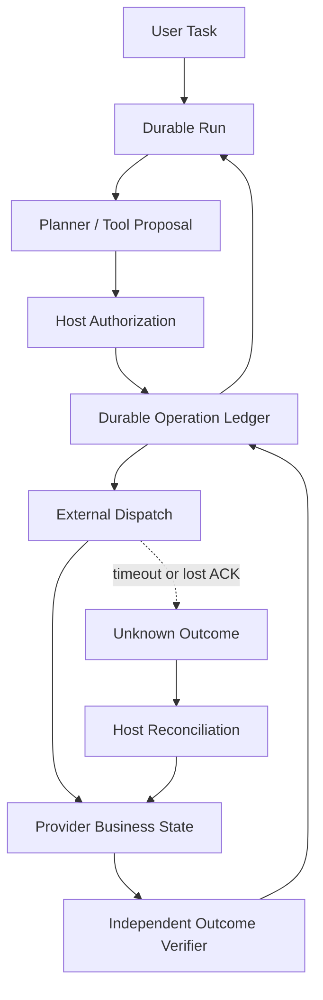
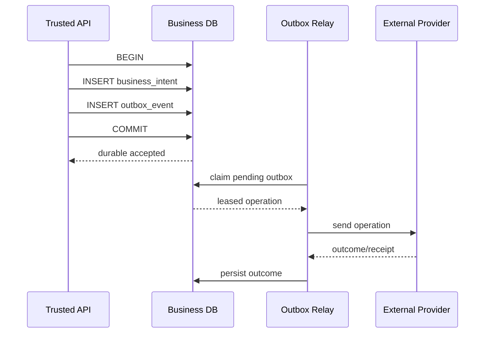
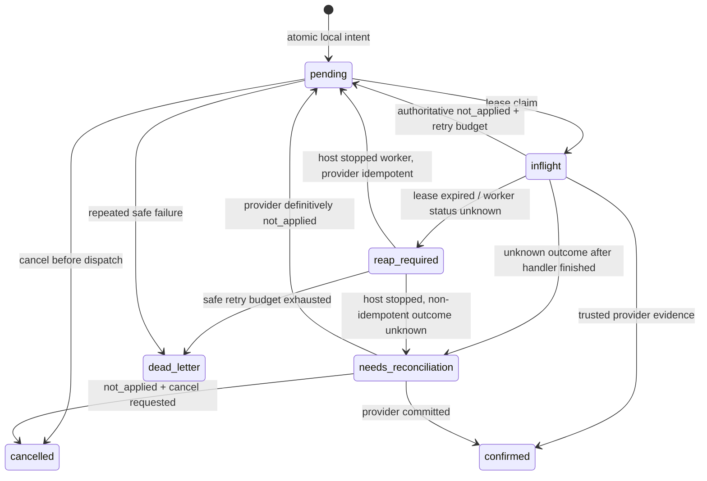
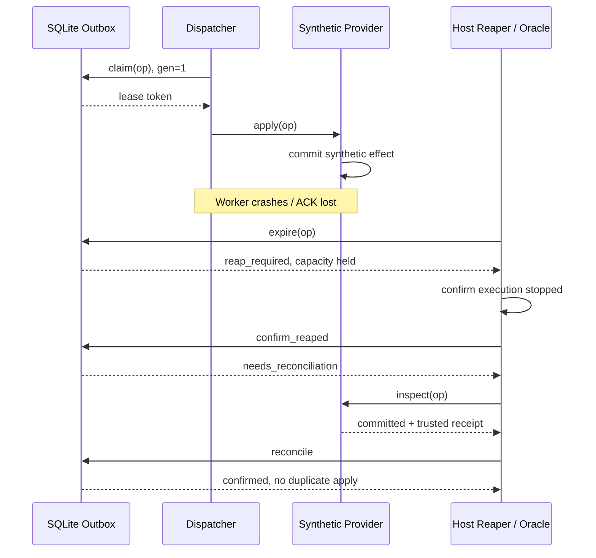
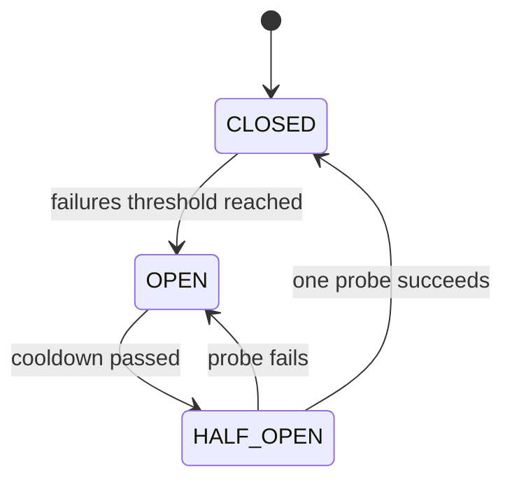

# 第 21 章：Agent Reliability 与故障恢复

> **状态：正文初稿 v0.1，待技术审稿** · 第四篇：生产级 Agent Runtime 与 Infrastructure  
> **主线**：Durable Intent → Transactional Outbox → Leased Delivery → Unknown External Outcome → Reconcile → Verified Completion。  
> **实验**：Python 3.11+、SQLite、受信任的合成 Provider、故障注入和单元测试。不运行真实邮件、付款、部署、Shell、云资源或网络请求。  
> **技术边界**：本章真正执行 SQLite 事务与状态持久化、纯内存模拟的外部效果、断点恢复、断路器和补偿计划；它不是分布式交易协调器、云端 Worker IAM、生产 Message Broker、KMS、真实 Sandbox 或端到端 Exactly-Once。

## 本章的核心问题

> 外部 API 可能已经完成了业务操作，但 Agent 因超时、网络分区或 Worker 崩溃没有收到确认。Runtime 现在应该怎么办？

回答不能是“把同一个 Tool Call 再发一次”，也不能是“标记失败”。未知不是失败；不确定的业务状态必须保留，直到能够根据可信的外部事实进行判断。

本章同时讨论：重试风暴、服务过载、Circuit Breaker、Transactional Outbox、Inbox / Idempotent Consumer、Saga 与补偿、Worker 失联、状态恢复和可量化的可靠性指标。

## 学习目标

完成本章应能够：

1. 区分进程错误、网络错误、数据库错误、模型错误、工具错误和**外部业务结果未知**。
2. 解释为什么“数据库操作成功 + 事件发送成功”不是简单的两个连续写入。
3. 用一个 SQLite 事务同时提交 Business Intent 和 Outbox 消息，避免本地 Dual-Write Gap。
4. 用稳定 Request Key、Provider 去重记录和重启恢复实现受约束的幂等投递。
5. 区分 Producer Inbox/Outbox、Consumer Dedup、Transport Ack 和 Business Receipt。
6. 用 Worker Lease、Generation Fencing 和安全 Reaper 阻断过时确认。
7. 在非幂等外部操作结果未知时拒绝盲目重试，并依赖 Host-owned Oracle 进行核对。
8. 实现 Circuit Breaker 的 Closed → Open → Half-Open 和单个 Probe。
9. 理解指数退避加 Jitter 为什么比同步重试更稳健。
10. 理解 Saga Compensation 是新的业务事务，不是数据库级时光倒流。
11. 用故障注入覆盖所有主要崩溃窗口，区分已验证事实与待核实状态。
12. 认识本章实现与生产级 Durable Execution、分布式 Outbox Relay 和跨租户安全之间的差距。

---

## 21.1 Agent 可靠性为什么比普通 RPC 更困难？

单次 HTTP 请求通常在数百毫秒到几秒之间完成，而 Coding Agent、Browser Agent 和 Research Agent 可能持续运行数分钟甚至更长，还要调用多个具有不同一致性语义的服务。

假设一个 Agent 需要：

```text
1. 读取用户的任务
2. 修改本地代码
3. 推送补丁至远程仓库
4. 触发 CI
5. 查询 CI 状态
6. 创建 Pull Request
7. 向用户报告结果
```

其中第 1–2 步主要依赖本地状态；第 3–6 步含外部系统和不可简单回滚的副作用。即使模型准确无误，任何两个步骤之间都可能进程崩溃、超时或丢失 ACK。

### 21.1.1 五种必须区别的状态

| 观察到的现象 | 可以得出的结论 | 不应得出的结论 |
| --- | --- | --- |
| 本地参数校验失败 | 工具尚未进入正常执行 | 真实世界一定没有其他历史副作用 |
| 服务器明确返回业务拒绝且未提交 | 该请求可视为未被接受（以服务契约为准） | 所有相关系统都没有变化 |
| 连接断开 / Timeout | 当前客户端不知道最终结果 | 业务请求一定没有执行 |
| Provider 返回提交回执 | Provider 声称已经接受或完成 | 用户最终任务目标已经通过全部验收 |
| 独立业务读回与验收通过 | 可根据验收契约将任务标为已验证 | 执行环境已自动安全销毁 |

可靠性工程的第一步是**不把这些状态错误合并**。

### 21.1.2 交叉边界



关键是：**Tool Result、Run State 和真实 Provider Business State 不是一份数据，也不一定在同一个事务域中。**

## 21.2 故障分类（Fault Taxonomy）

### 21.2.1 确定性故障

例子：

- JSON Schema 不匹配；
- Tool Name 不在白名单；
- 缺少必要 Scope；
- 请求非法或者业务输入无效；
- 本地业务逻辑可重复复现地失败。

这类情况通常应直接向上返回固定错误，不应无限重试。

### 21.2.2 瞬时故障

例子：

- 连接池短暂耗尽；
- 下游 `503`；
- DNS 或网络出现短暂抖动；
- 获取数据库锁时产生暂时性竞争；
- Provider 请求被限制，返回 Retry-After。

这里可能适合有限重试，但要同时考虑是否已产生副作用。

### 21.2.3 超时和结果未知

最危险的故障窗口：

```text
Agent                        External Provider
  |                                  |
  |----------- send/write ---------->|
  |                                  | commit effect
  |               X lost ACK         |
  |<---------- timeout --------------|
  |
  | WHAT IS THE ACTUAL STATE?
```

Timeout 仅说明客户端没有在约定时间得到确认，不是服务器事务未提交的证据。

### 21.2.4 崩溃故障

故障可能发生在：

1. Local Intent 创建前；
2. Local Intent 与 Outbox 写入之间；
3. SQLite Commit 之后、Dispatcher 领取之前；
4. 已领取任务、对 Provider 发请求之前；
5. Provider Commit 之后、ACK 之前；
6. 调度器完成本地 ACK 之后、用户收到结果之前；
7. Worker Lease 过期之后但执行进程仍运行。

每个窗口对应不同的恢复逻辑，不能统一处理成“执行失败重试”。

### 21.2.5 Byzantine / 恶意故障

恶意或遭 Prompt Injection 的 Worker 可能伪造完成消息、篡改结果或试图扩大工具权限。这不是简单 `try/except` 能解决的问题。

仍需第 18 章的 OS Sandbox、第 19 章 Host Reference Monitor、真实业务系统权限与来源可验证的审计。**本章状态机不为恶意同进程 Python 提供隔离**。

## 21.3 双重写入问题（Dual Write Problem）

### 21.3.1 看似合理的实现

```python
database.save_order(order)
message_broker.publish("order.created", order)
```

如果第一个操作已提交、第二个操作失败，订单存在却没有消息；如果先发布消息再保存数据库，消费者可能观察到不存在的订单。

两次独立写入之间没有天然的原子性。这是 Transactional Outbox 试图解决的问题。[1]

### 21.3.2 为什么两个 `try/except` 也没用？

```python
try:
    database.save(...)
    broker.publish(...)
except Exception:
    database.rollback()
```

如果 Broker 已经收到消息，后面的本地 Rollback 不能将消息撤回。反过来，数据库已真正 Commit，再捕获异常也不能保证可以安全逆转外部系统已完成的动作。

**跨进程、跨服务事务不因它们出现在同一个 Python 函数里而自动变成原子操作。**

## 21.4 Transactional Outbox

### 21.4.1 核心原理

生产者把业务状态和要发布的事件放入**同一个数据库事务**：



本地崩溃在 Commit 之前，则 Intent 和 Outbox 一起回滚；Commit 之后则两个记录都存在。这样解决了本地双重写入窗口。[1][2]

但注意：**Outbox 只保证本地写入事实，不保证 Relay 只发送一次。**

### 21.4.2 SQLite 模式

本章在 [`reliability_outbox.py`](../../src/mini_agent/reliability_outbox.py) 里创建：

```text
business_intents(
    op_id, tenant_id, run_id, action, request_key,
    payload, mode, max_attempts, fingerprint, created_at
)

outbox(
    op_id, state, attempts, generation, next_ready_at,
    lease_owner, lease_token, lease_deadline,
    receipt, cancel_requested, error_code, updated_at
)

outbox_events(
    sequence, op_id, timestamp, kind, detail, generation
)
```

核心生产者写入：

```python
with store._tx() as db:
    db.execute("INSERT INTO business_intents (...) VALUES (...)")
    db.execute("INSERT INTO outbox (...) VALUES (...)")
    db.execute("INSERT INTO outbox_events (...) VALUES (...)")
# COMMIT
```

对外公开的 `create_intent` 验证请求身份、允许的 Action、Payload 大小与请求幂等性，才进入这一事务。

### 21.4.3 故障注入：Commit 之前崩溃

```python
store.create_intent(
    operation,
    simulate_crash_after_business_insert=True,
)
```

测试引发可信、仅用于实验的 `SimulatedCrash`：在本地业务记录插入后、Outbox 插入前抛出异常。SQLite `BEGIN IMMEDIATE` 事务会整体 Rollback，数据库中不应残留孤立业务记录。

**此故障注入参数是教学接口，绝不能成为 Model Tool 让用户在生产中任意触发事务失败的控制能力。**

### 21.4.4 Outbox Relay 仍可能重复发送

Relay 工作时可能：

```text
1. claim outbox
2. send to external service
3. external service commits
4. relay crashes before updating outbox
5. relay restarts
```

第 4 步故障无法由本地 SQLite 事务解决。第 5 步需要外部业务幂等性、查询和明确的恢复策略。这也是 AWS Outbox 官方资料特别强调 Consumer Idempotency 的原因。[1]

## 21.5 Inbox、Idempotency Key 和去重

### 21.5.1 不同层面的 Idempotency

我们至少会遇到三种去重：

| 层次 | 幂等对象 | 典型 Key | 能证明什么 |
| --- | --- | --- | --- |
| API Submission | 用户重复提交同一任务 | `client_request_id` | 不产生两个不同的 Run |
| Outbox Producer | 同一业务意图重复创建 | `tenant,run,request_key` | 不产生两个 Outbox 事件 |
| External Consumer | 同一个真实业务效果重复发送 | Provider 支持的 `idempotency_key` | 外部服务可避免重复效果 |

**只有前两层的去重，不能保证第三层有幂等执行能力。**

### 21.5.2 一次可靠 Consumer 写入

如果下游是自己的数据库服务，可以让消息去重标记与业务更新在同一个事务里提交：

```sql
BEGIN;
INSERT INTO processed_messages(message_id) VALUES(?);
UPDATE accounts SET ... WHERE ...;
COMMIT;
```

如果 `processed_messages` 已存在，按明确协议将重复消息视为已处理，不再次执行业务更新。关键是消息去重和业务修改必须同事务，不能先记去重记录再在另一个事务里修改业务。[2]

### 21.5.3 Provider 的 Idempotency Key

一些真实 API 支持稳定业务 Request Key，并记录第一次执行结果。该能力必须以具体 Provider 的**官方契约和有效期**为准，不能因为 HTTP Method 是 POST 就假设支持。

本章 `EffectMode.IDEMPOTENT` 的含义是：可信 Host 已确认模拟 Provider 支持按 `tenant,run,request_key` 去重。`SyntheticProvider` 为重复请求返回相同 Receipt，记录一次实际效果。

`EffectMode.NON_IDEMPOTENT` 则**不**保证重复执行安全；遇到未知状态绝不直接重试。

### 21.5.4 不能由 Model 声称“幂等”

```json
{"action": "send_email", "idempotent": true}
```

这不应该成为可信系统的实际重试分类。业务安全分类应来自经过审查的 Tool Registry、Provider 契约与 Trusted Host Policy。

## 21.6 Outbox 状态机与执行边界



### 21.6.1 状态的实际含义

- `pending`：本地意图存在，外发尚未处于有效 Worker Lease；
- `inflight`：某个 Worker 已领取操作，持有 Token、Generation、Deadline；
- `reap_required`：失联或执行异常，**尚未证明执行进程已停止**，执行容量仍保留；
- `needs_reconciliation`：外部效果未知，不可自动重发；可向可信外部系统查询；
- `confirmed`：根据可信外部系统或独立核对得到效果回执；
- `cancelled`：确认没有需要继续执行的操作；
- `dead_letter`：尝试次数耗尽，等待明确的人工/运维处理。

其中 `confirmed` 只针对**这一项外部效果**，并不自动意味着用户整个 Agent Task 已完成。Coding Agent 还需跑测试，Browser Agent 还需核实保存/发布事实，Research Agent 还需要证据质量验收。

## 21.7 Claim、Lease 与 Generation Fencing

### 21.7.1 为什么 Claim 必须原子？

Relay A 与 B 同时读取 `pending`，如果都认为自己能调用 Provider，可能产生重复外发。因此 Claim 在 `BEGIN IMMEDIATE` SQLite 事务内进行，成功 Claim 会写入：

```python
DispatchLease(
    op_id=...,
    worker_id=...,
    token=random_token,
    generation=previous_generation + 1,
    deadline=now + lease_seconds,
    attempt=previous_attempt + 1,
    ...
)
```

只在相同 SQLite 文件的事务范围内，才可以声称本章提供了原子 Claim。

### 21.7.2 旧 Worker 的 Result 不应覆盖新状态

```text
Worker A: generation=1, token=A
       ↓ timeout
Host confirms Worker A's sandbox terminated
       ↓
Worker B: generation=2, token=B
       ↓
late ACK from A → rejected
```

数据库侧验证 State、Owner、Token、Generation、Deadline 和 Cancellation。

**重要**：数据库拒绝旧 ACK 不能保证旧 Worker 不会访问外部服务；真正的资源服务仍应验证效果的 Idempotency/Fencing 或由可信 Sandbox Host 杀死旧 Worker。

### 21.7.3 为什么 `reap_required` 不立即释放执行容量？

Lease Expired 不代表 Sandbox Process Stopped。即使已经把记录置为失联，只要还没有可信 Host 销毁回执，就应该继续计入运行资源预算。

本章 `capacity_used()` 统计 `inflight` 和 `reap_required`；只在 `confirm_reaped(...,actually_destroyed=True)` 被可信 Host 确认后才释放。

**这只是可信调用者传入的教学回执，并不会真的启动或销毁容器。** 真实系统需要第 18、20 章的 Sandbox ID、TerminationReceipt、IAM 和持久化资源账本。

## 21.8 外部已提交，但 ACK 丢失

### 21.8.1 失败时序



### 21.8.2 为什么不能把 `Timeout` 当作失败？

因为通信双方可能观察到不同状态：

- 客户端：没有收到响应；
- Provider：交易已经提交；
- Scheduler：仍是 Inflight；
- 用户：未收到完成通知。

只有查询真实 Provider 的业务状态，才能尝试消除这种不一致。若查询本身也失败或结果不具权威性，状态仍必须保持未知。

### 21.8.3 “Not Found” 真的等于“Not Applied”吗？

**不一定。**

很多真实服务采用最终一致性。写入刚提交时，另一个 Read Replica 可能尚未看到这条记录。如果这个短暂的 `404 Not Found` 被错误翻译为“业务肯定没有发生”，Retry 仍可能产生重复副作用。

本章 `BackendEvidence(status="not_applied")` 只有在 Synthetic Provider 可提供同步、权威、最终的负面证据时才成立。

生产中应有明确的 Provider Contract：哪些查询能断言**绝对未执行**，哪些只能返回 `unknown`。

## 21.9 Circuit Breaker：防止依赖过载放大

### 21.9.1 为什么连续重试有时会让故障更严重？

假设 Model Provider 已接近容量上限，Agent Runtime 遇到 503 就立即重试，重试又失败，再次重试。多个客户端同时这样做，会形成 Retry Storm，使本来暂时过载的系统更难恢复。

AWS Builders' Library 的 *Timeouts, Retries, and Backoff with Jitter* 讨论了多层重试放大和退避的重要性。[3]

### 21.9.2 三态断路器



- **CLOSED**：请求正常通过，连续失败达到阈值后 OPEN；
- **OPEN**：在冷却期直接拒绝新调用，不打到下游；
- **HALF_OPEN**：冷却后放行极少量试探；
- Probe 成功重新 CLOSED，失败重新 OPEN。

本章 `CircuitBreaker` 支持冷却期、并发锁、Permit Identity、Half-Open 单 Probe，以及试探失败后重新等待。

### 21.9.3 Circuit Breaker 不是授权服务

一个请求被断路器允许，只意味着当前容量/依赖健康策略允许尝试，**并不意味着 Tool/Principal/Resource 被授权**。

实际顺序应为：

```text
Host Authorization (Chapter 19)
    ↓
Budget / Circuit Breaker
    ↓
Durable Claim / Trusted Tool Backend
    ↓
Actual Provider
    ↓
Reconciliation / Verifier
```

也要避免 Breaker 的错误恢复逻辑导致重复提交非幂等外部事务：健康状态恢复不等于旧请求外部效果已知。

## 21.10 Retry Backoff 与 Jitter

### 21.10.1 指数退避

设基础等待时间为 `b`、最大等待 `c`，第 `k` 次失败后的窗口：

\[
D_k=\min(c,b 2^{k-1}).
\]

直接使用 `D_k` 会让大量在同一时刻失败的客户端也在几乎相同时间重新请求。

### 21.10.2 Full Jitter

给每个 Retry 一个随机或分散的实际 Delay：

\[
J_k\sim U(0,D_k).
\]

它通常能降低大规模客户端同时重试的峰值。

本章 `RetryPolicy.delay` 使用 `SHA-256(request_key,attempt)` 的可复现数值生成 **Deterministic Full Jitter**，便于稳定自动化测试；生产中不同客户端若共享相同 Key，还应采用彼此独立的随机化或更明确的协调机制，以避免“相同输入同步重试”。

### 21.10.3 Retry 的必要边界

- 有最大 Attempt；
- 有总 Deadline 与用户成本预算；
- 只针对明确可安全重试的失败；
- 尊重 Provider Retry-After；
- 采用 Jitter；
- 限制跨层级累计重试；
- 非幂等未知状态**先 Reconcile，不自动 Retry**。

多个 Retry 层嵌套可能极大放大调用次数。例如三层各尝试三次，最坏情况下一个用户请求可触发 27 次底层调用；应将重试预算集中在一个明确层次。[3]

## 21.11 Saga 与补偿事务

### 21.11.1 本地 Rollback 不等于分布式 Compensation

假设一个业务流程：

```text
reserve inventory
    ↓
charge payment
    ↓
notify user
```

若最后一步失败，无法使用一个 SQLite Rollback 自动撤销已经被外部库存和付款系统提交的结果。

Saga 将业务拆为一串局部事务，在需要撤销已完成的动作时创建与之对应的**补偿事务**。Microsoft 的云原生分布式数据指南也用库存/支付等示例说明这一模式。[4]

### 21.11.2 逆序补偿

已经确认：

```text
reserve inventory: committed
charge payment: committed
notify user: not_started
```

在获得业务授权并满足前置条件后，可提出：

```text
refund payment
release inventory
```

注意是**提出**，不是自动执行。退款可能产生手续费、账务记录和时延；不能保证用户现实体验完全回到原点。

### 21.11.3 未知前向结果必须阻断自动补偿

如果 `charge payment` 状态是 `unknown`，我们甚至不知道是否真的需要退款。盲目执行补偿可能构成新的错误操作。

本章 `plan_compensation` 使用 Host-Verified 状态：

- `not_started`；
- `committed`；
- `compensated`；
- `unknown`。

若存在任何 Unknown Step，则返回 `blocked_unknown`，不会自动生成补偿序列。若已有不可逆且确认提交的步骤，返回 `manual_review_required`。

真正执行补偿也应创建**新的 Outbox Intent、独立 Idempotency Key、真实 Approval 和业务 Verifier**。补偿本身仍会失败，因此 Saga 不是万能回滚系统。

## 21.12 本章实现：三个可运行的 Python 组件

### 21.12.1 SQLite Transactional Outbox

[`src/mini_agent/reliability_outbox.py`](../../src/mini_agent/reliability_outbox.py)

核心接口：

```python
store.create_intent(intent)
lease = store.claim(worker_id, allowed_tenants)
store.heartbeat(lease)
store.acknowledge(lease)

store.mark_uncertain(lease)
store.expire()
store.confirm_reaped(op_id, generation, actually_destroyed=True)
store.reconcile(op_id)
store.cancel(op_id)
```

`create_intent` 在同一 SQLite 事务插入 Business Intent 与 Outbox；`claim` 使用 `BEGIN IMMEDIATE`，为每个 Attempt 增加 Generation 并生成随机 Token。

`acknowledge` 并不相信 Worker 的 `"done"` 文本；它独立读取可信 Provider Oracle 结果。`reconcile` 会在调用 Oracle 前后都检查持久化状态版本，避免旧查询结果无条件覆盖已变化的任务。

### 21.12.2 合成外部 Provider

[`src/mini_agent/reliability_fixture.py`](../../src/mini_agent/reliability_fixture.py)

Fixture 有：

```python
class SyntheticProvider:
    attempted_requests: int
    committed_effects: int
    force_unknown_inspection: bool

    def apply(self, lease) -> str: ...
    def inspect(self, intent) -> BackendEvidence: ...
```

它模拟一个与 SQLite Outbox **独立的外部业务账本**。内存 Provider 可以保持活跃，而调度器 SQLite Connection 被关闭和重建，模拟“Agent Runtime 重启，外部服务业务效果仍存在”。

对 `IDEMPOTENT` 请求，模拟 Provider 使用稳定 `(tenant_id,run_id,request_key)` 去重；对 `NON_IDEMPOTENT` 不保证相同调用的重复执行不会新增效果。

注意：这是真正执行的合成 Python 逻辑，但**没有向真实邮件、付款或网络服务产生任何效果**。

### 21.12.3 Circuit Breaker、RetryPolicy 与 SagaPlan

[`src/mini_agent/resilience_patterns.py`](../../src/mini_agent/resilience_patterns.py)

包含：

- `RetryPolicy`：有最大 Attempt、指数上界的确定性 Jitter；
- `CircuitBreaker`：Closed/Open/Half-Open 状态、阈值、冷却时间和唯一 Probe Permit；
- `SagaStep` 和 `CompensationPlan`：根据 Host-Verified 状态生成补偿建议；
- `plan_compensation`：遇到未知状态或无法补偿的动作时，返回显式阻断。

本章的 Saga **只负责计划建议，不会执行退款或发送通知**，这恰好体现了前向/逆向业务操作需要不同授权和确认机制的原则。

## 21.13 故障注入实验

### 21.13.1 运行方式

```bash
python -m pip install -e .
python examples/ch21_reliability_lab.py
python -m unittest discover -s tests -p 'test_ch21.py' -v
```

实验代码：[`examples/ch21_reliability_lab.py`](../../examples/ch21_reliability_lab.py)。它使用临时 SQLite 文件，Python 进程退出后清理，不需要外部依赖服务。

### 21.13.2 Scenario A：本地事务中途崩溃

```text
BEGIN
  INSERT business_intent
  [SimulatedCrash before outbox insert]
ROLLBACK

assert business_intents == 0
assert outbox == 0
```

若不使用同一事务，可能留下业务记录或待发消息一方缺失的永久不一致。

### 21.13.3 Scenario B：Provider 已提交，ACK 丢失

```text
Outbox claim(op)
Provider.apply(op) → synthetic receipt exists
<crash, no acknowledge>
New OutboxStore opens same SQLite file
Lease deadline passes
expire → reap_required
host confirms stopped → needs_reconciliation
Provider.inspect → committed + receipt
reconcile → confirmed
```

最重要的断言：

```text
Non-idempotent external effects = 1
Automatic retry = False
Final operation status = confirmed
```

这里的 Provider Query 是 Host 能够核实合成事实的教学替身，不能据此假设任何真实邮件/付款 Provider 都一定有强一致的状态查询接口。

### 21.13.4 Scenario C：幂等重试

同一个 ID/Request Key：

```text
attempt 1 → apply → receipt-X
<ACK lost / crash>
reaper confirms stopped
attempt 2 → apply with same key → receipt-X
```

Fixture 的请求计数为 2，但模拟业务效果只提交一次。**这源自 Provider 自身实现了请求去重，不是因为 Queue 具备神奇的 Exactly-Once 能力。**

### 21.13.5 Scenario D：断路器与 Saga

依赖连续失败两次使 Circuit Breaker OPEN，冷却期内拒绝新请求；冷却后放行一个 HALF_OPEN 探针，探针成功使其回到 CLOSED。

Saga 的正向步骤包含 Reserve、Charge 和尚未执行的 Notify。Compensation Planner 提议逆序 `refund → release`，但不执行。

## 21.14 完整测试矩阵

新增 [`tests/test_ch21.py`](../../tests/test_ch21.py) 覆盖：

| 领域 | 测试要点 |
| --- | --- |
| Transactional Outbox | 本地意图与 Outbox 同事务提交；中途崩溃一起回滚 |
| Intent Identity | 重复提交完全一致的操作返回同一记录，冲突请求拒绝 |
| SQLite Recovery | 新对象读取原 Outbox 状态与 Attempt |
| Atomic Claim | 两个独立 SQLite Connection 只有一个能领取同一条消息 |
| Worker Scope | 未被 Host 授权的 Tenant 不能领取其他租户消息 |
| Heartbeat/Fencing | 过期 Token、错误 Worker、旧 Generation 被拒绝 |
| Backend Confirmation | Worker 自报不算成功，需要 Host Oracle 证据 |
| Unknown Non-Idempotent | 崩溃后进入待核对，不自动重复执行 |
| Idempotent Retry | Provider Request Key 去重，重复请求不重复效果 |
| Reaper / Capacity | Host 未确认销毁前不释放运行容量 |
| Negative Lookup | 确认没发生副作用，才允许受限重试或取消 |
| Unknown Lookup | 继续保持未知，不能将未知当成失败/成功 |
| Cancellation | 未外发可取消；运行中请求需独立清理与核对 |
| Dead Letter | 尝试预算耗尽明确终止自动重试 |
| Event Redaction | 事件元数据没有原始 Secret/Token/Payload |
| Retry / Jitter | 延迟有界、同请求可复现、不同请求分散 |
| Circuit Breaker | 失败阈值、Open 冷却、Half-Open Probe、恢复 |
| Saga Planner | 逆序补偿、未知阻断、不可逆业务操作需人工审查 |

这些测试有 36 个顶层 `unittest` 方法，部分方法再包含多个断言和输入分支。**通过单元测试并不意味着具备真实网络分区、磁盘断电一致性、跨区域高可用或已验证的安全隔离**。

## 21.15 可靠性测量与 SLO

### 21.15.1 各层的成功标准

- **Delivery Attempt Success**：某次调用返回 Provider Receipt；
- **Operation Confirmed**：外部业务结果被可信方式确认；
- **Task Verified**：整次用户目标经独立业务 Verifier 验收；
- **Resource Reaped**：执行环境被宿主确认销毁。

它们可能在不同时间变成真，不能互相替代。

### 21.15.2 建议观测指标

| Metric | 含义 |
| --- | --- |
| `outbox_pending_count` | 待投递的业务意图 |
| `outbox_inflight_count` | 已领取、未确认的投递 |
| `outbox_reap_required_count` | 失联/异常等待宿主销毁 |
| `outbox_reconciliation_age_seconds` | 外部效果未知状态的停留时长 |
| `outbox_duplicate_delivery_total` | 重复请求/重复投递次数 |
| `provider_effect_dedup_total` | Provider 去重生效次数 |
| `circuit_breaker_open_total` | 下游依赖断路次数 |
| `retry_delay_seconds` | Backoff 和 Jitter 的分布 |
| `outbox_dead_letter_count` | 达到 Retry Budget 的操作 |
| `saga_manual_review_count` | 无法自动补偿的业务事务 |
| `cost_per_verified_task` | 包括失败和重试的全量成本 |
| `verified_task_success_rate` | 通过独立验收的用户任务比例 |

注意业务级成功率和调用级成功率的分母不同。如果将每次 Retry 都算作一个用户任务，会严重扭曲最终任务成功率与成本。

### 21.15.3 未知效果的 SLO

可以定义：

\[
P_{\mathrm{unresolved}}(t)
=
\frac{N_{\mathrm{operations\ unresolved\ after}\ t}}
{N_{\mathrm{operations\ started}}}.
\]

以及从 `needs_reconciliation` 进入到实际完成核对的 P50/P95/P99 时间。

**可靠的系统不仅要降低故障率，还要缩短不确定状态被正确识别与消除的时间。**

## 21.16 与第 12、19、20 章的整合

### 21.16.1 第 12 章：Run State 与 Operation Ledger

第 12 章已有 `DurableStore`，本章使用独立的 `business_intents/outbox` 表展示双写问题和未知外部结果。二者目前**不是同一个事实来源**：如果部署时分别使用不同数据库，不能假装可以跨数据库原子 Commit。

生产应使用：

1. 一个统一的 Transaction Boundary 管理同一业务聚合；
2. 或使用 Outbox/Event Store，将跨服务状态变化异步投影到下游；
3. 每次跨边界事件都具有稳定 ID、Idempotency Key、Consumer Dedup；
4. Run/Step/Activity 状态以一个明确的 Durable History / Aggregation 来源为准。

### 21.16.2 第 19 章：权限与审批

本章 `OutboxStore` 相信 Trusted Host 已批准 `allowed_actions`、租户和工作范围；它没有 IAM、SecurityReferenceMonitor 或真实审批身份。

真实生产中：

```text
Model proposal
    → Chapter 19 Host Policy / exact-action Approval
    → durable Business Intent + Outbox transaction
    → Chapter 20 Scheduler / Worker identity + Sandbox
    → external provider
    → Chapter 21 trusted effect query + reconciliation
    → independent Task Verifier
```

即便 Outbox 正确，若未经授权就创建了发送邮件的 Intent，可靠性机制仍会“可靠地执行错误操作”。**Reliability 与 Security 是两个互相依赖但不能替代的属性。**

### 21.16.3 第 20 章：队列、租约与资源预算

第 20 章的 `SQLiteTaskScheduler` 处理公平调度、资源预留、Worker Fencing 和任务取消。本章展示更具体的*外部副作用投递*及本地 Outbox 双写。

本教程刻意将这两个有限模型分为单独文件，避免暗示已经实现了它们之间的跨库原子事务。真正端到端系统需要共享 Event/Operation Identity、运行时生命周期与具备 Host Auth 的结果回执。

**不要把两个独立 SQLite 文件串成先后提交就当作生产分布式事务。**

## 21.17 为什么这还不是完整生产可靠性平台？

本章已经实现的和仍未实现的必须分清：

| 能力 | 本章现状 | 生产升级 |
| --- | --- | --- |
| Local Atomic Intent+Outbox | 是，SQLite `BEGIN IMMEDIATE` | 统一业务数据库事务 / Outbox / CDC |
| Cross-Connection Atomic Claim | 是，同 SQLite 文件 | 多节点 Queue / 数据库 HA / Broker |
| Lease Generation & Fencing | 是，DB 状态层 | 对实际 Host / Provider 也生效 |
| Unknown Effect | 是，显式未决状态 | 可信外部 Provider 状态查询和业务证据 |
| Provider Idempotency | 合成 Fixture 实现 | Provider 官方稳定 Idempotency Key 契约 |
| Cancellation / Reaping | 可信模拟 ACK | 真正终止 Sandbox / 撤销凭证 |
| Circuit Breaker | 内存、独立依赖状态 | 分布式/节点侧版本、监控与降级策略 |
| Jitter | 具有可复现性质的确定性算法 | 真实跨客户端随机化与全局 Retry Budget |
| Saga | 只生成补偿提议 | 新的有授权业务操作、Outbox、验证和审计 |
| Host Identity | 可信测试代码 | IAM、mTLS、Worker Identity、短期凭证 |
| Fault Injection | 合成测试 | Crash / Network Partition / Disk / VM / Provider 混合演练 |
| Exactly-Once External Effects | **无此保证** | 依赖外部服务幂等协议与特定一致性边界 |

本章不会把本地单测结果包装成全链路生产事故率或安全保证。

## 21.18 课后练习

### 理论题

**21.1** 为什么 “Provider Timeout” 不代表 “Provider 没有提交”？画出客户端、网络、服务端三个状态视图。

**21.2** Outbox 能原子地提交哪些数据？它为什么无法保证消费者恰好收到或处理一次？

**21.3** 区分 Client Submission Idempotency、Outbox Message Identity 和 Provider Side Effect Idempotency。

**21.4** 为什么 Lease Token 可以阻止旧 ACK，但不能阻止旧 Worker 继续向外部服务器发送请求？

**21.5** 在什么情况下数据库查询 `not found` 不足以判定业务未发生？解释最终一致性。

### 编程题

**21.6** 为 Outbox 新增按 Tenant/Run 幂等的 Consumer Inbox，证明 ProcessedMessage 与本地业务状态变更可在同一个 SQL 事务中提交。

**21.7** 将本章 Outbox 与第 12 章 DurableStore 合并为一个统一的 Run/Operation Schema，增加 Migration 版本及 Event Sequence。

**21.8** 用 PostgreSQL `FOR UPDATE SKIP LOCKED` 实现多进程 Outbox Relay，执行 100 个竞争 Claim 测试。

**21.9** 对模拟外部 Provider 加入延迟可见性：已经提交但前五次查询返回 `unknown`，证明恢复逻辑不会把它变为 `not_applied`。

**21.10** 在单独的受控 Worker 环境中运行真实 Reaper，并以已签名 Termination Receipt 替换 `actually_destroyed=True`。

**21.11** 为 `CircuitBreaker` 加入多依赖独立状态、窗口化失败率、Half-Open Probe Timeout 和失败异常分类。

**21.12** 将 `RetryPolicy` 从 Deterministic Jitter 改为可注入的真实安全随机源，并增加全局 Retry Token Budget。

**21.13** 为 `Saga` 添加明确的补偿 Approval、执行身份、稳定幂等 Key 和各补偿步骤的外部 Verifier。

**21.14** 将 Provider 的真实 Response Receipt 存入加密 Artifact Store，Outbox 只保留最小引用 ID 与审计摘要。

**21.15** 设计 `reconcile()` 的模型：返回值可以是 `committed`、`not_applied`、`unknown`，并为每种结果定义可审计业务证据。

### 实验与可靠性

**21.16** 随机在事务提交前、Claim 后、Provider Apply 前后、ACK 前后注入 Crash，对 1,000 个合成 Job 统计 Lost Effect、Duplicate Effect 和 Unknown Effect。

**21.17** 比较无 Jitter、Equal Jitter、Full Jitter 在同步 10,000 客户端重试时的请求峰值分布。

**21.18** 对同一个 Provider 实施限流与 `503`，比较固定重试、指数退避、Circuit Breaker 三种策略的吞吐、错误率和恢复时间。

**21.19** 创建一个退款已成功，但 Undo ACK 丢失的 Saga Compensation Case，证明补偿本身也需要 Idempotency 和 Reconciliation。

**21.20** 把 Outbox Job、Provider Receipt、Run Event、Sandbox Cleanup Receipt 关联到同一个 Trace，但防止敏感数据被写入高基数 Metrics Label。

### 系统设计

**21.21** 用户在付款 API 未知状态时取消 Task。你会如何处理取消 ACK、可能已经产生的支付、退款和用户通知？

**21.22** 有 3 个 Agent Worker、2 个 Scheduler Instance 和 1 个 Provider。设计在网络分区时如何使用数据库 Fencing 与 Provider Idempotency 避免重复副作用。

**21.23** 设计以 Transactional Outbox + Kafka + Consumer Inbox 为核心的架构，明确 Producer/Consumer 每个事务边界。

**21.24** 讨论为什么不能自动将所有 Agent 动作“逆序执行相反命令”当成 Saga 补偿，举出发送邮件、付款、删除数据的反例。

**21.25** 定义一个可靠性 SLO：未决非幂等操作中，95% 应在多久内完成核对？设计相应告警、排队优先级和人工应急流程。

## 21.19 本章总结

1. **Agent Reliability 最重要的能力之一是正确表达“未知”**，而不是掩盖它。
2. **Transactional Outbox 解决本地业务写入与事件记录的原子性**，但无法自动保证远程恰好执行一次。
3. **Idempotency 必须由真实业务接受端实现或确认**，不能只在 Queue 里重试相同 Request Key 就相信不会重复效果。
4. **Lease/Generation Fencing 拒绝过时的状态提交**，但旧 Worker 在真实外部系统产生的副作用需要其他机制控制。
5. **Lease Expired 不等于 Process Stopped**，必须等待可信 Host Reap 确认再释放执行容量。
6. **非幂等操作结果未知时不得自动重试**，需要独立的可信 Oracle 或明确的业务补偿流程。
7. **Circuit Breaker 与 Jitter 是过载治理策略**，不是授权系统或数据一致性协议。
8. **Saga Compensation 是新的业务操作**，可能失败、需要审批，不能被当作事务回滚。
9. **完整系统必须把 Security、Scheduling、Persistence 和 Verification 组合起来**，并明确每个事务边界。
10. 本章的 SQLite + Fake Provider 实验可复现故障窗口与恢复不变量，但不具有生产级多节点一致性或实际外部效果保证。

下一章：[第 22 章《Agent Observability 与 Debugging》](22.md)。我们将进一步研究 Tracing、Event Correlation、Model/Tool Span、日志脱敏、任务回放、故障根因分析、成本账本和可验证的运行时可观测性。

---

## 参考资料

[1] Amazon Web Services. *Transactional Outbox Pattern*. AWS Prescriptive Guidance. https://docs.aws.amazon.com/prescriptive-guidance/latest/cloud-design-patterns/transactional-outbox.html

[2] Amazon Web Services. *Building Reliable Microservices with Amazon SQS and the Outbox Pattern*. AWS Builder Center, 2026. https://builder.aws.com/content/3JoT1IGGqqckc82pZpWlBuRClcP/building-reliable-microservices-with-amazon-sqs-and-the-outbox-pattern

[3] Marc Brooker. *Timeouts, Retries, and Backoff with Jitter*. Amazon Builders' Library. https://aws.amazon.com/builders-library/timeouts-retries-and-backoff-with-jitter/

[4] Microsoft Learn. *.NET Cloud-native Data Patterns — Saga*. https://learn.microsoft.com/en-us/dotnet/architecture/cloud-native/distributed-data

[5] Temporal Documentation. *Detecting Activity Failures*. https://docs.temporal.io/encyclopedia/detecting-activity-failures

[6] Temporal Documentation. *Workflow Execution and Event History*. https://docs.temporal.io/workflows

[7] Stripe API Docs. *Idempotent Requests*. https://docs.stripe.com/api/idempotent_requests

[8] Martin Kleppmann. *Designing Data-Intensive Applications*. O'Reilly.

[9] Martin Fowler. *Event Sourcing*. https://martinfowler.com/eaaDev/EventSourcing.html

[10] Python Documentation. *sqlite3 — DB-API Interface*, https://docs.python.org/3/library/sqlite3.html

[11] SQLite Documentation. *Transactions*, https://www.sqlite.org/lang_transaction.html

[12] AWS SQS Documentation. *Visibility Timeout*. https://docs.aws.amazon.com/AWSSimpleQueueService/latest/SQSDeveloperGuide/sqs-visibility-timeout.html

> **技术审稿提醒（2026 年 10 月）**：测试所用的 Synthetic Provider、Reaper、Host Oracle 和 Compensation Planner 都是教学模拟。真正外部 API 的“未发生”判定、幂等期限、回执可靠性和认证必须参考对应 Provider 官方契约。不要使用本章 Python 例子对真实账户或用户数据直接执行未经授权的操作。
