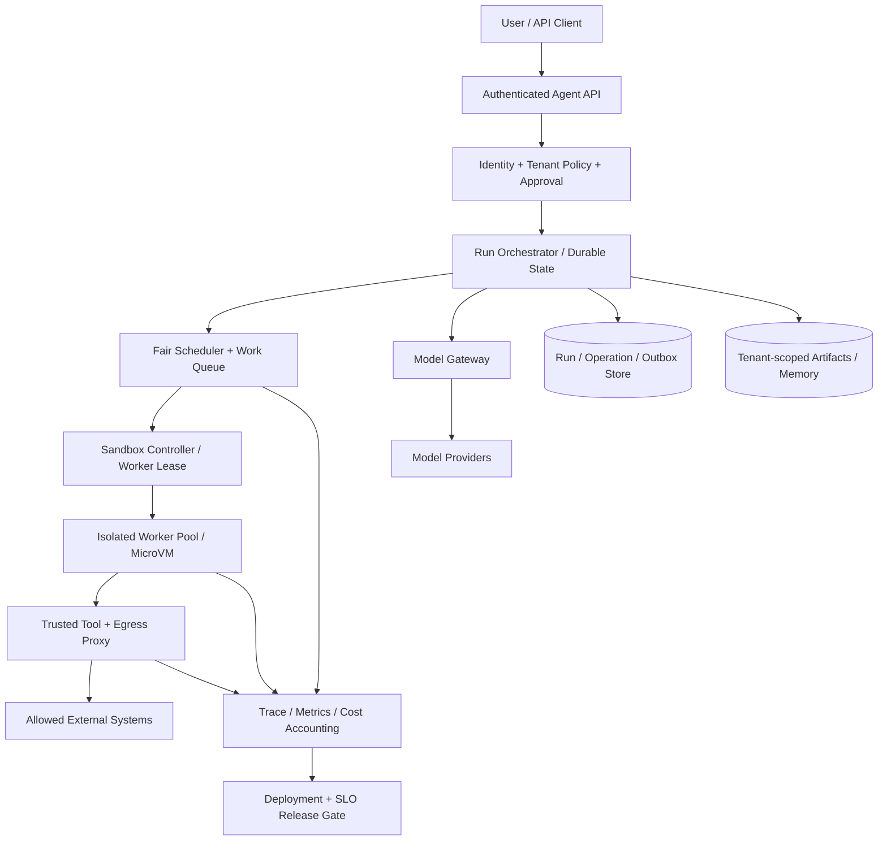
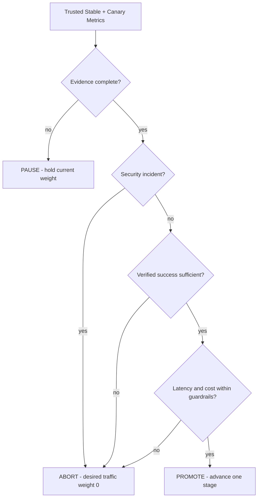

# 第 24 章：Agent 平台化与生产部署

> **正文初稿 v0.1，待技术审稿** · 第四篇：生产级 Agent Runtime 与 Infrastructure  
> **本章主线**：从可运行的单机 `mini-agent` 过渡到多租户生产平台的 Control Plane / Execution Plane / Data Plane 分层；通过版本化配置预检、可审计发布计划、灰度观测、暂停/终止决策和发布回滚边界串起整个工程闭环。  
> **本章代码**：真正执行 Python 静态策略检查、Kubernetes 参考对象渲染（JSON，不会安装）、SQLite 发布决策账本与乐观并发，基于**合成且由可信调用者提供的观测指标**做 Canary Gate。无集群 API、Helm/Kustomize 安装、Argo 控制器、付费模型、真实用户或外部副作用。  
> **必须区分**：`ReleaseLedger` 写入的是**期望的发布决策（Desired State）**，不是 Kubernetes、Ingress 或 Service Mesh 已完成流量切换的事实。真实生产上线必须有外部执行控制器、身份校验、操作回执、实际状态读回、Rollback 和独立验收。

## 学习目标

本章完成后，应能够：

1. 将 Agent API、Run Orchestrator、Scheduler、Model Gateway、Tool Proxy、Isolated Worker、State/Artifact Store、Observability 分解为职责清晰的服务。
2. 区分 **Control Plane**、**Execution Plane** 与 **Data Plane**，建立可信身份、工具权限、外部网络和用户数据的流向。
3. 设计可信配置、版本化部署、Service Account、Tenant Quota、Network Policy 和 RuntimeClass 的上线前检查。
4. 解释 Kubernetes Pod Security Admission、NetworkPolicy、ResourceQuota、Probes、HPA 的能力和限制。
5. 设计 Control Plane 与代码执行 Sandbox 间的隔离，尤其防止 Host 凭证被用户代码读取。
6. 理解为什么 Kubernetes Namespace 只是一个隔离和配额机制，不等于完整的恶意多租户安全边界。
7. 为模型、Prompt、Tool Schema、Sandbox Image 与数据库 Schema 设计独立的版本兼容和回滚策略。
8. 构建使用真实业务任务验收结果、延迟、安全事故和成本的 **Canary Release Gate**。
9. 区分 **Release Pause**、**Abort / Rollback Desired Traffic**、**实际外部效果核对**。
10. 通过故障注入测试验证：不安全的配置不能进入发布，低样本量不能自动扩大灰度，失败指标不能继续扩散。
11. 为可用性、成功率、延迟、费用、回滚、灾难恢复设计 SLO/SLI 和 On-call 操作手册。
12. 明确教学示例距完整 Kubernetes/Argo/Firecracker 生产平台还有哪些重要缺口。

---

## 24.1 什么才算 Agent Platform？

第 4 章我们从离线 Agent Loop 起步；第 7 章实现工具协议与安全调用；第 12、20、21 章分别建立耐久状态、Scheduler 和副作用恢复；第 18、19 章解释沙箱与权限；第 22、23 章提供可观测性和费用分析。

这些模块全在一个 Python 项目里**可运行**，不意味着只需把代码打包成 Docker 镜像，平台就能支持多租户生产工作负载。

Agent Platform 必须同时解决三个层面：

- **应用能力**：用户如何描述任务、选择 Agent、访问工具、审查结果？
- **运行能力**：任务如何入队、隔离、调度、恢复、验证、计量？
- **平台能力**：谁能部署、升级、回滚、撤销权限、调查事故、执行灾难恢复？

一个更准确的定义是：

> Agent Platform 是可信控制平面协调多个有限权限的决策/执行工作负载，并对用户任务的生命周期、外部副作用、隔离、成本、可观测性和版本升级负责的服务系统。

### 24.1.1 不要将 Agent SDK 误当成完整平台

模型框架可能提供 Tool Call 和 Handoff，工作流框架可能提供 DAG 和 Checkpoint，容器运行时可能提供执行隔离；但每个子系统都没有自动承担整个生命周期的授权、审计和正确性验收。

例如，一个 Coding Agent 返回“修复成功”以后，平台还需要确认 Git Patch、执行环境安全、测试结果、真正的用户权限和对用户可见的 Release/PR 状态。这些往往跨越多个服务和不同的故障边界。

## 24.2 三层架构：Control Plane / Execution Plane / Data Plane



### 24.2.1 Control Plane

可信服务负责：

- User/Tenant Authentication 和 Authorization；
- Run 与 Task 的生命周期；
- Workflow DAG / Planning orchestration；
- Scheduler、Admission、Budget；
- Tool Capability / Risk / Approval；
- Sandbox Placement、租约、强制取消和销毁；
- 版本配置和 Release Rollout；
- 独立 Verifier 与 Incident Response。

**模型本身不获得修改 Control Plane Policy 的能力。** 一个 Prompt、网页或第三方 Tool Result 不能签发管理员 Token、授予外网 Egress 或选择更低的沙箱隔离等级。

### 24.2.2 Execution Plane

运行真正的任务工作负载：

- Python/Node/Rust 代码及单元测试；
- Chromium 会话、下载和浏览器页面；
- OCR / 文件解析、批量索引和本地模型工具；
- 可能来自不可信用户或 LLM 的代码。

如果用户/模型可控制进程代码，就必须回到第 18 章的隔离要求：非特权执行、受限 RootFS、CPU/Memory/PIDs、Egress、Secret Broker、可信 Host 强制销毁。

Tool Proxy、凭证签发、Run State 写入权应保留在可信层，不能把全部管理接口暴露给 Worker。

### 24.2.3 Data Plane 与持久化事实来源

数据存储不是一大块通用 `shared_state`。至少区分：

| 存储 | 核心对象 | 一致性需求 |
| --- | --- | --- |
| Run/Task DB | Task、Run、Step、Checkpoint | 状态版本、事务、重启可恢复 |
| Operation Ledger | 外部副作用、Request Key、Receipt | Intent/Outbox 原子提交、Reconcile |
| Queue/Lease Store | Job、Claim、Worker、Generation | 事务领取、Fencing、Reap |
| Artifact Store | Patch、浏览器文件、日志片段 | Tenant ACL、版本、过期、内容校验 |
| Memory/RAG | 来源、文本、Embedding | 租户授权、过期、来源可信度 |
| Trace/Metrics | Span、Latency、Token Usage、Cost | 脱敏、采样、保留策略 |
| Configuration Store | Policy、Tool Schema、Release Version | 可审计审批、不可静默更改 |

本书前几章部分表独立部署在 SQLite 教学文件中。生产时不可以假设**多个文件各自成功 Commit 就构成跨库原子事务**；应按 Aggregate/Workflow 一致性设计单一事实来源、Outbox、Consumer Inbox、CDC 或工作流事件历史。

## 24.3 最小可运行生产架构的服务拆分

一个符合最小职责分离原则的平台至少有：

### Agent API / Auth Gateway

负责处理用户身份、Request Quota、提交 Run、读取结果、取消任务。它应该把长时间的 Agent 工作交给持久 Queue，而不是让 HTTP Request 同步阻塞几十分钟。

API Response 可以包含 `run_id` 和当前受控状态，但不应仅因为任务提交成功就返回 `verified`。

### Run Orchestrator

负责编排 Planner/Workflow，保存 Checkpoint，处理外部 Event、Pause/Resume、人类审批和业务状态。它不应持有执行任意 Shell 的长期宿主特权。

### Scheduler / Worker Controller

使用第 20 章的 Tenant Fairness、Admission、Lease、Fencing、Reaper 和 Cancellation 机制；将资源预算转换为实际 Sandbox/Worker 调度。

### Model Gateway

统一模型协议、Token Usage、Rate Limit、Timeout、Cost 和 Provider Routing。该服务需要严格的调用预算、错误分类和日志脱敏。

### Tool Proxy / Security PEP

将第 19 章 Reference Monitor 部署为**模型和不可信 Worker 之外**的可信执行网关。在最后调用 Backend 前检查 Principal、Tenant、Run、Tool、Resource、Args、Egress、Approval 和 Idempotency。

### Sandbox Host / Runtime

负责 MicroVM/gVisor/容器启动、隔离、进程生命周期、Temp Workspace、Network Policy、销毁和清理回执。业务流程是否成功与 VM 是否已销毁是两个不同事实。

### Observability / Cost Ledger / Verifier

收集受控 Trace、Token 与工具成本、成功率和副作用状态。一个模型输出的 `"task_complete":true` 不应自动转成用户任务通过业务验收。

## 24.4 多租户：Namespace 不是完整的安全边界

Kubernetes 官方将多租户细分为软多租户和更严格的租户隔离场景，并明确指出 ResourceQuota 有助于防止 Noise Neighbor，但不能覆盖所有共享资源，例如网络流量。[1]

### 24.4.1 Tenant Scope 的层次

```text
Authenticated User
  └── Organization / Tenant
      └── Project / Workspace
          └── Agent Run
              └── Tool Authorization
                  └── Sandbox / Artifact Scope
```

权限的精确对象由业务系统决定；例如用户虽然可以“读取仓库”，但不一定允许读取组织中所有仓库、创建 Pull Request 或部署生产系统。

### 24.4.2 Namespace + RBAC + ResourceQuota

Kubernetes Namespace 提供资源名称隔离范围，RBAC 限制 API 访问，ResourceQuota / LimitRange 控制资源使用。它们不是相互替代关系。

推荐同时设计：

- 可信 API 的 Tenant Context，禁止客户端任意指定其他租户；
- Namespace/ServiceAccount/RBAC；
- ResourceQuota/LimitRange；
- Pod Security Admission；
- NetworkPolicy 和真实网络 Egress Gateway；
- Worker Secret Broker、Artifact ACL、Memory Tenant Filter；
- 最终 Workload OS Sandbox 隔离。

对于高风险不可信代码，应该根据威胁模型评估专用 Node Pool、gVisor 或 MicroVM，而不是认为“Namespace 不同就安全”。

### 24.4.3 为什么必须先分离 ServiceAccount？

如果所有服务共用同一个 Token，Sandbox Worker 被攻击后可能借助控制平面服务权限扩展攻击影响。

本章预检要求 Agent API、Scheduler、Tool Gateway 与 Sandbox Worker 的 ServiceAccount 名称各不相同，并默认 `automountServiceAccountToken=false`。这能减少意外 Token 注入，但不等于生产 IAM 已经实现：真实 ServiceAccount、RBAC 和凭证签发仍需由集群可信操作员配置。

## 24.5 Kubernetes Workload Hardening

### 24.5.1 Pod Security Standards

Kubernetes 官方的 `Restricted` Profile 包含 Non-root、Seccomp、Capability Drop 和限制 Volume 类型等要求。[2]

本章 `ServiceProfile` 记录：

```python
run_as_non_root=True
read_only_root=True
drop_all_capabilities=True
allow_privilege_escalation=False
host_network=False
host_path=False
automount_service_account_token=False
```

其中一个关键点是 **Image 必须由不可变 Digest 固定**；`:latest` 标签不具备这样的内容不可变性。

现实中 Digest Pinning 还需要供应链签名、镜像扫描、可信 Registry、定期补丁和 SBOM，不能只检查 Digest 正则就证明镜像安全。

### 24.5.2 NetworkPolicy 和实际 CNI

NetworkPolicy 可以为 Namespace 设置 Default Deny Ingress 和 Egress。Kubernetes 官方提醒，Egress 默认拒绝还会影响 DNS，若有合法 DNS 需求必须另外显式允许。[3]

注意：

- NetworkPolicy 是否真正生效取决于集群所使用的网络插件和其配置；
- DNS、重定向、外网访问应由可信 Egress Gateway/Proxy 进一步约束；
- 单个 Pod 标签不会自动实现完整域名/URL 级别的 Egress 授权；
- 镜像内的恶意代码不能因为 Namespace Default Deny 而自动获得“完全安全”的证明。

### 24.5.3 RuntimeClass

`RuntimeClassName` 将 Pod 的执行方式映射到集群配置的 Runtime Handler。仅在 Deployment JSON 里写 `gvisor` 或 `microvm` **并不能创建 gVisor 或 Firecracker**：相应的运行时、CRI、隔离控制和节点配置必须由真正的 Operator 预先部署并验收。

本章将 Control Plane 服务的 `isolation` 定为 `hardened-oci`，而受模型/用户代码影响较大的 `sandbox-worker` 需要 `gvisor` 或 `microvm`。

这是一条**教学上线策略**，不是 Kubernetes 官方对所有 Agent Platform 强制规定的部署方式；真实服务可根据兼容性和风险选择更合适的 Runtime。

### 24.5.4 四种常见错误配置

| 错误 | 潜在后果 | 预检应拒绝 |
| --- | --- | --- |
| `image: latest` | 版本不可追溯、回滚失去精确性 | `image_digest_required` |
| `privileged / hostNetwork / hostPath` | 加大主机资源访问面 | `unhardened_workload` |
| `allow-all-egress` | 不可信代码可直接外发数据 | `network_default_deny_missing` |
| `sandbox-worker` 仅普通控制容器且共用管理 namespace | 隔离边界混淆 | `untrusted_worker_requires_isolated_runtime` |

本章通过 Python 静态检查阻止这些已知字段的危险组合，但真正 Kubernetes Admission Controller 必须在集群入口对完整的 Workload Spec 做权威校验。

## 24.6 Kubernetes Probes：Liveness、Readiness、Startup

Kubernetes 官方明确区分：[4]

- **Liveness**：容器是否应被重启；
- **Readiness**：容器是否应接收新流量；
- **Startup**：容器是否完成启动、是否应该开始后续探针。

### 24.6.1 不要把所有异常都变成进程重启

假设 Model Provider 临时 429，若 Agent API 的 Liveness Probe 因依赖不可用而失败，Kubernetes 将重启所有 API Pod，可能反而放大负载和故障。

通常：

- Liveness 检查本进程的不可恢复健康；
- Readiness 可结合必要依赖，但也需防止级联；
- Startup 容忍合理的冷启动期；
- 任务是否通过独立业务验收由 Run Verifier 判断，而不是 Pod Ready。

**Pod Ready ≠ Agent Task Verified。**

### 24.6.2 长任务与优雅终止

Agent Worker 可能正在执行分钟级 Coding/Browser 任务。发布或扩缩容时：

1. Worker 先停止领取新的 Lease；
2. 正在运行的 Task 接到取消/迁移通知；
3. Host 确认 Sandbox 资源安全销毁或恢复；
4. 外部副作用不确定时进入 `needs_reconciliation`；
5. 只有真正确认之后才释放运行资源。

`terminationGracePeriodSeconds` 不是无限安全保证；Pod 被 Kill 后也不自动撤销已提交的外部付款/邮件。第 20–21 章的 Lease/Reaper/Outbox 仍必须运行。

## 24.7 Horizontal Pod Autoscaling 与资源容量规划

Kubernetes HPA `autoscaling/v2` 支持 Custom Metrics 与多指标扩缩容，在多个指标输入时根据推荐的最大副本数采取调整。[5]

Agent Platform 不能只看 CPU：

| 服务 | 有用的扩缩容信号 |
| --- | --- |
| Agent API | 入站 QPS、连接、CPU、P95 请求延迟 |
| Model Gateway | Active Requests、Tokens/s、Provider Quota、429 |
| Scheduler | Queue Depth、Claim Latency、Database CPU/Locks |
| Isolated Workers | Ready Jobs、Actual Running Slots、Sandbox Acquire Latency |
| Tool Gateway | Outbound Concurrency、Rate Limit、Side Effect Backlog |
| Verifier | Pending Verification、Verifier Latency、Backpressure |

真正的 HPA 自定义队列指标需要 Metrics Adapter/Provider 配置，单纯写一个自定义字符串不会让 HPA 自动读取 Redis 或 SQLite。

### 24.7.1 一个保守容量模型

假设节点资源在系统预留后为：

\[
H=(C_{\mathrm{cpu}},M_{\mathrm{memory}},D_{\mathrm{disk}}).
\]

单个 Sandbox 需要：

\[
s=(c,m_{\mathrm{guest}}+m_{\mathrm{overhead}},d).
\]

那么静态、不超配条件下的部署上界为：

\[
N_{\max}\le
\min\left(
\left\lfloor\frac{C_{\mathrm{cpu}}}{c}\right\rfloor,
\left\lfloor\frac{M_{\mathrm{memory}}}{m_{\mathrm{guest}}+m_{\mathrm{overhead}}}\right\rfloor,
\left\lfloor\frac{D_{\mathrm{disk}}}{d}\right\rfloor
\right).
\]

这只是容量算术估算。还需加入 Pod/VM 启动、网络资源、GPU、Artifact/Log Cache、Tenant Ratio、Burst Headroom 和故障节点迁移余量。

### 24.7.2 HPA 与业务 Queue 不可脱节

一个 Worker Pod 数量翻倍，如果真正的瓶颈是 Provider 每分钟调用次数、数据库 Claim 锁或批准沙箱的容量，吞吐可能并不提升。

正确扩容需要先识别关键瓶颈，再按资源维度调节，而不是看到 Queue Depth 高就无限提高 Replica Count。

## 24.8 配置版本是发布的第一道防线

Agent Platform 有多条会独立变化的版本线：

```text
Service image digest
Model provider + model version
System/developer prompt version
Tool schema + risk policy version
Run event / checkpoint schema
Database schema
Sandbox base image / kernel
Memory index schema
Verifier/evaluation dataset version
Release and rollback policy
```

如果一次发布同时升级所有版本而缺乏兼容性矩阵，遇到故障将很难定位根因，甚至可能无法恢复旧 Run。

### 24.8.1 Expand–Migrate–Contract

数据库 Schema 升级应优先采取兼容过程：

1. **Expand**：先新增兼容字段/表，让旧代码仍能读写；
2. **Migrate**：逐步转换历史数据和新写入；
3. **Switch**：在验证通过后让新代码使用新增结构；
4. **Contract**：最后移除已过时字段，必须保证不再有旧 Worker/回滚需求。

如果候选代码要求 Schema 3，而当前稳定版本仍只支持 Schema 2，那么灰度期间旧代码或回滚可能失败。不能把 Image Rollback 当作 Schema Rollback。

本章 `PlatformManifest` 记录当前稳定 Schema 和候选兼容区间，预检要求：

\[
v_{\min}^{candidate}
\le
v_{\mathrm{stable}}
\le
v_{\max}^{candidate}.
\]

这是最小**前向兼容**检查，不是完整 Migration Correctness 证明；生产还需双版本 Run/Tool/Memory 数据和实际数据库演练。

### 24.8.2 可追溯的发布规格

```python
@dataclass(frozen=True)
class ReleaseSpec:
    release_id: str
    stable_version: str
    candidate_version: str
    manifest: PlatformManifest
```

相同 `release_id` 再次提交必须指向**完全相同的 Manifest Fingerprint 与 Gate Policy**。不能允许一个外部客户端重用旧 ID 偷换镜像、安全配置或发布条件。

`Manifest.fingerprint` 使用不可变配置的规范 JSON 摘要；生产还需要签名、发布审批、可信 Artifact Store 和谁有权发版的 IAM。


## 24.9 发布策略：从 Rolling Update 到业务灰度

### 24.9.1 Kubernetes Deployment 滚动更新的能力

原生 Deployment RollingUpdate 能在 Pod Ready 后逐步替换旧副本，结合 MaxSurge/MaxUnavailable 维护一定的服务可用性。

但 **Pod Ready 只能说明 Pod 可以接收流量**，无法回答新 Agent 的 Prompt、Tool 权限、独立业务验收、Token 成本或外部副作用是否发生回归。

例如：

- 新版本可以返回 HTTP 200，但报告事实全部错误；
- 浏览器任务完成后错把“保存草稿”变成“发布”；
- Model Gateway 因参数变化令 Token 费用翻倍；
- Scheduler 新版有 Fencing Bug，旧 Worker 可能覆盖状态；
- Sandbox Base Image 更新后浏览器稳定性下降。

这些都不能只用 Readiness Probe 判断。

### 24.9.2 Canary / Blue-Green 与 Argo Rollouts

Argo Rollouts 支持 Canary、Blue-Green、AnalysisRun/AnalysisTemplate 和 Metric-based Progressive Delivery。其官方文档区分 `Successful`、`Failed` 和 `Inconclusive` 分析结果：通过可继续发布，失败可中止，证据不足可以暂停等待人工判断或后续观测。[6]

本章提取其中“**灰度流量与业务指标验收分离**”的思想，设计一个教学级 `CanaryPolicy`：

```python
CanaryPolicy(
    stages=(5, 25, 50, 100),
    min_attempts=20,
    min_seconds=60,
    min_verified_rate=0.96,
    max_latency_ratio=1.25,
    max_cost_ratio=Decimal("1.15"),
)
```

上述值只是为了离线测试选择的策略 Fixture，**不是建议任何真实公司直接使用的生产阈值**。

含义：

- 按 5%、25%、50%、100% 四阶段扩大发布计划；
- 每轮窗口至少积累足够的尝试和观测时间；
- Canary Task 的独立验收率不低于 96%；
- Canary P95 Latency 不超过 Stable 的 1.25 倍；
- Canary Cost/Verified Task 不超过 Stable 的 1.15 倍；
- 发现任何已确认的安全事故则立即提出中止建议。

### 24.9.3 三态 Gate：Promote、Pause、Abort



为什么证据不足要 Pause，而不是自动通过或全部回滚？

**没有观测结果不等于成功，也不必然代表已发现严重故障。** 需要区分：

- 安全事故/已证实的指标越界 → Abort；
- 未获得足够样本量、观测缺失或基线不可用 → Pause；
- 有足够可比较的独立业务证据且全部约束满足 → Promote。

真正发布系统还需要最长 Pause TTL、人工值守、故障降级策略，避免在缺失观测时无期限保持不安全流量。本章只实现确定性的 Pause 结果，不做自动倒计时。

## 24.10 “成功率”必须按独立任务验收定义

### 24.10.1 一个有意严格的 Verifier 输入

```python
@dataclass(frozen=True)
class CanaryMetrics:
    elapsed_seconds: int
    attempted: int
    verified: int
    p95_latency_ms: float
    total_cost_usd: Decimal
    security_incidents: int
    release_id: str
    observed_weight: int
    window_id: str
    source: str = "trusted-observer"
```

`attempted` 是这一观测窗口内的任务数；`verified` 是由**Host-owned Business Verifier** 已确认成功的任务数，不是模型输出 `done`、HTTP 2xx 或 Worker Exit 0 的数量。

任务级指标可写为：

\[
Q = \frac{N_{\mathrm{independently\ verified}}}
{N_{\mathrm{attempted}}}.
\]

如果分母为零，应当返回证据不足，而非人为报告 100% 成功率。

### 24.10.2 成本要按已验收任务归一化

\[
C_{\mathrm{unit}}=
\frac{C_{\mathrm{model}}+C_{\mathrm{tools}}
+C_{\mathrm{sandbox}}+C_{\mathrm{retries}}+C_{\mathrm{verification}}}
{N_{\mathrm{verified}}}.
\]

仅比较“每次 Model Call 的平均价格”可能掩盖新版本需要更多 Retry/Verifier/工具调用的问题。

本章 `CanaryMetrics.total_cost_usd` 是测试中明确提供的 Aggregated Cost；生产需要与第 22 章 Trace Usage 和第 23 章 Cost Ledger 对接，尤其不能漏计失败/重试产生的成本。

### 24.10.3 为何不能直接相信 Model 报告的指标？

如果一个错误的 Agent 将自己的 `"success":true` 当作验收依据，它可以让成功率很好看，却真正损害用户任务。

因此 `judge_canary` 只作为决策函数；生产系统需要在**可信观测层**查询经过授权的任务验收记录、成本明细和安全事件，并把观测窗口和 Release Version 绑定。本章还要求每个候选阶段使用**不同的观测窗口 ID**，并检查指标是否属于当前 Release 和 Traffic Weight；成功放量后无法重复使用旧窗口继续过审。

本章 `source="trusted-observer"` 字段只是教学标签，无法认证上报者；真正发布 Gateway 应验证工作负载身份、数据来源、样本量、时间窗和指标查询的版本一致性。

## 24.11 为什么 Rollback 不等于外部事务回滚？

这是 Agent Platform 相比普通 Web Service 发布特别重要的一点。

假设候选 Agent 已经在 5% 灰度期间执行了：

- 发送一封邮件；
- 创建一个 Pull Request；
- 提交一次支付请求；
- 发布一个用户草稿。

之后质量指标下降，Release Controller 决定将 Canary 流量切回 Stable。**已完成的外部副作用并不会随着镜像回滚而自动逆转。**

因此发布回滚必须和以下系统协作：

- 第 19 章 Host Tool Policy：停止有风险的新动作；
- 第 20 章 Scheduler：停止向不健康版本分配新的 Lease；
- 第 21 章 Operation Ledger：区分已经提交、未知与未提交的外部操作；
- 第 18 章 Sandbox Controller：强制终止危险 Workload；
- 第 22 章 Observability：追踪 Release ID、Run ID 与真实效果；
- Verifier / Human Review：确认哪些用户任务需要核对或补偿。

**Desired Traffic Weight=0 是发布控制决策，不是业务副作用已消失的证据。**

## 24.12 SQLite 发布账本：从无状态判断到耐久决策

本章提供 [`ReleaseLedger`](../../src/mini_agent/platform_deployment.py)，使用 SQLite 存储：

```text
releases:
  release_id
  stable_version
  candidate_version
  manifest_hash
  policy_hash
  policy_json
  generation
  status
  weight
  stage_index
  reason

release_events:
  release_id
  generation
  action
  reason
  previous_weight
  next_weight
```

### 24.12.1 CAS 防止两个控制器同时扩大灰度

假设 Controller A 和 B 都读到：

```text
release-001, generation=3, weight=50%
```

二者各自都想提交决策。若没有 CAS，可能同时扩大流量，或后写入者覆盖前一方的安全终止决定。

本章 `decide(..., expected_generation=3)` 在 SQLite `BEGIN IMMEDIATE` 事务中：

1. 加载当前 Release 状态；
2. 读取创建 Release 时固化的 Policy；
3. 验证状态尚未 Finalize，且 Generation 相等；
4. 基于 Host Metrics 执行 Gate；
5. 只提交下一阶段、暂停或终止其中一种决策；
6. 将新 Generation 与安全原因码写入事件账本。

第二个携带旧 Generation 的 Controller 会收到 `VersionConflict`，不能覆盖较新的决定。

### 24.12.2 防止 Release ID 偷换目标

初始化 Release 后，同 `release_id` 重放完全相同的 Stable/Candidate、Manifest Hash 和 Policy Hash，可以返回现有发布；但若重新提交同 ID 却改变镜像或安全配置，必须拒绝。

该规则与前面章节的 Task/Run Idempotency 设计一致。发布记录属于可信操作，不允许模型自由更改权限或阈值。

### 24.12.3 保存决策 ≠ 操作完成

Ledger 当前只写入：

```text
desired_weight = 25
status = observing
```

它不会真正连接 Kubernetes API、Service Mesh 或 Argo Rollouts，也不能证明 Ingress 已将 25% 的请求导向 Canary。

真正的生产控制器还需要：

```text
Desired Release Decision
  ↓
Authenticated deployment/traffic actuator
  ↓
Provider accepts command
  ↓
Observed Cluster/Ingress State
  ↓
Receipt + reconciliation
  ↓
Next Metric Window
```

如控制命令超时，需要首先读取实际流量状态，不应在未知情况下重复执行任意操作。第 21 章的 Outbox/Unknown Effect 模型同样适用于发布操作。

## 24.13 本章从零实现的 Python 模块

### 24.13.1 PlatformManifest：控制服务、执行服务、租户

```python
@dataclass(frozen=True)
class PlatformManifest:
    platform_id: str
    policy_version: str
    services: tuple[ServiceProfile, ...]
    tenants: tuple[TenantProfile, ...]
    stable_db_schema: int
    candidate_min_db_schema: int
    candidate_max_db_schema: int
```

`ServiceProfile` 限定：

- Service/Namespace/ServiceAccount；
- 不可变 Image Digest；
- CPU/Memory Requests & Limits；
- Runtime Isolation Class；
- Network Egress Profile；
- 非特权用户、Read-only RootFS；
- 禁用 Privilege Escalation、HostNetwork、HostPath 和 SA Token AutoMount。

`TenantProfile` 记录 Tenant ID、Namespace、Queued/Running Budget、CPU/Memory Quota。

**注意**：本章的 Tenant Profile 不会自动创建真实 ResourceQuota、NetworkPolicy 或隔离租户文件。配置只是准备应用到真实控制平面的预期策略。

### 24.13.2 Preflight：静态规则与阻断

```python
findings = preflight(platform)
assert findings == ()
```

`preflight` 发现多种部署错误，例如：

| 规则编码 | 问题 |
| --- | --- |
| `missing_required_service` | 缺少 Agent API、Scheduler、Gateway 或 Worker |
| `image_digest_required` | 镜像没有按 SHA-256 Digest 固定 |
| `shared_tenant_namespace` | 不同 Tenant 共用命名空间（本章高隔离策略不允许） |
| `service_accounts_not_separated` | 控制平面与 Worker 可能共用凭证身份 |
| `unhardened_workload` | 存在 Host 权限或缺失安全约束 |
| `network_default_deny_missing` | 运行工作负载没有 Default Deny 设计 |
| `untrusted_worker_requires_isolated_runtime` | 不可信 Worker 仅用普通 OCI 运行 |
| `rollback_schema_incompatible` | Candidate 与稳定 DB Schema 不兼容 |

规则码用于 CI/审查人员定位问题，不应把所有敏感配置原文复制到不可信 Agent 的错误结果中。

### 24.13.3 参考 Kubernetes JSON 渲染

`reference_kubernetes_objects(manifest)` 可生成有限的：

- Namespace；
- Default Deny Ingress/Egress NetworkPolicy；
- Deployment（带 Image Digest、Resource Requests/Limits、Secure Container/Pod Fields 和 RuntimeClassName）。

这些对象可用于讨论和离线检查，但不是完整的生产部署清单：

- `registry.invalid` 是刻意使用的无效示例 Registry 地址；
- 没有创建 Service/Ingress、ServiceAccount、RBAC、Secret Broker；
- 没有创建 Egress Proxy 的真实允许规则；
- 没有集群适配的 RuntimeClass Handler；
- 没有 CI/CD Artifact 签名、镜像扫描、实际 Runtime 安装；
- 没有数据库、持久化队列和模型/工具服务真实配置。

**不要直接将这些静态参考 JSON 当作可以运行完整 Agent Platform 的 Helm Chart。**

### 24.13.4 发布门

`judge_canary(baseline,candidate,weight,next_weight,policy)` 只返回：

```text
RolloutJudgment:
  action = promote | pause | abort
  reason = safe machine-readable reason
  current_weight
  next_weight
```

它在安全事故时优先 Abort；样本量不足时 Pause；有可比较的样本且 Task Success、P95 Latency、Cost/Verified Task 都满足策略，才 Promote。

### 24.13.5 ReleaseLedger

SQLite 账本在每轮将 Gate 决策保存成带 Generation 的事件，对并发写入使用 CAS，保存初次发布的 Policy 和 Manifest Hash。

但是权限仍由外部 Host 管理：如果让不可信 Worker 直接写 SQLite、伪造 Canary Metrics，整套控制平面的信任边界就会被破坏。代码里的 `source` 文本标签不能代替真正鉴权。

## 24.14 离线实验

源代码与运行入口：

- [平台/灰度源码](../../src/mini_agent/platform_deployment.py)
- [合成可信 Fixture](../../src/mini_agent/platform_fixture.py)
- [运行示例](../../examples/ch24_platform_lab.py)
- [单元测试](../../tests/test_ch24.py)

```bash
python -m pip install -e .
python examples/ch24_platform_lab.py
python -m unittest discover -s tests -p 'test_ch24.py' -v
```

### 24.14.1 实验 A：Preflight

运行可信的合成 PlatformManifest，验证：

- 四个必要服务存在；
- 服务账号分离；
- Tenant Namespace 不重叠；
- 所有镜像由不可变 Digest 指向；
- Worker 为 `gvisor` RuntimeClass；
- CPU/Memory Requests 不高于 Limits；
- 开启 Default Deny、Non-root、Seccomp 与 Drop ALL Capabilities。

实验打印静态 Preflight Findings，期望空列表。

### 24.14.2 实验 B：缺少观测 → Pause

创建一个 Release，初始期望流量 5%。

第一次评测时 Stable 或 Canary 指标缺失：

```text
release-001
desired weight = 5%
metrics incomplete
decision = pause
desired weight remains 5%
```

不会因为观测系统断链而自动将灰度推进到 25%。

### 24.14.3 实验 C：多阶段通过

对于每阶段都达到合成指标条件的 Release：

```text
5% → 25% → 50% → 100% → promoted
```

第四轮在 100% 窗口经过一次完整验收之后才成为 `promoted`。这避免刚到 100% 就跳过最终验证的常见漏洞。

所有 Traffic Weight 都是 SQLite Ledger 中的 Desired State，**程序没有实际移动一条请求**。

### 24.14.4 实验 D：安全事故中止

第二个 Release 从 5% 灰度开始，模拟收到一个 Host-owned Security Incident：

```text
security_incidents=1
decision=abort
desired weight=0
status=aborted
```

即使其他指标健康，Gate 也不应扩大该版本的流量。是否真实完成 Cluster Rollback，仍需要实际 Controller 与外部状态验证。

## 24.15 测试覆盖哪些生产不变量？

本章新增 41 项单元测试，主要覆盖：

| 类别 | 核心断言 |
| --- | --- |
| Image Identity | 拒绝可变标签和不合法 Digest |
| Privilege | 非 root / Read-only RootFS / Capabilities / Host Paths 等静态约束 |
| Isolation | Untrusted Worker 不能降级为 Control Plane 普通 OCI |
| Network | 不能静态配置开放外网 |
| Tenant | 命名空间、ServiceAccount 不混用 |
| Resources | Requests ≤ Limits，Replica 取值正确 |
| Schema | Candidate 与 Stable DB Schema 兼容 |
| Render | 参考 Kubernetes JSON 不含 Privileged / HostPath |
| Evidence | 指标缺失、低样本量不能自动 Promote |
| Quality | Verified Success Rate 不达标 → Abort |
| Security | 事故信号 → Abort，即使样本少 |
| Latency | P95 超出约束 → Abort |
| Cost | Cost per Verified Task 退化 → Abort |
| Canary Policy | 不合法 Stage/Threshold 拒绝 |
| Durability | SQLite 重建仍能读取 Release Status |
| Idempotency | 同 ID 只能初始化同 Manifest/Policy |
| Fencing | 旧 Generation 不能覆盖新决策 |
| Concurrent Control | 两个 Controller 竞争时仅一个可提交 |
| Terminality | 已 Promoted/Aborted 的 Release 不得被继续推进 |
| Audit | 只保存 Reason Codes、Version 与权重变化，避免用户原始内容 |

这证明的是离线发布判定函数和 SQLite 状态机内部逻辑。它不证明真实集群安全隔离、Argo Controller 一定按时响应，或任何真实模型的升级不会出现质量回归。

## 24.16 SLO、SLI 与 Error Budget

平台化不能只看 Pod CPU 和 Tool Call 日志，需要建立 User-centric 服务指标。

### 24.16.1 四类 SLO

**API SLO**：合法用户能否提交、查看和取消任务；衡量请求可用性、认证成功与响应延迟。

**Task SLO**：独立验收的 Task Success、完成时间和正确拒绝的比例。一个 Run 的 HTTP 202 只表示排队成功。

**Side Effect SLO**：外部写操作有多少进入 `needs_reconciliation`，这些未决结果多久能获得可信确认；避免用业务事故换“低失败率”。

**Sandbox SLO**：Sandbox Acquire Latency、Resource Saturation、强制销毁回执、孤儿 VM/进程数量。

### 24.16.2 Error Budget

若某 SLO 为 99.9% 的 API Availability，其名义 Error Budget 为 0.1%。但重要的是基于明确的请求口径计算，并区别：

- `expected deny`：用户权限不允许；
- `business failure`：合法任务未能成功完成；
- `infrastructure failure`：服务不可用；
- `security incident`：安全事件，不能仅被并入普通 5xx 指标。

不要因发布导致少数用户发生未经授权的操作，就宣称“总体 99.99% 请求成功所以安全可控”。安全事故应有独立 Stop Condition。

### 24.16.3 发布中的样本量和信号可用性

真实 Canary Gate 应明确：

- 灰度与 Stable 的相同任务类型/流量构成；
- 双方可比较的时段；
- 最小可信样本量；
- 指标聚合与延迟；
- 关键指标的置信区间与统计误差；
- 观测是否受到采样或流量偏差影响；
- Safety Gate 与人工审批规则。

本章只是确定性 Guardrail Gate，没有统计显著性/假设检验和多任务分布对齐，因此不能以一个合成样例推导生产灰度阈值。

## 24.17 Deployment as Code、GitOps 与供应链

### 24.17.1 Git Commit 与运行配置

建议将代码和部署配置版本化：

```text
git commit SHA
    + signed container digest
    + release spec
    + tool policy version
    + model/prompt version
    + database schema compatibility
    + verifier dataset version
    + rollback plan
```

“代码已提交”不表示环境已部署，“镜像已构建”也不表示镜像已被集群拉取或通过健康检查。

### 24.17.2 GitOps Control Plane

GitOps 可以用受审查的仓库目标状态与集群实际状态做持续调谐；但必须考虑：

- CI 执行身份与 ServiceAccount 的最小权限；
- 谁有权修改代码、策略、密钥和审批；
- 变更与 Release ID 的关联；
- 发布失败时的实际状态和快照恢复；
- 数据库迁移的单向不可逆性；
- 下游外部工具副作用不会被 Git Rollback 消除。

本章 ReleaseLedger 是**离线判定原型**，不是一个运行中的 Argo CD/Flux 或 Argo Rollouts Controller。

## 24.18 灾难恢复（Disaster Recovery）

生产 Agent Platform 不能只依赖 Kubernetes ReplicaSet 在单集群内自愈。假设：

- Postgres 故障；
- Queue Broker 数据丢失；
- Sandbox Host 断电；
- 对象存储暂时不可用；
- Model Provider 大规模服务中断；
- Tool Gateway 凭证被撤销。

平台需要定义：

**RPO (Recovery Point Objective)**：可接受的持久数据丢失量。

**RTO (Recovery Time Objective)**：从事故到恢复可用服务的目标时间。

对长期 Agent Run，必须能在重建 Scheduler/Worker 之后恢复正确的 Step/Operation 状态，并避免凭空重试已经发生的不可逆动作。

灾难恢复演练不能仅测试 API Server 自动拉起，还应包括：

1. 重建 Durable Queue 与 Operation Ledger；
2. 恢复 Lease/Generation 和 Host Reaper；
3. 查证外部 Provider 的未知副作用；
4. 恢复 Artifact ACL 与加密密钥；
5. 对照 Verifier 确认实际用户结果；
6. 处理模型/工具 Schema 的运行中版本兼容问题。

## 24.19 生产环境还缺少哪些组件？

从教学到真正上线，仍需要：

- Kubernetes Cluster、网络插件、Pod Security Admission；
- 可信 Container Registry、镜像签名、SBOM、漏洞扫描；
- 真实 ServiceAccount、RBAC、mTLS、Tenant Identity、Secret Broker；
- gVisor/Firecracker/Kata 等隔离 Runtime 的安装与独立验收；
- 实际 ResourceQuota、LimitRange、NetworkPolicy 和 Egress Proxy；
- Run DB、Operation Ledger、Outbox/Inbox 和高可用 Backup；
- 真正 Worker Lease、Sandbox Lifecycle、Host Termination Receipt；
- Model Gateway Rate Limits、Provider Usage、真实费用核对；
- OTel Collector、Metrics Backend、Tracing、Audit Access Control；
- Argo Rollouts 或等效部署执行器及真实 Traffic Observation；
- 生产指标窗口、业务独立 Verifier、人工审批、错误预算和 On-call；
- 真正的负载测试、容错演练、跨 Tenant 安全测试；
- 数据备份/恢复、Migration 兼容和未决业务结果核对。

**这些组件仅在正文中设计，没有因为测试通过就成为已部署能力。**

## 24.20 习题与项目任务

### 理论题

**24.1** 区分 Control Plane、Execution Plane、Data Plane，解释为什么模型不能直接获得 Kubernetes Cluster Admin Token。

**24.2** 对一个 Coding Agent 平台，列出最少六种权限边界：Tenant、Run、Tool、Repo、Sandbox、Artifact、Network 等。

**24.3** 比较 Pod Ready、HTTP Request Success、Worker Task Done 与 Independent Task Verified。为什么它们不能互相替代？

**24.4** 为什么 Kubernetes ResourceQuota 不等于多租户强隔离？解释 Node、Network、Kernel 的共享资源问题。

**24.5** 为什么回滚 Agent 服务版本可能无法回滚已发送邮件和已提交数据库事务？

### 编程任务

**24.6** 在专用本地 Kind/K3s 测试集群，部署四个服务的简化 Manifest，并补齐 ServiceAccount/RBAC/Service/Ingress/LimitRange/NetworkPolicy。不要把本章无效 Registry 的教学 JSON 直接部署到生产。

**24.7** 将 `preflight` 改为一个 CI Stage，验证受保护镜像的签名与 SBOM；失败时必须阻止 Release。

**24.8** 在已配置 CNI 和 Pod Security Admission 的测试环境，验证 Default Deny 对 Pod/DNS 的实际生效情况，并按最小权限补齐 Egress Gateway 规则。

**24.9** 用第 18 章真正的 Sandbox Backend 替换 RuntimeClass 教学标签，验证 Worker 无法读取 Host Token/其他 Tenant 文件。

**24.10** 为 `CanaryMetrics` 增加可信 Trace Query 适配器，基于第 22 章的 Model/Tool Span 和 Host Verifier 读取独立指标。

**24.11** 实现 Release 状态的 Reconciliation Loop：将 SQLite Desired Weight 与真实 Argo Rollouts/Ingress Observed Weight 对比，验证 Actuator Receipt，再提交状态。

**24.12** 用真实 Provider Usage 替换合成 Cost，记录 `Cost per Verified Task` 并在费用超额时 Pause/Abort。

**24.13** 给 ReleaseLedger 加上经过 IAM 认证的操作身份、审批、审计签名和必要的 CAS/撤销机制。

**24.14** 为 Release 关联 Database Migration/Checkpoint Schema 与旧版 Worker 的兼容性测试，证明回滚后长期 Run 仍可恢复。

### 性能、安全和可靠性评测

**24.15** 模拟 500 个租户、不同 Agent 任务时长和 Sandbox 冷启动分布，测量 Admission Rejection、Queue P99、Cost/Verified Task。

**24.16** 故障注入让发布期间 Model Gateway 大量 429，讨论哪些指标应该触发 Pause、Abort、限制 Worker、调整 Circuit Breaker。

**24.17** 模拟一次 Browser Agent 误发布草稿的安全事故，解释为什么即使错误请求占比极低，仍应在安全 Gate 中立即止损并核实已发生的效果。

**24.18** 对比 Native Deployment RollingUpdate 与 Argo Rollouts AnalysisRun，实现可复现的通过、证据不足、失败三种发布条件。

**24.19** 设计一套多 Region Run/Artifact/Outbox 恢复策略，明确定义 RPO、RTO 及跨区域外部副作用的幂等恢复方式。

**24.20** 对平台做一次 Production Readiness Review，列出需要线上实测的 20 项安全、网络、权限、备份、容量、可观测性和回滚断言，并形成证据清单。

## 24.21 本章总结

1. **Agent Platform 是一个具有可信权限与任务生命周期的分布式服务系统，不是 Docker 化的 Agent Loop。**
2. Control Plane、Execution Plane、Data Plane 必须分离，尤其不能把 Host 权限交给不可信 Agent。
3. 多租户 Namespace/ResourceQuota 是重要基础，但不等于完整安全隔离。
4. Pod Security、NetworkPolicy、RBAC、RuntimeClass、Sandbox 和 Secret Broker 应协同设计；声明配置不等于真实执行成功。
5. Run、Tool、Model、Prompt、DB Schema、Sandbox Image 版本需要明确兼容和回滚边界。
6. Canary 应根据独立 Task Verification、安全事故、P95 延迟和 Cost/Verified Task 决策，而不只是看 Pod Ready 或 HTTP 200。
7. **缺少可靠观测时要 Pause；已证实的安全/质量回归要 Abort；全部指标通过才进入下一阶段。**
8. SQLite ReleaseLedger 展示决策持久化和 Generation CAS，但没有实际部署或切流能力。
9. **Traffic Rollback 不会撤销外部业务副作用**，仍需 Operation Ledger、Reconciliation 和必要的人工审查。
10. 真实生产上线必须经过独立的安全、可靠性、性能、灾难恢复和用户任务验收。

至此第四篇（第 18–24 章）的 Sandbox、Security、Scheduling、Reliability、Observability、Cost 和 Platform Deployment 均有教学原型。**平台尚未真正部署到多租户生产环境，不能把章节完成率等同于生产成熟度。**

下一章：[第 25 章《Agent Evaluation 基础》](25.md)。我们将从系统评测的可信任务、评测数据集、Verifier、Task Success、费用和失败分类开始，构建可复现的 Agent Evaluation Framework。

---

## 参考资料（以官方说明为主）

[1] Kubernetes. *Multi-tenancy*. https://kubernetes.io/docs/concepts/security/multi-tenancy/

[2] Kubernetes. *Pod Security Standards — Restricted*. https://kubernetes.io/docs/concepts/security/pod-security-standards/

[3] Kubernetes. *Network Policies — Default Deny*. https://kubernetes.io/docs/concepts/services-networking/network-policies/

[4] Kubernetes. *Liveness, Readiness, and Startup Probes*. https://kubernetes.io/docs/tasks/configure-pod-container/configure-liveness-readiness-probes/

[5] Kubernetes. *Horizontal Pod Autoscaling*. https://kubernetes.io/docs/concepts/workloads/autoscaling/horizontal-pod-autoscale/

[6] Argo Rollouts. *Analysis and Progressive Delivery*. https://argoproj.github.io/argo-rollouts/features/analysis/

[7] Argo Rollouts. *Canary Deployment Strategy*. https://argoproj.github.io/argo-rollouts/features/canary/

[8] Kubernetes. *Resource Quotas*. https://kubernetes.io/docs/concepts/policy/resource-quotas/

[9] Kubernetes. *Pod Lifecycle*. https://kubernetes.io/docs/concepts/workloads/pods/pod-lifecycle/

[10] Google SRE Book. *Service Level Objectives*. https://sre.google/sre-book/service-level-objectives/

[11] OpenTelemetry. *Generative AI Semantic Conventions*. https://opentelemetry.io/docs/specs/semconv/gen-ai/

[12] Firecracker. *Production Host Setup*. https://github.com/firecracker-microvm/firecracker/blob/main/docs/prod-host-setup.md

> **技术与安全声明（2026 年 10 月）**：本章离线判断依据的是固定合成指标和由可信 Python 调用者提供的 ReleaseSpec。`registry.invalid`、RuntimeClass 字符串、NetworkPolicy 声明和 Pod Security Labels 都不是实际已部署且安全有效的集群环境。本章的发布日志表达决策意图，不包含认证、真实环境状态读回、实际外部副作用核对或多集群一致性。生产部署必须经过合规授权和独立的实际环境测试。
