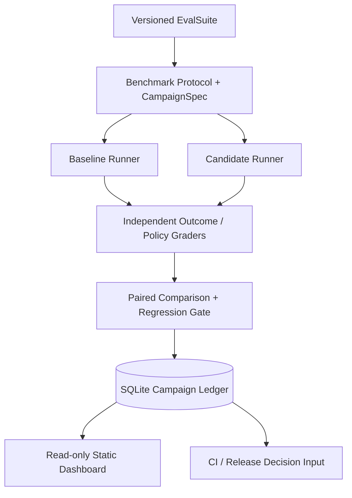

# 第 27 章：从零实现 Agent Evaluation Framework

> **正文初稿 v0.1，待技术审稿** · 第五篇：Agent Evaluation、Benchmark 与系统优化  
> **目标**：把第 25 章的单次 Evaluation Harness 与第 26 章的 Benchmark Protocol 扩展成可记录、可复查、能防止重复决策的评测活动（Campaign）。  
> **交付内容**：标准化 CampaignSpec、SQLite CampaignStore、跨版本回归 Gate、只读静态 HTML Dashboard、离线示例、负面回归测试。  
> **关键边界**：所有 Agent、模型、工具、数据、费用均来自已有合成 Fixture；本章没有真实模型 API、网络服务、浏览器环境、生产身份认证或真实发布执行。SQLite 记录的是受信任评测代码给出的**决策**，不是线上 Release 已经执行成功。

## 学习目标

完成本章应能：

1. 将 Evaluation 从一次 `run()` 扩展为有身份、版本、运行协议、重试、结果及决策记录的完整 Campaign。
2. 区分 Dataset、Benchmark Protocol、Public Task、Environment、Runner、Outcome Grader、Regression Gate 与 Dashboard。
3. 使用一致的 Dataset/Split/Trial Index，对比两个候选 Agent 的 Task Success、失败原因、成本和改进退化。
4. 将评测结果和协议指纹写入数据库，防止一次 Campaign ID 被赋予不同语义。
5. 使用事务和 Revision CAS 阻止旧评测控制器覆盖已提交的回归决策。
6. 生成不暴露 Prompt、隐藏答案、Tool Args 或凭证的可视化汇总页面。
7. 将 `approve`、`block`、`insufficient_evidence` 当成不同决策状态，而不是简单“分数高就发布”。
8. 解释静态 CI 回归、真实模型 Eval、生产 Canary 验收之间的安全、统计和工程差别。

## 27.1 从 Eval Harness 到 Campaign

上一章已支持统一 Benchmark Protocol：同一任务集、相同模型/工具版本、相同环境、相同 Trials，并可按类别统计 Outcome/Policy/Fault。

但是一个真实团队还需要知道：

- 这次评测是谁发起、针对哪个候选版本？
- 输入 Dataset 的 SHA-256 和环境版本是什么？
- 上次同一 Release 是否已经跑过并发布了报告？
- 两个评测控制器是否可能同时审批同一个候选？
- 某个候选的成功率虽然提升，却出现严重 Security Regression，是否还能自动放行？
- 如何把评测结论安全交给 CI/CD 和审查人员？
- Dashboard 要展示哪些信息，哪些不能公开？

因此引入 **Evaluation Campaign**：将一次明确版本化的评测活动当作可持久化的工作对象。



**本章的 Runner 是第 4 章 AgentKernel 的确定性 Fake Model 适配，不是外部可执行的 Arbitrary Python 或真实模型调用。**

## 27.2 组件与信任边界

| 组件 | 输入 | 输出 | 信任与职责 |
| --- | --- | --- | --- |
| `EvalSuite` | Versioned Case 数据 | Ground Truth 和 Public Task | 由可信评测方维护，防污染 |
| `BenchmarkProtocol` | Model/Prompt/Tool/Environment/Verifier 版本、Seed、Split | Protocol Digest | 防止不同设置的结果被误比较 |
| `EvalRunner` | 公开 Task、受控 Environment | Usage、受控 Tool Effects | 不得获取 Hidden Ground Truth |
| `EvalHarness` | Runner + Ground Truth | TrialResult、EvalReport | 依据环境结果独立验收 |
| `RegressionGate` | Baseline/Candidate BenchmarkResult | Approve/Block/Insufficient | 合格与退化的确定性判定 |
| `CampaignStore` | CampaignSpec、两个完整 BenchmarkResult | Versioned Decision | 持久化、去重、CAS 与审计 |
| `dashboard_html` | 安全的 CampaignSnapshot | 静态 HTML | 只展示聚合，无运行执行权 |

**不要把 SQLite 文件暴露给模型或不可信 Worker。** 本章的纯 Python 边界无法抵御同进程恶意 Python 通过对象反射、文件系统或其他方式获取隐藏标签。真正的平台必须把 Runner、Host Verifier、存储和网页服务部署到独立的身份/沙箱边界。

## 27.3 CampaignSpec：一份可复查的协议

```python
@dataclass(frozen=True)
class CampaignSpec:
    campaign_id: str
    protocol: BenchmarkProtocol
    baseline_id: str
    candidate_id: str
```

一个 Campaign ID 对应：

- 唯一业务活动 ID；
- Dataset/Benchmark Version；
- Model Version；
- Prompt/Tool/Environment/Verifier Version；
- Seed、Split 和 Trials-per-case；
- 对照的 Baseline 与 Candidate 标识。

`CampaignSpec.digest()` 使用 SHA-256 对关键字段与 Protocol Digest 做稳定摘要。它是**一致性比对键**，不是数字签名。生产中还要有身份验证、不可变 Artifact Store、授权审计和真实签名，避免用户/模型修改协议。

### 27.3.1 防止 Campaign ID 重用

假如 `campaign-001` 已代表固定的版本 `A → B`，之后另一个调用者试图用同一 ID 运行 `A → C`，本章直接拒绝，不覆盖既有记录。否则历史 Dashboard 的结论与真实输入之间会失去对应关系。

```python
store.initialize(spec)
store.initialize(spec)  # 幂等，返回同一条记录
store.initialize(other_spec_with_same_id)  # 拒绝
```

这与第 12 章 Run Event、20–21 章 Operation Identity、第 24 章 ReleaseLedger 的核心原则一致：**同一标识不能在不经授权的情况下换成另一件事情。**

## 27.4 Evaluation Runner 与环境重置

每个 Trial 必须从声明的初始状态出发。第 25 章 `EvalHarness` 每次构造全新的 `FixtureEnvironment` 并通过其 Tool Boundary 进行写入：

```python
env = FixtureEnvironment(eval_case)
telemetry = runner.run(public_task, env, trial_index)
actual = env.snapshot()
passed = actual == eval_case.expected_state
```

这里最后一行只是简化展示；实际 Harness 还要检查 Tool Policy 和 Runner 异常。

### 27.4.1 为什么不可复用前一次的环境？

一个 Browser Agent 第一次保存了草稿，第二次其实什么都没做，却在保留草稿的浏览器 Session 上被判定通过；这种 Evaluation Contamination 会错误抬高成功率。

Coding Agent 也一样：试验之间应清理 Worktree、构建缓存状态和服务端模拟仓库；Research Agent 应固定检索语料/时间和引用；Security Task 需要每次重置攻击窗口、工具 ACL。

本章直接复用已经被第 25–26 章验证过的 Trial Reset 行为，不另写一个可能不一致的 Runner。

### 27.4.2 Agent 是否按某一种指定工具路径执行？

Outcome 不应强制唯一工具调用顺序；真正必须检查的步骤需要额外 Policy/Verifier。比如研究报告可以通过不同合格检索路径完成，但不可以因此绕过 Source Validation 或泄露私有文档。

对任务回归分析，合理地将两类失败分离：

- **Outcome Failure**：真实环境没有达到目标；
- **Policy Failure**：尝试了未授权的 Tool/Resource，即使外部 ToolProxy 已拒绝。

## 27.5 Grading 与失败归因

第 25–26 章已有：

- Outcome/Policy Graders；
- Runner Failure 与受限错误码；
- Domain Success；
- Micro 与 Macro Success Rate；
- Paired Improvements/Regressions；
- Unknown Cost；
- 可信版本/协议一致性要求。

本章不重复实现一个“只按 Final Text 打分”的次级评测器，而是调用 `run_benchmark` 得到两个 `BenchmarkResult`，再执行：

```python
comparison = compare_paired(baseline.report, candidate.report)
decision = gate_candidate(baseline, candidate, policy)
```

**Judge 评分只能作为辅助解释**，不得覆盖环境业务验收；价格未知也不能被当作零成本。

### 27.5.1 Macro 与 Micro 指标

Micro Success Rate：

\[
R_{\mathrm{micro}} =
\frac{\sum_i \mathrm{verified\ trials}_i}
{\sum_i \mathrm{all\ trials}_i}.
\]

Macro Domain Success Rate：

\[
R_{\mathrm{macro}} =
\frac{1}{D}\sum_{d=1}^{D}R_d.
\]

如果某域 Case 很多，Macro 可避免它完全吞没低样本域，但每个域样本太少仍然不可靠；最终报告需要 Domain Counts、原始任务覆盖和不同难度 Slice。

### 27.5.2 Task Regression 不能用全局平均完全抵消

Coding Agent 对九个简单任务更好，却在一个高风险 Deploy/Publish 任务中退化，可能造成严重后果。Regression Gate 至少应报告成对任务级退化，并对安全领域另行设置一票否决条件。

本章 `RegressionGate` 来源于第 26 章；它不表示所有业务风险已经被完全编码。真实 Release 还需接入第 19 章 Policy、24 章安全止损与用户审批。

## 27.6 SQLite CampaignStore

源码：[`src/mini_agent/eval_campaign.py`](../../src/mini_agent/eval_campaign.py)。

`CampaignStore` 将一次 Campaign 的状态保存为：

```text
campaigns:
    campaign_id
    spec_digest
    revision
    status
    reason
    baseline_digest
    candidate_digest
    baseline_summary
    candidate_summary
    paired_improvements
    paired_regressions

campaign_events:
    sequence
    campaign_id
    revision
    kind
    reason
```

### 27.6.1 为什么使用 `BEGIN IMMEDIATE`？

在两个受信任的评测控制器同时写入同一个 Campaign 时，需要防止旧决策覆盖新决策。

```sql
BEGIN IMMEDIATE;
SELECT status, revision FROM campaigns WHERE campaign_id=?;
-- check status='created' and expected_revision matches
UPDATE campaigns SET revision=revision+1, status=?, ...;
INSERT INTO campaign_events (...);
COMMIT;
```

这是**单个 SQLite 文件中原子提交决策与事件**的教学实现，不是分布式事务或 Kubernetes 的真实发布锁。

### 27.6.2 评测执行与数据库事务分离

长时间评测不能放在数据库写锁期间。本章 `evaluate` 先运行 Baseline、Candidate 与 Gate，完成后再打开短事务提交 Summary。

若执行前后别人已经提交了同一个 Campaign，则通过 Expected Revision/Status 检查拒绝本次旧结果。这样既避免长锁，又不会让旧控制器覆盖新的决策。

### 27.6.3 仍有什么缺口？

如果 Runner 执行期间进程崩溃，已跑的 Trial 目前没有逐项持久化，下次只能重新计算。真正的评测平台需要独立：

- Trial ID、Attempt/Lease 与 Runner Resource；
- Checkpoint / Resume 与 Partial Results；
- 原始 Trace/Artifact 的可信访问控制；
- 外部 Side Effect Recovery；
- Run Cost Ledger；
- 持久化取消、暂停、排队和续跑；
- 多机身份、调度与数据库 HA。

第 20–22 章提供了这些系统的教学基础，但本章没有声称已经端到端集成它们。

## 27.7 Dashboard：展示什么、不展示什么？

本章 `dashboard_html(snapshot)` 返回一个完全离线、无 JavaScript/第三方 CDN 的静态 HTML 表格。字段包含：

- Campaign ID、Decision、Reason、Revision；
- Baseline/Candidate Micro Success Rate；
- Paired Improvements/Regressions；
- Baseline/Candidate Cost per Verified Task（可能是 Unknown）。

所有变量经过 HTML Escape，结果中不包含：

- 原始 User Task；
- Hidden Ground Truth；
- Tool Arguments；
- Agent Final Text；
- 原始 Exception；
- Credentials、浏览器 Cookie 和文件路径。

这能减少无意泄露和 HTML 注入，但不是完整 Web 认证方案。若将静态页面托管到在线服务，仍需要可信 HTTP Auth、Tenant Scope、CSP 和符合隐私政策的数据保留。

### 27.7.1 Dashboard 不是评测事实来源

网页展示的是 CampaignStore 的聚合快照，不是新的 Grader。不能因为 HTML 中展示 `approve` 就授予生产 Deployment 权限。真正 Release Gate 应从经过认证的 Evaluation Service 读取对应 Campaign/Protocol 的签名结果，再与第 24 章的发布控制器结合。

## 27.8 离线实验

文件：[`examples/ch27_evaluation_framework_lab.py`](../../examples/ch27_evaluation_framework_lab.py)、[`tests/test_ch27.py`](../../tests/test_ch27.py)。

```bash
python -m pip install -e .
python examples/ch27_evaluation_framework_lab.py
python -m unittest discover -s tests -p 'test_ch27.py' -v
```

实验流程：

1. 加载 `evals/ch25_offline_suite.json`，验证 Dataset Version；
2. 创建 BenchmarkProtocol 与 CampaignSpec；
3. 初始化 Campaign 记录；
4. 使用真实第 4 章 AgentKernel 与确定性 Fake Model 运行 Baseline/Candidate；
5. 独立检查 Toy Environment 的真实状态和 Tool Policy；
6. 执行 Chapter 26 Regression Gate；
7. 保存 Summary、Protocol Digest、Revision、决策与事件；
8. 生成安全的静态 HTML Dashboard；
9. 验证未授权写入、重复/过时决策等负面路径。

合成 Heldout Case 的预期描述结果：Baseline 3/6 成功，Candidate 5/6 成功，成对改善 2 次、退化 0 次。这里的两条 Heldout Case 完全公开，只为测试评测逻辑，不代表某个真实模型的真实质量。

## 27.9 可靠性与统计风险

### 27.9.1 小样本与显著性

本章只有两条不同的 Heldout Case，每个 Case 运行三次。六个 Trial 不能被当成六个互相独立的用户任务样本。第 25 章使用不同 Case 首次 Trial 的 Wilson/McNemar 教学统计，避免夸大显著性。

真正 A/B 应在多个代表性任务、不同难度/领域、预先锁定的评测标准和权限预算下运行，报告置信区间、回归类别及安全严重度。

### 27.9.2 缓存与数据污染

固定 Dataset 可能被模型训练或 Prompt 迭代污染；报告中的 Heldout 字样不构成真正保密证明。实际 Benchmark 应将隐藏答案、Runner 和 Grader 分别置于可信权限边界，持续增加新的真实任务，并进行数据来源与隐私审查。

### 27.9.3 只优化“跑得快”会出现什么问题？

一个 Agent 可以跳过必要的测试或核对步骤，让时延更低，但任务可能根本没完成。成本、调用次数与延迟只有在**独立成功和安全约束满足**之后才是优化目标。

## 27.10 CI 与生产级评测

建议采用两条流水线：

**Fast Offline CI**：每次提交运行确定性 Toy Case、严格 Dataset Loader、环境重置、Evaluator/Gate 和并发 CAS。无需网络或模型费用，失败意味着代码回归。

**Approved Real Benchmark**：使用隔离的浏览器/编码/研究环境、真实模型版本、Prompt/Tool Budget 和授权数据。收集真实 Provider Usage、Tool/Sandbox Cost、Independent Outcome，以及失败样本。只能由可信 Release Control Plane 消费其结果。

在接入真实生产数据前，应把评测执行权、Ground Truth、Grader 和 Dashboard Access Control 分开，不让模型或第三方工具服务直接写 Report Storage。

## 27.11 本章测试矩阵

| 分类 | 可验证行为 |
| --- | --- |
| Campaign 创建与幂等 | 相同 Spec 重放返回现有记录 |
| 身份冲突 | 同 ID 换协议/候选版本被拒绝 |
| SQLite 持久化 | 重启后 Summary/Revision/状态仍可读取 |
| 原子提交 | Summary 和 Event 进入同一事务 |
| 旧控制器 Fencing | Stale Revision 不得覆盖既有决策 |
| 并发 CAS | 两个控制器只能有一个提交成功 |
| 错误 Runner | Runner Failure 不能被判作 Approve |
| Dataset/Protocol | 输入不匹配时拒绝写入 |
| Regression Gate | 独立 Task Regression/预算阈值控制 |
| Dashboard | 不输出原始任务/隐藏答案/Tool 参数 |
| HTML Escape | 不可信字符串不能直接注入标签或脚本 |
| 未评测数据 | 显示 Unknown 而不是伪造 100% 或 0 美元 |

本章测试不是恶意同进程 Python 隔离证明，也不是分布式多节点数据库故障演练。

## 27.12 课后练习

1. 将 `CampaignStore` 与第 20 章 TaskScheduler 的 Job/Lease/Retry 打通，支持长 Benchmark 的可靠续跑。
2. 将每个 Trial 的摘要、Evaluator Version、Model Version 和运行时间独立写入持久化存储。
3. 为 Coding/Browser/Research 分别实现真实环境重置 Adapter，并在独立 Sandbox 中运行。
4. 对 Tool Trajectory 增加不改变 Outcome 通过状态的辅助分析、错误调用计数与根因分类。
5. 为报告接入真实 Token Usage 与第 22 章脱敏 Trace，区分 Unknown/Unobserved 与零成本。
6. 实现任务级 Cluster Bootstrap 以及 `pass@k` 与 `pass^k` 的稳定性分析，避免伪独立样本。
7. 增加认证的 Campaign API、多租户访问控制和签名 Outcome Receipt。
8. 将静态 Dashboard 扩展成交互查询，只有授权审查员能打开原始 Trace/Artifact。
9. 在第 24 章 Canary Release 中验证 Campaign Protocol 与发布版本一致，不能复用其他版本的旧 `approve`。
10. 构造 Dataset Contamination 和 LLM-as-a-Judge 高分误报样例，并检验独立 Verifier 不被覆盖。

## 27.13 总结

Agent Evaluation Framework 需要把真实 Outcome、Tool Policy、Dataset/Protocol、Runner、Grader 和持久化活动身份完整串起来。**最终任务成功由独立可信 Environment Verifier 判定，模型文字和辅助 Judge 不能代替业务事实**。Campaign Ledger 可以防止重复或旧决策覆盖，Dashboard 负责安全呈现聚合结果，但它们不等于真正的在线授权、Sandbox 或集群 Release Controller。

下一章：[第 28 章《Agent 系统优化方法》](28.md)，将围绕质量、效率、费用和安全权衡建立可重复的优化与回归实验。

---

## 参考资料

- Anthropic Engineering. *Demystifying evals for AI agents*. https://www.anthropic.com/research/demystifying-evals-for-ai-agents
- OpenAI Developers. *Evaluate agent workflows*. https://developers.openai.com/api/docs/guides/agent-evals
- SWE-bench. *Can Language Models Resolve Real-World GitHub Issues?*. https://arxiv.org/abs/2310.06770
- τ-bench. *A Benchmark for Tool-Agent-User Interaction*. https://arxiv.org/abs/2406.12045
- AgentDojo. *A Dynamic Environment to Evaluate Prompt Injection*. https://arxiv.org/abs/2406.13352
- Python Documentation. *sqlite3 and Transaction Behavior*. https://docs.python.org/3/library/sqlite3.html

> **教学与安全说明**：本章只能验证合成数据上的控制流程和 SQLite 一致性边界；不证明真实模型的质量、Tool 安全、云平台隔离、上线授权或跨租户隐私。真实 Benchmark 需要独立沙箱、隐藏数据权限与可验证的外部业务状态。
