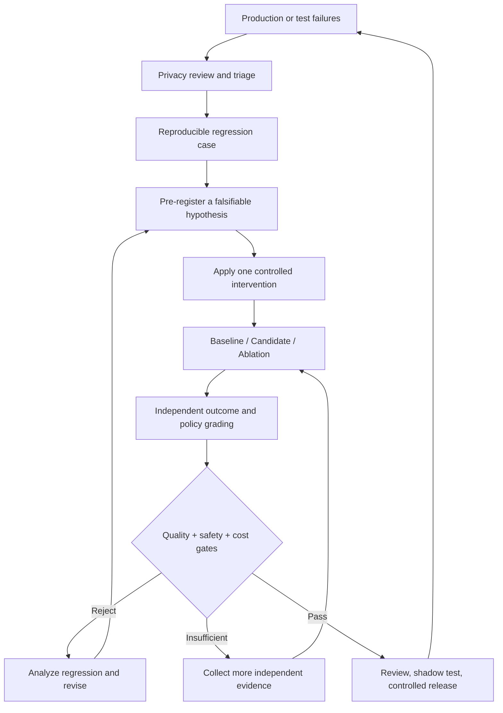
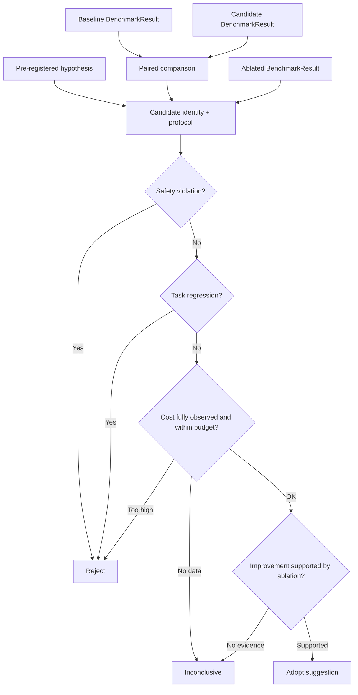

# 第 28 章：Evaluation-Driven Development——以评测驱动 Agent 持续改进

> **状态：正文初稿 v0.1，待技术审稿** · 第五篇：Agent Evaluation、Benchmark 与系统优化  
> **本章目标**：把第 25 章的 Outcome Grader、第 26 章的 Benchmark Protocol、第 27 章的 CampaignStore 串成“发现失败 → 登记假设 → 实施单变量优化 → 消融/配对评测 → 安全和成本回归门禁 → 人工审查 → 新故障入库”的迭代闭环。  
> **实验**：真实运行前面章节的 Python EvalHarness + Fake AgentKernel，并使用合成任务和合成费用评估 EDD 逻辑。不访问任何外部模型、网络、真实浏览器或生产数据，不能从结果推断实际 LLM 能力改善。

## 学习目标

完成本章后，读者能够：

1. 解释 Evaluation-Driven Development（EDD）与单纯 Prompt Tuning、Benchmark 排名、系统性能优化的区别。
2. 把线上失败整理成可信、脱敏、可重复执行的 Regression Case，并维护其来源和审查记录。
3. 使用 Outcome/Policy/Trajectory 三个层面进行失败归因，提出可被证伪的优化假设。
4. 设计固定数据集、共享 Benchmark Protocol、每候选独立的 CandidateConfig 和可重复 Trial Seed。
5. 区分 A/B Testing、Ablation、Regression Testing、Offline Evaluation 与 Online Canary。
6. 在候选平均成绩上涨时仍发现安全问题、单任务回归、费用上升或不完整证据。
7. 为多目标优化建立不可违反的硬性安全门槛和可量化的质量/成本/延迟预算。
8. 解释小样本统计、反复调参和隐藏数据泄漏为何会使观察到的收益不可靠。
9. 使用本章 Python EDD Decision Gate 验证一条完整的离线改进闭环。
10. 把模型评测输出与第 24 章可信部署控制面正确隔离。

## 28.1 从「评得准」到「改得好」

第 25 章回答“什么是正确的 Agent 行为”；第 26 章回答“怎样设计公平、可复现的 Benchmark”；第 27 章提供评测活动的版本化记录、持久化 Campaign 与 Regression Gate。本章则回答：

> **面对 Agent 的失败，怎样提出具体的工程改动，并以可复现证据判断该改动是否值得保留？**

一个团队在没有评测驱动的情况下，常见研发循环是：

```text
用户反馈不好
  → 猜测 Prompt 不够好
  → 修改 System Prompt
  → 挑几个案例手动运行
  → 觉得效果还不错
  → 发布
  → 其他业务场景发生回归
```

EDD 采用不同的流程：



核心区别是：**不是先改系统后找可以证明它变好的案例，而是先定义失败与验收，再决定应改什么以及什么结果会否定假设。**

Anthropic 的 Agent Evals 研究强调尽早建立代表性任务、持续引入真实失败、避免只在上线后才发现回归。[1] OpenAI 的 Evaluation Best Practices 也把明确目标、数据集、评分指标、实验比较和持续评测组织为研发循环。[2]

## 28.2 失败模式分类与根因定位

### 28.2.1 最终失败与过程失败

某个 Agent 报告任务完成失败，可能来自：

| 失败层面 | 示例 | 可能的改善方向 |
| --- | --- | --- |
| Goal Interpretation | 用户要求「保存草稿」，Agent 误解为「发布」 | Prompt / Task Contract |
| Context | 关键文件、网页证据没有进入上下文 | Retrieval / Context Engineering |
| Planning | 执行顺序错误，遗漏必要检查 | Planner / Dependency Model |
| Tool Selection | 使用了不合适的工具或非法参数 | Tool Schema / Selection |
| Execution | Tool Timeout、Sandbox 无法启动 | Runtime / Retry / Backpressure |
| Verification | Agent 只相信模型自报 `done` | Independent Outcome Verifier |
| Memory | 使用过期资料、跨租户数据污染 | Provenance / TTL / ACL |
| Security | Prompt Injection、越权写入/外发 | Host Reference Monitor |
| Cost/Latency | 过多重复检索或模型调用 | Batching / Cache / Routing |

第一步不是立即调整模型，而是用第 22 章隐私保护的 Span、第 25 章 Grader 和第 26 章 Failure Taxonomy 定位问题发生的层次。

### 28.2.2 不同失败可能表面相同

以 Browser Agent 没有成功保存草稿为例：

- 模型从未调用 Save Tool；
- 模型调用了错误工具；
- Tool Proxy 因权限不正确拒绝；
- 工具调用成功，但页面提交尚未完成；
- 服务端已保存，但 Client ACK 丢失；
- Verifier 查错了数据库或任务版本。

这些情况的最终状态可能都显示“草稿不存在或未知”，但真正应实施的修复完全不同。尤其是最后两项，不允许简单重放写入造成重复发布或多次提交。

**好的 Failure Taxonomy 应同时保留可观察的失败事实与尚未验证的因果假设。**

## 28.3 建立可证伪的优化假设

### 28.3.1 Hypothesis 不应写成「优化 Prompt」

推荐采用：

```text
Observed Failure:
  browser-draft 在 3 次中有 3 次未写入

Hypothesis:
  Agent 不识别 "Save X as Y" 的工具操作模式，
  而不是 Tool Backend 自身发生故障

Intervention:
  仅改 Prompt / Tool Schema 提示，不改 Tool Policy

Predicted Change:
  browser-draft 的受信任环境写入成功率提升

Falsification:
  ablated version 与 candidate 成功率相同，
  或任何安全事件/显著回归出现

Constraints:
  不增加未授权操作、保持成本预算
```

这样才能区分“我们改过代码”和“我们找到真正有效的工程因素”。

### 28.3.2 对应 Python 数据模型

[`ChangeHypothesis`](../../src/mini_agent/evaluation_driven_development.py)：

```python
ChangeHypothesis(
    hypothesis_id="h1",
    suspected_failure="outcome_mismatch",
    intervention="prompt",
    candidate_config=CandidateConfig("toy-model-v1","new-prompt"),
    minimum_improvements=1,
    max_regressions=0,
    max_cost_ratio=Decimal("1.2"),
)
```

它约束 Intervention 类型、唯一 ID、最小改善数、允许退化数和 Cost Ratio，拒绝非法、负数及 NaN。真实团队还应记录研究者、时间、预期领域、实验抽样规则与数据访问审批。

## 28.4 A/B Test、消融实验与配对比较

### 28.4.1 A/B 实验

Baseline（A）与 Candidate（B）应共享：

- 相同 Dataset Digest 和 Split；
- 相同 Tool/Environment/Verifier Protocol；
- 可比较的试验预算；
- 统一的 Task Success 与 Policy Grader；
- 预先规定的时延、成本与安全门槛。

但**Model Version、Prompt Version 等候选配置可以不同**。前面的技术校准已经将它们独立为 `CandidateConfig`，避免错误要求比较双方必须使用相同模型。

### 28.4.2 消融（Ablation）

如果候选加入了“新的 Context 检索策略”，消融实验应创建：

```text
A: baseline
B: baseline + new context strategy
B-minus: B without the new context strategy
```

如果 B 相对 A 变好，但 B-minus 同样变好，那么“新 Context 策略导致改善”的因果解释并不充分。

本章 `decide_edd` 要求 Ablation 存在，而且候选成功率必须高于消融版本，否则结果为 `inconclusive`。

这只是简单的教学判定，并不能证明真正因果关系：**Ablation 是否真的只去掉一个因素，依赖可信实验设计，代码中的 Candidate ID 无法独立验证。** 生产还应登记完整配置 Diff、种子与资源分配。

### 28.4.3 Paired Outcome

使用同一 Task/Trial 对比，可以记录：

- `improved`：A 失败、B 成功；
- `regressed`：A 成功、B 失败；
- `tied`：二者结果相同。

相比只比较两个总体平均数，成对报告更容易发现“某个版本总体提高，但在高风险任务上退化”的情况。

不过同一 Case 的多个 Trial 相关性很强；不能把每个 Trial 当成独立用户样本来宣称统计显著性。第 25 章的 Wilson/McNemar 已讨论这一限制。

## 28.5 多目标优化：质量、成本、延迟、安全

优化目标可以抽象为：

\[
\max_{\theta}\ Q(\theta)
\quad
\text{subject to}\quad
S(\theta)=0,\ C(\theta)\le C_{\max},\
L_{p95}(\theta)\le L_{\max}.
\]

其中：

- `Q`：可信 Outcome Success；
- `S`：安全/越权行为；
- `C`：所有尝试计入的总成本；
- `L`：端到端延迟。

第 28 章首先强调**硬约束**。较高成功率不能抵消未授权付款、越权读写或 Prompt Injection。成本收益也不能抵消任务结果错误。

### 28.5.1 为什么 Cost per Verified Task 比 Cost per Call 更重要？

若 Agent A 一次模型调用只花很少钱，却需要多轮工具重试，Agent B 调用更贵模型但只需少量工具操作，那么仅看模型价格会误判。

\[
C_{\mathrm{verified}}
=
\frac{C_{\mathrm{all\ attempts}}}
{N_{\mathrm{verified\ outcomes}}}.
\]

本章直接复用第 25–26 章的 `cost_per_verified_task_usd`，要求费用可观测。基准总成功数为零、费用缺失时，必须报告 `inconclusive`，不能把未知当作零。

### 28.5.2 为什么不能无条件宣称「成本降低就发布」？

如果一个更便宜的候选去掉了 Security Verifier、忽略用户批准或禁止工具，成本自然可能降低，但系统不符合业务验收目标。

在建议采纳之前必须确认：

1. Candidate 没有新增未授权操作；
2. 任务层面没有超出预注册允许范围的退化；
3. Outcome Success 没有降低；
4. 成本证据完整；
5. Cost Ratio 在阈值内；
6. 独立 Ablation 显示干预因素可能与改善有关；
7. 改善达到预注册的最小阈值。

第 24 章的 Release Gate 还需要在真实环境、可信观测和灰度阶段重新校验这些条件。

## 28.6 EDD Decision Gate 的完整算法



核心实现 [`evaluation_driven_development.py`](../../src/mini_agent/evaluation_driven_development.py)：

```python
result = decide_edd(
    baseline,
    candidate,
    hypothesis,
    ablated=ablation_result,
)

assert result.action in {"adopt", "reject", "inconclusive"}
```

这里 `adopt` 仅表示**在教学合成任务、预注册约束下，建议保留候选改动**，不是生产权限批准，更不是已执行 Deployment。

### 28.6.1 为什么保留 `inconclusive`？

以下条件无法证明可安全采纳：

- Ablation 缺失；
- Provider 费用不完整；
- Improvement 数量不足；
- Ablation 和 Candidate 效果相同；
- 基准运行条件不一致；
- 样本数量太小，不能推导一般业务效果。

成熟研发流程应承认证据不足，而不是把一切结果硬归类为“赢/输”。

## 28.7 从线上失败到离线 Regression Dataset

真实 Agent 的开发会不断遇到无法预见的新失败。一个持续改进平台应当把经审查的失败转化为 Regression Task。

流程：

```text
Production observation
    ↓
Authorization / privacy / data retention review
    ↓
Remove PII, secrets, irrelevant content
    ↓
Verify provenance and reproduce in safe environment
    ↓
Write minimum task + expected outcome + forbidden effects
    ↓
Independent verifier and tool policy review
    ↓
Add to regression split with dataset version update
    ↓
CI + scheduled real-model evaluation
```

本章提供 `RegressionCaseProposal` 和 `propose_regression_case`，**只生成等待人工审查的建议对象**，没有写真实用户数据，也没有自动修改隐藏测试集。

特别注意：对低熵用户标识做 SHA-256 **不是充分匿名化**。真实用户数据需要明确来源授权、最小化、访问控制以及重复标识泄露评估，不得仅凭哈希就绕过合规审查。

## 28.8 和第 25–27 章的接口关系

| 章节 | 已实现能力 | 第 28 章新增 |
| --- | --- | --- |
| 25 | EvalSuite、Runner、Outcome/Policy Grader、Trial Reliability | 将失败指标转为可证伪假设 |
| 26 | Benchmark Protocol、CandidateConfig、Domain Scores、Regression Gate | 完整 A/B + Ablation 对照与多目标门槛 |
| 27 | CampaignStore、逐 Trial Checkpoint、SQLite 恢复与 Dashboard | 让实验结论进入可持续的研发迭代流程 |
| 28 | Hypothesis、EDD Decision、Regression Proposal | 统一安全/质量/费用/消融采纳规则 |

建议在真正生产运行时，先从第 27 章的可信 Campaign 取得已完成/已签名的 Eval Results，再经 EDD Gate 与人工审批进入第 24 章发布流程。

**不要让模型自己生成评分、自己修改 Hidden Ground Truth、自己声明“优化成功”、再自己部署。**

## 28.9 离线实验

代码：

- [EDD Decision Gate](../../src/mini_agent/evaluation_driven_development.py)
- [离线 Hypothesis/Ablation 示例](../../examples/ch28_edd_lab.py)
- [新增单元测试](../../tests/test_ch28.py)
- [六条合成任务 Dataset](../../evals/ch25_offline_suite.json)

运行：

```bash
python -m pip install -e .
python examples/ch28_edd_lab.py
python -m unittest discover -s tests -p 'test_ch28.py' -v
```

### 28.9.1 合成假设

在 `heldout` Split 下，Baseline 和 Ablated Toy Runner 不识别某类 `Save` 指令；Candidate 支持该指令，但仍有一次故意设置的失败。

这个设计提供一个可测的 Toy 改善例子，不是现实中的 Prompt Optimization。

### 28.9.2 测试输出的意义

预期：

- Baseline Success Rate = 3/6；
- Candidate Success Rate = 5/6；
- Ablated Success Rate = 3/6；
- Paired Improvements = 2；
- Paired Regressions = 0；
- 合成费用未突破预先登记阈值；
- 所有合成 Tool Policy 约束均通过；
- EDD Gate 给出 `adopt` 建议。

但这只有两条不同的 Heldout Case、六个相关 Trial，远不足以宣称统计显著或现实世界模型质量提高。真正的 CI 通过只是证明**评测流程代码符合已编写的断言**。

## 28.10 对抗与失败测试

[`test_ch28.py`](../../tests/test_ch28.py) 至少覆盖：

| 测试 | 预期 |
| --- | --- |
| Failure Triage | 只汇总安全失败原因码，不复制原始 Prompt |
| 候选改善与 Ablation | 条件满足给出 `adopt` |
| 缺少 Ablation | `inconclusive` |
| Ablation 效果与 Candidate 相同 | 不能宣称干预有效 |
| 不同 Candidate Config | 身份不匹配拒绝对比 |
| 不同 Benchmark Protocol | 拒绝跨协议比较 |
| Task Regression | `reject` |
| 安全违规 | 即使 Outcome 好也 `reject` |
| 费用缺失 | `inconclusive` |
| 不合法 Hypothesis | NaN/非法干预/布尔阈值拒绝 |
| 线上失败 Intake | 只生成受控元数据，需人工审查 |

## 28.11 实际团队的 EDD 工作制度

建议建立短周期的工作流程：

**每次功能变化前**：选一组真实故障/功能 Case，定义期望的 Outcome 和不可违反的安全条件。

**每次实验**：固定共享 Benchmark Protocol、候选配置和预算，记录唯一 Experiment ID、Ablation、失败归因和可复现的 Trace/Artifacts。

**每次代码提交**：运行低成本离线 CI，防止 Evaluator/Tool/Policy 本身出现回归。

**定期真实模型评测**：在有权限的隔离环境运行更大 Dataset，观察 Sampling 方差、Domain Slices、成本和置信度。

**真实上线时**：用第 24 章的 Canary/SLO Gate 对真正流量做观察，不把离线 `adopt` 等同于生产部署许可。

**失败反馈**：将经过隐私审查、可重复验证的新失败录入 Regression Split，同时留意 Dataset 已被优化饱和的问题。

## 28.12 常见 EDD 误区

1. **只优化一个总分**：隐藏安全、成本和类别退化。
2. **修改完再挑测试集**：产生数据选择偏差。
3. **只看 LLM Judge 的评分**：忽略真实环境状态。
4. **不做 Ablation**：无法判断哪个工程因素带来改善。
5. **重复使用同一个 Heldout 调参**：测试集慢慢变成开发集。
6. **认为记录 Seed 就完全可复现**：真实 Provider、并发、Tool、外部环境仍可能非确定。
7. **只记录成功 Trial**：失败成本和可靠性指标被错误美化。
8. **把 CI 通过当生产安全证明**：没有验证真实外部业务状态或 OS 隔离。

## 28.13 课后习题

1. 将 `ChangeHypothesis` 扩展成明确的优化前预测、样本量计划、实验阶段、批准人和配置 Diff。
2. 设计 Prompt/Context/Model/Tool/Planning/Verifier 的多因素消融矩阵，并说明交互作用可能造成的偏差。
3. 对 Research/Coding/Browser 三种任务分别建立 Failure Taxonomy，禁止用同一个“模型没回答好”概括所有错误。
4. 增加 Task Level Cluster Bootstrap 与最小独立 Case 样本数，不再以 2 条 Case 得出采纳结论。
5. 将第 27 章 CampaignStore 变成真实长运行 Experiment 的持久化控制面，支持多模型、Ablation 和并发 Worker。
6. 增加 P95 延迟、实际 Tool/Sandbox 成本、用户人工反馈与 Security Incident 一票否决。
7. 对进入 Regression Split 的生产样本设计授权、隐私、去标识化、独立 Verifier 和 Dataset Version Pipeline。
8. 与第 24 章灰度发布系统连接，要求真实 Release State/Metric/Version 匹配，才能进入下一流量阶段。
9. 实验一个错误 Proxy 缓存导致 Research 答案过期的 Case，证明 Context Optimization 不能绕过来源和时间有效性。
10. 设计一个 Hidden Test 被 Prompt 泄露污染的攻击案例，证明同进程 Evaluation 无法保护真正的 Ground Truth。

## 28.14 本章总结

Evaluation-Driven Development 不是不断修改 Prompt 或追求一个更高的 Leaderboard Score，而是建立“**失败 → 可验证假设 → 受控实验 → 独立验收 → 回归/成本/安全门禁 → 发布决策 → 新失败入库**”的长期工程循环。

本章用受控 Toy Benchmark 演示 EDD Gate 与 Ablation 的基本规则。它不会自动执行任何生产部署，也没有统计证明真实 LLM 的质量提升。下一阶段要把此流程放到真正隔离的评测平台里，使用代表性任务、可信 Trace/Usage 和可审计的在线回归验证。

下一章按教材目录进入第 29 章（高级推理与 Agentic RL）。

---

## 参考资料

[1] Anthropic Engineering. *Demystifying evals for AI agents*. https://www.anthropic.com/research/demystifying-evals-for-ai-agents

[2] OpenAI Developers. *Evaluation best practices*. https://developers.openai.com/api/docs/guides/evaluation-best-practices

[3] Anthropic Engineering. *Building effective agents*. https://www.anthropic.com/engineering/building-effective-agents

[4] SWE-bench. *Can Language Models Resolve Real-World GitHub Issues?*. https://arxiv.org/abs/2310.06770

[5] τ-bench. *A Benchmark for Tool-Agent-User Interaction*. https://arxiv.org/abs/2406.12045

[6] OpenAI. *Evals*. https://github.com/openai/evals

> **实验边界（2026-10）**：所有数据均为公开合成 Fixture、同进程可信 Python 与人为设定的 Fake Model；不构成真实模型质量统计、用户隐私审查、企业级 Sandbox 或自动化 Release 的技术保证。
