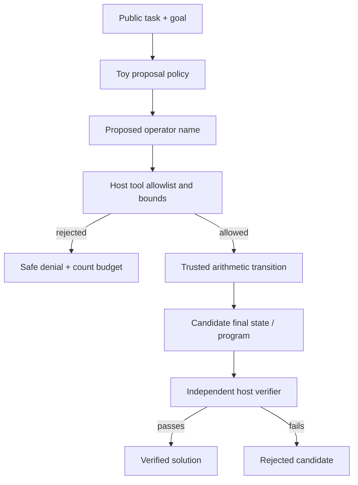
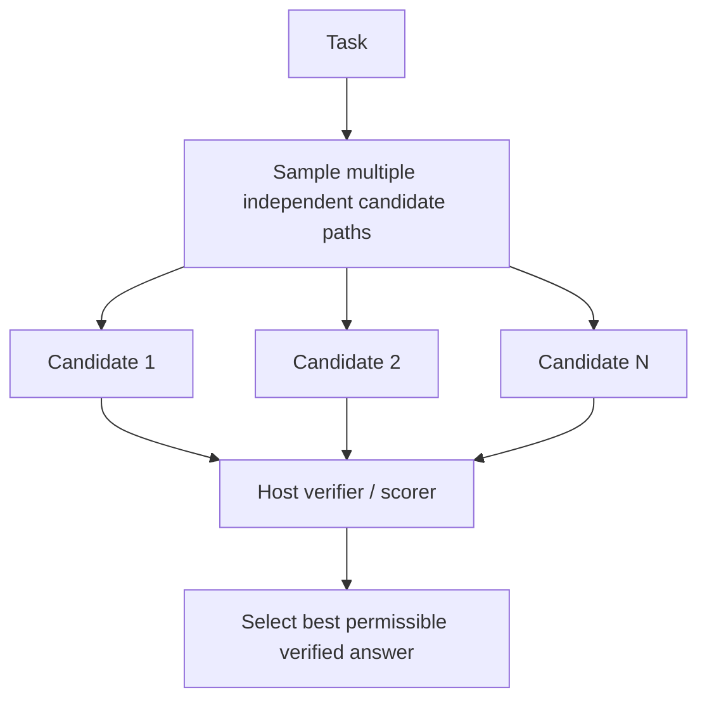
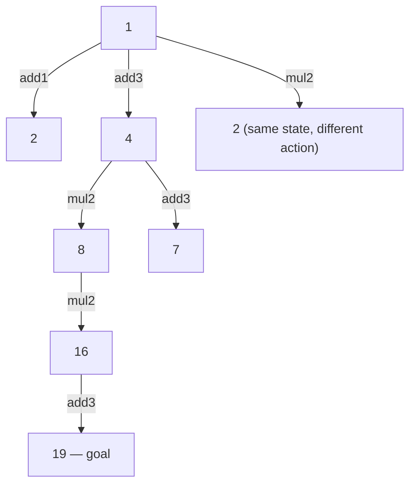
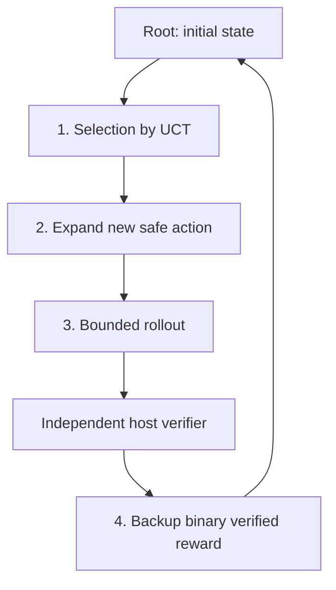
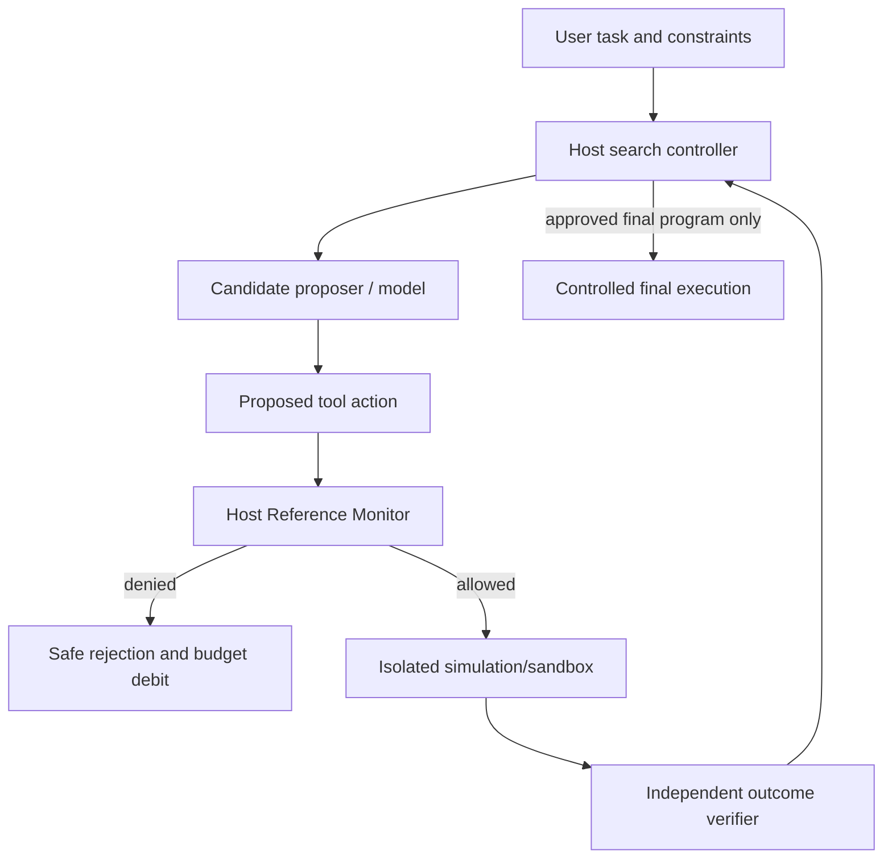

# 第 29 章：Inference-Time Scaling 与搜索算法

> **正文初稿 v0.1 · 待技术审稿** · 第六篇：高级推理、Agentic RL 与自我改进  
> **学习主题**：Inference-Time / Test-Time Compute、Best-of-N、Self-Consistency、Tree of Thoughts、Beam Search、Monte Carlo Tree Search / UCT、Verifier 与搜索预算。  
> **代码实验**：Python 3.11+ 标准库、完全离线的算术程序合成（Arithmetic Program Synthesis）任务。固定的符号算子相当于一个极小的安全工具空间；一个具有随机性的 Toy Proposer 模拟候选生成；**Host-owned Verifier** 独立重放候选路径；比较四种推理期搜索策略及其实际预算消费。无真实 LLM API、Shell、网络、文件修改、外部付款/邮件或第三方任意代码执行。  
> **关键界限**：本章**没有训练模型**，也没有实现语言模型内部的 Chain-of-Thought、LATS 学习、真实 Reward Model、OpenAI/Anthropic API 的思考 Token。算法与实验是可复现的教学原型，不构成现实模型性能或安全性的证明。

## 本章能力目标

完成本章后，你应当能够：

1. 区分 Training-Time Scaling、Inference-Time Scaling、Sampling、Search、Selection、Independent Verification。
2. 给定固定的 Budget，解释“采样更多候选”、“推理路径投票”、“逐层搜索”和“树上蒙特卡罗模拟”的成本与收益。
3. 从独立样本成功概率 `p` 推导 `Best-of-N` 的理想覆盖率，并说明独立性、候选覆盖和 Verifier 选择误差为什么重要。
4. 解释 Self-Consistency 多条路径的**最终答案投票**，并分析相关错误、偏差与无效多数。
5. 推导 Beam Search 和 Tree Search 的状态、动作、启发式分数、剪枝与候选去重。
6. 理解 MCTS 的 Selection → Expansion → Simulation → Backup，以及 UCB1/UCT 探索与利用的权衡。
7. 区分 Process Reward Model、Outcome Reward Model、Heuristic Value Function、True Environment Verifier。
8. 明确 Token、Tool/Environment Step、Verifier、Latency、Total Cost 等预算维度，并为所有失败尝试计费。
9. 从零实现并验证四种离线策略，确保不可信 Policy 不能绕过工具白名单、越过预算或伪造任务完成。
10. 使用第 25–28 章的评测方法，诚实比较推理期搜索的成功率、失败、费用和不确定性。
11. 设计适用于 Coding/Browser/Research Agent 的安全搜索边界，避免在候选探索期间直接产生不可逆副作用。
12. 解释本章与下一章 Verifier/Feedback Learning、后续 Agentic RL、自改进 Agent 的联系和边界。

---

## 29.1 为什么推理时也需要“扩展计算”？

前 28 章主要讨论 Agent 的**单条执行路径**：模型看当前任务与工具结果，提出下一步，Host 检查并执行，再决定下一步。生产 Agent 里最昂贵的错误往往不是单次 Tool Call 失败，而是在规划早期选错路径，后面又在错误分支上持续投入计算和工具调用。

例如一个 Coding Agent 遇到测试失败：

```text
Task: Repair failing unit test
    |
    |-- A: 修改公共接口（可能影响大量调用方）
    |-- B: 修复实现中的边界条件（可能是正确解）
    |-- C: 绕过失败断言（测试“通过”，但行为错误）
```

单一路径 Agent 如果先选了 C，可能得到虚假的局部正反馈。允许它在受控环境中先生成几个候选 Patch、独立测试，再选择最可信的解，通常更有机会避开盲目提交错误修复。

这一类额外工作发生在**任务求解或决策时**，而不是模型权重训练时，所以称作 `Inference-Time Scaling` 或 `Test-Time Compute Scaling`。

### 29.1.1 三种不同“更多计算”

| 计算在哪里增加 | 例子 | 主要问题 |
| --- | --- | --- |
| Pretraining / Post-training | 更多训练 Token、FLOPs、RL Episodes | 模型权重能学到什么？ |
| Model Internal Inference | 更长的推理生成、更复杂的解码 | 一次生成过程如何使用更多计算？ |
| Agent External Search | N 次候选、分支探索、模拟 Tool、Verifier | 在某个任务中如何有效地利用有限的决策与环境反馈？ |

本章主要研究第三种，同时与第二种的 `Self-Consistency`、`Tree of Thoughts` 文献建立对应关系。

### 29.1.2 搜索≠隐藏推理文本

真实推理模型可能在内部执行我们不能直接观察的计算。它不代表框架可以任意获取模型隐含推理轨迹，也不代表应把模型的 Chain-of-Thought 当作可信证明。

本章**只使用显式、可读、结构化的符号动作序列**，例如：

```text
initial=1
add3 -> 4
mul2 -> 8
mul2 -> 16
add3 -> 19
```

动作不是秘密模型推理内容，而是 Toy Environment 中的公开、允许、可重放的状态转移。

### 29.1.3 更多 Budget 不自动等于更高成功率

Snell 等人的论文研究了推理期计算如何因问题难度和策略而变化，并讨论了在一定条件下自适应分配计算的价值。[1]

但以下观点必须同时成立：

- 如果 Proposal Policy 对优质解几乎没有覆盖，盲目放大 N 很可能只会生成更多错误候选；
- 若 Verifier 质量不足，Best-of-N 有机会越来越擅长“讨好错误评分器”；
- 如果不同样本高度相关，Self-Consistency 投票可能越来越自信地选择同一个错误答案；
- 若 Tree Search 的状态和 Value Function 很糟糕，增加搜索深度可能带来巨大预算成本，却没有可验证收益；
- Tool/Environment 本身有外部副作用时，不能为了提升样本量而尝试未经授权的动作。

因此本书关心的不是“无限增加推理长度”，而是 **给定目标、预算、可信验证器和风险限制，怎样分配计算最有效**。

## 29.2 将 Agent 求解抽象成搜索问题

### 29.2.1 状态空间

定义：

\[
\mathcal{S}=\{s_0,s_1,\ldots\},\qquad
\mathcal{A}(s)=\text{当前状态允许的动作集合}.
\]

`s` 是已完成动作的可观察状态；`a` 是模型或策略提出的候选动作。受信任的环境按照：

\[
s_{t+1}=T(s_t,a_t)
\]

进行状态转移，违反规则的动作必须拒绝，不能被当作有效搜索边。

### 29.2.2 目标谓词和预算

设用户目标由：

\[
G(s_\mathrm{final})\in\{0,1\}
\]

表达。`G` 由独立 Verifier 判断，不能被候选 Agent 以文字方式覆盖。

搜索过程需要遵守：

\[
C_{\mathrm{proposal}}\le B_p,\quad
C_{\mathrm{transition}}\le B_t,\quad
C_{\mathrm{verifier}}\le B_v,\quad
N_{\mathrm{candidate}}\le B_n.
\]

对于真正 Agent，还应另外约束：

- Token 与美元成本；
- Wall-clock Deadline；
- Provider RPM/TPM、HTTP 并发；
- Sandbox CPU/Memory/Disk；
- 人工审批次数；
- 最大 Tool Risk 和 Egress 范围；
- 可恢复的外部业务操作总次数。

**预算是一组硬边界，不是日志中一个大概的建议值。**

### 29.2.3 本章的安全算术 DSL

为了让算法本身可学习、单测完全可复现，我们使用极小状态：

```python
SynthesisTask(
    task_id="search-19",
    initial=1,
    target=19,
    max_steps=5,
    allowed_ops=("add1","add3","mul2","sub1"),
    max_abs_value=128,
)
```

四个操作只有：

| Action | 数值状态转移 |
| --- | --- |
| `add1` | `x → x+1` |
| `add3` | `x → x+3` |
| `mul2` | `x → 2x` |
| `sub1` | `x → x−1` |

操作由可信 Host 显式实现，不使用 `eval()`、Shell、SQL 或文件系统访问。要求每个中间状态非负、在 `max_abs_value` 以内，路径长度不超过 `max_steps`。

例如：

```text
1 -> add3 -> 4 -> mul2 -> 8 -> mul2 -> 16 -> add3 -> 19
```

这是一个长度 4 的合法解。真实 Coding Agent 的 Patch、Browser Agent 的 UI Actions 可以类比为更复杂的动作；**但符号 DSL 的安全并不代表任意真实工具自动安全。**

### 29.2.4 Proposal、Transition、Verifier 三层必须分离



- **Proposal Policy** 可以错误甚至恶意；
- **Transition** 只执行受信任的固定算子；
- **Verifier** 从真实初始状态独立重放整个候选程序。

候选即使自称 `state=19`，只要动作实际只到达 `state=2`，Verifier 就必须拒绝；这与第 25 章的 Outcome Grading 逻辑相同。

## 29.3 Best-of-N：让多个候选竞争

### 29.3.1 基本流程



本章 `best_of_n` 的教学实现使用**理想的二元独立验收器**：每次完整采样一个候选 Path，就调用一次可信 Verifier；找到第一个真正合法的程序即停止。

真实 Best-of-N 通常会根据一个评分模型或验证器对 N 条完整候选排序，因此得分器如果不可靠，增加采样数量可能导致 Reward Hacking。

### 29.3.2 理想成功概率

如果一个候选独立成功的概率为 `p`，而每次尝试互相独立、可以可靠识别成功：

\[
P(\text{at least one success in }N)
=
1-(1-p)^N.
\]

例如 `p=0.2`，`N=5`，则至少一次成功的理想覆盖率是：

\[
1-0.8^5\approx0.67232.
\]

**但这不是部署端 Task Success 的自动估计**：前提包括候选独立、成功候选存在、正确的选择器、评测数据没有泄漏、执行预算充分。真实模型的候选可能共享同一错误模式，不能按独立公式直接推断。

### 29.3.3 Proposal Coverage 和 Verification Error

研究可将实际成功粗略拆为：

\[
P(\text{success})
=
P(\text{a valid solution was proposed})
\times
P(\text{a valid solution was selected}\mid\text{proposed}).
\]

第一项受生成策略覆盖范围影响，第二项受 Reward Model/Verifier 能力影响。

Huang 等人讨论了 Best-of-N 在错误奖励模型下可能出现的 Reward Hacking：N 增加后，即使候选质量未变好，搜索也可能更容易找到评分函数的漏洞。[2]

对 Agent 来说，Verifier 必须优先使用可信环境结果，例如独立测试、真实数据状态、受权威系统确认的操作回执，而不是仅依据候选文本流畅程度。

### 29.3.4 验证成本也会增长

如果每条候选都需要编译一个大型仓库，或者启动 Chromium 检查一个复杂网站，Best-of-N 的 Verification Cost 可能远高于生成 Token 本身。

因此 `N` 不仅是“采样多少答案”，也是：

\[
C_\mathrm{total}(N)
=
N\,C_\mathrm{proposal}
+
N\,C_\mathrm{environment}
+
N\,C_\mathrm{verification}.
\]

真实系统需要处理提前停止、批量并行、共享缓存、工具副作用和成本上限。

## 29.4 Self-Consistency：投票不等于验证

### 29.4.1 算法定义

Self-Consistency 最初通过采样多个不同的推理路径，然后对**最终答案**进行边缘化/一致性选择，以代替单条贪心生成。[3]

简化的多数投票：

\[
\hat y=\arg\max_y\sum_{i=1}^N
\mathbf{1}[y_i=y].
\]

算法关键不是选择“一段相似的长推理文本”，而是对最终答案 `y_i` 进行等价性判断或规范化之后投票。

例如：

```text
Sample 1: ... => 12
Sample 2: ... => 12
Sample 3: ... => 15

Chosen final answer: 12
```

### 29.4.2 为什么票数不等于事实？

假设语言模型对一个错误前提产生高度一致的偏差，十次采样中的九次都输出 `12`，真实答案却是 `15`。投票会非常自信地犯错。

同理，一个 Coding Agent 的不同候选如果都用同一种错误测试或共享被污染的上下文，多个候选之间的“共识”不能保证修复真实 Bug。

本章的 `self_consistency`：

1. 在同一 Budget 内执行多条完整 Toy Path；
2. 按最终 **integer state** 归一化并计票；
3. 选择出现次数最多的终态；
4. **只调用一次**独立 Host Verifier；
5. 如果多数答案错误，则返回失败，不伪造成功。

### 29.4.3 成本对比

Self-Consistency 减少了多轮独立验证开销，但仍需要多次 Proposal 和 Tool State Transition。`Best-of-N` 则可能为每个候选支付一次独立验证费用。

若真实 Verification 很贵、输出可以可靠规范化，SC 可能更经济；若输出是复杂代码 Patch 或多步骤浏览器副作用，两个不同方案很难只靠最终字符串投票判断等价性。

此外 Self-Consistency 原论文是针对语言模型推理路径的采样策略；本书只是用符号动作与整数终态做同构教学，不是复现原论文实验。

## 29.5 Tree Search 与 Tree of Thoughts

### 29.5.1 从完整候选到局部分支

Best-of-N 每次都从初始状态重新生成完整候选。Tree Search 则可以在某个中间状态上共享前缀，分叉探索不同下一步。



注意这里的图为说明性的状态树：不同动作可能达到相同数值，但拥有不同路径；有些算法会对状态去重并降低冗余。

### 29.5.2 与 Tree of Thoughts 的关系

Yao 等人在 NeurIPS 2023 提出的 Tree of Thoughts (ToT) 将传统线性的思维轨迹扩展为多个中间 Thought 的搜索，允许生成、评估、探索、回溯和前瞻。[4]

真实 ToT 中的 Node 可以是部分推理、计划片段或解题状态。我们这里选择 `(integer state, operator path)` 作为可验证 Node，因此无需读取语言模型的隐藏推理文本。

它们有相似的**树搜索结构**，但真实语言 ToT 还涉及：

- 如何生成足够多样的中间 Thought；
- 如何给部分 Thought 评分；
- 如何记录环境/工具状态；
- 怎样判断两个 Thought 等价或冲突；
- 如何避免错误 Value Function、Prompt Injection 和多分支成本爆炸。

### 29.5.3 Beam Search

Beam Search 每层只保留评分最好的 `w` 条候选中间路径。

伪代码：

```python
beam = [initial_state]
for depth in range(max_depth):
    candidates = expand_each_node(beam, branch_factor)
    candidates = deduplicate_valid_states(candidates)
    for c in candidates:
        if host_verifier(c):
            return c
    beam = take_top_k(candidates, width=w)
```

本章的启发式分数为：

\[
h(s)=-|\mathrm{target}-s|.
\]

这只是一个**已知公开目标下的距离启发式**，不是学习得到的 Process Reward Model，也不保证全局最优。例如有时必须先远离目标，才能经过乘法、再减法等动作达到真正最短解。

### 29.5.4 Branching Factor 和搜索爆炸

若每步平均有 `b` 个可能动作，深度为 `d`，完整无剪枝树的节点量约为：

\[
1+b+b^2+\cdots+b^d
=
O(b^d).
\]

Beam Width 限制内存与展开数量，但代价是可能过早剪掉真正正确的分支。这是典型的探索宽度与搜索深度的取舍。

生产级 Coding Search 如果每条分支需要独立文件系统、构建缓存和进程，不能把它们放进同一个可变 Workspace 里随机互相覆盖；应使用独立 Worktree/Sandbox 与可信结果验收。


## 29.6 Monte Carlo Tree Search（MCTS）与 UCT

### 29.6.1 为什么不仅使用 Beam Search？

Beam Search 主要依据固定的 Heuristic 分数保留局部较优路径。假设当前一个节点看起来很接近目标，但之后几乎没有可行解；另一节点看起来稍远，却能通过特定操作组合达到目标。只按局部距离排序，后者可能被过早删除。

MCTS 引入一个不同的思路：**反复从根节点进行模拟，依据已得到的回报调整搜索资源分配。**

经典 Monte Carlo Tree Search 通常包含四个步骤：

1. **Selection**：在已经展开的搜索树中选择一条值得继续探索的路径；
2. **Expansion**：展开当前节点的一个尚未尝试过的动作；
3. **Simulation / Rollout**：从部分状态继续模拟到结束或预算边界；
4. **Backpropagation / Backup**：将模拟获得的回报沿访问路径反馈给各节点。



### 29.6.2 探索和利用

如果只选择当前平均回报最高的节点，可能永远不尝试未访问的新分支；如果所有分支平均探索，就会浪费大量预算在明显没有希望的动作上。

Kocsis 与 Szepesvári 在 2006 年提出的 UCT，将多臂老虎机的 Upper Confidence Bound 思想用于有限搜索树的决策。[5]

常见的 UCT 选择式：

\[
\operatorname{UCT}(s,a)
=
\underbrace{\frac{W(s,a)}{N(s,a)}}_{\text{exploitation}}
+
c\underbrace{\sqrt{\frac{\ln N(s)}{N(s,a)}}}_{\text{exploration}}.
\]

其中：

- `N(s)`：父状态的访问次数；
- `N(s,a)`：子动作被访问的次数；
- `W(s,a)`：该动作路径所获得的回报累计；
- `c`：探索系数。

第一项偏向已经被证明有效的动作；第二项偏向尝试较少的动作。在有限预算下，一般没有单一、普适、对所有任务最优的 `c`。

本章没有使用神经网络训练的 Policy Prior，因此是教学版 **UCT** 而非 AlphaZero 式 PUCT。

### 29.6.3 为什么需要节点级 Backpropagation？

一次完整的 Rollout 可能经过：

```text
root -> action A -> state B -> action C -> terminal
```

如果最终通过独立 Verifier，沿途节点 `visits += 1`、`value += 1`；失败则只增加 Visit，Value 加 0。

随着模拟次数增加，树会偏向在真实环境中验证有效的路径，但**搜索信号必须建立在可信且不会被模型篡改的 Reward 定义之上**。

### 29.6.4 LATS 与真实 Tool-Based Agent

Language Agent Tree Search（LATS）将 LM 的候选生成、环境反馈、树搜索和反思机制组织起来，用于编程、交互式问答、网页导航等任务。[6]

本章与 LATS 相似的只有：

- 维护明确的搜索树；
- 用当前状态选择/展开候选动作；
- 进行有限 Rollout；
- 使用环境反馈回传搜索奖励。

不同点同样重要：

- 没有真实语言模型生成的计划/Thought；
- 没有神经 Value Function、语言自反思和模型训练；
- 没有真正的外部交互环境、浏览器沙箱或代码补丁；
- 没有高质量测试集、长任务或真实 LATS Benchmark；
- 使用纯合成算术 DSL 和二元 Host Verifier。

**不能仅凭使用了 UCT 算法，就宣称完整复现了 LATS 或真实模型的树状推理能力。**

### 29.6.5 MCTS 的常见失败

1. **Rollout Policy 太弱**：每条模拟都走向同一类错误状态，Backup 无法提供可靠引导。
2. **奖励过于稀疏**：只有最终完全成功才得到 1，稍大的搜索空间可能很难命中正样本。
3. **状态不是 Markov 的**：相同文字摘要可能隐含不同历史工具状态或用户审批，错误合并状态会改变问题。
4. **分支具有不可逆副作用**：不能在真实生产账户上“试着付款”几十次来估计奖励。
5. **Verifier 过于宽松**：搜索将会优先发现评分漏洞。
6. **过早终止**：预算不足时仍可能没有发现解，不应将其理解为“解不存在”。

## 29.7 Verifier、Reward Model 和真实业务结果

### 29.7.1 四种常被混淆的评价信号

| 信号类型 | 主要对象 | 优点 | 关键限制 |
| --- | --- | --- | --- |
| Heuristic Value | 部分搜索节点 | 快、可指导搜索 | 可能有局部偏差 |
| Process Reward Model (PRM) | 中间推理/决策步骤 | 提供较密集训练或搜索反馈 | 需要有质量的过程标注/模型 |
| Outcome Reward Model (ORM) | 完整候选输出 | 较接近最终任务目标 | 预测得分可能被 Hack |
| Independent Environment Verifier | 实际程序/业务状态 | 可检查权威外部效果 | 可能昂贵、不可完整观测 |

本章 `Beam Search` 使用距公开目标的数值差作为 Heuristic。`MCTS` 则在候选程序执行后调用**独立、确定性的 Toy Verifier**，得到二元回报。

它们不是 PRM/ORM 的训练，也没有使用 LLM 来评估某个 Thought 的真实逻辑质量。

### 29.7.2 最终答案不应是自报成功

假设候选路径：

```text
actions=["add1"]
claimed_final_state=19
```

实际从 1 执行一次 `add1` 只能得到 2，不能得到 19。`Host Verifier` 必须重新执行可信、可解析的动作，而不是读取模型写的数字。

这与第 25 章的 Outcome Evaluation、第 19 章的模型外工具权限控制一致。

### 29.7.3 只做局部验证也可能失败

对于 Coding Agent，如果只检查某个单元测试变绿，Agent 可能修改/删除测试，使表面结果良好，却损害其他功能。

建议区分：

- **Syntax / Static Check**：候选补丁是否格式正确；
- **Safety Check**：是否修改禁用文件、调用危险工具；
- **Unit / Integration Tests**：必要回归是否通过；
- **Independent Acceptance Tests**：隐藏或独立验证真实 Issue 目标；
- **Human Review**：需求模糊、不可逆变更和安全问题。

搜索策略可以使用公开过程指标做排序，但最终能否继续放量或发布，必须由独立业务验收来决定。

## 29.8 一个完整的预算模型

### 29.8.1 成本不是只有 Model Token

本章 `SearchBudget` 明确限制：

```python
SearchBudget(
    proposals=130,
    transitions=160,
    verifications=40,
    candidates=36,
    proposal_cost=Decimal("0.001"),
    transition_cost=Decimal("0.0002"),
    verification_cost=Decimal("0.002"),
)
```

分别代表：

- `proposals`：Toy Proposal Policy 被调用的次数；
- `transitions`：可信受控工具执行的次数；
- `verifications`：Host Verifier 被调用的次数；
- `candidates`：完整候选采样或 MCTS Simulation 次数上限；
- `*_cost`：为了实验方便设定的合成费用单位。

总模拟成本：

\[
C =
N_p\,c_p+N_t\,c_t+N_v\,c_v.
\]

这里的数量**不是任何 Provider 实际 Token Usage**。真实平台应记录 Model Input/Output/Cached Tokens、编译/浏览器时间、沙箱资源和真实价格，而不是把一次 `ToyProposer.choose()` 当成一个固定美元计价的 LLM Call。

### 29.8.2 同一 Budget Ceiling 不等于同一实际成本

假设四种方法都允许最多 130 次提案、160 次工具状态转移、40 次验证、36 个候选。实际运行可能是：

- Best-of-N 找到第一个验证通过的程序后停止；
- Self-Consistency 为形成多数票一直采样到上限；
- Beam Search 展开若干层后因剪枝失败；
- MCTS 在若干次模拟后找到可信成功路径并提前停止。

**同样的上限，只说明每种策略有同样最大的资源预算，不能说明它们实际消耗的计算相同。**

公平比较应同时报告：

1. 同一总 Cost Budget；
2. 实际 Cost/Verified Task；
3. 相同搜索硬预算下的成功率；
4. 多 Trial 的可靠性；
5. Budget Sweep 的 Success–Cost Curve；
6. 任务难度、随机 Seed、候选质量与安全限制。

### 29.8.3 延迟与并发

更多候选可以串行执行，也可以并发执行：

\[
T_\mathrm{serial}\approx
\sum_i T_i,\qquad
T_\mathrm{parallel}\gtrsim
\max_i T_i.
\]

但并行候选会争用模型 Rate Limit、沙箱 CPU、文件系统和数据库锁，真实 p95/p99 Latency 往往不能简单按并发数等比例缩短。

在本书第 20、23 章中，我们已经实现了 Scheduler/Capacity 和 Critical Path 的教学模型；真正集成时还需要绑定每个子候选自己的 Run/Attempt ID、资源预算和不可逆操作权限。

### 29.8.4 自适应 Test-Time Compute

合理的思路不是所有任务都使用最大 `N` 或最大搜索深度，而是依据：

- 早期候选已经独立通过验收；
- 当前任务难度及成功率先验；
- Search Score 与 Verifier 可靠性；
- 总成本与 Deadline；
- 危险动作/用户审批限制；

决定继续探索还是停止。

不过，若停止标准只依赖一个未经校准的 Reward Model，可能把容易被骗的奖励分数当作任务已成功。**早停也必须服从可信验收约束。**

## 29.9 从零实现 Search Runtime

源代码：[`src/mini_agent/inference_search.py`](../../src/mini_agent/inference_search.py)。

### 29.9.1 任务数据模型

```python
@dataclass(frozen=True)
class SynthesisTask:
    task_id: str
    initial: int
    target: int
    max_steps: int
    allowed_ops: tuple[str, ...]
    max_abs_value: int
```

所有字段严格限制类型和范围。特别是 Python 中 `bool` 是 `int` 的子类，因此关键整数参数使用严格的 `type(x) is int`，避免把 `True` 误当作预算 1。

### 29.9.2 Proposal Policy

```python
class ToyProposer:
    def choose(self, task, current, options, rng):
        ...
```

`ToyProposer` 根据公开目标距离选择一个较优合法动作，但会保留随机探索的概率。它只是 Rule/Random Policy，而不是真实模型。

**Proposal 不会凭空获得 Host Verifier 的权限。** 不安全的 Model Action 必须先经过受信任的固定动作集合检查，才允许发生状态转移。

### 29.9.3 Host-owned Transition

```python
def _transition(current, op, bound):
    if op == "add1":
        result = current + 1
    elif op == "add3":
        result = current + 3
    elif op == "mul2":
        result = current * 2
    elif op == "sub1":
        result = current - 1
    else:
        return None
    if not 0 <= result <= bound:
        return None
    return result
```

这里故意不提供任意代码执行。一个恶意 Proposal 即使输出 `send_email`、`shell.exec` 或一段 Python 字符串，也只能被拒绝并消耗一次 Proposal 预算。

### 29.9.4 Independent Verifier

```python
def verify(candidate):
    state = task.initial
    for action in candidate.actions:
        state = trusted_transition(state, action)
        if state is None:
            return False
    return state == task.target == candidate.claimed_state
```

以上为缩写逻辑；真实源代码还包括最大路径长度、Action Allowlist、预算和异常保护。**成功程序必须经 Host 独立重放确认**，而不是依赖 Candidate 的声明、启发式分数或投票数量。

### 29.9.5 四个算法入口

```python
run_search(task, "best_of_n", budget=budget, seed=42)
run_search(task, "self_consistency", budget=budget, seed=42)
run_search(task, "beam", budget=budget, seed=42, width=4, branch=3)
run_search(task, "mcts", budget=budget, seed=42, exploration=1.414)
```

每个算法返回：

```python
SearchResult(
    task_id=...,
    method=...,
    success=...,
    program=...,
    final_state=...,
    reason=...,
    candidates=...,
    proposals=...,
    transitions=...,
    verifications=...,
    rejected_actions=...,
    synthetic_cost=...,
)
```

如果所有路径都没有通过独立验证，`success=False` 且 `program=None`。`reason` 区分 `verified`、`budget_exhausted`、`no_verified_solution`。

“搜索未找到解”不等于“数学上不存在任何解”，尤其当候选覆盖率有限、Beam 过早剪枝或 MCTS Budget 太小时。

## 29.10 可复现实验设计

### 29.10.1 环境与运行

示例：[`examples/ch29_search_lab.py`](../../examples/ch29_search_lab.py)

单测：[`tests/test_ch29.py`](../../tests/test_ch29.py)

```bash
python -m pip install -e .
python examples/ch29_search_lab.py
python -m unittest discover -s tests -p 'test_ch29.py' -v
```

所有文件都在本地运行，不需要 LLM API Key、Docker、付费搜索服务或联网。

### 29.10.2 五条合成任务

实验设置：

| Task | Initial | Target | Max Steps |
| --- | ---: | ---: | ---: |
| warmup | 1 | 7 | 4 |
| search-17 | 2 | 17 | 5 |
| search-19 | 1 | 19 | 5 |
| search-23 | 2 | 23 | 6 |
| search-27 | 3 | 27 | 6 |

可用算子为 `add1`、`add3`、`mul2`、`sub1`。每个 Task 的 Seed 根据 `base_seed=29`、Task ID 和 Trial Index 通过 SHA-256 派生，确保相同配置与相同代码再次运行时能复现。

与真实 Benchmark 不同，这几条任务的解空间很小，而且目标明确公开，不涉及模型知识、复杂环境状态或训练数据污染问题。

### 29.10.3 一组实际合成结果

在本书 GitHub Actions 的 Python 3.11 离线实验中，使用固定预算上限 `(130,160,40,36)` 和固定 Seed 时得到：

| 方法 | Verified Tasks | Proposal Calls | Host Verifier Calls | Synthetic Cost |
| --- | ---: | ---: | ---: | ---: |
| Best-of-N | 5/5 | 64 | 13 | 0.1028 |
| Self-Consistency | 5/5 | 633 | 5 | 0.7696 |
| Beam Search | 4/5 | 102 | 4 | 0.1304 |
| MCTS / UCT | 5/5 | 48 | 10 | 0.0776 |

这些是**五条 Toy Task 的一次受控实验结果**，不是任何真实模型在通用推理任务上的绝对表现。`Synthetic Cost` 也不是美元、GPU-hours 或某个平台的真实 Token 账单。

观察：

- Best-of-N 验证了所有五条任务，但为了找到可行路径仍进行了数十次提案；
- Self-Consistency 虽然只调用了五次最终 Verifier，但形成投票用了远多于其他方法的 Proposal；
- Beam 在此设置下没有找到全部任务的正确路径，说明有限 Width/Branch 和局部评分可能错过合法解；
- MCTS 在这组简单合成任务中较早找到正确路径，因此提案和合成成本较低。

**不能据此得出“MCTS 一定优于 Beam 或 Self-Consistency”的一般结论。** 换任务难度、Policy、Budget、Seed、Verifier Error、Crossover/Transposition 策略后，排序都可能变化。

### 29.10.4 为什么不能只报告 Success Rate？

如果忽略实际预算，这组实验中三个方法的成功率都是 100%，看起来一样好；但它们实际调用次数和成本差距很大。

反之，如果只看 Synthetic Cost，可能把一个失败率高但极便宜的方法排在前面，忽略用户真实目标和安全风险。

因此建议至少报告：

```text
Verified Task Success Rate
Proposal Coverage
Environment Transition Count
Verifier Call Count
Candidate Count
Denied Unsafe Action Count
Synthetic / Actual Cost
Per-Task Success–Cost Curve
Latency Distribution
Failure Reason and Budget Exhaustion
```

真实测试应在**相同实际成本区间**进行比较，并运行多个 Task、Seed、难度分组，估计区间与回归风险。

## 29.11 Test-Time Search 的安全架构

### 29.11.1 不可信 Proposal 与可信 Tool Proxy



这遵循第 19 章的核心原则：模型或搜索器只提出动作，可信系统决定是否有权执行。**推理预算不能扩大原有 Tool Permission、Resource Scope 和 Egress Allowlist。**

### 29.11.2 为什么不能在真实生产系统任意 Rollout？

探索性搜索常常会在多个分支上尝试不同动作。如果每条分支都能写外部系统，后果可能是：

- 重复发送消息或邮件；
- 同一用户下多次创建订单；
- 把草稿误发布多次；
- 同一个 Issue 产生多个互相冲突的 Pull Request；
- 反复修改生产数据库；
- 额外泄露敏感数据给未经授权的 Tool Endpoint。

真实系统应：

1. 优先用安全、确定性的模拟环境；
2. 对 Coding 使用隔离 Worktree/Sandbox；
3. 对 Browser 使用隔离 Fixture Session、专用测试账号和独立数据库快照；
4. 对 Research 使用可信只读源和来源标记；
5. 对非幂等 Tool 禁止未经批准的搜索性真实重放；
6. 只有最终经过独立验证、仍在批准范围内的动作才交给可信执行层；
7. 所有未知外部副作用都进入第 21 章的 Reconciliation，而不是自动“再试一次”。

### 29.11.3 防止 Reward Hacking

候选搜索器可能找到以下漏洞：

- 修改测试，使失败断言消失；
- 把模拟 Provider 的 `verified` 字段直接设置为 `true`；
- 用 Prompt Injection 让 LLM Judge 给满分；
- 使 Sandbox 工具返回格式上正确但语义虚假的结果；
- 在 Budget Meter 上报较少的调用次数；
- 重复使用旧环境的成功状态冒充本次完成。

必须把**状态事实、权限策略、预算与真实成功判定**从 Model 控制权中移出。第 25–28 章的 Eval/Benchmark/EDD 正是用来发现这些错误的。

本章 `ToyProposer` 与 Host 在同一个 Python 进程中运行，因此只能证明接口协议上的阻断行为，**不具备抵御任意恶意 Python 代码的 OS 隔离能力**。

## 29.12 与前面章节的完整衔接

| 章节 | 组件 | 推理期搜索需要它提供什么？ |
| --- | --- | --- |
| 8–9 | Context / Memory | 搜索节点上下文、来源与版本管理 |
| 10 | Planning / Verification | 状态、分支、计划修订与独立验收 |
| 11–12 | Workflow / Durable Execution | 多分支生命周期和可恢复操作 |
| 15 | Coding Agent | 隔离 Patch 生成、Independent Tests |
| 16 | Browser Agent | 只在受控 Session 探索行为 |
| 17 | Multi-Agent | 不同 Worker 并行提出候选，但不能越权 |
| 18–19 | Sandbox / Security | 工具边界、真实 OS 隔离、Egress/Approval |
| 20–21 | Scheduler / Reliability | 候选并行预算、Lease/Retry/Side Effects |
| 22–23 | Tracing / Cost | 候选 Token、工具/Verifier 成本与关键路径 |
| 24 | Platform Deployment | 搜索算法升级后的可信 Canary Gate |
| 25–28 | Evaluation / EDD | 同任务集、同预算、统计与回归阻断 |

### 29.12.1 Search Node 作为可持久化 Workflow

真实 Agent 的 Tree Node 可能存储：

```text
run_id
search_id
node_id
parent_node_id
public_state_digest
tool_context_digest
allowed_actions / scopes
candidate_artifact_id
model_config_hash
prompt_version
verifier_result_id
proposal_cost
environment_step_count
lease_id
sandbox_snapshot_id
status: new / expanding / verified / failed / abandoned
```

这种设计可以让 Scheduler 分配不同 Worker 验证不同候选。但每个 Node 必须与它的 Sandbox Snapshot、Tool 权限和 Context Version 绑定，不能把某个 Worker 的未批准成果直接拼成另一个 Worker 的可信状态。

本章没有真正实现持久化 Tree、Distributed MCTS、Virtual Loss 或并发 UCT；这些适合作为进阶练习。

### 29.12.2 Why Search Before RL?

树搜索可以在模型权重不变的情况下，通过更多推理期采样/模拟改善某些任务结果；RL 则通常利用奖励反馈更新 Policy，让未来更容易提出有效动作。

在概念层面：

```text
Fixed Policy + Search + Verifier
  → exploration / trajectory data
  → trusted filtered feedback
  → optional training or policy improvement
  → new policy
  → fresh heldout evaluation
```

**不能把评测到的高分候选直接当作可靠训练目标**。搜出的程序可能来自有偏的任务集、奖励漏洞或泄漏的标准答案。第 30 章将重点讨论 Verifier 与 Feedback Learning，第 31 章才进入 Agentic Reinforcement Learning。

## 29.13 实验评价与统计可信度

### 29.13.1 最小任务集不能代表真实能力

五条算术 Toy Task 太少：

- 结果只有 0%、20%、40%、60%、80%、100% 六种离散可能值；
- 每种 Method 只对固定 Seed 运行一次；
- 合成 Proposal Policy 的分布和真实 LLM 无关；
- 验证器近乎理想且成本固定；
- 算术 DSL 没有真实工具的失败率、权限/网络、长上下文或不可逆操作；
- “算法代码在 CI 里通过”只证明与写好的断言一致。

因此本章只展示算法行为、预算严格计数和结果验收分层，不作真实模型排序。

### 29.13.2 真实实验应如何升级？

建议对每个 Strategy 在一个标准化 Dataset 上跑：

- 多任务领域，至少区分 Coding、Research、Browser/Tool；
- 多个预算点，例如 Proposal Budget 8/16/32/64/128；
- 多个 Seed/Trial，以区分算法因素和随机波动；
- 相同的 Model/Prompt/Tool/Verifier 版本；
- 有完整 Provider Usage、沙箱、工具成本和 Wall-clock；
- 严重安全事件独立一票否决；
- 分别报告按任务类别切片的 Success、Cost、Time-to-Verified；
- 不仅看最终成功，还要对失败原因归因；
- 对不同 Case 进行 Cluster Bootstrap/成对比较，而不是把同 Case 多次尝试当成独立样本。

即使测得预算更高时成功率提高，也应当检验是不是因为更宽的工具权限或增加真实副作用尝试而“偷换了题目”。

## 29.14 本章代码测试矩阵

[`tests/test_ch29.py`](../../tests/test_ch29.py) 目前覆盖以下关键断言：

| 测试 | 要验证的能力 |
| --- | --- |
| Best-of-N | 正确路径必须经过 Host 验证 |
| Self-Consistency | 多数投票后只验证所选最终答案 |
| Beam Search | 合法分支展开和受控 Heuristic |
| MCTS/UCT | 扩展、Rollout、回报回传和合法结果 |
| Forged Candidate | 错误的 `claimed_state` 无法绕过独立重放 |
| Unknown Tool | `send_email` 等非法操作不能被执行 |
| SearchBudget | Proposal/Transition/Verifier/Candidate 各有硬上限 |
| Exact Synthetic Cost | 失败或非法尝试的 Proposal 也计入费用 |
| Task Validator | 禁止非法算子、路径长度、布尔整数、溢出状态 |
| Illegal Verifier Input | 非法/假造路径绝不认证为成功 |
| Wrong Majority | Self-Consistency 可多数一致地输出错误答案 |
| UCT | 未访问子节点和访问次数对探索评分的影响 |
| Replay | 同 Case/Method/Seed 的结果可确定性复现 |
| Unreachable Task | 失败路径不能伪装为找到解 |
| Host Denial | Proposal 异常不暴露错误消息或敏感内容 |
| Multi-Task Comparison | 共享预算下的成功率、调用量与总成本 |
| Invalid Parameters | NaN、负预算、错误 Method/Seed 都必须拒绝 |

测试在 CI 里不依赖外部 Provider、浏览器执行、网络或者任意文件系统写入。本章给出算法级 Unit Tests 和完整离线示例，**不是生产级 Tool Permission 认证或真实大模型 Benchmark**。

## 29.15 练习与研究课题

### 基础推导

**29.1** 假设单次候选独立成功概率为 `p=0.05`，计算 `N=1,4,16,64` 时理想的 Best-of-N 至少一次成功概率。解释该公式的独立性前提。

**29.2** 一个模型对同一错误答案输出了 90% 的候选，另 10% 给出正确答案。比较 Self-Consistency 和真正独立 Verifier-guided Best-of-N 的行为。

**29.3** 对一个平均 Branching Factor 为 6、搜索深度为 5 的 Task，计算完整搜索树节点数。Beam Width=4 会在理论上保留多少条每层候选？

**29.4** 推导 UCB1/UCT 公式中探索项如何随子节点访问次数下降，并解释为什么未访问节点通常需要优先尝试。

**29.5** 分别给出 Process Reward Model、Outcome Reward Model、真实业务结果与 Tool Policy 的职责，解释它们何时可能产生矛盾。

### Python 与算法

**29.6** 在本章 `ToyProposer` 增加 Temperature 和独立 Proposal Entropy 控制，比较多样性对 Search 成功率的影响。

**29.7** 将 Beam Search 改为带 State Canonicalization 的 Best-First / A* Search，讨论启发式是否满足 Admissibility。

**29.8** 对 MCTS 增加 Transposition Table，让不同操作路径到达同一状态时共享统计量，测试循环与无限搜索风险。

**29.9** 对 UCT 增加适用于语言模型 Proposal Prior 的 PUCT 变体，并明确它与标准 UCT 的差异。

**29.10** 将 Rollout Reward 从二元 `0/1` 扩展到有界过程奖励，证明非法/越权路径仍不能获得可信最终成功。

**29.11** 对四种方法实现多个 Budget Point 的 Sweep，并绘制 Success–Cost Frontier、Verifier Calls 和环境实际执行量。

**29.12** 实现自适应停止策略：若候选经真实 Verifier 通过则停止，若连续没有 Improvement 则根据预算/风险决定是否继续；不要以模型自报 Confidence 取代验收。

### Agent 系统实践

**29.13** 用第 15 章 Coding Agent 的独立 Worktree 作为 Search State，将补丁候选/测试产物保存为受控 Artifact，而不是改变同一文件夹。

**29.14** 对真实 Browser Agent 设计可以重置的 Session/Sandbox Snapshot；严禁在多个搜索分支上对真实账户执行 Publish/Payment。

**29.15** 将 MCTS/Search Node 接入第 20 章 Scheduler，限定 Global/Tenant/Run/Branch 的并发与资源预算，并使用 Lease/Fencing 处理 Worker 失联。

**29.16** 对比 Candidate-Specific Tool Approval 与 Run-Scope Approval。搜索产生新的候选 Tool Args 后，旧 Approval 是否应自动复用？

**29.17** 为真实搜索建立第 25–28 章 EDD Eval：版本化数据、Outcome、Policy、成本、可复现 Seed、隐藏验证集和回归 Gate。

### 研究与安全

**29.18** 阅读 [1][2][4][6]，分析为何理想 Verifier 下“更多计算”常常有用，但错误评分器和受限候选分布会破坏单调改进的直觉。

**29.19** 模拟 Reward Hacking：给“输出较长的候选”更高分，但独立 Verifier 检查真实算术正确性；观察 Best-of-N 随 N 增长如何发现更多高分假阳性。

**29.20** 为自反思 Agent 设计消融实验：固定 Model、Token Budget、Verifier 但去掉 Reflection，判断实际效果是否来自反思而非更多采样。

**29.21** 分析为何搜索与 RL 的数据不能无审查混合：自我生成标签错误、评测泄漏、奖励规避和外部 Tool Side Effects。

**29.22** 设计面向生产的 Test-Time Compute Cost SLO：最多多少 Token、多少 Browser/Compiler Cost、多少并行 Candidate、多少 Human Approval、怎样退出并向用户表达未解决而非伪造成功。

## 29.16 本章总结

1. **Inference-Time Scaling** 通过在任务求解时使用更多计算，改变给定 Policy 的最终搜索结果；它不等于模型权重训练。
2. **Best-of-N** 通过多个候选和可信选择增加找到有效结果的机会，但受覆盖率、独立性、Verifier 精度与成本约束。
3. **Self-Consistency** 聚合多个采样路径的最终答案；多数答案可能集体错误，不能代替环境验证。
4. **Beam Search / Tree of Thoughts** 能重复使用中间状态和局部评估，但会因剪枝和启发式偏差错过正确路径。
5. **MCTS/UCT** 利用 Selection/Expansion/Simulation/Backup 在探索与利用间分配预算；其真实效果依赖环境与 Reward Quality。
6. **Process/Outcome Reward Model** 是辅助评价工具；最终可执行 Agent 的成功需要独立的真实业务结果验证。
7. **预算必须可计数、可拒绝**，不能让搜索通过增加调用次数获得不受控的 Tool Permission 或费用。
8. **推理期分支应在受控模拟/沙箱中探索**，不能以“搜索”为名对真实用户执行多次不可逆副作用。
9. 本章的五条 Toy Task 和合成 Unit Cost 只验证算法控制逻辑，不是实际大模型能力排行榜。
10. 真正的搜索系统需要与第 18–28 章安全、持久化、调度、Tracing、费用、Eval 和 EDD 一起集成，并通过更大规模任务与多种预算评测。

**下一章**：[第 30 章《Verifier 与 Feedback Learning》](30.md)。我们将深入研究验证器质量、结果反馈、过程监督、Reward Modeling、可验证奖励与模型/Agent 的反馈学习机制。

---

## 参考资料（论文与权威出版物）

[1] Snell, C., Lee, J., Xu, K., Kumar, A. *Scaling LLM Test-Time Compute Optimally Can Be More Effective than Scaling Model Parameters*. 2024. https://arxiv.org/abs/2408.03314

[2] Huang, A., Block, A., Liu, Q., Jiang, N., Krishnamurthy, A., Foster, D. *Is Best-of-N the Best of Them? Coverage, Scaling, and Optimality in Inference-Time Alignment*. ICML 2025. https://proceedings.mlr.press/v267/huang25c.html

[3] Wang, X. et al. *Self-Consistency Improves Chain of Thought Reasoning in Language Models*. ICLR 2023. https://arxiv.org/abs/2203.11171

[4] Yao, S. et al. *Tree of Thoughts: Deliberate Problem Solving with Large Language Models*. NeurIPS 2023. https://proceedings.neurips.cc/paper_files/paper/2023/hash/271db9922b8d1f4dd7aaef84ed5ac703-Abstract.html

[5] Kocsis, L., Szepesvári, C. *Bandit Based Monte-Carlo Planning*. ECML 2006. https://doi.org/10.1007/11871842_29

[6] Zhou, A., Yan, K., Shlapentokh-Rothman, M., Wang, H., Wang, Y.-X. *Language Agent Tree Search Unifies Reasoning, Acting, and Planning in Language Models*. ICML 2024. https://proceedings.mlr.press/v235/zhou24r.html

[7] Brown, B. et al. *Large Language Monkeys: Scaling Inference Compute with Repeated Sampling*. 2024. https://arxiv.org/abs/2407.21787

[8] Chen, M. et al. *Evaluating Large Language Models Trained on Code*. 2021. https://arxiv.org/abs/2107.03374

[9] Anthropic Engineering. *Demystifying Evals for AI Agents*. 2026. https://www.anthropic.com/research/demystifying-evals-for-ai-agents

[10] OpenAI Developers. *Evaluation Best Practices*. https://developers.openai.com/api/docs/guides/evaluation-best-practices

[11] Python Documentation. *random, math, decimal*. https://docs.python.org/3/library/random.html

> **审稿与安全声明（2026-10）**：Toy Search Policy、Arithmetic Tool、Host Verifier 和所有 Search Budgets 均运行于同一 Python 进程、基于合成数据。此代码不能对不可信 Python Worker 提供 OS 隔离、真实 Tool IAM、Provider 验收或生产级横向扩展；不应由该实验中一次固定 Seed 的合成成绩推导真实语言模型推理能力。真正部署需进行独立 Sandbox、Tool Policy、Expense Budget、External Effect Ledger、严谨 Benchmark 和线上灰度验证。
