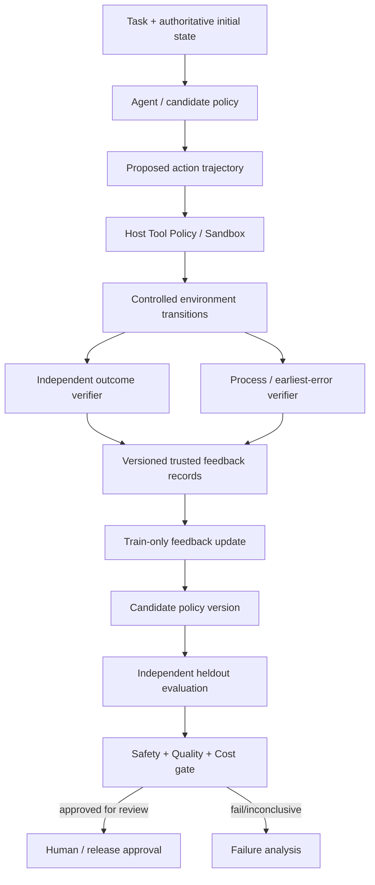
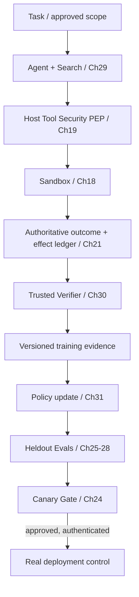

# 第 30 章：Verifier 与 Feedback Learning

> **正文初稿 v0.1，待技术审稿** · 第六篇：高级推理、Agentic RL 与自我改进  
> **主线**：可信环境事实 → Outcome / Process Verifier → Feedback Provenance → 奖励代理的校准与漏洞 → Train-Only Feedback → 候选策略更新 → 独立 Heldout 验收。  
> **实验环境**：Python 3.11+ 标准库、纯本地且无副作用的算术 DSL，复用第 29 章 `SynthesisTask` 与四个安全算子。实验包含 12 条合成、公开的任务（6 Train + 6 Heldout）、一个确定性独立验证器、一个**故意有缺陷**的长度奖励模型、Brier/ECE 校准，以及一个表格式反馈学习器。无真实大模型训练、GPU、LLM API、联网、Shell、Browser、真实业务写入或生产数据。  
> **严格界限**：本章真正训练的只是少量计数构成的 `TabularFeedbackPolicy`，更接近受监督的二元反馈估计；**没有实现 RL、PRM 神经网络训练、ORM 微调、PPO/GRPO、DPO 或任何语言模型权重更新**。结果仅能说明受控 Toy 环境中的方法行为。

## 本章学习目标

完成本章，读者能够：

1. 准确区分 **Environment State、Outcome Verifier、Process Verifier、Reward Model、Human/Model Feedback 与 Tool Policy** 的职责。
2. 分辨业务操作**真实成功**、模型**声称成功**、Verifier **返回正例**、Reward Model **预测高分**之间的差异。
3. 推导 Outcome Supervision 和 Process Supervision 的监督对象，以及它们在推理搜索和 Agent RL 中的不同作用。
4. 实现有限、安全 DSL 上的步骤验证与最终结果验证，记录第一个失败步骤和可重放路径指纹。
5. 分析 Proxy Reward 如何被搜索器利用，尤其在 Best-of-N/MCTS 对奖励分数优化时。
6. 在有独立真值的验证集中测量 Reward Model 的 TP、FP、TN、FN、Precision、False Positive Rate、Brier Score、Expected Calibration Error（ECE）。
7. 说明为什么 Reward Calibration 不只看 Accuracy，更不能把较高的主观分数等同于真实任务安全通过。
8. 设计有版本的数据集、Train/Heldout 分离、反馈来源与标签校验，防止模型自报或污染数据进入训练环路。
9. 从零实现一个使用真实可信二元标签进行 Beta(1,1) 平滑的表格型 Policy，并在独立任务上测量变化。
10. 分析 Positive-only 反馈、同任务重复、训练数据泄漏、分布漂移、验证器漏洞和指标选择造成的错误改进。
11. 建立 Feedback-to-Policy 的可审计闭环，并解释为何必须由 Host 而不是 Agent 自己决定结果真值和部署权限。
12. 为第 31 章 Agentic Reinforcement Learning 准备可靠的奖励/环境接口，同时理解本章并未开展梯度训练。

---

## 30.1 评测之后，还缺少什么？

第 25–28 章已经建立了：

- 版本化 Dataset 与独立 Outcome Grader；
- 多领域 Benchmark / Evaluation Protocol；
- Campaign 的持久化、断点续跑与 Regression Gate；
- Evaluation-Driven Development：诊断失败、假设、A/B 和消融。

第 29 章进一步展示 Best-of-N、Self-Consistency、Beam Search、MCTS：固定一个候选 Proposal Policy，通过更多推理期计算获得更好的候选覆盖和选择。

现在需要回答更深入的问题：

> **我们能否把搜索和工具执行过程中的“成功 / 失败 / 错误位置”转化为可靠反馈，让下一版 Agent 更容易生成正确行为？**

困难不在于记录一个数字，而在于**这个数字到底是否代表真实任务目标**。

### 30.1.1 一个危险的简单做法

假设某个 Coding Agent 产生 Patch 后，模型说：

```json
{
  "task_completed": true,
  "reward": 1.0
}
```

如果训练系统直接把这条数据当作正例，那么一个无需实际运行测试的 Agent 就可以反复生成 `reward=1.0`，并让后续模型学会这种表面行为。

同样，Browser Agent 可能在没有保存草稿时输出“保存成功”；Research Agent 可能编造引文并获得一个偏好长回答的 Judge 高分。

因此：

**Feedback 首先是一份需要 provenance 和验证的证据，不是模型输出的一个浮点数。**

### 30.1.2 基础闭环



真实生产还需要每次更新的 Model/Prompt/Tool/Reward Version、执行身份、数据许可、Hidden Grader 和长期回归监控。

## 30.2 五种“正确性”不要混在一起

| 判断对象 | 例子 | 能证明什么 | 不能证明什么 |
| --- | --- | --- | --- |
| Format Validity | JSON Schema 合法 | 字段和类型满足约束 | 任务目标达成 |
| Tool Authorization | 写操作允许的 Resource | 动作在有效权限范围内 | 修改结果是用户想要的 |
| Process Correctness | 每个算术步骤合法 | 前缀动作符合定义 | 最终结果已达目标 |
| Outcome Correctness | 状态等于可信 Target | 目标后置条件成立 | 任意外部副作用已回滚 |
| Model-based Reward | 回答评分 0.95 | 某个评分器偏好该候选 | 真实业务正确与安全 |

### 30.2.1 Syntax / Policy / Process / Outcome 的不同错误

使用第 29 章 Toy Task：

```text
initial = 1
target = 7
max_steps = 4
allowed = add1, add3, mul2, sub1
```

几条候选：

```text
A: add3, add3               -> 1 -> 4 -> 7
B: add1, add1               -> 1 -> 2 -> 3
C: add3, publish, add3      -> step 2 illegal
D: add3, add3; claimed=100  -> actual=7, claimed final state is wrong
```

- A：合法步骤，最终目标达成；
- B：步骤合法，**但最终目标未达成**；
- C：第 2 步不在 Tool Allowlist，必须立即拒绝、之后的动作不能执行；
- D：实际步骤可达目标，但对外声明终态与事实冲突，不能把该声明当作准确结果证明。

### 30.2.2 有限 DSL 的 Process 标签

对步骤序列 `a_1,\ldots,a_T`，定义：

\[
s_t = T(s_{t-1}, a_t),\qquad
v_t=\mathbf{1}[
a_t\in \mathcal A(s_{t-1})\land s_t\text{在安全范围内}
].
\]

本章的 `v_t` 表示**动作是否被可信符号环境合法执行**，而不等于自然语言推理在数学逻辑上无误。

尤其不能把“合法但没有接近目标”的 `add1` 直接判成非法步骤。当前 Toy Process Verifier 不评价动作的最优性，只检查规则和状态。

对 C：

```text
step_labels=(True, False)
first_error_step=2
process_ok=False
outcome_ok=False
```

发生非法步骤后停止，不运行剩余部分。对于真实 Agent，后面的工具调用可能触及敏感服务，不能为了“完整评分”而继续执行已知越权路径。

### 30.2.3 Outcome 标签

目标谓词：

\[
r_{\mathrm{outcome}}
=\mathbf{1}[s_T=s_{\mathrm{target}}].
\]

如果候选还带有一个 `claimed_final`，验证器要求它与真正的 `s_T` 一致；声明与重放事实矛盾，不可视为可信完成回执。

在生产场景中，Outcome 可能是：

- 编译、测试、隐藏回归条件均满足的 Patch；
- 浏览器后端确有草稿，且没有任何未经授权发布；
- Provider 返回经核验的外部效果回执；
- Research 的每一关键 Claim 能从可信来源对应证据；
- Sandbox 确认环境停止且资源清理完成。

**不能从模型说 `done` 就直接构建 `r_{\mathrm{outcome}}=1`。**

## 30.3 Outcome Verifier：从结果直接得到标签

2021 年 Cobbe 等人的 *Training Verifiers to Solve Math Word Problems* 通过生成多个候选答案，并训练 Verifier 选择其中正确的答案，展示了“辨别答案有时比直接生成答案容易”的方法价值。[1]

这是第 29 章 Best-of-N 的基础：提案器负责提出可行解，Verifier 从候选中筛选目标成立的程序。

### 30.3.1 完美 Verifier、经验 Verifier 与 Reward Model

必须把三者区分：

1. **可证明/确定性的真实检查器**：如有限算术 DSL 的确定性重放；
2. **依赖有限测试的验收器**：如 Coding Agent 的 Unit/Integration Tests，可能覆盖不足；
3. **预测正确性的 Model Scorer**：输出概率或偏好分数，本身也可能出错。

即使 Unit Tests 全部绿，也不能保证没有未覆盖 Bug；但它通常比 Agent 文本自报更有约束力。

真实生产系统的 Verifier 还应有自己的安全身份，不应允许候选代码修改测试入口或伪造输出。

### 30.3.2 本章独立 Host Verifier

源码：[`src/mini_agent/feedback_learning.py`](../../src/mini_agent/feedback_learning.py)。

```python
verifier = TrustedArithmeticVerifier()

evidence = verifier.verify(
    task,
    ("add3", "add3"),
    claimed_final=7,
)
assert evidence.process_ok
assert evidence.outcome_ok
assert evidence.final_state == 7
```

它从任务初始整数状态开始重放，检查 Operator Allowlist、最大步数、状态上下界和声明终态。

输出是受控、可审计结构：

```python
Verification(
    task_id=...,
    path_digest=...,
    process_ok=True,
    outcome_ok=True,
    first_error_step=None,
    step_labels=(True, True),
    final_state=7,
    reason="verified",
)
```

错误原因使用固定枚举式字符串，`path_digest` 是公开合成路径的摘要，不复制模型内部推理文本或任意外部 Tool Arguments。

### 30.3.3 为什么“只验证最终结果”还不够？

即使最终状态正确，过程可能尝试了：

- 读取其他租户的文档；
- 请求未经许可的 Egress Endpoint；
- 修改测试或删除隐私敏感字段；
- 使用不允许的付款/发布 Tool；
- 伪造环境回执。

因此安全敏感 Agent 的完整通过应该是：

\[
\mathrm{verified\_success}
=
\mathrm{outcome\_ok}
\land\mathrm{policy\_ok}
\land\mathrm{execution\_integrity}.
\]

本章的 DSL 本身无外部副作用，其 Process 标签兼具少量 Tool Allowlist 检查；真实系统必须继续使用第 19 章独立的 Host Reference Monitor。

## 30.4 Process Supervision：给中间步骤提供反馈

Lightman 等人发表的 *Let's Verify Step by Step* 系统比较了最终结果监督（Outcome Supervision）和中间步骤监督（Process Supervision），在指定的数学数据集上发现过程监督更有效，并发布 PRM800K 标注资源。[2][3]

### 30.4.1 训练标签的差别

Outcome Supervision：

```text
Question
   |
   +-- Step 1
   +-- Step 2
   +-- Step 3
   |
   +-- Final correct? 0/1
```

Process Supervision：

```text
Question
   |
   +-- Step 1 correct? 1
   +-- Step 2 correct? 1
   +-- Step 3 correct? 0   <-- earliest detected error
   |
   +-- Final result
```

Outcome Label 对完整轨迹给出结果评价，通常标注便宜但信号稀疏。Process Label 对局部步骤提供更密集监督，可帮助定位错误发生的位置；但步骤真值可能难以标注，且部分步骤正确不保证最终正确。

### 30.4.2 PRM 与 ORM

- **PRM**（Process Reward Model）：预测某个中间推理步骤的正确/合理程度；
- **ORM**（Outcome Reward Model）：预测完整候选答案是否正确或符合偏好。

在实际数学推理场景中，PRM 可能依赖人类步骤标注、生成式 Critic、可调用的 Symbolic Verifier；ORM 可能从最终答案标签学习。

但本章 `TrustedArithmeticVerifier` **不是训练出来的 PRM**：它直接对有限算术 DSL 执行确定性运算。`step_labels` 更接近“规则引擎观测”，而不是一个要学习参数的奖励网络。

### 30.4.3 PRM800K 与 ProcessBench

PRM800K 是过程监督数据集。OpenAI 公布其训练使用约 80 万条有质量控制的步骤标签；论文也说明原始未过滤标签规模更大，不能简单将数据集名字当作精确总记录数。[3]

ProcessBench（ACL 2025）包含约 3,400 条步骤错误定位案例，要求模型找出**最早出现错误的步骤**，或确认全部步骤正确，专门评估过程错误识别。[4]

这两个研究对 Agent 有直接启示：

- 学会找到失败前缀，比只在最后报告失败更方便定位根因；
- 过程反馈的标注正确性、分布覆盖和一致性需要独立验证；
- 一条格式上合法的 Tool Trace 不代表完整业务目标正确；
- 不同复杂度/领域的 Step Verifier 可能有不同误判率。

## 30.5 Reward Model 的信任边界

### 30.5.1 模型奖励不是物理事实

假设一个 Model-based Reward 函数：

\[
\hat r_\phi(x,y)\in[0,1]
\]

对任务 `x` 和候选 `y` 输出一个看似“质量”概率。它可能是：

- 分类器输出；
- Preference Pair 训练得到的相对排序分数；
- LLM Judge 对 Rubric 的评分；
- Process Reward 的聚合；
- 工具输出的可用性启发式。

但 `\hat r_\phi` 仍是一个**估计器**。若训练数据缺失危险场景、偏好表达长度或出现分布漂移，其高分可能与真实 `r_{\mathrm{env}}` 冲突。

### 30.5.2 Reward Model 的误差在搜索时会被放大

假设一个错误奖励模型特别喜欢冗长答案。Best-of-N 搜索 N 条候选，选得分最高的一条。随着 N 增加，系统可能越来越容易采样到长而虚假的答案，使 Proxy Score 增加，但真实任务表现下降。

RewardBench（2024）专门为 Reward Models 构造涵盖 Chat、Reasoning、Safety 和 OOD 情境的偏好基准，并强调不同 RM 的能力限制。[5]

DeepSeek-R1 的 Nature 论文也明确指出：在可验证的数学、编程与逻辑任务中采用规则式奖励，以降低神经 Reward Model 在大规模 RL 时可能被利用的风险；对更复杂的主观任务，获得可靠奖励仍然困难。[6]

**奖励模型越要影响真实执行或训练，越应该在独立真值上测量 False Positive / Calibration 和对抗稳健性。**

## 30.6 Reward Hacking：当 Proxy Objective 被优化到极致

Google DeepMind 对 Specification Gaming 的讨论指出：Agent 可能满足形式化指标的字面要求，却不满足真正的人类意图。[7]

### 30.6.1 一个算术 Toy 反例

任务：

```text
initial=1
target=4
max_steps=4
```

两条路径：

```text
Good candidate:
    add3
    final state = 4
    length = 1

Bad candidate:
    add1, add1, add1, add1
    final state = 5
    length = 4
```

假设错误的 Proxy Reward 只鼓励更长的路径：

\[
\hat r_{\mathrm{length}}(y)
=
\min\left(1,\frac{|y|}{T_{\max}}\right).
\]

那么：

```text
Good reward = 1/4 = 0.25
Bad reward  = 4/4 = 1.00

True outcome:
Good = 1
Bad  = 0
```

若直接使用 Proxy Score 排序，系统会选择明显错误的候选。多采样与更强搜索甚至可能进一步放大这类错配。

### 30.6.2 代码的实际选择

```python
result = compare_proxy_and_host(
    task,
    candidates=(
        ("add3",),
        ("add1", "add1", "add1", "add1"),
    ),
)

assert result.proxy_verified is False
assert result.verified_success is True
```

`compare_proxy_and_host` 分别报告：

- Proxy Score 最高的候选及其真实结果；
- Trusted Host 按预算独立重放以后发现的可行候选。

这不是一种可以对所有自然语言任务使用的完美解法：真实验证往往昂贵、可能不完备，并需要独立的 Tool/Policy Check。

### 30.6.3 Reward Hacking 的多种形式

| Proxy Objective | 可能出现的作弊/错误策略 |
| --- | --- |
| 字数多 | 生成很长但与任务无关的报告 |
| 测试通过率 | 修改或删除测试来制造假绿 |
| Tool Call 次数少 | 跳过必需的验收和事实查询 |
| 模型自报成功 | 输出 `success=true` 但没有真实效果 |
| 低延迟 | 提前宣布任务完成 |
| 低模型费用 | 使用更多未计费工具或外部人工成本 |
| 高在线点击率 | 过度承诺、夸大或误导 |
| Judge 高分 | 模仿 Judge 偏好的措辞/答案格式 |

好的 Agent 平台需要同时记录真实业务结果、安全授权、资源、成本和用户要求，不能仅优化其中一个可被模型控制的数字。


## 30.7 怎样量化 Verifier / Reward Model 的可靠性？

一个高分比例不能回答以下问题：

- 真正正确的候选中有多少被识别？
- 真正错误的候选中有多少被误认为正确？
- 分数 0.9 的候选，长期是否真的约 90% 成功？
- 错误集中在安全/工具调用还是一般逻辑？
- 增加 Best-of-N 后是否放大 False Positive？
- 训练集表现与真正未见数据的表现是否一致？

因此需要独立、版本化的校准数据集和多个维度的指标。

### 30.7.1 混淆矩阵

对于预测通过阈值 `\tau`，定义：

| | 真实 Outcome 正确 | 真实 Outcome 错误 |
| --- | ---: | ---: |
| Predicted Positive | True Positive (TP) | False Positive (FP) |
| Predicted Negative | False Negative (FN) | True Negative (TN) |

核心指标：

\[
\mathrm{Precision}=\frac{TP}{TP+FP},
\]

\[
\mathrm{Recall}=\frac{TP}{TP+FN},
\]

\[
\mathrm{FPR}=\frac{FP}{FP+TN}.
\]

如果分母为零，应报告 `Unknown / Not Defined`，不能为了仪表盘好看伪装成 0% 或 100%。

对 Agent 安全，FP 往往格外重要：一个错误且危险的任务被错误通过，可能比漏掉一个合法候选的代价大得多。

### 30.7.2 为什么准确率（Accuracy）会误导？

假设 10,000 个候选中只有 1% 正确。一个模型若一律预测“错误”，Accuracy 可以达到 99%，但它无法帮助 Best-of-N 挑出一个可用候选。

另一个 Verifier 即使总准确率稍低，只要能在可接受的 FPR 下显著提高 Recall，可能对发现有效程序更有价值。

因此应按任务类别与风险等级报告：

- Precision、Recall、FPR；
- True/False Positive Count；
- Threshold 与 Score Distribution；
- High-risk Tool Cases 的单独漏判；
- Evaluation Dataset 的类别比例；
- Out-of-Distribution 和 Prompt Injection 对抗样本。

### 30.7.3 Brier Score

如果 Reward Model 输出的是校准概率 `p_i\in[0,1]`，真实结果为 `y_i\in\{0,1\}`，Brier Score 定义为：

\[
\mathrm{Brier}=\frac1N\sum_{i=1}^N(p_i-y_i)^2.
\]

越小表示**在这个具体数据分布上**概率误差越小。它衡量概率评分，但不能证明某个高风险类别没有严重 False Positive。

本章提供：

```python
audit = audit_reward_model([
    (task, ("add3",), 0.25),
    (task, ("add1","add1","add1","add1"), 1.0),
])
print(audit.brier)
```

这两个候选的真实结果分别是 `1` 和 `0`，所以：

\[
\mathrm{Brier}
=\frac{(0.25-1)^2+(1-0)^2}{2}
=0.78125.
\]

此结果非常差，恰好揭示错误 Proxy Reward 选错路径的问题。

### 30.7.4 Expected Calibration Error（ECE）

将预测概率按区间分桶 `B_1,\ldots,B_M`，对每个桶计算：

- 平均预测置信度 `\operatorname{conf}(B_m)`；
- 实际正确比例 `\operatorname{acc}(B_m)`。

得到：

\[
\mathrm{ECE}
=\sum_{m=1}^{M}
\frac{|B_m|}{N}
\left|\operatorname{acc}(B_m)-
\operatorname{conf}(B_m)\right|.
\]

本章将分数分到 5 个固定区间内，演示这个公式。对上述两个候选，ECE 的教学估计为 0.875。

但必须注意：

1. ECE 会随桶数、样本量、分数分布变化；
2. ECE 很低不代表 Ranking 很好，也不保证危险类别 FPR 很低；
3. 小样本上的 ECE 不具备可靠的置信保证；
4. 语言模型 Judge 输出 `0.9`，不一定天然就是可校准的成功概率；
5. 真实 RewardBench 类型的偏好分数，需要先明确如何转换为可解释概率。

因此“我的模型 ECE=0.02”只在完整说明任务集、阈值、分桶规则和统计不确定性后才有意义。

### 30.7.5 本章的 RewardAudit

```python
@dataclass(frozen=True)
class RewardAudit:
    total: int
    positives: int
    tp: int
    fp: int
    tn: int
    fn: int
    brier: float
    expected_calibration_error: float

    @property
    def precision(self) -> float | None: ...

    @property
    def false_positive_rate(self) -> float | None: ...
```

它只接受**可比较的预测分数和由独立 Host 重新计算的二元标签**。NaN、Infinity、布尔值冒充数字、超出 `[0,1]` 的分数都被拒绝。

这验证的是一个简单实验接口，不是神经 Reward Model 的完整校准服务；生产还需校准集隔离、身份认证、校准版本、统计区间和数据漂移监控。

## 30.8 可信反馈数据需要哪些字段？

一个适合用于学习的数据记录应当至少包含：

```text
feedback_id / episode_id / task_id
tenant_id / run_id / sandbox_id
dataset_version / environment_version / verifier_version
public_action_or_trace_digest
actual_result_receipt
outcome_label / process_error_location
tool_policy_verdict
feedback_source_and_authorization
timestamp / model_version / prompt_version
training_or_heldout_split
privacy_and_retention_policy
```

这里的“应该记录”不是“应该把全部敏感内容都复制到普通日志”。

对于企业代码和真实用户文件，应优先使用安全的 Artifact Reference、最小化字段与授权的可审计存储。

### 30.8.1 第 19–21 章的信任边界仍然生效

模型不能通过以下方式绕过训练数据门禁：

```json
{
  "tool": "send_email",
  "outcome": "succeeded",
  "reward": 1.0,
  "verified_by": "agent"
}
```

可信 Host 应查询真实 Tool Backend/Provider 或沙箱运行记录，再生成 Feedback Label。无法确认外部效果时，应该存储 `unknown`，不应默认正例或负例。

需要区分：

- **工具已经被接受**；
- **工具真正执行**；
- **副作用确实提交**；
- **业务任务完成并验收**；
- **执行环境已销毁**。

如果外部邮件可能已发送但 ACK 丢失，不能把 Timeout 当成 `reward=0` 并让策略反复发送直到 Judge 给出正分；这会把第 21 章的未知副作用问题变成奖励系统失误。

### 30.8.2 本章的安全小样本反馈

本章 `FeedbackRecord` 包含：

```python
FeedbackRecord(
    task_id="train-plus3-at2",
    action="add3",
    label=True,
    process_ok=True,
    path_digest="...",
    suite_digest="...",
    source="independent_host_verifier",
)
```

不保存模型秘密内部推理文本、用户原始文档或任意 Tool Argument。`source` 是一个教学来源标签，**没有密码学认证效力**。

为了降低篡改风险，`fit_tabular_feedback_policy` 会在构建模型前再次使用可信 Host Verifier 计算每个标签，并检查：

- 是否来自当前版本的 Dataset；
- Task ID 是否属于 `train`；
- Operator 是否在允许列表；
- 标签、Process 合法性和路径摘要是否匹配；
- 是否存在相同 `(task_id, action)` 的重复记录；
- 是否包含预期的完整训练动作覆盖。

但如果任意不可信 Python 能进入同一运行进程，它仍可能操纵对象或文件。因此真实训练管线需要独立服务、IAM、签名回执和受限执行环境。

## 30.9 一个版本化的 Train / Heldout 反馈数据集

文件：[`evals/ch30_feedback_suite.json`](../../evals/ch30_feedback_suite.json)。

本章有 12 条互不相同的合成单步算术任务：

| Split | 目标差值 `target-initial` | Initial Values | 任务数 |
| --- | ---: | --- | ---: |
| Train | +1 | 3、6、9 | 3 |
| Train | +3 | 2、5、8 | 3 |
| Heldout | +1 | 4、7、10 | 3 |
| Heldout | +3 | 4、7、10 | 3 |

每条任务的 Operator 集合相同：

```python
("add1", "add3", "mul2", "sub1")
```

训练组和测试组的 `(initial,target)` 组合不相同，且 Case ID 完全分离。

### 30.9.1 为什么故意让 Train 和 Heldout 使用同一类目标差值？

目的是演示最小化的表格泛化：策略可以从 Train 中观察到“目标差值 +3 时通常选择 add3”，再对不同的 Initial Value 使用同一规则。

如果 Heldout 的目标差值全是没有出现在 Train 的分布外情况，纯表格策略根本不应被期待自动推断新规则。

**这种特征复用是人为设计的教学任务分布，不代表真实语言模型具备跨任务泛化能力。**

### 30.9.2 Dataset Digest

`FeedbackSuite.digest()` 包括：

- Suite ID、Version；
- 各 Case 的 Task ID 和 Split；
- Initial/Target；
- Allowlisted Operators；
- Max Steps/Value Bound。

任何修改都会改变 SHA-256 摘要。训练得到的 Policy 保留 `suite_digest`，`evaluate_heldout_policy` 不允许拿旧 Dataset 的 Policy 直接冒充同一版本的真实测试结果。

### 30.9.3 公开 Heldout 不是严格保密 Benchmark

虽然数据文件分为 `train` / `heldout`，但所有 Case 都公开在 GitHub。读者可以直接看到标签生成规则和目标状态。

它适合教数据管线与隔离约束，不能用来宣称模型有未经接触的泛化能力。真正生产/研究评测应使用可信管理的隐藏集、限制调参观察次数，并避免训练数据与评测任务泄漏。

## 30.10 生成训练反馈：不是相信模型说它成功

### 30.10.1 枚举许可动作、逐项独立检查

本章的训练数据只有 6 条 Task，每条都有 4 个允许 Operator。因此可信采集过程产生：

\[
N_{\mathrm{feedback}}
=6\times4=24.
\]

```python
suite = load_feedback_suite("evals/ch30_feedback_suite.json")
feedback = collect_train_feedback(suite)
assert len(feedback) == 24
```

每个反馈都由 Host Verifier 的 `verify(task,(action,))` 计算得出，覆盖**成功和失败**操作。

训练组中有 6 条正例、18 条负例（对每条 One-step Task 恰有一个 Operator 到达精确目标）。

### 30.10.2 为什么需要负例和动作覆盖？

假设你只保留成功 Tool Call，那么训练数据会过度集中在“模型本来就会的操作”。未成功或被拒绝的动作不进入学习过程，模型就无法可靠地区分“没观察过”与“多次明确失败”。

更严重的是，如果失败的外部操作结果未知，不可以未经核对就构造负例。数据采集应区分：

- 正例 `verified success`；
- 负例 `verified failure`；
- 未知 `unresolved external outcome`；
- 越权 `policy denied`；
- 无效 `invalid tool request`。

本章使用最容易给出完整真值的纯算术 DSL，因此可以安全、廉价地枚举所有候选动作；不能把这个假设泛化到所有真实 Agent Tool。

### 30.10.3 每条标签的来源与完整性

```python
policy = fit_tabular_feedback_policy(suite, feedback)
```

Trainer 重新验证记录，不接受：

- `label=True` 的自报；
- 修改过的 `path_digest`；
- 旧 Suite Digest；
- Heldout Case 伪装训练样本；
- 某个动作的重复标签；
- 缺失大部分失败示例的 Training Coverage。

**训练数据是带来源的外部观察，而不是可以由 Agent 任意“打标签”的东西。**

## 30.11 从反馈中更新一个小型 Policy

### 30.11.1 为什么本章不直接训练 Transformer？

真实 LLM RL 或 Reward Model Training 需要大量高质量数据、权重梯度、优化器、采样和 Eval，以及 GPU/Distributed Training。把它直接放入一个关于 Verifier 可靠性的章节，容易掩盖最核心的问题：**反馈标签是否可信，训练是否污染了测试集**。

本章先做一个极小的受监督策略更新：

```text
Public state feature:
    delta = target - initial

Action:
    one of add1, add3, mul2, sub1

Trusted label:
    did this action reach target in one step?
```

### 30.11.2 简单的 Beta(1,1) 平滑

针对某个特征 `d` 和动作 `a`，在训练数据中观察：

- `s_{d,a}`：经过 Host 验证成功的次数；
- `n_{d,a}`：被独立验证的总次数。

采用 Beta(1,1) 先验的后验均值：

\[
\hat p(\mathrm{success}\mid d,a)
=
\frac{s_{d,a}+1}{n_{d,a}+2}.
\]

例如对 `d=+3,a=\texttt{add3}`：

\[
s=3,\quad n=3
\Longrightarrow
\hat p=\frac{4}{5}=0.8.
\]

对于 `d=+3,a=\texttt{add1}`：

\[
s=0,\quad n=3
\Longrightarrow
\hat p=\frac15=0.2.
\]

若没有任何样本：

\[
\hat p=\frac12.
\]

这种简单平滑避免对小样本直接输出绝对的 0/1 信心。

但是 **0.8 只是特定统计模型下的估计**，不是对未来所有 +3 任务成功率的真实可靠置信界限；其独立性与相同分布假设很强。

### 30.11.3 动作选择

当前的 `TabularFeedbackPolicy.choose(task)`：

1. 计算当前公开任务 `delta=target-initial`；
2. 查询每个允许 Operator 的经验统计；
3. 只考虑由可信 DSL 可以合法执行的动作；
4. 选择后验成功率最高者；
5. 遇到相同分数时使用预定义、稳定的 Host Operator 顺序。

这不涉及 Transformer 权重，也不包含 Policy Gradient、DPO 或 PPO/GRPO 的任何参数更新。

### 30.11.4 为什么这仍然是一种 Feedback Learning？

因为 Policy 在训练前后的行为发生了改变：

- Baseline：根据固定优先级，总是优先使用 `add1`；
- Feedback Policy：学会利用 Train 中被验证过的 `(delta, action)` 成败统计；
- Heldout：在不同 Task ID 和 Initial Value 上评估反馈是否有帮助。

它是一个**受监督反馈到策略更新**的最小、透明示例。

真实模型训练时，同样应考虑反馈标签质量、样本选择、数据污染、Reward Version 与后续独立评测，而不是将 `feedback=1` 的字段直接拼进 Prompt。

## 30.12 独立 Heldout 实验与预期结果

### 30.12.1 完整运行命令

运行源码：

- [`src/mini_agent/feedback_learning.py`](../../src/mini_agent/feedback_learning.py)
- [`evals/ch30_feedback_suite.json`](../../evals/ch30_feedback_suite.json)
- [`examples/ch30_feedback_lab.py`](../../examples/ch30_feedback_lab.py)
- [`tests/test_ch30.py`](../../tests/test_ch30.py)

```bash
python -m pip install -e .
python examples/ch30_feedback_lab.py
python -m unittest discover -s tests -p 'test_ch30.py' -v
```

### 30.12.2 实验 A：规则 Verifier 对抗伪造

```text
Task initial=1,target=4,max_steps=4

Candidate good:  add3
Candidate bad:   add1, add1, add1, add1

Proxy score:     0.25 versus 1.00
True outcome:    1 versus 0
```

`compare_proxy_and_host` 中 Proxy 挑中错误的长路径，但独立 Host Verifier 仍能找到正确的短路径。

### 30.12.3 实验 B：校准有偏 Reward

使用上述两个样本，阈值为 0.5：

| 指标 | Toy 结果 |
| --- | ---: |
| TP | 0 |
| FP | 1 |
| TN | 0 |
| FN | 1 |
| Precision | 0 |
| False Positive Rate | 1.0 |
| Brier | 0.78125 |
| ECE（5 bins） | 0.875 |

这些数值完全由合成标签和人为设置的错误 Reward 推导，不是某个真实模型的评分。

### 30.12.4 实验 C：反馈学习提升训练分布内的 Heldout

| 模型/策略 | Train | Heldout 独立 Task 数 | Heldout Verified |
| --- | --- | ---: | ---: |
| Baseline 固定算子顺序 | 不学习 | 6 | 3/6 |
| TabularFeedbackPolicy | 6 个 Train Task × 4 个候选标签 | 6 | 6/6 |

主要原因可以直接解释：

- `target-initial=+1` 时，Baseline 的 `add1` 本来就正确；
- `target-initial=+3` 时，Baseline 的 `add1` 错误；
- Train 中真实成功的 `add3` 标签让新策略对 +3 任务使用 `add3`；
- Heldout 的 Initial Values 不同，但目标差值是训练时见过的特征。

### 30.12.5 严格限制实验结论

这 6 个 Heldout Task 并不是六条复杂真实 Agent 用户任务，而是人工构造的单步规则问题。算法知道公开 Target，可以在如此简单的空间中学习高度直接的映射。

实验仅说明：

**在受控 Toy Distribution 上，准确反馈可以改善一个小型动作选择策略，而且评测器可识别这种改善。**

它不证明：

- 真实 LLM 经过 RL 会提升；
- 这种规律可推广到未见目标差值、复杂多步任务；
- Reward Model 可以可靠评分自然语言逻辑；
- 真实模型不会受到 Dataset Contamination；
- 反馈闭环在真实权限、外部副作用和网络分区下已足够安全。

真实效果需要第 25–28 章的多案例独立 Eval、校准的 Reward Model、成本与回归控制，以及真正的训练与部署验证。

## 30.13 训练–评测数据隔离

### 30.13.1 为什么不能把 Heldout 的标签拿来改善 Policy？

假设我们先看所有测试样本和最终答案，再训练一个记忆这些样本的策略，最后在相同数据上得到 100%。这不是令人信服的泛化能力证据，而是测试集污染。

本章明确规定：

```text
train split:
    used to fit policy statistics

heldout split:
    used only after policy is fixed
    never supplied to fit_tabular_feedback_policy
```

`fit_tabular_feedback_policy` 会检查每个 Task ID 是否属于 Train，不满足时拒绝。`evaluate_heldout_policy` 会验证 Policy 与当前 Suite Digest 一致。

但这些是**教学 API 的约束**，不能阻止恶意同进程 Python 读取公开 JSON，因此真实隐藏数据应通过 IAM 和独立存储/运行权限保护。

### 30.13.2 训练数据有反馈选择偏差

现实中的 Agent 反馈通常不是随机、完整的：

- 成功用户可能更愿意反馈；
- 高风险动作会被 Policy 拦截，因此没有实际 Outcome；
- 网络失败和超时留下未知记录；
- 策略只执行当前认为有希望的动作；
- 有些领域的任务数量远大于其他领域。

这样从日志计算的 `P(success|action,state)` 未必是无偏的真实概率。

需要记录 Behavior Policy、采样概率（Propensity）、任务难度、工具权限、原始尝试分母和可能的 Selection Bias。若用离线数据估计新 Policy，特别要注意 Off-Policy Evaluation 的分布支持和方差风险。

本章因为可以在安全算术 DSL 中枚举全部合法动作，暂时规避了这个问题，**并不意味着现实系统也能做到**。

### 30.13.3 Verifier 本身也会漂移

以下改变都可能改变标签语义：

- 更新测试用例或业务验收规则；
- 切换外部数据库读模型；
- 修改 Tool Schema 或权限；
- 调整人类评审 Rubric；
- 更换 Reward Model；
- 改变可使用的用户上下文或引用来源；
- 数据集问题定义发生变化。

因此训练记录至少要固定 `verifier_version`、`dataset_version`、`environment_version`，历史标签改变时应重新审查或维护显式 Migration。

## 30.14 From Verifiable Reward to RL：为下一章准备接口

### 30.14.1 受监督反馈与 Reinforcement Learning 的区别

本章直接知道每个 Toy 动作在独立 Verifier 下是否达到目标，并根据经验统计选择动作。这相当于具有完整离线标签的简单决策表拟合。

Agentic RL 则通常讨论：

- Agent 根据当前策略 `\pi_\theta` 和环境状态产生 Trajectory；
- 环境返回稀疏或密集的 Reward；
- 算法使用 On-policy / Off-policy 数据更新参数；
- 使用 Advantage、Policy Ratio、KL、Entropy、Value Function 等训练约束；
- 更新的策略必须在新数据上独立验收。

RL 的一个简化目标：

\[
J(\theta)=
\mathbb E_{\tau\sim\pi_\theta}
\left[R(\tau)\right].
\]

在 Policy Gradient 思想下，可写出形式化的估计：

\[
\nabla_\theta J(\theta)
\approx
\frac1N\sum_{i=1}^{N}
\sum_{t}
\nabla_\theta\log \pi_\theta(a_{i,t}\mid s_{i,t})
\widehat A_{i,t}.
\]

这只是为第 31 章引入符号；**本章没有实现该目标的梯度计算、回传或模型参数更新**。

### 30.14.2 Outcome Reward 与 Process Reward 在 RL 中的作用

Outcome Reward：

\[
R(\tau)=\mathbf{1}[\mathrm{verified\ target\ reached}].
\]

Process Reward 可以作为中间步骤的密集信号：

\[
R_\mathrm{process}(\tau)
=\sum_t r_{\mathrm{step}}(s_t,a_t).
\]

但如果简单地给“动作合法”每步加正奖励，Agent 可能学会无意义地反复执行合法操作来积累 Reward，而没有达成用户目标。

因此真正的 Reward 设计必须解决：

- Positive Reward 的业务语义；
- Step Reward 是否能鼓励无限循环；
- Episode/Action/Token Budget；
- 真正的终态正确性；
- 真实风险和工具权限；
- Reward Hacking 与分布漂移；
- 模型是否能操控 Verifier；
- 用户人类价值目标与容易计算的指标之间的偏差。

### 30.14.3 和 DeepSeek-R1 研究的关系

DeepSeek-R1 的 Nature 论文讨论了基于规则的准确率/格式奖励、RL 管线和神经 Reward Model 的局限。[6]

对 Agent Infra 的启示不是“所有任务只需要简单 `if/else`”，而是：

1. 若目标可以可靠验证，规则式反馈非常有价值；
2. 某些复杂主观目标无法仅靠确定性 Verifier 完成；
3. 不可靠的奖励器经大规模优化可能被利用；
4. RL 的收益依赖环境、数据、训练算法和可信后验评测；
5. 真正带工具的 Agent 还需处理副作用、身份、成本和安全。

## 30.15 面向 Coding、Browser、Research 的真实反馈

### 30.15.1 Coding Agent

可记录：

- Patch SHA-256；
- 触及文件是否在允许范围；
- 独立隐藏测试的通过情况；
- 无关文件修改数量；
- Build/Test Cost；
- 源测试是否遭篡改；
- 真实 Issue 目标是否得到验收。

不能把“所有公开测试通过”当成绝对真值：Agent 可能对隐藏需求回归，或者通过改变测试掩盖错误。

### 30.15.2 Browser Agent

可记录：

- 环境 Session / Database Snapshot ID；
- 页面交互与后端业务状态；
- 草稿是否保存、发布是否意外发生；
- 是否尝试读取 Cookie/Token 或跨用户资源；
- Tool Proxy 的安全原因码；
- 取消和 Side Effect Reconciliation 结果。

对真实邮件、订单、付款等工具，**超时未知效果必须保留为 Unknown**，不可以按 `reward=0` 自动重发。

### 30.15.3 Research Agent

可记录：

- Claim-Evidence Graph；
- 引用的可信来源 ID 与快照时间；
- 是否存在无法验证的事实声明；
- 对重要冲突证据是否进行了讨论；
- 隐私/来源授权；
- 回答完整度的人类或 LLM Judge 评价。

Research 的事实验证常常既昂贵又随时间变化，所以不能简单地用文本相似度、引用数量或 Judge 语气偏好充当权威 Feedback。

## 30.16 和第 18–29 章的安全/系统衔接



核心不变量：

1. **Model 不签发自身权限**；
2. **Model 不给自己标注可信成功**；
3. **模型训练/选择不能修改隐藏测试答案**；
4. **训练反馈的未知外部效果要单独核对**；
5. **新的 Policy 需要在独立任务上评测**；
6. **通过评测不是生产部署权限**。

真实系统如果让未经授权的 Model 同时控制 Proposal、Reward、Verifier、训练数据和 Release Gate，很容易让自我改进沦为自我评分的循环。

## 30.17 Offline Unit Tests 的实际覆盖

[`tests/test_ch30.py`](../../tests/test_ch30.py) 包含下列系列：

| 类别 | 核心断言 |
| --- | --- |
| Outcome Replay | 正确/错误 Candidate 都要从初始状态重新验收 |
| Step Labels | 合法过程、错误结果和首次非法步骤分开记录 |
| Tool Allowlist | `publish` 等非法动作被拒绝且不继续执行 |
| State Bounds | 越界、非法步数和错误类型不能通过 |
| Proxy Reward | 长而错误的程序可能比短而正确的程序得更高分 |
| True Verifier Selection | 不会让高 Proxy Score 覆盖真实 Outcome |
| Calibration | TP/FP/TN/FN、Precision、FPR、Brier、ECE |
| Reward Input | NaN、Infinity、负概率、Bool-as-number 被拒绝 |
| Dataset | 版本摘要、Train/Heldout 拆分、跨组重复问题拒绝 |
| Loader | 重复 JSON 字段、非法内容、符号链接拒绝 |
| Trusted Feedback | Train-only、验证器来源、路径摘要与标签重算 |
| Anti-Tamper | 标签翻转、旧 Digest、重复数据、未授权动作拒绝 |
| Coverage | Train 动作不完整时不能冒充完整数据学习 |
| Tabular Update | 对公开特征 `delta` 学习 Beta 平滑成功率 |
| Heldout | 新 Task ID 与状态值上独立验证，报告准确率变化 |

单元测试覆盖的是程序可复现性和代码层不变量，不是 Tensor Training、真实恶意执行隔离或模型能力评估。

## 30.18 Agent Infra 视角的 Production Readiness

如果打算在企业级 Agent Platform 上运行 Feedback Learning，至少需要：

- **数据与授权**：真实用户允许使用的数据范围、脱敏、保留和数据撤回政策；
- **统一标识**：Task/Run/Tool/Verifier/Reward/Policy/Dataset Version；
- **可信 Execution**：隔离 Sandbox、Tool Authorization、Egress 和 Secret Broker；
- **完整 Failure States**：Succeeded、Failed、Unknown、Cancelled、Reap Required；
- **可信 Verifier**：真实业务读回、独立测试、Human Rubric、来源证明；
- **Reward Audit**：TP/FP/FN、按风险类别校准、误判根因；
- **训练方法**：明确区分 SFT/BC/DPO/PPO/GRPO、训练数据来源和权重版本；
- **离线/在线评测**：Heldout、Regression、Adversarial、Cost、Latency 和 Safety；
- **发布控制**：真实 Canary、Rollback、Approval、灰度 Side Effect Reconciliation；
- **审计与灾难恢复**：实验版本、训练事件、Checkpoint 和外部效果追踪。

本章不包含这些真实云服务的部署，只提供可重复、可审查的最小代码与概念接口。

## 30.19 习题与研究方向

### 理论推导

**30.1** 用一个四步算术程序说明 Process Correctness 与 Outcome Correctness 之间的区别。什么时候中间每步合法，但任务最终没有完成？

**30.2** 对一个二元 Reward Model 的预测结果，给定 `TP=20,FP=5,TN=70,FN=5`，求 Precision、Recall、FPR 和 Accuracy。哪个指标更适合控制高风险 Tool 的错误批准？

**30.3** 推导 Brier Score 与 ECE 的计算方法，解释为什么 ECE 对样本大小、桶划分和分数分布敏感。

**30.4** 对比 Outcome Supervision 与 Process Supervision 的标签粒度、成本和适用问题。什么时候更密集的过程反馈反而容易引入误差？

**30.5** 一个 Reward Model 奖励回答长度，而真正目标是精确回答。解释 Best-of-N 随 N 增大可能怎样放大 Reward Hacking。

**30.6** 若训练任务的某个特征 `d` 下，动作 `a` 有 8 次成功、2 次失败，采用 Beta(1,1) 先验，其后验均值是多少？若只观察 1 次成功呢？

**30.7** 比较 Supervised Feedback Fitting、Behavior Cloning、DPO、PPO、GRPO 的训练目标与反馈数据要求。为什么不能把本章表格式计数更新叫做 GRPO？

### 编程

**30.8** 给 `TrustedArithmeticVerifier` 增加任务特定的 `forbidden_actions` 和 Step Budget 账本，并对非法步数做负面测试。

**30.9** 为 RewardAudit 加入 Recall、Balanced Accuracy、ECE 不同分桶方式与 Bootstrap 误差区间。

**30.10** 实现一个 Proxy Reward 的对抗搜索，固定 Verifier 和 Dataset，观察最大化 Proxy Score 与真实 Success 的分离。

**30.11** 对训练数据加入 10%、20%、40% 的随机标签噪声，测量 `TabularFeedbackPolicy` Heldout 成功率和校准变化。

**30.12** 将表格型 Policy 扩展为纯 Python Softmax Linear Model，推导交叉熵梯度，但仍需独立 Heldout 验证。

**30.13** 设计一个最小多步 Actor–Critic Toy Environment，清晰区分 Policy、Value、Reward 与 Verifier，再为第 31 章做准备。

**30.14** 让 `FeedbackSuite` 支持冻结 Dataset Version、独立 `test` Split，以及真正不可被 Runner 读取的 Hidden Labels 存储。

**30.15** 为真实 Coding Agent 的 Patch/Test/Verifier 设计经独立审查的反馈提取适配器，证明它不能通过修改测试来获取虚假奖励。

### 工程与安全

**30.16** 设计一个带外部邮件服务的 Agent Reward：Provider ACK 丢失时，为什么不能把 Timeout 标为失败并无条件重发？

**30.17** 给 Browser Agent 设计一组“保存草稿与公开发布混淆”的对抗 Case，记录 Policy Deny、Outcome 与不确定 Side Effect。

**30.18** 设计一个 Feedback Poisoning 攻击：不可信网页注入 `verified=true` 标签，说明 Trusted Host 怎样重新验证并拒绝此记录。

**30.19** 设计跨 Tenant 的 Feedback Data Isolation：为什么光给 Case ID 计算 SHA-256 不能实现用户数据匿名化与授权？

**30.20** 设计 Feedback–Train–Eval–Release 的统一 Trace，并解释哪几个身份拥有查看数据、写标签、启动训练和批准发布的权力。

**30.21** 设计一个 Reward Model 由于训练集漏洞而产生 OOD 假阳性的事故复盘：如何补充数据、回滚模型和校准 Verifier？

**30.22** 把第 29 章的 Best-of-N / MCTS 与本章 RewardAudit 结合，研究错误 Reward Model 经过更多搜索后如何增大实际失败风险。

**30.23** 给第 31 章 Agentic RL 设计最小训练数据协议：每次 Trajectory 需要哪些状态、动作、Reward、Behavior Policy、Version 与异常记录？

## 30.20 本章总结

1. Verifier 的任务是依据可信环境或可核查依据判定结果，而不是赞同模型的完成声明。
2. Outcome Supervision 反馈最终结果；Process Supervision 提供中间步骤的更密集反馈，但过程正确性不自动保证最终任务正确。
3. Reward Model 是对质量的估计器，它的高分不等于真实成功；在搜索与训练中优化错误指标可能导致 Reward Hacking。
4. Reward Model 必须通过独立标签检查 TP/FP/FN/TN、Brier、ECE、不同任务/风险类别表现，不能只报告 Accuracy。
5. Feedback 需要 Version、Provenance、Split、Policy 和外部效果证据；未经核实的自报标签不能进入可信训练集。
6. Train/Heldout 必须隔离；数据漂移、选择偏差、未知外部效果和 Test Leakage 都会让统计结果失真。
7. 本章用 Beta 平滑的表格策略在 Toy Heldout 上展示准确反馈对 Action Selection 的影响；这不是训练真实 LLM 或 RL。
8. 正式 RL 需要 Trajectory、Reward、Behavior/Current Policy、Advantage、优化器和独立评测，这将进入下一章。
9. 将 Agent 真正用于 Coding/Browser/Research 时，必须与 Tool Permission、Sandbox、Durable Effect Ledger、隐私和上线审查连接。
10. **可靠的 Feedback Learning 从可信真值开始，而不是从更复杂的优化算法开始。**

**下一章**：[第 31 章《Agentic Reinforcement Learning》](31.md)。我们将学习 MDP、Trajectory、Return、Policy Gradient、PPO/GRPO 的 Agent 版本以及受控工具环境里的奖励/训练与评测。

---

## 参考资料（官方与同行评审优先）

[1] Cobbe, K. et al. *Training Verifiers to Solve Math Word Problems*. 2021. https://arxiv.org/abs/2110.14168

[2] Lightman, H. et al. *Let's Verify Step by Step*. ICLR 2024. https://arxiv.org/abs/2305.20050

[3] OpenAI. *Improving mathematical reasoning with process supervision / PRM800K*. 2023. https://openai.com/index/improving-mathematical-reasoning-with-process-supervision/ · https://github.com/openai/prm800k

[4] Zheng, C. et al. *ProcessBench: Identifying Process Errors in Mathematical Reasoning*. ACL 2025. https://aclanthology.org/2025.acl-long.50/

[5] Lambert, N. et al. *RewardBench: Evaluating Reward Models for Language Modeling*. 2024. https://arxiv.org/abs/2403.13787

[6] DeepSeek-AI. *DeepSeek-R1 incentivizes reasoning in LLMs through reinforcement learning*. Nature 2025. https://www.nature.com/articles/s41586-025-09422-z

[7] Krakovna, V. et al. *Specification gaming: the flip side of AI ingenuity*. Google DeepMind, 2020. https://deepmind.google/blog/specification-gaming-the-flip-side-of-ai-ingenuity/

[8] Ouyang, L. et al. *Training language models to follow instructions with human feedback*. NeurIPS 2022. https://arxiv.org/abs/2203.02155

[9] Rafailov, R. et al. *Direct Preference Optimization: Your Language Model is Secretly a Reward Model*. NeurIPS 2023. https://arxiv.org/abs/2305.18290

[10] Sutton, R. S., Barto, A. G. *Reinforcement Learning: An Introduction*. Second Edition, 2018. http://incompleteideas.net/book/the-book-2nd.html

[11] DeGroot, M. H., Schervish, M. J. *Probability and Statistics*. Fourth Edition.

[12] 第 29 章源码：[`src/mini_agent/inference_search.py`](../../src/mini_agent/inference_search.py)；第 25–28 章 Evaluation/Benchmark/EDD 实验目录见 [`book/README.md`](../README.md)。

> **2026 年 10 月技术审稿声明**：本章训练样本、奖励分数、Token/Runtime 假设、Toy Verifier 与 Policy 均为公开、可复现的教学数据。Python 同进程接口不能提供恶意模型/程序的安全隔离；SHA-256 和文本 `source` 标签不能认证真实业务回执。6 个 Heldout Toy Task 的成绩不构成统计显著或真实语言模型/Agent 质量证明。
