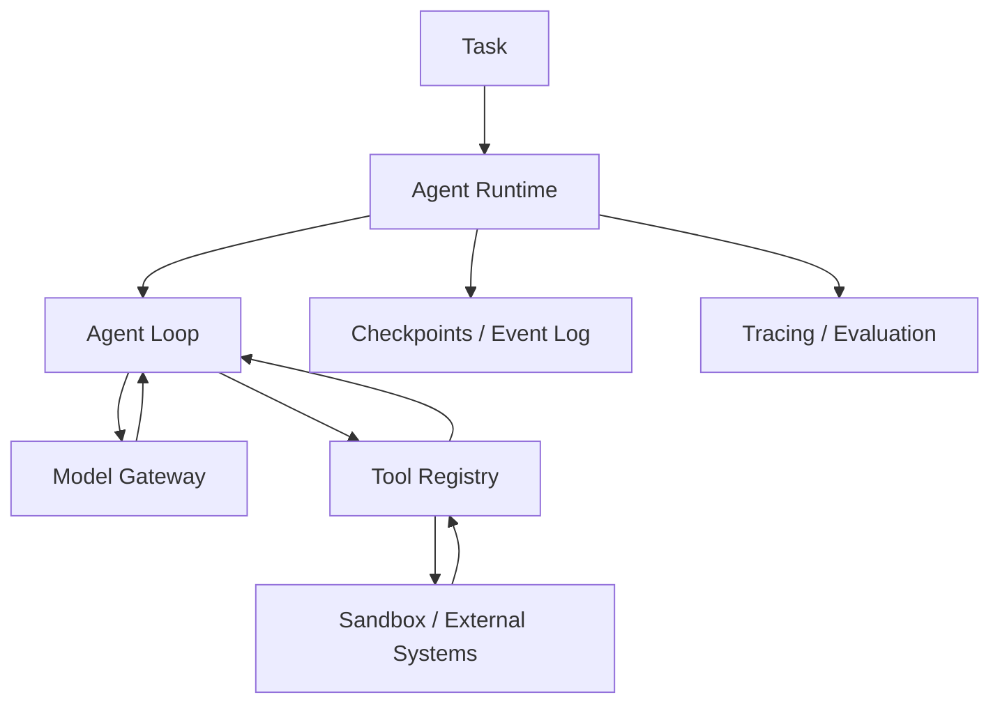

# 教学项目架构

全书将按 **Agent Kernel → Tool Runtime → Context & Memory → Durable Execution → Sandbox → Evaluation** 演进，而不是简单封装某个框架。

## v0.1 范围

目前只实现同步执行循环、结构化工具调用、严格工具注册与参数验证、迭代上限和基础测试。离线示例中的模型采用预定义响应，帮助读者验证协议和控制流。未实现 Sandbox、Memory、Tracing、Checkpoint、安全隔离等生产能力。

## 核心边界

- **Model**：接收消息并返回文本或工具调用，不直接执行工具。
- **Agent**：负责追加消息、调用工具、控制循环与结束条件。
- **ToolRegistry**：按名称查找并验证调用参数，执行显式注册的 Python 函数。
- **Runtime（未来）**：管理持久化任务、执行沙箱、配额与重试。

所有返回内容均视为不可信输入。当前示例不能运行不可信 shell 或代码。

## 第 4 章：Agent Kernel 教学 v0.2

本章新增独立实现，**保留此前 `mini_agent.core` 的 v0.1 行为**：

- [Agent Kernel](../src/mini_agent/agent_v2.py)：`ModelReply`、`ToolCall`、`ToolRegistry`、`RunResult`、`Event`。
- [Chat Completions Model Adapter](../src/mini_agent/chat_adapter.py)：HTTP 请求和模型响应转换；不覆盖 Responses API 或其他供应商协议。
- [算术工具](../src/mini_agent/demo_tools.py)：只有显式注册的低风险、只读算术函数。
- [离线示例](../examples/ch04_agent_loop.py)：规则模型对观察作出下一步决策，最终执行 `add → multiply → final`。
- [真实模型示例](../examples/ch04_live_agent.py)：需要设置环境变量 `AGENT_API_KEY` 和 `AGENT_MODEL`。
- [回归测试](../tests/test_ch04.py)：协议、异常、预算、权限、参数校验、HTTP 假 Transport。

### 本章不提供的保证

- `read_only` 是可信开发者标注，**不是 OS 级隔离**；
- `allow_writes=True` 是显式的教学开关，**不是人类审批和授权体系**；
- 同一轮多个工具调用是**串行**执行，未解决相互依赖和幂等问题；
- `max_model_calls` / `max_tool_calls` 不等于执行时间、费用或 Token 的完整预算；
- `status=completed` 仅表示模型返回最终文本，不代表业务结果被独立验证；
- 没有沙箱、持久化恢复、上下文压缩、工具进程中断或可靠重试机制。

这些能力在后续第 5–12 章和第 18–28 章迭代实现。
