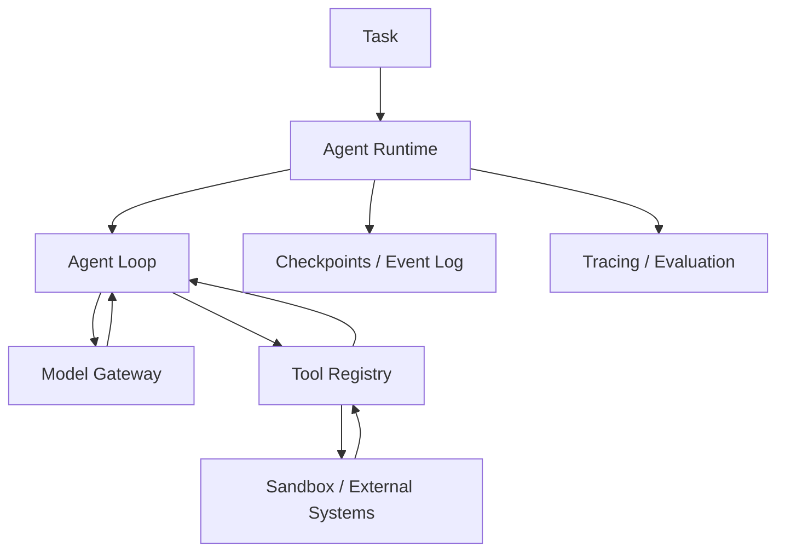

# 教学项目架构

全书将按 **Agent Kernel → Tool Runtime → Context & Memory → Durable Execution → Sandbox → Evaluation** 演进，而不是简单封装某个框架。

## v0.1 范围

目前只实现同步执行循环、结构化工具调用、严格工具注册与参数验证、迭代上限和基础测试。离线示例中的模型采用预定义响应，帮助读者验证协议和控制流。未实现 Sandbox、Memory、Tracing、Checkpoint、安全隔离等生产能力。

## 核心边界

- **Model**：接收消息并返回文本或工具调用，不直接执行工具。
- **Agent**：负责追加消息、调用工具、控制循环与结束条件。
- **ToolRegistry**：按名称查找并验证调用参数，执行显式注册的 Python 函数。
- **Runtime（未来）**：管理持久化任务、执行沙箱、配额与重试。

所有返回内容均视为不可信输入。当前示例不能运行不可信 shell 或代码。
