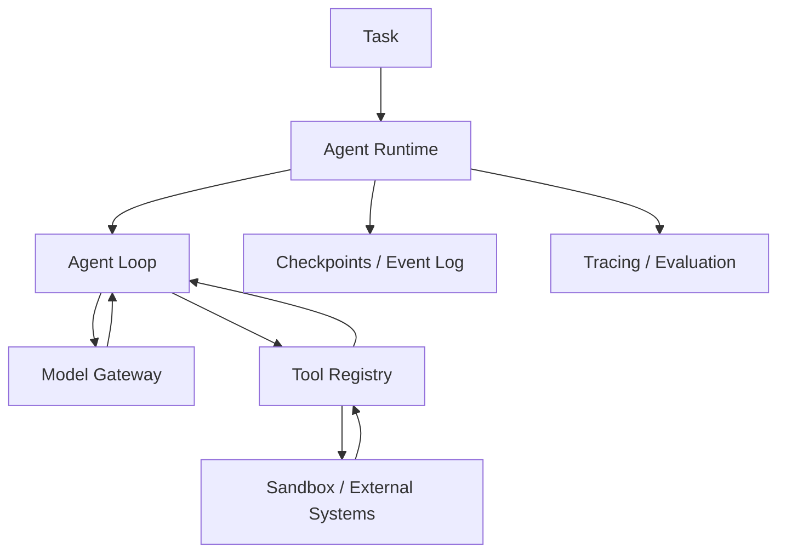

# 教学项目架构

全书将按 **Agent Kernel → Tool Runtime → Context & Memory → Durable Execution → Sandbox → Evaluation** 演进，而不是简单封装某个框架。



## v0.1 范围

目前只实现同步执行循环、结构化工具调用、严格工具注册与参数验证、迭代上限和基础测试。离线示例中的模型采用预定义响应，帮助读者验证协议和控制流。未实现 Sandbox、Memory、Tracing、Checkpoint、安全隔离等生产能力。

## 核心边界

- **Model**：接收消息并返回文本或工具调用，不直接执行工具。
- **Agent**：负责追加消息、调用工具、控制循环与结束条件。
- **ToolRegistry**：按名称查找并验证调用参数，执行显式注册的 Python 函数。
- **Runtime（未来）**：管理持久化任务、执行沙箱、配额与重试。

所有返回内容均视为不可信输入。当前示例不能运行不可信 shell 或代码。

## 第 4 章：Agent Kernel 教学 v0.2

本章新增独立实现，**保留此前 `mini_agent.core` 的 v0.1 行为**：

- [Agent Kernel](../src/mini_agent/agent_v2.py)：`ModelReply`、`ToolCall`、`ToolRegistry`、`RunResult`、`Event`。
- [Chat Completions Model Adapter](../src/mini_agent/chat_adapter.py)：HTTP 请求和模型响应转换；不覆盖 Responses API 或其他供应商协议。
- [算术工具](../src/mini_agent/demo_tools.py)：只有显式注册的低风险、只读算术函数。
- [离线示例](../examples/ch04_agent_loop.py)：规则模型对观察作出下一步决策，最终执行 `add → multiply → final`。
- [真实模型示例](../examples/ch04_live_agent.py)：需要设置环境变量 `AGENT_API_KEY` 和 `AGENT_MODEL`。
- [回归测试](../tests/test_ch04.py)：协议、异常、预算、权限、参数校验、HTTP 假 Transport。

### 本章不提供的保证

- `read_only` 是可信开发者标注，**不是 OS 级隔离**；
- `allow_writes=True` 是显式的教学开关，**不是人类审批和授权体系**；
- 同一轮多个工具调用是**串行**执行，未解决相互依赖和幂等问题；
- `max_model_calls` / `max_tool_calls` 不等于执行时间、费用或 Token 的完整预算；
- `status=completed` 仅表示模型返回最终文本，不代表业务结果被独立验证；
- 没有沙箱、持久化恢复、上下文压缩、工具进程中断或可靠重试机制。

这些能力在后续第 5–12 章和第 18–28 章迭代实现。

## 第 5 章：控制平面领域模型（内存演示）

- [领域模型](../src/mini_agent/run_domain.py)：`TaskSpec` / `RunState` / `StepState` / `RunEvent`、合法状态转移、事件历史投影。
- [第 4 章桥接器](../src/mini_agent/run_capture.py)：将已经结束的 `AgentKernel` 执行消息**事后转换**为领域事件，不提供崩溃恢复。
- [实验](../examples/ch05_run_lifecycle.py)：演示 `RUNNING → WAITING_APPROVAL → RUNNING`、重放和过时版本拒绝。
- [测试](../tests/test_ch05.py)：生命周期守卫、原子内存追加、版本冲突、事件身份和防御性复制。

### 关键模型

- **Task** 是需求目标；**Run** 是一次执行尝试；**Step** 是模型/工具活动；**Event** 是已经发生的领域状态变化。
- `replay(events)` 只计算状态，不允许调用模型或执行工具。
- `InMemoryEventStore` 只在同一个 Python 进程内、通过锁与版本号进行原子条件追加。它**没有磁盘持久化、跨机器事务或 Worker 租约**。
- `emit(...)` 是单写者便利函数，读取版本与追加事件不是不可分割的一次操作；多写者应直接使用带 `expected_version` 的 `append`。
- 事件身份去重不能保证外部工具 **exactly-once**；恢复和副作用幂等留待后续章节。

### 三种流

```text
Control flow : coordinator, permissions, scheduling
Data flow    : messages, context, tool I/O, artifacts
Event flow   : run.created, step.finished, run.paused ...
```

领域事件不是 OpenTelemetry Trace Span，二者未来可通过 `run_id` / `step_id` / `trace_id` 关联。

## 第 6 章：Model Gateway（教学版）

- [模型网关](../src/mini_agent/model_gateway.py)：OpenAI Chat Completions 和 Anthropic Messages 的原生 HTTP 适配、统一 `ModelReply` 与 `TokenUsage`、显式路由、有限重试、临时错误 Fallback。
- [SSE 增量组装](../src/mini_agent/gateway_stream.py)：支持两种接口的文本增量和客户端工具参数流。工具提议直到完整结束才会交给 Runtime 检验。
- [离线双协议演示](../examples/ch06_gateway_demo.py)：通过 Fake Transport 模拟模型响应、Token Usage 与流式 Tool Call。
- [可选线上演示](../examples/ch06_live_gateway.py)：需要用户指定具有调用权限的具体模型与凭证，未纳入 CI。
- [测试](../tests/test_ch06.py)：Native Tool Use Roundtrip、缓存口径、Streaming 中断、错误分类、重试和 Fallback 边界。

### 本版本未实现

`ModelGateway` 为同步教学组件；不支持 Responses API、所有 Anthropic 扩展、Async API、Rate Limiter、Circuit Breaker、全局 Deadline、账单对账、自动 Provider 合规审查和中断后安全 Streaming Resume。预设路由不代表已建立质量/价格驱动的模型评测系统。

### Token Usage 语义

标准化的 `TokenUsage.input_tokens` 是总输入量；`cached_read_input_tokens` 和 `cached_write_input_tokens` 是其中组成部分，不能再次相加。缺失用量为 `None`，不是零。失败请求可能产生实际费用但拿不到 Usage。

### 操作约束

只使用可信配置的 Endpoint；本章禁止自动 HTTP Redirect，但不构成完整出站网络安全控制。发生协议错误、持久性错误或流式中断时，不把响应伪装成成功、不自动绕过权限 Fallback。所有真实模型调用应另行配置凭证、审计和预算。

## 第 7 章：Schema-aware Async Tool Runtime（教学版）

- [工具系统](../src/mini_agent/tool_runtime.py)：`ToolCatalog`、`ToolPolicy`、`AsyncToolRuntime`、输入与输出 JSON Schema Draft 2020-12 校验、调用预算、异常归一化、并发 Semaphore 和写操作 Lock。
- [MCP Tool Adapter](../src/mini_agent/mcp_tools.py)：使用用户提供的、已连接的 MCP Python SDK v2 `Client`；分页发现、工具名称加 Server Alias，仅注册本地白名单中的 MCP Tools。
- [Async Agent Bridge](../src/mini_agent/async_agent.py)：复用此前同步 `Model.complete` 协议，允许异步执行工具并回填 Tool Results。
- [离线实验](../examples/ch07_tool_runtime.py)：演示连续模型工具调用、本地读写审批和 Fake MCP。
- [可选本地 MCP Client](../examples/ch07_mcp_client_v2.py)：安装项目 extras `.[mcp]`，只对 Loopback 服务做白名单 Tool Discovery。
- [单元测试](../tests/test_ch07.py)：复杂 JSON Schema、重复键、权限拒绝、工具超时、并发、MCP Output Schema 和模型桥接。

### 风险边界（重点）

- JSON Schema 不授权环境副作用；MCP `annotations.readOnlyHint` 是远程宣称，不作为本地权限事实。
- 本章风险与审批仅是由**可信服务端创建**的 `ToolPolicy` 教学对象，不能让 LLM 或不可信客户端自主颁发。
- `asyncio.wait_for` 取消是协作式的，不能确保外部 API 事务或阻塞操作已停止；返回超时意味着**结果未知**。
- 重复调用 ID 只在当前进程的内存表去重；并非 Durable Execution、Exactly-once 或全局权限系统。
- Remote MCP Transport、认证、进程启动与连接生命周期交由官方 SDK 管理。本章默认 CI 完全离线。
- 生产环境的沙箱、资源隔离、持久化、授权审计以及工具调用幂等性仍需后续章节完成。

## 第 8 章：Context Engineering（教学版）

- [Context Manager](../src/mini_agent/context_engineering.py)：`ContextBudget`、`ContextUnit`、`HeuristicTokenCounter`、`ContextManager`、`ContextManagedModel` 和内存归档。
- [离线实验](../examples/ch08_context_lab.py)：比较最近历史与可信重要证据优先策略，另演示含归档引用的 Compaction。
- [测试](../tests/test_ch08.py)：Pinned 内容预算、工具消息原子性、重复/孤立 Tool Call ID、历史不变性、归档恢复、Model Wrapper 集成与超限停止。

### 关键不变量

- 完整历史由 AgentKernel / Run Store 管理；Model View 只是给当前模型的一次输入快照。
- System、初始用户目标和最近一次 User Message 都不能无声删除。
- Assistant Tool Calls 与全部匹配的 Tool Results 是不可拆分的单位；不完整 History 必须拒绝。
- 可信应用才可设置 Importance，不能读取不可信 Tool Output 的“优先级”主张。
- 工具结果超长可裁剪并保留原文 Archive ID，但 Archive **当前仅在进程内有效**。
- `HeuristicTokenCounter` 是可复现的长度代理，**绝非实际 Tokenizer、硬容量保证或账单**。
- `compact` 生成的是可检索归档标记，而**不是未经验证的语义事实摘要**。
- 为模型筛选上下文，不提供 Prompt Injection 免疫、真实 Memory、跨进程持久化或已实现的检索授权。

## 第 9 章：Memory Service（教学版）

带来源、版本、过期、租户/所有者作用域的 Memory Store；词项覆盖率、字符哈希向量、RRF 混合检索。身份过滤先于排序。无持久化、真实 Embedding、认证和物理硬删除。

## 第 17 章：Multi-Agent Supervisor / Blackboard（教学版）

- [控制器](../src/mini_agent/multi_agent.py)：`AgentIdentity`、`DelegatedTask`、`Delegation`、`AgentReply`、`Supervisor`、`Blackboard`、`HostResolution`，以及只读输入视图和逐 Key CAS。
- [专长 Worker Fixture](../src/mini_agent/multi_agent_fixture.py)：API、QA、Writer 三种角色，可与单 Generalist 作相同验收标准下的离线对比。
- [模型适配](../src/mini_agent/multi_agent_model.py)：兼容第 4/6 章 Model Protocol 的严格 JSON 结果提议；调用模型时不授予工具执行权限。
- [实验](../examples/ch17_multi_agent_lab.py)：Single Worker 三轮、Multi-Agent 两轮、同 Key 并发冲突与可信 Host 显式版本裁决。
- [测试](../tests/test_ch17.py)：非法委派、输入/输出权限、数据冲突、乐观版本、Host 裁决、预算、Worker Timeout、独立验收和无效 JSON。

### 核心不变量

1. Worker 只能读取当前 Task 显式声明的 Input Keys，不能经模型文字自行授予更多写入能力。
2. Worker 只能返回 ProposedArtifact；由可信 Supervisor 检查 Task ID、写权限、输出集合、版本并提交真实 Artifact。
3. 每个并发 Wave 的写入在当前进程内**整批提交或整批拒绝**；已成功的较早 Wave 不会自动回滚。
4. 同 Key 并发冲突不会走 Last Writer Wins，必须重新规划或可信 Host 根据新证据显式处理。
5. 最终状态只有通过独立 Verifier 才是 `verified`，Worker 自报 `done` 不能替代验收。
6. 规则 Worker 与短延时合成 I/O 的实验**不能证明真实 LLM 多 Agent 的能力或成本收益**。

### 仍未实现

Worker 的真实操作系统沙箱、远程通信协议（A2A）、动态委派、强一致跨进程共享状态、Token/费用账本、Worker 租约、幂等工具副作用与 Durable Resume。后续第 18–24 章逐步完善。

## 第 18 章：Agent Sandbox 与执行环境

- [主机资源受限执行器](../src/mini_agent/process_executor.py)：Trust Host 注册脚本白名单并复制到临时 Workspace，用 Shell-Free `subprocess` + `start_new_session` + `selectors` 限制超时/输出，终止进程组及回收目录。**这不是 OS 隔离沙箱**，不允许执行未知/恶意代码。
- [Resource Bootstrap](../src/mini_agent/_resource_child.py)：在受信任的子进程中设置 `RLIMIT_CPU`、`RLIMIT_AS`、`RLIMIT_FSIZE`、`RLIMIT_NOFILE` 再运行 Host 批准的 Python Fixture；这些限制不是 cgroup/VM 配额。
- [Reservation Controller](../src/mini_agent/sandbox_reservations.py)：CPU millicores、Guest Memory + Runtime Overhead、Disk 的 Admission；TTL 到期设置 `reap_required`，直到可信 Control Plane 确认销毁之前都继续计入使用量。
- [Read-only Diagnostics](../src/mini_agent/sandbox_diagnostics.py)：只读取当前进程的 Namespace 标识、cgroup v2 配置；不修改 Host。
- [离线示例](../examples/ch18_sandbox_lab.py) · [可信 Fixture](../examples/ch18_trusted_worker.py) · [测试](../tests/test_ch18.py)。
- [生产级隔离评审](ch18_sandbox_review.md)：真实 Firecracker/gVisor/OCI 交付必须实现的安全、验证、回收和观测契约。

### 边界警告

本章 CI **没有启动 MicroVM、执行 unshare、创建 cgroup 或部署 Seccomp**。Runner 里的 Child 与宿主共享 Mount、Network、UID、Kernel。恶意进程可以创建独立 Session、访问其他宿主资源、执行网络调用或绕过实验级控制。因此资源执行器只应执行可信 Fixture。真实多租户 Agent 需要硬隔离平台、租户授权、最低特权、出站网络限制、持久化资源租约与 Host 侧销毁验收。
