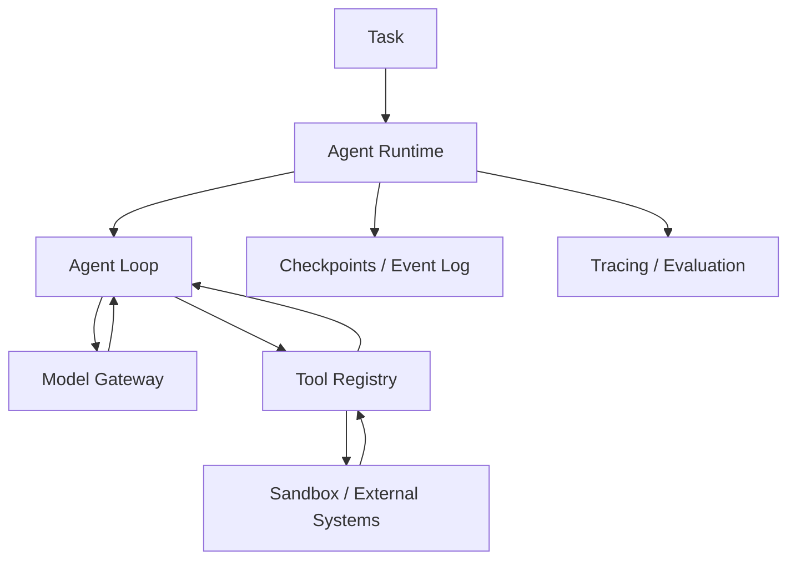

# 教学项目架构

全书将按 **Agent Kernel → Tool Runtime → Context & Memory → Durable Execution → Sandbox → Evaluation** 演进，而不是简单封装某个框架。



## v0.1 范围

目前只实现同步执行循环、结构化工具调用、严格工具注册与参数验证、迭代上限和基础测试。离线示例中的模型采用预定义响应，帮助读者验证协议和控制流。未实现 Sandbox、Memory、Tracing、Checkpoint、安全隔离等生产能力。

## 核心边界

- **Model**：接收消息并返回文本或工具调用，不直接执行工具。
- **Agent**：负责追加消息、调用工具、控制循环与结束条件。
- **ToolRegistry**：按名称查找并验证调用参数，执行显式注册的 Python 函数。
- **Runtime（未来）**：管理持久化任务、执行沙箱、配额与重试。

所有返回内容均视为不可信输入。当前示例不能运行不可信 shell 或代码。

## 第 4 章：Agent Kernel 教学 v0.2

本章新增独立实现，**保留此前 `mini_agent.core` 的 v0.1 行为**：

- [Agent Kernel](../src/mini_agent/agent_v2.py)：`ModelReply`、`ToolCall`、`ToolRegistry`、`RunResult`、`Event`。
- [Chat Completions Model Adapter](../src/mini_agent/chat_adapter.py)：HTTP 请求和模型响应转换；不覆盖 Responses API 或其他供应商协议。
- [算术工具](../src/mini_agent/demo_tools.py)：只有显式注册的低风险、只读算术函数。
- [离线示例](../examples/ch04_agent_loop.py)：规则模型对观察作出下一步决策，最终执行 `add → multiply → final`。
- [真实模型示例](../examples/ch04_live_agent.py)：需要设置环境变量 `AGENT_API_KEY` 和 `AGENT_MODEL`。
- [回归测试](../tests/test_ch04.py)：协议、异常、预算、权限、参数校验、HTTP 假 Transport。

### 本章不提供的保证

- `read_only` 是可信开发者标注，**不是 OS 级隔离**；
- `allow_writes=True` 是显式的教学开关，**不是人类审批和授权体系**；
- 同一轮多个工具调用是**串行**执行，未解决相互依赖和幂等问题；
- `max_model_calls` / `max_tool_calls` 不等于执行时间、费用或 Token 的完整预算；
- `status=completed` 仅表示模型返回最终文本，不代表业务结果被独立验证；
- 没有沙箱、持久化恢复、上下文压缩、工具进程中断或可靠重试机制。

这些能力在后续第 5–12 章和第 18–28 章迭代实现。

## 第 5 章：控制平面领域模型（内存演示）

- [领域模型](../src/mini_agent/run_domain.py)：`TaskSpec` / `RunState` / `StepState` / `RunEvent`、合法状态转移、事件历史投影。
- [第 4 章桥接器](../src/mini_agent/run_capture.py)：将已经结束的 `AgentKernel` 执行消息**事后转换**为领域事件，不提供崩溃恢复。
- [实验](../examples/ch05_run_lifecycle.py)：演示 `RUNNING → WAITING_APPROVAL → RUNNING`、重放和过时版本拒绝。
- [测试](../tests/test_ch05.py)：生命周期守卫、原子内存追加、版本冲突、事件身份和防御性复制。

### 关键模型

- **Task** 是需求目标；**Run** 是一次执行尝试；**Step** 是模型/工具活动；**Event** 是已经发生的领域状态变化。
- `replay(events)` 只计算状态，不允许调用模型或执行工具。
- `InMemoryEventStore` 只在同一个 Python 进程内、通过锁与版本号进行原子条件追加。它**没有磁盘持久化、跨机器事务或 Worker 租约**。
- `emit(...)` 是单写者便利函数，读取版本与追加事件不是不可分割的一次操作；多写者应直接使用带 `expected_version` 的 `append`。
- 事件身份去重不能保证外部工具 **exactly-once**；恢复和副作用幂等留待后续章节。

### 三种流

```text
Control flow : coordinator, permissions, scheduling
Data flow    : messages, context, tool I/O, artifacts
Event flow   : run.created, step.finished, run.paused ...
```

领域事件不是 OpenTelemetry Trace Span，二者未来可通过 `run_id` / `step_id` / `trace_id` 关联。

## 第 6 章：Model Gateway（教学版）

- [模型网关](../src/mini_agent/model_gateway.py)：OpenAI Chat Completions 和 Anthropic Messages 的原生 HTTP 适配、统一 `ModelReply` 与 `TokenUsage`、显式路由、有限重试、临时错误 Fallback。
- [SSE 增量组装](../src/mini_agent/gateway_stream.py)：支持两种接口的文本增量和客户端工具参数流。工具提议直到完整结束才会交给 Runtime 检验。
- [离线双协议演示](../examples/ch06_gateway_demo.py)：通过 Fake Transport 模拟模型响应、Token Usage 与流式 Tool Call。
- [可选线上演示](../examples/ch06_live_gateway.py)：需要用户指定具有调用权限的具体模型与凭证，未纳入 CI。
- [测试](../tests/test_ch06.py)：Native Tool Use Roundtrip、缓存口径、Streaming 中断、错误分类、重试和 Fallback 边界。

### 本版本未实现

`ModelGateway` 为同步教学组件；不支持 Responses API、所有 Anthropic 扩展、Async API、Rate Limiter、Circuit Breaker、全局 Deadline、账单对账、自动 Provider 合规审查和中断后安全 Streaming Resume。预设路由不代表已建立质量/价格驱动的模型评测系统。

### Token Usage 语义

标准化的 `TokenUsage.input_tokens` 是总输入量；`cached_read_input_tokens` 和 `cached_write_input_tokens` 是其中组成部分，不能再次相加。缺失用量为 `None`，不是零。失败请求可能产生实际费用但拿不到 Usage。

### 操作约束

只使用可信配置的 Endpoint；本章禁止自动 HTTP Redirect，但不构成完整出站网络安全控制。发生协议错误、持久性错误或流式中断时，不把响应伪装成成功、不自动绕过权限 Fallback。所有真实模型调用应另行配置凭证、审计和预算。
