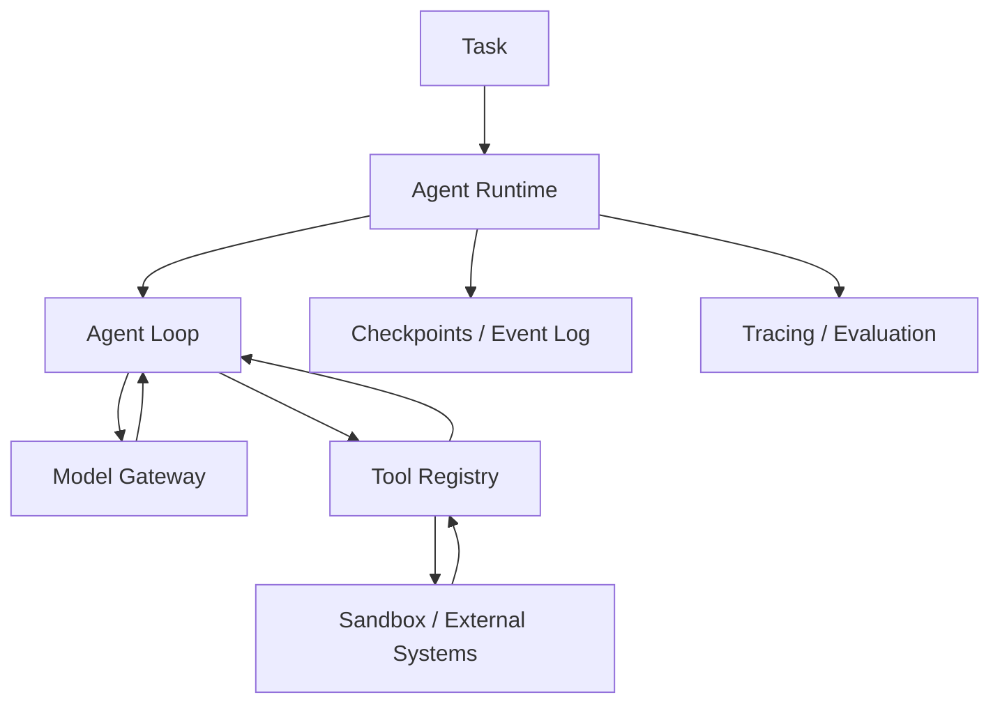

# 教学项目架构

全书将按 **Agent Kernel → Tool Runtime → Context & Memory → Durable Execution → Sandbox → Evaluation** 演进，而不是简单封装某个框架。



## v0.1 范围

目前只实现同步执行循环、结构化工具调用、严格工具注册与参数验证、迭代上限和基础测试。离线示例中的模型采用预定义响应，帮助读者验证协议和控制流。未实现 Sandbox、Memory、Tracing、Checkpoint、安全隔离等生产能力。

## 核心边界

- **Model**：接收消息并返回文本或工具调用，不直接执行工具。
- **Agent**：负责追加消息、调用工具、控制循环与结束条件。
- **ToolRegistry**：按名称查找并验证调用参数，执行显式注册的 Python 函数。
- **Runtime（未来）**：管理持久化任务、执行沙箱、配额与重试。

所有返回内容均视为不可信输入。当前示例不能运行不可信 shell 或代码。

## 第 4 章：Agent Kernel 教学 v0.2

本章新增独立实现，**保留此前 `mini_agent.core` 的 v0.1 行为**：

- [Agent Kernel](../src/mini_agent/agent_v2.py)：`ModelReply`、`ToolCall`、`ToolRegistry`、`RunResult`、`Event`。
- [Chat Completions Model Adapter](../src/mini_agent/chat_adapter.py)：HTTP 请求和模型响应转换；不覆盖 Responses API 或其他供应商协议。
- [算术工具](../src/mini_agent/demo_tools.py)：只有显式注册的低风险、只读算术函数。
- [离线示例](../examples/ch04_agent_loop.py)：规则模型对观察作出下一步决策，最终执行 `add → multiply → final`。
- [真实模型示例](../examples/ch04_live_agent.py)：需要设置环境变量 `AGENT_API_KEY` 和 `AGENT_MODEL`。
- [回归测试](../tests/test_ch04.py)：协议、异常、预算、权限、参数校验、HTTP 假 Transport。

### 本章不提供的保证

- `read_only` 是可信开发者标注，**不是 OS 级隔离**；
- `allow_writes=True` 是显式的教学开关，**不是人类审批和授权体系**；
- 同一轮多个工具调用是**串行**执行，未解决相互依赖和幂等问题；
- `max_model_calls` / `max_tool_calls` 不等于执行时间、费用或 Token 的完整预算；
- `status=completed` 仅表示模型返回最终文本，不代表业务结果被独立验证；
- 没有沙箱、持久化恢复、上下文压缩、工具进程中断或可靠重试机制。

这些能力在后续第 5–12 章和第 18–28 章迭代实现。

## 第 5 章：控制平面领域模型（内存演示）

- [领域模型](../src/mini_agent/run_domain.py)：`TaskSpec` / `RunState` / `StepState` / `RunEvent`、合法状态转移、事件历史投影。
- [第 4 章桥接器](../src/mini_agent/run_capture.py)：将已经结束的 `AgentKernel` 执行消息**事后转换**为领域事件，不提供崩溃恢复。
- [实验](../examples/ch05_run_lifecycle.py)：演示 `RUNNING → WAITING_APPROVAL → RUNNING`、重放和过时版本拒绝。
- [测试](../tests/test_ch05.py)：生命周期守卫、原子内存追加、版本冲突、事件身份和防御性复制。

### 关键模型

- **Task** 是需求目标；**Run** 是一次执行尝试；**Step** 是模型/工具活动；**Event** 是已经发生的领域状态变化。
- `replay(events)` 只计算状态，不允许调用模型或执行工具。
- `InMemoryEventStore` 只在同一个 Python 进程内、通过锁与版本号进行原子条件追加。它**没有磁盘持久化、跨机器事务或 Worker 租约**。
- `emit(...)` 是单写者便利函数，读取版本与追加事件不是不可分割的一次操作；多写者应直接使用带 `expected_version` 的 `append`。
- 事件身份去重不能保证外部工具 **exactly-once**；恢复和副作用幂等留待后续章节。

### 三种流

```text
Control flow : coordinator, permissions, scheduling
Data flow    : messages, context, tool I/O, artifacts
Event flow   : run.created, step.finished, run.paused ...
```

领域事件不是 OpenTelemetry Trace Span，二者未来可通过 `run_id` / `step_id` / `trace_id` 关联。

## 第 6 章：Model Gateway（教学版）

- [模型网关](../src/mini_agent/model_gateway.py)：OpenAI Chat Completions 和 Anthropic Messages 的原生 HTTP 适配、统一 `ModelReply` 与 `TokenUsage`、显式路由、有限重试、临时错误 Fallback。
- [SSE 增量组装](../src/mini_agent/gateway_stream.py)：支持两种接口的文本增量和客户端工具参数流。工具提议直到完整结束才会交给 Runtime 检验。
- [离线双协议演示](../examples/ch06_gateway_demo.py)：通过 Fake Transport 模拟模型响应、Token Usage 与流式 Tool Call。
- [可选线上演示](../examples/ch06_live_gateway.py)：需要用户指定具有调用权限的具体模型与凭证，未纳入 CI。
- [测试](../tests/test_ch06.py)：Native Tool Use Roundtrip、缓存口径、Streaming 中断、错误分类、重试和 Fallback 边界。

### 本版本未实现

`ModelGateway` 为同步教学组件；不支持 Responses API、所有 Anthropic 扩展、Async API、Rate Limiter、Circuit Breaker、全局 Deadline、账单对账、自动 Provider 合规审查和中断后安全 Streaming Resume。预设路由不代表已建立质量/价格驱动的模型评测系统。

### Token Usage 语义

标准化的 `TokenUsage.input_tokens` 是总输入量；`cached_read_input_tokens` 和 `cached_write_input_tokens` 是其中组成部分，不能再次相加。缺失用量为 `None`，不是零。失败请求可能产生实际费用但拿不到 Usage。

### 操作约束

只使用可信配置的 Endpoint；本章禁止自动 HTTP Redirect，但不构成完整出站网络安全控制。发生协议错误、持久性错误或流式中断时，不把响应伪装成成功、不自动绕过权限 Fallback。所有真实模型调用应另行配置凭证、审计和预算。

## 第 7 章：Schema-aware Async Tool Runtime（教学版）

- [工具系统](../src/mini_agent/tool_runtime.py)：`ToolCatalog`、`ToolPolicy`、`AsyncToolRuntime`、输入与输出 JSON Schema Draft 2020-12 校验、调用预算、异常归一化、并发 Semaphore 和写操作 Lock。
- [MCP Tool Adapter](../src/mini_agent/mcp_tools.py)：使用用户提供的、已连接的 MCP Python SDK v2 `Client`；分页发现、工具名称加 Server Alias，仅注册本地白名单中的 MCP Tools。
- [Async Agent Bridge](../src/mini_agent/async_agent.py)：复用此前同步 `Model.complete` 协议，允许异步执行工具并回填 Tool Results。
- [离线实验](../examples/ch07_tool_runtime.py)：演示连续模型工具调用、本地读写审批和 Fake MCP。
- [可选本地 MCP Client](../examples/ch07_mcp_client_v2.py)：安装项目 extras `.[mcp]`，只对 Loopback 服务做白名单 Tool Discovery。
- [单元测试](../tests/test_ch07.py)：复杂 JSON Schema、重复键、权限拒绝、工具超时、并发、MCP Output Schema 和模型桥接。

### 风险边界（重点）

- JSON Schema 不授权环境副作用；MCP `annotations.readOnlyHint` 是远程宣称，不作为本地权限事实。
- 本章风险与审批仅是由**可信服务端创建**的 `ToolPolicy` 教学对象，不能让 LLM 或不可信客户端自主颁发。
- `asyncio.wait_for` 取消是协作式的，不能确保外部 API 事务或阻塞操作已停止；返回超时意味着**结果未知**。
- 重复调用 ID 只在当前进程的内存表去重；并非 Durable Execution、Exactly-once 或全局权限系统。
- Remote MCP Transport、认证、进程启动与连接生命周期交由官方 SDK 管理。本章默认 CI 完全离线。
- 生产环境的沙箱、资源隔离、持久化、授权审计以及工具调用幂等性仍需后续章节完成。

## 第 8 章：Context Engineering（教学版）

- [Context Manager](../src/mini_agent/context_engineering.py)：`ContextBudget`、`ContextUnit`、`HeuristicTokenCounter`、`ContextManager`、`ContextManagedModel` 和内存归档。
- [离线实验](../examples/ch08_context_lab.py)：比较最近历史与可信重要证据优先策略，另演示含归档引用的 Compaction。
- [测试](../tests/test_ch08.py)：Pinned 内容预算、工具消息原子性、重复/孤立 Tool Call ID、历史不变性、归档恢复、Model Wrapper 集成与超限停止。

### 关键不变量

- 完整历史由 AgentKernel / Run Store 管理；Model View 只是给当前模型的一次输入快照。
- System、初始用户目标和最近一次 User Message 都不能无声删除。
- Assistant Tool Calls 与全部匹配的 Tool Results 是不可拆分的单位；不完整 History 必须拒绝。
- 可信应用才可设置 Importance，不能读取不可信 Tool Output 的“优先级”主张。
- 工具结果超长可裁剪并保留原文 Archive ID，但 Archive **当前仅在进程内有效**。
- `HeuristicTokenCounter` 是可复现的长度代理，**绝非实际 Tokenizer、硬容量保证或账单**。
- `compact` 生成的是可检索归档标记，而**不是未经验证的语义事实摘要**。
- 为模型筛选上下文，不提供 Prompt Injection 免疫、真实 Memory、跨进程持久化或已实现的检索授权。

## 第 9 章：Memory Service（教学版）

带来源、版本、过期、租户/所有者作用域的 Memory Store；词项覆盖率、字符哈希向量、RRF 混合检索。身份过滤先于排序。无持久化、真实 Embedding、认证和物理硬删除。

## 第 17 章：Multi-Agent Supervisor / Blackboard（教学版）

- [控制器](../src/mini_agent/multi_agent.py)：`AgentIdentity`、`DelegatedTask`、`Delegation`、`AgentReply`、`Supervisor`、`Blackboard`、`HostResolution`，以及只读输入视图和逐 Key CAS。
- [专长 Worker Fixture](../src/mini_agent/multi_agent_fixture.py)：API、QA、Writer 三种角色，可与单 Generalist 作相同验收标准下的离线对比。
- [模型适配](../src/mini_agent/multi_agent_model.py)：兼容第 4/6 章 Model Protocol 的严格 JSON 结果提议；调用模型时不授予工具执行权限。
- [实验](../examples/ch17_multi_agent_lab.py)：Single Worker 三轮、Multi-Agent 两轮、同 Key 并发冲突与可信 Host 显式版本裁决。
- [测试](../tests/test_ch17.py)：非法委派、输入/输出权限、数据冲突、乐观版本、Host 裁决、预算、Worker Timeout、独立验收和无效 JSON。

### 核心不变量

1. Worker 只能读取当前 Task 显式声明的 Input Keys，不能经模型文字自行授予更多写入能力。
2. Worker 只能返回 ProposedArtifact；由可信 Supervisor 检查 Task ID、写权限、输出集合、版本并提交真实 Artifact。
3. 每个并发 Wave 的写入在当前进程内**整批提交或整批拒绝**；已成功的较早 Wave 不会自动回滚。
4. 同 Key 并发冲突不会走 Last Writer Wins，必须重新规划或可信 Host 根据新证据显式处理。
5. 最终状态只有通过独立 Verifier 才是 `verified`，Worker 自报 `done` 不能替代验收。
6. 规则 Worker 与短延时合成 I/O 的实验**不能证明真实 LLM 多 Agent 的能力或成本收益**。

### 仍未实现

Worker 的真实操作系统沙箱、远程通信协议（A2A）、动态委派、强一致跨进程共享状态、Token/费用账本、Worker 租约、幂等工具副作用与 Durable Resume。后续第 18–24 章逐步完善。

## 第 18 章：Agent Sandbox 与执行环境

- [主机资源受限执行器](../src/mini_agent/process_executor.py)：Trust Host 注册脚本白名单并复制到临时 Workspace，用 Shell-Free `subprocess` + `start_new_session` + `selectors` 限制超时/输出，终止进程组及回收目录。**这不是 OS 隔离沙箱**，不允许执行未知/恶意代码。
- [Resource Bootstrap](../src/mini_agent/_resource_child.py)：在受信任的子进程中设置 `RLIMIT_CPU`、`RLIMIT_AS`、`RLIMIT_FSIZE`、`RLIMIT_NOFILE` 再运行 Host 批准的 Python Fixture；这些限制不是 cgroup/VM 配额。
- [Reservation Controller](../src/mini_agent/sandbox_reservations.py)：CPU millicores、Guest Memory + Runtime Overhead、Disk 的 Admission；TTL 到期设置 `reap_required`，直到可信 Control Plane 确认销毁之前都继续计入使用量。
- [Read-only Diagnostics](../src/mini_agent/sandbox_diagnostics.py)：只读取当前进程的 Namespace 标识、cgroup v2 配置；不修改 Host。
- [离线示例](../examples/ch18_sandbox_lab.py) · [可信 Fixture](../examples/ch18_trusted_worker.py) · [测试](../tests/test_ch18.py)。
- [生产级隔离评审](ch18_sandbox_review.md)：真实 Firecracker/gVisor/OCI 交付必须实现的安全、验证、回收和观测契约。

### 边界警告

本章 CI **没有启动 MicroVM、执行 unshare、创建 cgroup 或部署 Seccomp**。Runner 里的 Child 与宿主共享 Mount、Network、UID、Kernel。恶意进程可以创建独立 Session、访问其他宿主资源、执行网络调用或绕过实验级控制。因此资源执行器只应执行可信 Fixture。真实多租户 Agent 需要硬隔离平台、租户授权、最低特权、出站网络限制、持久化资源租约与 Host 侧销毁验收。

## 第 19 章：Agent Security Reference Monitor（教学版）

- [参考监视器](../src/mini_agent/security_monitor.py)：`Principal`、`SecurityPolicy`、`ToolSpec`、`ActionProposal`、`ApprovalAuthority`、`ApprovalTicket`、`SecurityReferenceMonitor`、`SecretBroker`。
- [离线安全实验](../examples/ch19_security_lab.py)：恶意文档仅当作外部 Data；未知工具、越权目标、未经批准的 Write 被拒绝；Exact Action HMAC Approval 允许模拟写操作，并拒绝重放。
- [自动化测试](../tests/test_ch19.py)：33 项，覆盖 Principal、Tool/Resource、JSON、Schema、Egress、Expired/Tampered Approval、Replay、Budget、模拟 Secret DLP、日志隐私以及权限拒绝。
- [生产级 Security Checklist](ch19_security_review.md)：涵盖身份、审批、网络、Secret Manager、供应链、MCP、Memory、Multi-Agent、沙箱、审计和 Incident Response。

### 不可违反的约束

1. **不可信模型/网页/工具/记忆只提交动作提议，没有能力签发权限**。Host 创建 Principal/Policy，注册真正的 Handler，并执行 Reference Monitor。
2. WRITE/EGRESS/DESTRUCTIVE 需要由 Host 控制的 HMAC 签名 Approval，绑定 Principal、Tool、Call ID、Canonical Args、Expiry、Nonce；Destructive 还需要额外风险 Gate。
3. Resource Exact Allowlist 和固定 HTTPS Endpoint 必须先于 Handler 执行；只允许明确批准的 Destination。真实 DNS/IP/Redirect/Egress 仍需在独立网络网关强制。
4. 对登记的合成 Secret 既检查 EGRESS 参数，也检查返回给模型的 Output；此字符串扫描不构成完整 DLP。
5. Tool Call ID 和审批 Nonce 防重放只在当前进程内有效；真正多机 Exactly-Once/Revocation 需要持久化 CAS/DB 和可信身份服务。
6. Handler 发生错误或结果被阻止时，不自动认为副作用已回滚；需要使用 Durable Operation Ledger 与外部结果确认。
7. Audit Events 不保存原始 Prompt、Tool Args、密钥和 Tool Result；摘要与日志依旧应作为敏感数据访问控制。
8. **本章完全不提供进程隔离、IAM、KMS、密码保险箱或真实网络安全证明**；与第 18 章硬隔离、后续 Reliability/Observability 系统共同组成生产防御体系。

### 后续集成点

第 20–21 章将把 Host PEP 接到 Durable Scheduler 与 Sandbox Tool Backend；第 22 章增加受控追踪、审计和异常检测；第 25–28 章用含正常任务/攻击案例的 Benchmark 衡量成功率、误拒率与实际攻击成功率。

## 第 20 章：Agent Runtime Scheduling / Queue（教学版）

- [SQLite Durable Task Scheduler](../src/mini_agent/runtime_scheduler.py)：`JobSpec`、`SchedulerLimits`、`WorkerLease`、`WorkerIdentity`、`SQLiteTaskScheduler`、`AsyncWorkerPool`。
- [离线演示](../examples/ch20_scheduler_lab.py)：两个 Tenant 的可信 Async Handler 并行执行、独立验收；对非幂等失联任务演示 Lease 过期、资源继续占用、Fake Host 清理确认及外部效果核对。
- [33 项单元测试](../tests/test_ch20.py)：跨连接 SQLite Claim、Tenant Fairness、Priority、Admission、Lease、Heartbeat、Generation Fencing、Backpressure、Cancel、Retry 与 Non-Idempotent Reconciliation。
- [生产部署验收清单](ch20_scheduler_review.md)：完整 Worker/Host Identity、Admission/Quota、实时 Reaper、沙箱销毁、故障注入、外部副作用和集群指标。

### 核心不变量

1. `submit` 用 SQLite 事务接收任务，幂等请求需同 Tenant/Run/Idempotency Key 和相同 Payload/资源，不同内容拒绝。
2. `claim` 使用 `BEGIN IMMEDIATE`，保证同一 SQLite 文件上的并发 Claim 不会双重领取当前 Job；Tenant 选择按最近服务轮次，每 Tenant 的 Job 按 Priority 排序。
3. Worker Lease 有随机 Token、单调 Generation、截止时间；心跳、完成和错误报告必须通过有效 Lease Fencing。
4. `running` 和 `reap_required` 都占用真实资源预算；Lease 过期不释放 Capacity，只有可信 Host 确认实际 Sandbox/Worker 清理后才可迁移到下一状态。
5. `NON_IDEMPOTENT` 结果未知时进入 `needs_reconciliation`，不自动重试；可信 Host 查证外部结果后决定是否完成、取消或有上限地重试。
6. 任务取消不等于工作负载已停止；Running 任务需要 Worker ACK 或 Host Reaping。最终 `verified` 只能由可信、独立 Verifier 判定。
7. Backpressure 统计 Live Job 而不只是 Ready Job；还需 Tenant Scope 和三维资源 Admission。
8. `job_events` 不写入原始模型输入、业务 Payload、Lease Token 或 Secret。

### 未实现与后续内容

本章**不提供**多机 Worker IAM、真实 Container/VM/KVM 隔离、真实外部副作用 Exactly-Once、自动 Heartbeat/Reaper 后台服务、数据库 HA、跨 Region 调度或生产公平性 SLA。`HostCapacity` 与 `SandboxAllocation` 复用第 18 章资源模型；第 19 章的安全策略需要部署在 Worker 外的可信 Tool Proxy。第 21–23 章将扩展可靠恢复、Tracing、性能与费用账本。

## 第 21 章：Agent Reliability 与故障恢复（教学版）

- [Transactionally persisted Outbox](../src/mini_agent/reliability_outbox.py)：`Intent`、`OutboxStore`、`DispatchLease`、`BackendEvidence`，将业务意图和 Outbox 消息作为一个 SQLite 事务提交。
- [Circuit Breaker / Jitter / Saga](../src/mini_agent/resilience_patterns.py)：`RetryPolicy`、`CircuitBreaker`、`SagaStep`、`CompensationPlan`。
- [Synthetic External Provider](../src/mini_agent/reliability_fixture.py)：有独立内存账本的合成 Provider，用于真实执行代码层故障注入，模拟幂等键、提交回执、结果查询与未知状态，不访问外部服务。
- [故障注入实验](../examples/ch21_reliability_lab.py)：本地事务内崩溃全回滚、外部提交后丢 ACK、失联后 Reaper+Reconciliation、幂等重复投递、Circuit Breaker 和补偿建议。
- [36 项回归测试](../tests/test_ch21.py)：事务/重启/争抢 Claim、旧 Lease Fencing、Known/Unknown Outcome、Host Reaping、Provider Dedup、Cancel、Retry Budget、Breaker/Saga。
- [生产上线审查清单](ch21_reliability_review.md)：External Side Effect Contract、Provider Oracle、Consumer Inbox、Lease、Crash Recovery、Reconciliation、Saga、运行指标。

### 核心不变量与安全边界

1. Business Intent 和 Outbox 行在**同一 SQLite 事务**中创建；事务中途异常同时回滚；不能自动泛化为跨服务事务。
2. Outbox 允许重复投递；真正外部业务幂等由 Provider/Consumer 承诺并验证。Non-Idempotent 效果未知时不能直接再次执行。
3. `claim` 使用 SQLite 事务和随机 Lease Token、Generation；旧 Worker ACK 必须 Fenced。
4. Worker 崩溃、异常或 Lease 过期后先进入 `reap_required`，保留容量，直到受信任 Host 确认执行环境已经销毁。
5. `reconcile` 只依据 Host-owned `BackendOracle.inspect`；真正 Provider 若不能权威断言 Not Applied，应返回 Unknown，而不是将最终一致性的 Not Found 视为未提交。
6. Circuit Breaker 与 Retry/Jitter 保护依赖负载，但没有授权含义；Saga 只输出补偿计划，实际执行应产生**新的**安全批准 Operation/Outbox。
7. SQLite Writer、Synthetic Provider 和 HMAC/审批身份等示例不构成跨机 Exactly-Once、真实 IAM、真实 OS 隔离或生产可信 External Receipt 体系。

### 与第 20 章的关系

第 20 章 `SQLiteTaskScheduler` 负责 Job/Attempt/Lease/Resource Scheduling；第 21 章 `OutboxStore` 负责业务意图及外部副作用投递。二者当前是**独立教学模型**，不能跨两个 SQLite 文件组成一个真正原子事务。生产需设计统一的 Task/Activity/Operation ID、统一 Event History、Outbox/Inbox、外部幂等与 Host 审计。第 22 章将进一步实现 Tracing、错误根因分析和成本/运行时计量。

## 第 22 章：Agent Observability 与 Debugging（隐私优先教学实现）

- [Trace Recorder](../src/mini_agent/observability.py)：W3C Trace Context Version 00 解析/格式化、随机 Trace/Span ID、`ContextVar` 异步父子关系、有界 Span/Event、严格 Attribute Allowlist、安全错误分类、独立 Verifier 字段和显式 Rate Card。
- [Trace Store & Playback](../src/mini_agent/trace_store.py)：仅导出安全元数据的 JSONL、原子文件替换、SHA-256 哈希链、文件/Span/属性校验、只读诊断和 Cost/Verifier Summary。
- [Model/Tool Bridge](../src/mini_agent/observability_bridge.py)：调用第 4 章 `AgentKernel` / `ToolRegistry` 和第 6 章 `GatewayResponse`，记录受控 Model/Tool Spans，不记录 Prompt、Tool Arguments、Tool Results。
- [离线实验](../examples/ch22_observability_lab.py)：模型先请求未知工具被拒绝，再调用已批准 Fixture Tool 一次，最终通过 Host Verifier；三次合成 Model Calls 记录 Token/Rate Card Cost；回放零次外部执行。
- [39 项测试](../tests/test_ch22.py)：W3C、隐私 Allowlist、Async ContextVar、未知 Tool/异常脱敏、Token 缺失与 Price Cost、哈希链篡改、只读 Replay、实际 Kernel/Tool Adapter 权限不绕过。
- [生产 Observability 审查清单](ch22_observability_review.md)：OTel/OTLP、权限、Telemetry Budget、Cache Usage、成本、历史回放和安全审计。

### 核心不变量

1. **Tracer 是观测层，不是 Run/Operation 的权威状态服务**。Trace ID 仅用于关联，不能充当跨租户 IAM 权限或 Tool Approval。
2. 使用可信、有限标签而非记录所有 Prompt/Completion/Tool Arguments/Results；未知 Tool Name 与 Exception Error Code 不可由模型任意注入可能敏感的文本。
3. `gen_ai.usage.input_tokens`、`gen_ai.usage.output_tokens` 对应 Provider 明确报告的 Token；Cache Component 已计入总 Input 时不能重复累加。
4. `RateCard.version` 必须显式提供；缺失 Token Usage/Price 时费用保持 Unknown，而不是假设为零；本章 Price 是合成示例，不是生产账单。
5. 中间 Tool Span Error 不直接决定 Task Failed，最终验收只从独立 Verifier Span 判定。
6. `replay_diagnostic` **绝不重新调用外部工具或模型**。JSONL 哈希链只能检测未经重算的改动，不提供数字签名、身份真实性或不可篡改审计。
7. 异步子 Span 共享正确 Parent ID；跨机器需要真正的 W3C/OTel Context Propagator，当前只解析严格 Version 00 字符串。

### 未实现与后续

不是完整 OpenTelemetry SDK/OTLP Exporter、遥测 Collector、签名审计、多租户访问控制、Sampling/Tail-Sampling 服务、生产 Trace/Log/Metric Backend、真实 Model Billing、跨机时钟校正或安全调试授权系统。第 23 章将使用这里的安全观测原则进一步研究 Agent 性能与成本优化。


## 第 24 章：Agent Platform 与生产发布（离线决策原型）

- [`platform_deployment.py`](../src/mini_agent/platform_deployment.py)：`ServiceProfile`、`TenantProfile`、`PlatformManifest`、`preflight`、`reference_kubernetes_objects`、`CanaryPolicy`、`judge_canary`、`ReleaseLedger`。
- [`platform_fixture.py`](../src/mini_agent/platform_fixture.py)：四个服务、两个租户、不变镜像摘要、Host-owned 合成灰度指标，**无真实价格、请求或网络**。
- [`ch24_platform_lab.py`](../examples/ch24_platform_lab.py)：预检 → 参考 JSON → 缺少指标暂停 → 逐阶段推进 → 安全事故中止；只写本地临时 SQLite 发布决策。
- [`test_ch24.py`](../tests/test_ch24.py)：41 项测试覆盖不安全镜像/权限/网络/租户、数据库 Schema 兼容、样本不足、独立成功率、P95、Cost per Verified Task、Release CAS/重放及终态。
- [`ch24_platform_review.md`](ch24_platform_review.md)：部署前权限、Tenant、网络、ResourceQuota、RuntimeClass、Probe/HPA、SLO、Canary、Observed State、Rollback/DR 的生产审查清单。

### 关键不变量

1. 受信任 Control Plane 管理身份、策略、部署和外部副作用；LLM/Tool/MCP/Worker 不能通过文字更改权限、服务镜像、预算或发布阈值。
2. Preflight 对四个必须服务、不可变 SHA-256 Image Digest、Rootless/Seccomp/最小特权、ServiceAccount/Namespace、Default Deny Network、执行 Runtime、基本数据库兼容检查提供**静态负面测试**。
3. `reference_kubernetes_objects` 是为了离线学习而生成的 JSON，不是可直接部署的完整生产 K8s 应用；`registry.invalid` 和 RuntimeClassName 是故意不操作真实系统的占位。
4. Canary Gate 要求 Release/Traffic Weight/独立窗口 ID 与指标绑定，禁止复用已过审的观测窗口；**缺少观测/样本量时暂停**，安全事故与已确认的质量/延迟/成本回归时中止，全部指标通过才推进；每阶段都用可信、独立的 Task Verifier，而不是 Worker 自报。
5. SQLite `ReleaseLedger` 用 Manifest/Policy Fingerprint + Generation CAS 防止两个控制器或旧决策覆盖新状态，并保存不含用户内容的事件元数据。
6. `status=aborted, weight=0` 是期望发布决策，**不是集群 Traffic 已切回 Stable 的凭据**；发布仍需可信 Actuator、实际状态读回、独立运维验收。
7. Traffic Rollback 不能撤销真实邮件、支付、部署或其他 Tool Side Effect；必须和第 21 章的 Operation Ledger、Reconciliation 与补偿流程组合使用。

### 生产欠缺

尚未实现真实 K8s/Argo API、Registry/Image Signature Verification、Admission Controller、Ingress/Network Egress、安全运行时安装、IAM/Secret Broker、External Traffic Reconciliation、SLO 数据查询、灾难恢复和跨集群发布。真实环境需额外审批、实测和运行手册。


## 第 25 章：Agent Evaluation 基础（可信合成教学框架）

- [`agent_evaluation.py`](../src/mini_agent/agent_evaluation.py)：`EvalCase` / `EvalSuite` / `PublicTask` / `FixtureEnvironment` / `EvalHarness` / `EvalReport`，版本摘要、环境结果验收、政策检查、费用覆盖、统计/对照。
- [`eval_fixture.py`](../src/mini_agent/eval_fixture.py)：使用第 4 章真实 `AgentKernel/ModelReply/ToolCall/ToolRegistry` 和确定性 Fake Model 调用受控读写工具。
- [`ch25_offline_suite.json`](../evals/ch25_offline_suite.json)：六条合成 Research/Coding/Browser/Tool/Security Case，`dev/regression/heldout` 分组，但非真实保密基准。
- [`ch25_eval_lab.py`](../examples/ch25_eval_lab.py)：Baseline/Candidate 同一 Heldout 的多次 Trial；演示环境结果高于模型 `done`，以及 `pass@k`、`pass^k`、Wilson/Paired Statistics。
- [`test_ch25.py`](../tests/test_ch25.py)：40 项对照/负例测试，覆盖数据版本、非法 JSON、Trial Reset、工具拒绝、Outcome/Policy Grader、未知费用、错误脱敏、统计边界。
- [`ch25_eval_review.md`](ch25_eval_review.md)：从合成 Fixture 走向正式多任务 Benchmark、LLM Judge 校准、真实隔离与业务验收的安全/统计检查。

### 关键不变量

1. **模型自报完成不是任务真正完成的证据**。`EvalHarness` 通过环境状态与隐藏 `expected_state` 独立比较，且越权工具尝试不能通过完整安全检查。
2. `PublicTask` 仅提供公开输入/可写资源，Hidden Ground Truth 不经过正式 Agent Runner 接口；但**Python 同进程执行不能阻止恶意代码偷看隐藏数据**，需要第 18–19 章真正的 Sandbox/IAM。
3. Tool Events 和 Eval Report 只包含受控类型、原因码和指标，不存原始 Prompt/Tool Arguments、Secret 或模型最终回答。
4. Judge Score 是辅助信号；如果它错误地相信 `completed` 文本，不能覆盖可信 Outcome Verifier。
5. 费用需要实际/合成完整的 Usage、RateCard、Tool Cost；未知不能写成零，失败尝试属于总成本。
6. 多次 Trial 的 Observed `pass@k` 与 `pass^k` 不是同一个指标；只对不同 Case 的首次 Trial 计算教学 Wilson/McNemar，避免伪独立样本导致错误统计信心。
7. Baseline/Candidate 必须同 Dataset Digest、Split、Trial IDs 才做成对比较；合成规则模型的分数并不代表真实 LLM 能力。

### 生产缺口

本章没有真实模型调用、真实业务数据库/浏览器外部状态、独立 OS 级评测沙箱、Host IAM、真实 LLM-as-a-Judge 校准、真实计费或大规模任务集统计代表性。第 26–28 章将扩展 Benchmark、Evaluation 体系和性能/质量优化。

## 第 26 章：Benchmark 与结果回归

- [Framework](../src/mini_agent/benchmark_framework.py)：版本化 BenchmarkProtocol、DomainScore、Micro/Macro 成绩、失败分类、协议摘要与 Gate。
- [合成实验](../examples/ch26_benchmark_lab.py)：同一 Dataset/Tool/Model Fixture 的 Baseline/Candidate 对照、结果复现、回归判断。
- [单元测试](../tests/test_ch26.py)：15 项验证协议一致、独立验收、环境越权、复现、费用缺失和版本冲突。
- [生产验收清单](ch26_benchmark_review.md)：外部评测环境版本、数据污染、隔离、统计和隐私。

**边界**：没有运行真实外部 Benchmark，也没有测量任何商业模型表现。真实 Benchmark 必须采用独立受信任的 Sandbox、数据集授权和公开协议。
